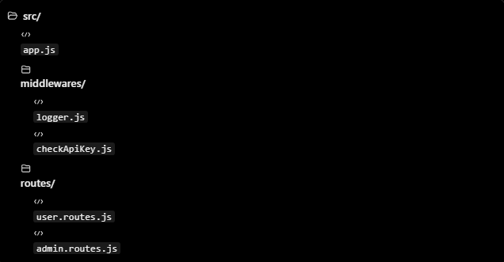
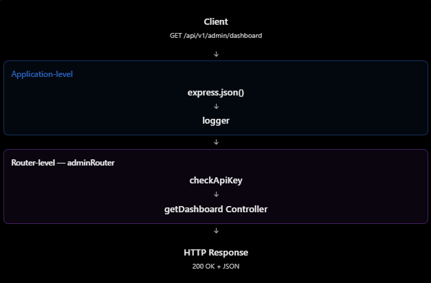

# ExpressJS: Application-level và Router-level Middleware

## Mục lục

- [Tổng quan](#tổng-quan)
- [Application-level middleware](#application-level-middleware)
- [Router-level middleware](#router-level-middleware)
- [Kết hợp trong dự án thực tế](#kết-hợp-trong-dự-án-thực-tế)
- [Các lỗi thường gặp](#các-lỗi-thường-gặp)
- [Câu hỏi ôn tập](#câu-hỏi-ôn-tập)

## Tổng quan

Cả application-level và router-level middleware đều nhận `req`, `res`, `next` và hoạt động trong middleware chain. Khác biệt nằm ở **nơi đăng ký**, từ đó quyết định **phạm vi** mà middleware áp dụng.

| Tiêu chí | Application-level middleware | Router-level middleware |
| --- | --- | --- |
| Gắn vào | Express app (`app`) | Express router (`router`) |
| Cú pháp | `app.use()` hoặc `app.METHOD()` | `router.use()` hoặc `router.METHOD()` |
| Phạm vi | Các request khớp mount path hoặc route trên app. | Các request đi vào router và khớp middleware/route trong router. |
| Ví dụ phù hợp | JSON parser, logging chung, CORS. | Authentication/authorization cho nhóm admin APIs. |

> Router cũng hoạt động như middleware, vì vậy router được gắn vào app bằng `app.use("/prefix", router)`.

## Application-level middleware

Application-level middleware được đăng ký trực tiếp trên Express app. Không truyền path vào `app.use()` nghĩa là middleware áp dụng cho mọi request đi qua app.

```js
const express = require("express");
const app = express();

function logger(req, res, next) {
  console.log(`${req.method} ${req.originalUrl}`);
  next();
}

app.use(logger);

app.get("/users", (req, res) => {
  return res.json({ message: "Users" });
});

app.get("/products", (req, res) => {
  return res.json({ message: "Products" });
});
```

Trong ví dụ trên, cả `GET /users` và `GET /products` đều chạy qua `logger`.

### Giới hạn theo mount path

Application-level middleware không mặc định chạy trên toàn bộ ứng dụng. Có thể gắn nó vào một prefix:

```js
app.use("/admin", logger);
```

Khi đó `logger` chỉ chạy với request khớp `/admin`, ví dụ `/admin/users`; `GET /users` sẽ không chạy middleware này.

Có thể gắn middleware trực tiếp cho một HTTP method/route:

```js
app.get("/reports", logger, (req, res) => {
  return res.json({ message: "Reports" });
});
```

## Router-level middleware

Router-level middleware được gắn lên một `express.Router()`. Nó hoạt động giống application middleware, nhưng chỉ có hiệu lực khi request đã được chuyển vào router đó.

Ví dụ có hai nhóm APIs:

- `/api/v1/users` — quản lý người dùng.
- `/api/v1/admin` — quản trị hệ thống.

Chỉ nhóm admin cần kiểm tra API key:

```js
const express = require("express");

const app = express();
const adminRouter = express.Router();

function checkApiKey(req, res, next) {
  if (req.get("x-api-key") !== "abc123") {
    return res.status(403).json({ message: "Forbidden" });
  }

  return next();
}

adminRouter.use(checkApiKey);

adminRouter.get("/dashboard", (req, res) => {
  return res.json({ message: "Admin dashboard" });
});

app.use("/api/v1/admin", adminRouter);

app.get("/api/v1/users", (req, res) => {
  return res.json({ message: "Users" });
});
```

| Request | `checkApiKey` có chạy? | Lý do |
| --- | --- | --- |
| `GET /api/v1/admin/dashboard` | Có | Request được mount vào `adminRouter`. |
| `GET /api/v1/users` | Không | Request không đi qua `adminRouter`. |

## Kết hợp trong dự án thực tế

Một cấu trúc thường gặp:



```js
app.use(express.json());
app.use(logger);

app.use("/api/v1/users", userRouter);
app.use("/api/v1/admin", adminRouter);
```

Trong `adminRouter`, có thể bảo vệ toàn bộ routes:

```js
adminRouter.use(checkApiKey);

adminRouter.get("/dashboard", getDashboard);
adminRouter.get("/users", getAllUsers);
```

Với `GET /api/v1/admin/dashboard`, request đi qua application middleware phù hợp, được mount vào `adminRouter`, đi qua `checkApiKey`, rồi mới đến controller. Nếu `checkApiKey` gửi response lỗi, controller không chạy.



## Các lỗi thường gặp

| Hiểu nhầm | Cách hiểu đúng |
| --- | --- |
| Application middleware luôn chạy cho mọi API | Không. `app.use("/admin", middleware)` chỉ áp dụng cho path `/admin` và các path con. |
| Router middleware dùng `app.use()` | Router middleware được đăng ký bằng `router.use()` hoặc `router.METHOD()`. |
| Router middleware tự áp dụng toàn app | Không. Nó chỉ chạy với request đi vào router tương ứng. |
| Chỉ application middleware dùng được `next()` | Cả hai loại đều dùng `next()` như nhau. |
| Router middleware không bị ảnh hưởng bởi thứ tự | Sai. Thứ tự đăng ký middleware và route vẫn quyết định luồng xử lý. |
| Dùng router thì không cần `app.use()` | Vẫn cần mount router vào app, ví dụ `app.use("/api/v1/admin", adminRouter)`. |

## Câu hỏi ôn tập

1. **Application-level và router-level middleware khác nhau thế nào?**  
   Application middleware được gắn vào `app`; router middleware được gắn vào `express.Router()`. Vì vậy chúng có phạm vi áp dụng khác nhau.

2. **Khi nào dùng application-level middleware?**  
   Khi logic áp dụng rộng cho app hoặc một URL prefix, ví dụ JSON parser và request logging.

3. **Khi nào dùng router-level middleware?**  
   Khi logic chỉ áp dụng cho một nhóm endpoint, ví dụ xác thực quyền admin.

4. **Application middleware có luôn chạy cho mọi request không?**  
   Không. Nó có thể bị giới hạn bằng mount path hoặc được gắn vào một route cụ thể.

5. **Cả hai loại có dùng `next()` không?**  
   Có. Cả hai cùng là middleware và đều dùng `next()` để chuyển quyền xử lý.

## Thực hành

Chạy ví dụ phân biệt phạm vi của logger application-level, middleware `/admin` và API key router-level tại [Application and Router Middleware Example](../Example/application-router-middleware-example.js).

## Tham khảo

- [Express: Using middleware](https://expressjs.com/guide/using-middleware/)
- [Express routing](https://expressjs.com/en/guide/routing/)
