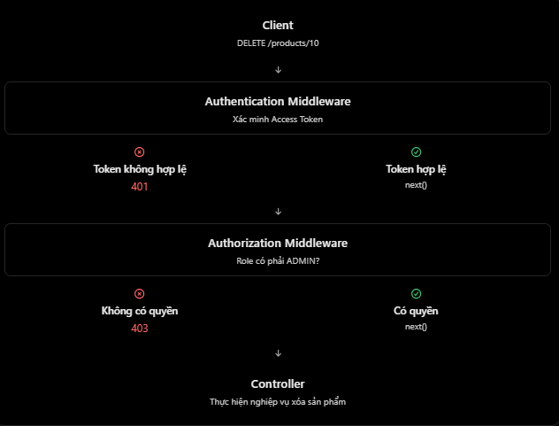

# ExpressJS: Authorization Based on Role (RBAC)

## Mục lục

- [Authorization là gì?](#authorization-là-gì)
- [Authentication và authorization](#authentication-và-authorization)
- [RBAC là gì?](#rbac-là-gì)
- [Authorization middleware](#authorization-middleware)
- [Role theo resource scope](#role-theo-resource-scope)
- [Các lỗi thường gặp](#các-lỗi-thường-gặp)
- [Câu hỏi ôn tập](#câu-hỏi-ôn-tập)

## Authorization là gì?

Authorization là quá trình kiểm tra một user **đã được xác thực** có được phép thực hiện action hoặc truy cập resource cụ thể hay không.

Ví dụ: user có role `USER` đã đăng nhập nhưng gọi:

```http
DELETE /api/v1/users/10
Authorization: Bearer <access-token>
```

Backend xác minh token thành công, nhưng user không có quyền xoá user khác. Response phù hợp thường là `403 Forbidden`.

## Authentication và authorization

| Tiêu chí | Authentication | Authorization |
| --- | --- | --- |
| Mục đích | Xác minh danh tính. | Kiểm tra quyền trên action/resource. |
| Câu hỏi | “Bạn là ai?” | “Bạn được phép làm gì ở đây?” |
| Dữ liệu | Credentials, session hoặc access token. | Role, permission, ownership và resource context. |
| Lỗi thường gặp | `401 Unauthorized` khi credential không hợp lệ/thiếu. | `403 Forbidden` khi đã xác thực nhưng không đủ quyền. |

| Tình huống | Kết quả |
| --- | --- |
| Không có access token | `401` |
| Access token sai hoặc hết hạn | `401` |
| Token hợp lệ, role `USER` gọi admin API | `403` |
| Token hợp lệ, role `ADMIN` gọi admin API | Cho phép xử lý |

Theo HTTP semantics, response `401` nên có `WWW-Authenticate` challenge, ví dụ `WWW-Authenticate: Bearer`. `403` biểu thị server hiểu request nhưng từ chối thực hiện; client không nên tự lặp request với cùng credential.

## RBAC là gì?

RBAC (Role-Based Access Control) là mô hình cấp hoặc từ chối quyền dựa trên role. Role là nhóm permission, giúp không phải gán từng permission riêng lẻ cho mọi user.

Ví dụ Product API:

| Action | `ADMIN` | `STAFF` | `USER` |
| --- | :---: | :---: | :---: |
| Xem products | ✓ | ✓ | ✓ |
| Tạo product | ✓ | ✓ | ✗ |
| Sửa product | ✓ | ✓ | ✗ |
| Xoá product | ✓ | ✗ | ✗ |
| Quản lý users | ✓ | ✗ | ✗ |

Nguyên tắc quan trọng:

- **Deny by default**: nếu không có rule cho phép rõ ràng, từ chối request.
- Kiểm tra quyền trên **mỗi request** cần bảo vệ, không chỉ ẩn nút ở frontend.
- Chỉ dùng role từ nguồn đáng tin cậy, chẳng hạn claim trong JWT đã verify hoặc database/session do server kiểm soát.

## Authorization middleware

Authentication middleware cần chạy trước và gắn identity đã verify vào `req.user`:

```js
req.user = {
  id: "10",
  role: "STAFF",
};
```

Authorization middleware có thể nhận các role được phép:

```js
function authorize(...allowedRoles) {
  return (req, res, next) => {
    if (!req.user) {
      res.set("WWW-Authenticate", "Bearer");
      return res.status(401).json({ message: "Authentication required" });
    }

    if (!allowedRoles.includes(req.user.role)) {
      return res.status(403).json({ message: "Forbidden" });
    }

    return next();
  };
}
```

Gắn middleware theo thứ tự `authenticate` → `authorize` → controller:

```js
router.get("/products", authenticate, getProducts);

router.post(
  "/products",
  authenticate,
  authorize("ADMIN", "STAFF"),
  createProduct,
);

router.delete(
  "/products/:id",
  authenticate,
  authorize("ADMIN"),
  deleteProduct,
);
```

`authorize()` phụ thuộc vào `req.user`, nên không thể chạy đáng tin cậy trước `authenticate`.

## Role theo resource scope

Global role như `ADMIN` không phải lúc nào cũng đủ. Trong hệ thống multi-tenant/workspace/family, một user có thể là manager trong family A nhưng chỉ là member trong family B.



Ví dụ:

```js
router.delete(
  "/families/:familyId",
  authenticate,
  authorizeFamilyRole("FAMILY_MANAGER"),
  deleteFamily,
);
```

`authorizeFamilyRole()` cần:

1. Lấy user ID đáng tin cậy từ `req.user`.
2. Lấy và validate `familyId` từ `req.params`.
3. Tìm membership của user trong family đó.
4. Kiểm tra membership còn active và có role phù hợp.
5. Chỉ gọi `next()` nếu được phép.

Với Prisma, permission check thường truy vấn membership hiện tại trong database. Điều này tránh lỗi “role `FAMILY_MANAGER` ở family A lại có quyền trên family B”. Đừng tin role do client gửi qua `req.body` hoặc query string.

Role trong JWT cũng có thể bị cũ khi quyền vừa bị thu hồi. Với thao tác nhạy cảm, hãy kiểm tra state/quyền hiện tại từ database hoặc áp dụng token/session revocation phù hợp.

## Các lỗi thường gặp

| Hiểu nhầm | Cách hiểu đúng |
| --- | --- |
| Đăng nhập là dùng được mọi API | Sai. Authentication không thay thế authorization. |
| Thiếu role `ADMIN` thì trả `401` | Nếu token hợp lệ nhưng thiếu quyền, thường trả `403`. |
| Ẩn nút Delete ở React là đủ | Không. Backend phải enforce authorization trên mỗi request. |
| Lấy role từ `req.body` | Không an toàn vì client có thể sửa input. |
| Role manager của workspace A có quyền ở mọi workspace | Sai. Phải kiểm tra scope/resource hiện tại. |
| Authorization chạy trước authentication | Sai khi nó phụ thuộc `req.user` được xác minh. |
| Role token không bao giờ cũ | Quyền có thể bị thay đổi; thao tác nhạy cảm nên kiểm tra quyền hiện tại. |

## Câu hỏi ôn tập

1. **Authorization trong Express là gì?**  
   Là kiểm tra user đã xác thực có quyền thực hiện action trên resource hay không.

2. **Authentication và authorization khác nhau thế nào?**  
   Authentication xác minh danh tính; authorization quyết định quyền truy cập.

3. **RBAC là gì?**  
   Là mô hình phân quyền dựa trên role, trong đó role nhóm các permissions.

4. **`401` khác `403` ra sao?**  
   `401` là thiếu/không hợp lệ credential; `403` là credential hợp lệ nhưng không đủ quyền.

5. **Áp dụng role-based authorization trong Express thế nào?**  
   Xác thực trước, gắn identity đáng tin cậy vào `req.user`, sau đó dùng middleware kiểm tra role/scope trước controller.

## Thực hành

Chạy ví dụ có login JWT, role middleware và family-scoped role check tại [Role-based Authorization Example](../Example/authorization-based-on-role-example.js).

## Tham khảo

- [OWASP Authorization Cheat Sheet](https://cheatsheetseries.owasp.org/cheatsheets/Authorization_Cheat_Sheet.html)
- [RFC 9110: 401 and 403 semantics](https://www.rfc-editor.org/rfc/rfc9110.html)
