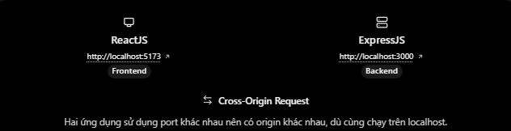
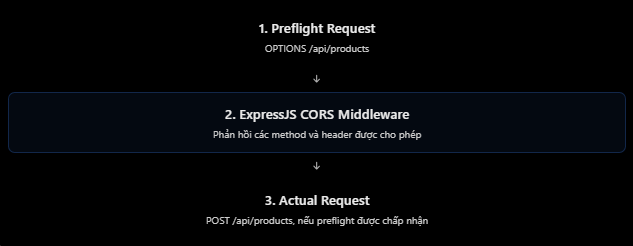

# CORS và cấu hình môi trường trong ExpressJS

## Mục lục

1. [CORS là gì?](#1-cors-là-gì)
2. [Cấu hình CORS](#2-cấu-hình-cors)
3. [Preflight request](#3-preflight-request)
4. [Credentials và cookie](#4-credentials-và-cookie)
5. [Cấu hình môi trường](#5-cấu-hình-môi-trường)
6. [Development và Production](#6-development-và-production)
7. [Ví dụ chạy được](#7-ví-dụ-chạy-được)
8. [Checklist và lỗi thường gặp](#8-checklist-và-lỗi-thường-gặp)

## 1. CORS là gì?

**CORS** (_Cross-Origin Resource Sharing_) là cơ chế dựa trên HTTP headers. Server dùng nó để nói với **trình duyệt** rằng JavaScript từ origin nào được phép đọc response của request cross-origin.



Một **origin** gồm `scheme + host + port`; path không thuộc origin.

| Frontend                  | Backend                   | Cùng origin? | Lý do                    |
| ------------------------- | ------------------------- | ------------ | ------------------------ |
| `http://localhost:3000`   | `http://localhost:3000`   | Có           | Ba thành phần giống nhau |
| `http://localhost:5173`   | `http://localhost:3000`   | Không        | Khác port                |
| `http://example.com`      | `https://example.com`     | Không        | Khác scheme              |
| `https://app.example.com` | `https://api.example.com` | Không        | Khác host                |

Trình duyệt áp dụng **Same-Origin Policy**. Nếu API không trả CORS headers phù hợp, browser chặn JavaScript đọc response. CORS không phải Authentication, Authorization hay biện pháp chặn mọi HTTP client: `curl`, Postman và server khác vẫn có thể gửi request. API nhạy cảm vẫn phải xác thực và phân quyền.

## 2. Cấu hình CORS

Cài middleware phổ biến `cors`:

```bash
npm install cors
```

### Cho phép mọi origin

```js
app.use(cors());
```

Cấu hình mặc định phù hợp với API công khai hoặc thử nghiệm, thường trả `Access-Control-Allow-Origin: *`. Không nên mặc định dùng cho API có dữ liệu riêng tư.

### Cho phép origin cụ thể

```js
app.use(
  cors({
    origin: "http://localhost:5173",
  }),
);
```

Với nhiều frontend, dùng allowlist. Không phản chiếu tùy ý `Origin` từ request.

```js
const allowedOrigins = new Set([
  "http://localhost:5173",
  "https://app.example.com",
]);

app.use(
  cors({
    origin(origin, callback) {
      // Request không có Origin, ví dụ curl hoặc health check.
      if (!origin || allowedOrigins.has(origin)) {
        return callback(null, true);
      }

      return callback(new Error("Origin is not allowed by CORS"));
    },
  }),
);
```

## 3. Preflight request

Một số cross-origin request khiến browser gửi `OPTIONS` trước để hỏi API có cho phép method và headers hay không. Đây là **preflight**. Ví dụ `POST` JSON sau thường bị preflight vì `Content-Type: application/json` không thuộc nhóm content type safelisted:

```js
fetch("http://localhost:3000/api/products", {
  method: "POST",
  headers: { "Content-Type": "application/json" },
  body: JSON.stringify({ name: "Laptop" }),
});
```



Middleware `cors` được gắn bằng `app.use(cors(...))` sẽ tự xử lý preflight cho các route phía sau. Không cần tự tạo controller `OPTIONS` cho từng route trong ví dụ thông thường. Không phải mọi cross-origin request đều có preflight.

## 4. Credentials và cookie

Nếu frontend gửi cookie hoặc HTTP authentication, client phải yêu cầu credentials:

```js
fetch("https://api.example.com/users/me", {
  credentials: "include",
});
```

Server phải dùng origin rõ ràng và bật `credentials`:

```js
app.use(
  cors({
    origin: "https://app.example.com",
    credentials: true,
  }),
);
```

Không dùng `origin: "*"` với credentialed request. Browser sẽ từ chối response đó. Khi dùng cookie cross-site, còn cần xem xét `SameSite`, `Secure` và bảo vệ CSRF; CORS không thay thế các cơ chế này.

## 5. Cấu hình môi trường

Biến môi trường tách cấu hình khỏi source code. Ví dụ thường gặp:

| Biến                | Mục đích                                             |
| ------------------- | ---------------------------------------------------- |
| `PORT`              | Port server lắng nghe                                |
| `NODE_ENV`          | Môi trường chạy, như `development` hoặc `production` |
| `CLIENT_ORIGINS`    | Danh sách frontend được phép, cách nhau bởi dấu phẩy |
| `DATABASE_URL`      | Chuỗi kết nối cơ sở dữ liệu                          |
| `JWT_ACCESS_SECRET` | Secret ký access token                               |

`process.env` luôn trả về chuỗi (hoặc `undefined`), vì vậy phải kiểm tra biến bắt buộc và chuyển đổi các giá trị số/boolean. Node.js hiện đại có thể nạp `.env` bằng `--env-file`; dự án cũng thường dùng `dotenv` để tương thích cách chạy phổ biến.

```dotenv
# .env — không commit file có secret thật
NODE_ENV=development
PORT=3000
CLIENT_ORIGINS=http://localhost:5173,http://localhost:3001
```

Một cấu hình tối thiểu, dùng `dotenv`:

```js
require("dotenv").config();

const port = Number(process.env.PORT ?? 3000);
const allowedOrigins = (process.env.CLIENT_ORIGINS ?? "")
  .split(",")
  .map((origin) => origin.trim())
  .filter(Boolean);

if (!Number.isInteger(port) || port < 1 || port > 65_535) {
  throw new Error("PORT must be an integer between 1 and 65535");
}

if (allowedOrigins.length === 0) {
  throw new Error("CLIENT_ORIGINS is required");
}
```

Không commit `.env` chứa secret. Hãy commit `.env.example` chỉ gồm tên biến và giá trị mẫu an toàn; môi trường deploy nên cấp secrets qua hệ thống cấu hình/secrets của hạ tầng.

## 6. Development và Production

| Cấu hình         | Development              | Production                                   |
| ---------------- | ------------------------ | -------------------------------------------- |
| `NODE_ENV`       | `development`            | `production`                                 |
| `CLIENT_ORIGINS` | `http://localhost:5173`  | `https://app.example.com`                    |
| `DATABASE_URL`   | Database local           | Database production                          |
| Secrets          | File local, không commit | Secret manager hoặc biến của nền tảng deploy |

Khi đổi `.env`, tiến trình Node đang chạy thường phải được khởi động lại. Đừng dựa vào `NODE_ENV` để quyết định một cách mơ hồ origin nào được tin cậy; đặt allowlist rõ ràng ở cấu hình deploy.

## 7. Ví dụ chạy được

Ví dụ đầy đủ có ở [cors-config-env-example.js](../Example/cors-config-env-example.js). Nó:

- Nạp `.env` bằng `dotenv`.
- Kiểm tra `PORT` và `CLIENT_ORIGINS` ngay khi khởi động.
- Chỉ cho các origin trong allowlist dùng CORS; có cấu hình preflight và credentials.
- Có `GET /health` và `POST /api/products` để thử request.

Chạy từ thư mục `ExpressJS/Example`:

```powershell
Copy-Item .env.example .env
npm install
npm run cors-env
```

## 8. Checklist và lỗi thường gặp

| Hiểu nhầm / lỗi                                     | Cách hiểu đúng                                              |
| --------------------------------------------------- | ----------------------------------------------------------- |
| Postman gọi được nên browser cũng gọi được          | Browser còn thực thi CORS                                   |
| CORS là Authentication                              | CORS chỉ kiểm soát việc browser cho JavaScript đọc response |
| `localhost:3000` và `localhost:5173` là cùng origin | Khác port nên khác origin                                   |
| Có thể dùng `*` cùng `credentials: true`            | Không; dùng origin cụ thể/allowlist                         |
| `.env` được Express tự đọc                          | Cần `dotenv`, `--env-file` hoặc cơ chế nạp khác             |
| Đưa secret vào `.env` là có thể commit              | Không; `.env` thật vẫn là dữ liệu nhạy cảm                  |
| CORS chặn được mọi client                           | Không; vẫn cần authentication, authorization, rate limit…   |

### Tự kiểm tra

1. Vì sao request JSON `POST` có thể tạo preflight?
2. Vì sao không nên dùng `origin: "*"` khi frontend gửi cookie?
3. Nếu triển khai frontend sang domain mới, cần đổi biến cấu hình nào?

## Tham khảo

- [MDN: Cross-Origin Resource Sharing (CORS)](https://developer.mozilla.org/en-US/docs/Web/HTTP/Guides/CORS)
- [Express cors middleware](https://github.com/expressjs/cors)
- [Node.js: Environment Variables](https://nodejs.org/api/environment_variables.html)
