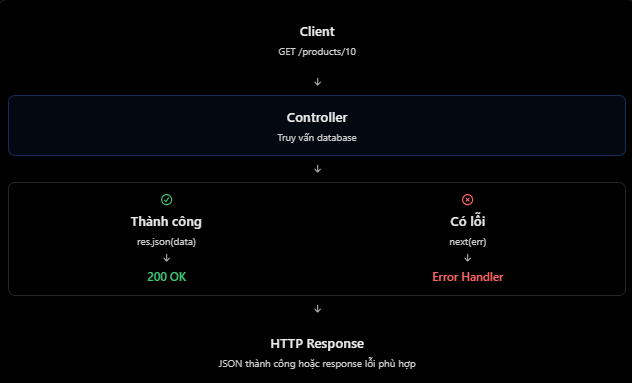

# ExpressJS: Error-handling Middleware

## Mục lục

- [Error-handling middleware là gì?](#error-handling-middleware-là-gì)
- [Khác middleware thông thường thế nào?](#khác-middleware-thông-thường-thế-nào)
- [`next()` và `next(error)`](#next-và-nexterror)
- [Global error handler](#global-error-handler)
- [Lỗi async/await trong Express 5](#lỗi-asyncawait-trong-express-5)
- [Xử lý 404](#xử-lý-404)
- [Các lỗi thường gặp](#các-lỗi-thường-gặp)
- [Câu hỏi ôn tập](#câu-hỏi-ôn-tập)

## Error-handling middleware là gì?

Error-handling middleware tiếp nhận và xử lý lỗi phát sinh trong lúc Express xử lý request. Ví dụ, controller gọi Prisma để truy vấn PostgreSQL có thể gặp lỗi kết nối database. Thay vì mỗi controller tự trả response `500` theo một cách khác nhau, ta chuyển lỗi đến một error handler tập trung.



Lợi ích chính:

- Response lỗi nhất quán trong toàn API.
- Giảm code xử lý lỗi lặp lại trong controller.
- Có một nơi để log lỗi nội bộ mà không lộ chi tiết cho client.
- Tách lỗi client dự kiến (`400`, `404`) khỏi lỗi server không mong đợi (`500`).

## Khác middleware thông thường thế nào?

Middleware thông thường nhận ba tham số:

```js
const logger = (req, res, next) => {
  console.log("Request received");
  next();
};
```

Error-handling middleware nhận **bốn** tham số:

```js
const errorHandler = (err, req, res, next) => {
  console.error(err.message);

  return res.status(500).json({
    message: "Internal Server Error",
  });
};
```

| Middleware | Chữ ký hàm | Công dụng |
| --- | --- | --- |
| Thông thường | `(req, res, next)` | Xử lý request hoặc chuyển request đi tiếp. |
| Error-handling | `(err, req, res, next)` | Nhận lỗi và tạo error response. |

Express nhận diện error handler dựa trên đủ bốn tham số, kể cả khi handler không dùng trực tiếp `next`.

## `next()` và `next(error)`

```js
next(); // Chuyển sang middleware/handler thông thường kế tiếp.
next(error); // Chuyển sang error-handling middleware.
```

Ví dụ:

```js
app.get("/products/:id", (req, res, next) => {
  const product = null;

  if (!product) {
    const error = new Error("Product not found");
    error.statusCode = 404;
    return next(error);
  }

  return res.json(product);
});
```

Khi `next(error)` được gọi, Express bỏ qua middleware/handler thông thường còn lại trong chain và tìm error handler phù hợp. `next(error)` không tự gửi response; error handler quyết định status và body response.

## Global error handler

Global error handler thường đặt sau routes để nhận lỗi được chuyển từ các route trước đó.

```js
app.use((err, req, res, next) => {
  console.error(err);

  // Nếu response đã bắt đầu gửi, giao lại cho default error handler của Express.
  if (res.headersSent) {
    return next(err);
  }

  const statusCode = Number.isInteger(err.statusCode) ? err.statusCode : 500;
  const safeStatusCode = statusCode >= 400 && statusCode < 600 ? statusCode : 500;

  return res.status(safeStatusCode).json({
    message: safeStatusCode >= 500 ? "Internal Server Error" : err.message,
  });
});
```

Không trả nguyên `err.stack`, database error hoặc secret cho client trong production. Log chi tiết ở server; client chỉ nhận thông tin an toàn và hữu ích.

## Lỗi async/await trong Express 5

Trong Express 5, route handler hoặc middleware trả về Promise sẽ tự chuyển lỗi bị `throw`/reject sang error flow. `async` function luôn trả về Promise.

```js
app.get("/products", async (req, res) => {
  const products = await prisma.product.findMany();
  return res.status(200).json(products);
});
```

Nếu `prisma.product.findMany()` reject, Express 5 chuyển lỗi đến error handler. Tuy nhiên, vẫn nên dùng `try/catch` khi cần thêm context, chuyển đổi loại lỗi hoặc trả error response riêng ở nơi xảy ra lỗi.

Với Express 4, lỗi Promise không tự được chuyển tiếp; cần dùng `try/catch` với `next(error)` hoặc async wrapper.

## Xử lý 404

`404 Not Found` do không khớp route **không phải error** trong Express, nên error handler không tự bắt nó. Thêm middleware 404 sau các routes và trước global error handler:

```js
app.use((req, res) => {
  return res.status(404).json({
    message: `Route ${req.method} ${req.originalUrl} not found`,
  });
});

app.use(errorHandler);
```

## Các lỗi thường gặp

| Hiểu nhầm | Cách hiểu đúng |
| --- | --- |
| Error handler chỉ có 3 tham số | Cần đủ `(err, req, res, next)`. |
| `next()` và `next(error)` giống nhau | `next()` đi theo luồng bình thường; `next(error)` đi theo luồng lỗi. |
| Error handler nên đặt trước routes | Thông thường đặt sau routes để nhận lỗi từ chúng. |
| Mọi lỗi đều trả `500` | Phân biệt lỗi client như `400`, `401`, `404` và lỗi server `500`. |
| Route không tồn tại sẽ tự vào error handler | Không. Cần middleware 404 riêng. |
| Có thể gửi lỗi database nguyên vẹn cho client | Không nên; log chi tiết ở server, trả message an toàn cho client. |
| Đã gửi response vẫn gọi `next(error)` bình thường | Cần kiểm tra `res.headersSent` trong error handler và delegate về default handler. |

Controller vẫn có thể trả response trực tiếp cho lỗi input đơn giản:

```js
if (!req.body.name) {
  return res.status(400).json({ message: "Invalid input" });
}
```

Error handler đặc biệt hữu ích cho lỗi cần được tập trung hoá hoặc phát sinh sâu trong service/database.

## Câu hỏi ôn tập

1. **Error-handling middleware là gì?**  
   Là middleware nhận và xử lý lỗi trong request flow, giúp API trả lỗi nhất quán.

2. **`next()` khác `next(error)` thế nào?**  
   `next()` chuyển sang handler bình thường; `next(error)` chuyển sang error-handling middleware.

3. **Nhận diện error handler bằng cách nào?**  
   Nó phải có đủ bốn tham số: `(err, req, res, next)`.

4. **Express 5 xử lý async errors ra sao?**  
   Lỗi throw hoặc Promise reject từ async handler được tự chuyển sang error flow.

5. **Vì sao nên có global error handler?**  
   Nó giảm lặp code, chuẩn hoá error response và tập trung log lỗi nội bộ.

## Thực hành

Chạy ví dụ có `404`, error từ `next(error)`, lỗi `async` và global error handler tại [Error-handling Middleware Example](../Example/error-handling-middleware-example.js).

## Tham khảo

- [Express 5: Error handling](https://expressjs.com/en/5x/guide/error-handling/)
- [Express FAQ: 404 is not an error](https://expressjs.com/en/5x/starter/faq/)
