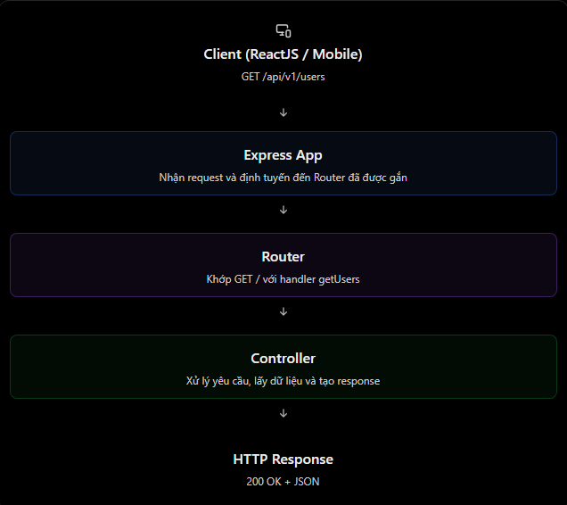
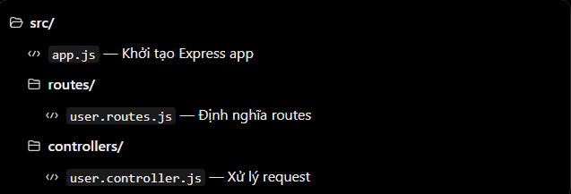

# ExpressJS: App, Router và Controller

## Mục lục

- [ExpressJS là gì?](#expressjs-là-gì)
- [Phân biệt App, Router và Controller](#phân-biệt-app-router-và-controller)
- [Ví dụ Users API](#ví-dụ-users-api)
- [Các lỗi và hiểu nhầm thường gặp](#các-lỗi-và-hiểu-nhầm-thường-gặp)
- [Câu hỏi ôn tập](#câu-hỏi-ôn-tập)

## ExpressJS là gì?

**ExpressJS** là một web framework tối giản chạy trên **Node.js**. Nó giúp xây dựng web server và REST API thuận tiện hơn nhờ các cơ chế như routing, middleware và xử lý HTTP request/response.

- **Node.js** là runtime cho phép JavaScript chạy ở phía server.
- **ExpressJS** là framework chạy trên Node.js, cung cấp công cụ để định nghĩa API và xử lý HTTP request/response (`req`/`res`).

Ví dụ: khi React gọi `GET /api/v1/users`, Express sẽ tìm route khớp với request đó và chạy hàm xử lý tương ứng.

## Phân biệt App, Router và Controller

| Thành phần | Vai trò chính |
| --- | --- |
| **Express app** | Khởi tạo và cấu hình ứng dụng; đăng ký middleware, gắn router và khởi chạy HTTP server. |
| **Router** | Nhóm các endpoint liên quan và chuyển request đến handler phù hợp. |
| **Controller** | Chứa hàm xử lý request; gọi business/service hoặc database khi cần, rồi trả response. |



> Sơ đồ trên mô tả luồng cơ bản. Trong ứng dụng thực tế, controller thường gọi **service** để xử lý nghiệp vụ; service có thể làm việc với PostgreSQL, MongoDB hoặc dịch vụ bên ngoài. Việc tách service giúp controller gọn và dễ kiểm thử hơn.

## Ví dụ Users API

Giả sử cần hai API:

- `GET /api/v1/users` — lấy danh sách người dùng.
- `GET /api/v1/users/:id` — lấy người dùng theo ID, ví dụ `GET /api/v1/users/1`.

Thay vì đặt toàn bộ code trong `app.js`, ta tách thành ba phần:



### Bước 1 — Express app (`app.js`)

```js
import express from "express";
import userRouter from "./routes/user.routes.js";

const app = express();

app.use(express.json());
app.use("/api/v1/users", userRouter);

app.listen(3000, () => {
  console.log("Server is running at http://localhost:3000");
});
```

- `express()` tạo một Express application.
- `express.json()` là middleware parse request body dạng JSON. Nó cần thiết cho các request như `POST`/`PATCH` có JSON body.
- `app.use("/api/v1/users", userRouter)` mount router vào URL prefix `/api/v1/users`.
- `app.listen(3000)` bắt đầu cho server lắng nghe tại cổng `3000`.

> Ví dụ dùng ES Modules; cần khai báo `"type": "module"` trong `package.json`.

### Bước 2 — Router (`routes/user.routes.js`)

```js
import { Router } from "express";
import { getUserById, getUsers } from "../controllers/user.controller.js";

const router = Router();

router.get("/", getUsers);
router.get("/:id", getUserById);

export default router;
```

Đường dẫn thực tế được ghép từ prefix tại `app.use()` và đường dẫn tại router:

| Khai báo router | Prefix khi mount | Endpoint thực tế |
| --- | --- | --- |
| `router.get("/", getUsers)` | `/api/v1/users` | `GET /api/v1/users` |
| `router.get("/:id", getUserById)` | `/api/v1/users` | `GET /api/v1/users/:id` |

Router tập trung vào việc định nghĩa endpoint và nối endpoint với controller; không nên chứa nhiều logic xử lý dữ liệu.

### Bước 3 — Controller (`controllers/user.controller.js`)

Để tập trung vào kiến trúc, ví dụ này dùng dữ liệu giả thay vì database.

```js
const users = [
  { id: 1, name: "An" },
  { id: 2, name: "Binh" },
];

export const getUsers = (req, res) => {
  return res.status(200).json(users);
};

export const getUserById = (req, res) => {
  const userId = Number(req.params.id);
  const user = users.find((item) => item.id === userId);

  if (!user) {
    return res.status(404).json({
      message: "User not found",
    });
  }

  return res.status(200).json(user);
};
```

Khi gọi `GET http://localhost:3000/api/v1/users/1`, server trả về:

```json
{
  "id": 1,
  "name": "An"
}
```

Các điểm cần nhớ:

- `req` đại diện cho HTTP request từ client. Ví dụ, `req.params.id` lấy giá trị `id` trong URL.
- `res` dùng để gửi HTTP response về client.
- `res.status(200).json(data)` thiết lập HTTP status và gửi response dạng JSON.
- Controller là handler được router gọi khi request khớp với route.

## Các lỗi và hiểu nhầm thường gặp

| Hiểu nhầm | Giải thích đúng |
| --- | --- |
| Router và controller giống nhau | Router định nghĩa đường dẫn và handler; controller xử lý request. |
| Controller bắt buộc phải là class | Không. Trong Express, controller thường là các function thông thường. |
| Chỉ tạo router là API hoạt động | Router phải được mount vào app, ví dụ bằng `app.use()`. |
| Express bắt buộc phải có controller riêng | Không bắt buộc. Đây là quy ước tổ chức code giúp dự án dễ bảo trì và kiểm thử hơn. |
| Router luôn phải ghi đủ URL | Khi router đã được mount với prefix, route bên trong chỉ cần dùng đường dẫn tương đối. |

## Câu hỏi ôn tập

1. **ExpressJS là gì?**  
   Là web framework cho Node.js, giúp xây dựng web server và REST API thông qua routing, middleware và cơ chế xử lý request/response.

2. **Express app khác Express Router như thế nào?**  
   App là ứng dụng chính, chịu trách nhiệm cấu hình server và gắn router. Router dùng để tổ chức các endpoint liên quan thành từng nhóm.

3. **Controller có vai trò gì?**  
   Controller nhận request từ router, thực hiện xử lý cần thiết hoặc gọi service, sau đó trả response cho client.

4. **Tại sao nên tách router và controller?**  
   Cách tách này làm rõ trách nhiệm của từng phần, giúp code dễ đọc, dễ bảo trì và dễ kiểm thử.

## Thực hành

Xem bài thực hành có hướng dẫn chạy, kiểm tra endpoint và bài tập mở rộng tại [Express App–Router–Controller Example](../Example/expressapp-router-controller-example.md).
