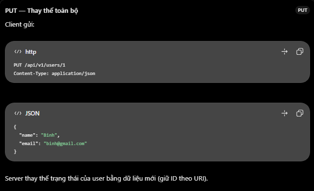
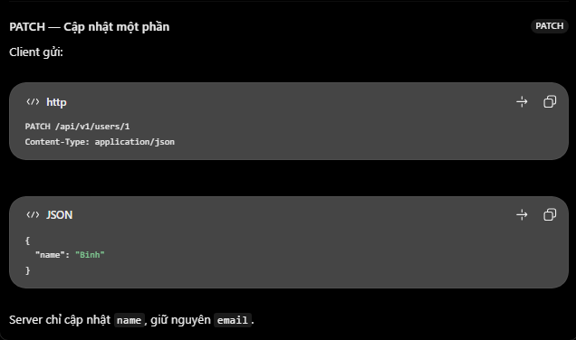

# ExpressJS: GET, POST, PUT, PATCH và DELETE

## Mục lục

- [Tổng quan](#tổng-quan)
- [Các HTTP method phổ biến](#các-http-method-phổ-biến)
- [Phân biệt PUT và PATCH](#phân-biệt-put-và-patch)
- [Ví dụ CRUD với ExpressJS](#ví-dụ-crud-với-expressjs)
- [HTTP status code thường dùng](#http-status-code-thường-dùng)
- [Safe và idempotent](#safe-và-idempotent)
- [Các lỗi và hiểu nhầm thường gặp](#các-lỗi-và-hiểu-nhầm-thường-gặp)
- [Câu hỏi ôn tập](#câu-hỏi-ôn-tập)

## Tổng quan

`GET`, `POST`, `PUT`, `PATCH` và `DELETE` là năm HTTP method phổ biến khi xây dựng REST API. Method thể hiện **ý định** của client đối với resource, chẳng hạn `users`, `products` hoặc `orders`.

> Đây không phải toàn bộ HTTP methods. HTTP còn có `HEAD`, `OPTIONS`, `CONNECT`, `TRACE` và các method khác; năm method trong bài là nhóm hay gặp nhất trong CRUD API.

Express phân biệt route dựa trên **cả HTTP method lẫn URL**. Vì vậy `GET /users` và `POST /users` là hai route khác nhau, dù dùng cùng đường dẫn.

## Các HTTP method phổ biến

| Method | Mục đích thường dùng | Ví dụ endpoint | Status thành công thường gặp |
| --- | --- | --- | --- |
| `GET` | Đọc dữ liệu. | `GET /api/v1/users` | `200 OK` |
| `POST` | Gửi dữ liệu để tạo resource hoặc thực hiện một action. | `POST /api/v1/users` | `201 Created` |
| `PUT` | Thay thế trạng thái của resource tại URI đích. | `PUT /api/v1/users/1` | `200 OK` hoặc `204 No Content` |
| `PATCH` | Áp dụng thay đổi một phần cho resource. | `PATCH /api/v1/users/1` | `200 OK` hoặc `204 No Content` |
| `DELETE` | Xoá resource. | `DELETE /api/v1/users/1` | `204 No Content` |

Trong Express, các method tương ứng là:

```js
router.get("/");
router.post("/");
router.put("/:id");
router.patch("/:id");
router.delete("/:id");
```

Một bộ Users API điển hình:

| HTTP request | Hành động |
| --- | --- |
| `GET /api/v1/users` | Lấy danh sách users. |
| `GET /api/v1/users/1` | Lấy user có ID `1`. |
| `POST /api/v1/users` | Tạo user mới. |
| `PUT /api/v1/users/1` | Thay thế user có ID `1`. |
| `PATCH /api/v1/users/1` | Cập nhật một phần user có ID `1`. |
| `DELETE /api/v1/users/1` | Xoá user có ID `1`. |

## Phân biệt PUT và PATCH

Giả sử resource hiện tại là:

```json
{
  "id": 1,
  "name": "An",
  "email": "an@example.com"
}
```





| | `PUT` | `PATCH` |
| --- | --- | --- |
| Ý nghĩa | Thay thế trạng thái resource tại URI đích bằng representation được gửi lên. | Áp dụng một thay đổi một phần lên resource. |
| Body thường dùng | Gửi đầy đủ các trường có thể cập nhật. | Chỉ gửi các trường muốn thay đổi. |
| Idempotent | Có, theo HTTP semantics. | Không được đảm bảo; tuỳ loại patch và cách server triển khai. |
| Ví dụ | `{ "name": "Binh", "email": "binh@example.com" }` | `{ "name": "Binh" }` |

Với `PUT`, cách xử lý trường bị thiếu là một phần của API contract. Nhiều API yêu cầu đủ trường; một số API có thể từ chối bằng `400 Bad Request`. Không nên tự mặc định rằng trường thiếu sẽ trở thành `null`.

## Ví dụ CRUD với ExpressJS

Ví dụ dùng mảng JavaScript để mô phỏng database:

```js
import express from "express";

const app = express();
app.use(express.json());

const users = [{ id: 1, name: "An", email: "an@example.com" }];
let nextId = 2;

const findUserIndex = (id) => users.findIndex((user) => user.id === Number(id));

// GET: lấy danh sách
app.get("/users", (req, res) => {
  return res.status(200).json({ data: users });
});

// POST: tạo mới
app.post("/users", (req, res) => {
  const { name, email } = req.body;

  if (!name || !email) {
    return res.status(400).json({ message: "name and email are required" });
  }

  const user = { id: nextId++, name, email };
  users.push(user);

  return res.status(201).json({ data: user });
});

// PUT: thay thế toàn bộ các trường có thể cập nhật
app.put("/users/:id", (req, res) => {
  const index = findUserIndex(req.params.id);
  const { name, email } = req.body;

  if (index === -1) return res.sendStatus(404);
  if (!name || !email) {
    return res.status(400).json({ message: "name and email are required" });
  }

  users[index] = { id: users[index].id, name, email };
  return res.status(200).json({ data: users[index] });
});

// PATCH: chỉ cập nhật các trường được gửi lên
app.patch("/users/:id", (req, res) => {
  const index = findUserIndex(req.params.id);
  const { name, email } = req.body;

  if (index === -1) return res.sendStatus(404);
  if (name === undefined && email === undefined) {
    return res.status(400).json({ message: "At least one field is required" });
  }

  if (name !== undefined) users[index].name = name;
  if (email !== undefined) users[index].email = email;

  return res.status(200).json({ data: users[index] });
});

// DELETE: xoá resource
app.delete("/users/:id", (req, res) => {
  const index = findUserIndex(req.params.id);

  if (index === -1) return res.sendStatus(404);

  users.splice(index, 1);
  return res.status(204).end();
});

app.listen(3000, () => {
  console.log("Server is running at http://localhost:3000");
});
```

## HTTP status code thường dùng

| Status code | Khi dùng |
| --- | --- |
| `200 OK` | Đọc, cập nhật hoặc xoá thành công và có response body. |
| `201 Created` | Tạo resource thành công. Có thể thêm header `Location` trỏ đến resource mới. |
| `204 No Content` | Xử lý thành công và không trả response body; hay dùng khi xoá. |
| `400 Bad Request` | Client gửi dữ liệu sai hoặc thiếu theo API contract. |
| `404 Not Found` | Không tìm thấy resource cần thao tác. |

> `204 No Content` không có response body. Vì vậy dùng `res.status(204).end()` hoặc `res.sendStatus(204)`; không gửi JSON body kèm status `204`.

## Safe và idempotent

Hai khái niệm này giúp hiểu đúng HTTP method:

| Khái niệm | Ý nghĩa | Các method trong bài |
| --- | --- | --- |
| **Safe** | Ý định của request không làm thay đổi trạng thái server. | `GET` là safe. |
| **Idempotent** | Gửi nhiều lần cùng một request có hiệu ứng mong muốn trên server giống gửi một lần. | `GET`, `PUT`, `DELETE` là idempotent; `POST` và `PATCH` không được đảm bảo. |

Ví dụ, gọi `DELETE /users/1` nhiều lần vẫn nhằm đạt cùng trạng thái là user `1` không còn tồn tại. Response cụ thể có thể khác nhau, như lần đầu `204`, lần sau `404`.

## Các lỗi và hiểu nhầm thường gặp

| Hiểu nhầm | Giải thích đúng |
| --- | --- |
| GET có thể dùng để tạo dữ liệu | Không nên. `GET` mang ngữ nghĩa đọc dữ liệu và là safe method. |
| POST chỉ dùng để tạo resource | POST cũng phù hợp cho action theo semantics của endpoint, ví dụ `POST /orders/1/cancel`. |
| PUT và PATCH giống hệt nhau | PUT thay thế state; PATCH thay đổi một phần. API contract phải nói rõ body được hiểu thế nào. |
| DELETE bắt buộc trả JSON | Không. `204 No Content` là response phổ biến. |
| Chỉ cần đúng URL là Express gọi đúng handler | Request cần khớp cả HTTP method và route path. |
| PATCH luôn idempotent | Không. Một patch cụ thể có thể idempotent, nhưng HTTP không đảm bảo điều đó cho mọi PATCH request. |

## Câu hỏi ôn tập

1. **Có bao nhiêu HTTP method?**  
   HTTP có nhiều method. `GET`, `POST`, `PUT`, `PATCH`, `DELETE` là năm method phổ biến cho CRUD API.

2. **PUT khác PATCH thế nào?**  
   PUT thay thế trạng thái resource; PATCH áp dụng thay đổi một phần. PUT có tính idempotent, còn PATCH không được đảm bảo.

3. **GET khác POST thế nào?**  
   GET dùng để lấy dữ liệu và không nên thay đổi state. POST gửi dữ liệu để tạo resource hoặc xử lý một action theo semantics của endpoint.

4. **GET và POST có thể dùng chung URL không?**  
   Có. Express xét cả HTTP method và đường dẫn để chọn handler.

5. **Idempotent là gì?**  
   Là khi gửi lặp lại cùng một request có hiệu ứng mong muốn trên server giống một lần gửi. Ví dụ `PUT`, `DELETE` và `GET`.

## Thực hành

Xem hướng dẫn tạo Users CRUD API, kèm các lệnh kiểm tra từng method, tại [CRUD HTTP Methods Example](../Example/get-post-put-patch-delete-example.md).

## Tham khảo

- [RFC 9110: HTTP Semantics](https://www.rfc-editor.org/rfc/rfc9110.html)
- [RFC 5789: PATCH Method](https://datatracker.ietf.org/doc/html/rfc5789)
