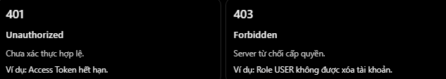

# ExpressJS: Dùng HTTP Status Code Đúng Tình Huống

## Mục lục

- [HTTP status code là gì?](#http-status-code-là-gì)
- [Các nhóm status code](#các-nhóm-status-code)
- [Status code cần nắm vững](#status-code-cần-nắm-vững)
- [Các cặp dễ nhầm](#các-cặp-dễ-nhầm)
- [Dùng trong ExpressJS](#dùng-trong-expressjs)
- [Các lỗi thường gặp](#các-lỗi-thường-gặp)
- [Câu hỏi ôn tập](#câu-hỏi-ôn-tập)

## HTTP status code là gì?

HTTP status code là mã ba chữ số trong response, biểu thị kết quả server xử lý request. Client như React, React Native, Axios hoặc curl dựa vào status code để quyết định bước tiếp theo.

Ví dụ `GET /api/v1/products/10` thành công:

```http
HTTP/1.1 200 OK
Content-Type: application/json

{
  "id": 10,
  "name": "Laptop"
}
```

Nếu product không tồn tại:

```http
HTTP/1.1 404 Not Found
Content-Type: application/json

{
  "message": "Product not found"
}
```

## Các nhóm status code


| Nhóm | Ý nghĩa | Ví dụ |
| --- | --- | --- |
| `1xx` | Informational response. | `100 Continue` |
| `2xx` | Request thành công. | `200`, `201`, `204` |
| `3xx` | Redirect hoặc cache-related response. | `301`, `304` |
| `4xx` | Client request/credential không hợp lệ hoặc không được phép. | `400`, `401`, `403`, `404`, `409`, `422` |
| `5xx` | Server/gateway không thể xử lý request hợp lệ. | `500`, `503` |

Trong REST API Express, thường gặp nhất là `2xx`, `4xx` và `5xx`.

## Status code cần nắm vững

### Nhóm 2xx — thành công

| Status | Khi dùng | Lưu ý |
| --- | --- | --- |
| `200 OK` | Request thành công và thường có response body. | Ví dụ GET product hoặc PATCH trả product sau khi cập nhật. |
| `201 Created` | Request tạo một hoặc nhiều resource mới thành công. | Response nên mô tả/tạo link đến resource; thường thêm header `Location`. |
| `204 No Content` | Request thành công, không có response content. | Không gửi JSON body; hay dùng với DELETE. |


Ví dụ `201 Created`:

```js
return res
  .status(201)
  .location(`/api/v1/products/${product.id}`)
  .json({ data: product });
```

Ví dụ `204 No Content`:

```js
return res.status(204).end();
```

### Nhóm 4xx — lỗi phía client hoặc điều kiện truy cập

| Status | Khi dùng | Ví dụ |
| --- | --- | --- |
| `400 Bad Request` | Request không hợp lệ theo API contract. | `price: -100` khi price phải dương. |
| `401 Unauthorized` | Thiếu hoặc không có credential xác thực hợp lệ. | Access token hết hạn. |
| `403 Forbidden` | Credential hợp lệ nhưng không đủ quyền. | `USER` gọi admin API. |
| `404 Not Found` | Không có resource/route, hoặc server không muốn tiết lộ resource tồn tại. | `/products/999` không tồn tại. |
| `409 Conflict` | Request xung đột với trạng thái hiện tại của resource. | Tạo user với email đã tồn tại. |
| `422 Unprocessable Content` | Nội dung request hiểu được nhưng không đáp ứng yêu cầu ngữ nghĩa. | Một API chọn mã này cho schema/business validation. |

Với `401`, HTTP specification yêu cầu response có `WWW-Authenticate` challenge. Với Bearer token, ví dụ:

```js
res.set("WWW-Authenticate", "Bearer");
return res.status(401).json({ message: "Authentication required" });
```

### Nhóm 5xx — lỗi server

| Status | Khi dùng | Ví dụ |
| --- | --- | --- |
| `500 Internal Server Error` | Lỗi bất ngờ khiến server không thể hoàn thành request. | Bug code hoặc lỗi database không được phân loại. |
| `503 Service Unavailable` | Dịch vụ tạm thời không thể phục vụ. | Bảo trì hoặc overload có chủ đích. |

`503` không phải mặc định cho mọi lỗi database. Chọn `500`, `503` hoặc mã khác dựa trên nguyên nhân và trạng thái thực tế. Có thể thêm `Retry-After` khi client nên thử lại sau.

## Các cặp dễ nhầm

### `200` vs `201` vs `204`

- `200`: xử lý thành công, thường có data trả về.
- `201`: tạo resource mới thành công; không phải mọi `POST` đều tạo resource. Ví dụ login thành công thường trả `200`.
- `204`: thành công, không có body.

### `401` vs `403`



- `401`: credential thiếu, sai hoặc hết hạn.
- `403`: server nhận diện credential nhưng không cho phép action/resource.

### `400` vs `404` vs `409` vs `422`

| Tình huống | Status thường phù hợp |
| --- | --- |
| `GET /users/abc` khi ID phải là số | `400` |
| `GET /users/999` với ID hợp lệ nhưng user không tồn tại | `404` |
| Tạo user có email vi phạm unique constraint | `409` |
| JSON đúng cú pháp nhưng vi phạm rule ngữ nghĩa, nếu API quy ước dùng `422` | `422` |

Nhiều API dùng `400` cho validation input. Chọn `400` hoặc `422` theo API contract, sau đó dùng nhất quán.

## Dùng trong ExpressJS

Ví dụ lấy product theo ID:

```js
app.get("/products/:id", async (req, res, next) => {
  const id = Number(req.params.id);

  if (!Number.isInteger(id) || id <= 0) {
    return res.status(400).json({ message: "Invalid product ID" });
  }

  try {
    const product = await prisma.product.findUnique({ where: { id } });

    if (!product) {
      return res.status(404).json({ message: "Product not found" });
    }

    return res.status(200).json(product);
  } catch (error) {
    return next(error);
  }
});
```

Cùng một endpoint có thể trả:

- `400`: ID sai format.
- `404`: ID hợp lệ nhưng không tìm thấy product.
- `200`: lấy thành công.
- `500`: lỗi server ngoài dự kiến, do global error handler trả.

## Các lỗi thường gặp

| Hiểu nhầm | Cách hiểu đúng |
| --- | --- |
| Mọi request thành công đều trả `200` | `201` và `204` cũng thành công, nhưng mang semantics khác. |
| User không có role admin thì trả `401` | Nếu đã xác thực nhưng thiếu quyền, thường trả `403`. |
| Không tìm thấy resource thì trả `500` | Thường trả `404`. |
| Body không hợp lệ thì trả `500` | Thường trả `400`, hoặc `422` nếu đó là API convention. |
| Danh sách rỗng nghĩa là `404` | `GET /products` thành công nhưng không có kết quả thường trả `200` với `[]`. |
| Xoá thành công trả `204` cùng JSON | `204` không có response content. |
| Cứ lỗi database là `503` | Cần phân loại nguyên nhân; `503` chỉ dành cho tình trạng tạm thời không sẵn sàng. |

## Câu hỏi ôn tập

1. **HTTP status code là gì?**  
   Là mã ba chữ số biểu thị kết quả xử lý HTTP request.

2. **`200`, `201` và `204` khác nhau thế nào?**  
   `200` thành công, thường có body; `201` tạo resource mới; `204` thành công và không có body.

3. **`401` và `403` khác nhau thế nào?**  
   `401` là credential thiếu/không hợp lệ; `403` là credential hợp lệ nhưng không đủ quyền.

4. **Khi nào dùng `404`?**  
   Khi resource/route không tìm thấy hoặc server không muốn tiết lộ resource tồn tại.

5. **`400` và `500` khác nhau thế nào?**  
   `400` chỉ lỗi ở request client; `500` chỉ lỗi bất ngờ ở server.

## Thực hành

Chạy API minh hoạ các status phổ biến tại [HTTP Status Code Example](../Example/http-status-code-example.js).

## Tham khảo

- [RFC 9110: HTTP Status Codes](https://www.rfc-editor.org/rfc/rfc9110.html)
- [IANA HTTP Status Code Registry](https://www.iana.org/assignments/http-status-codes)
