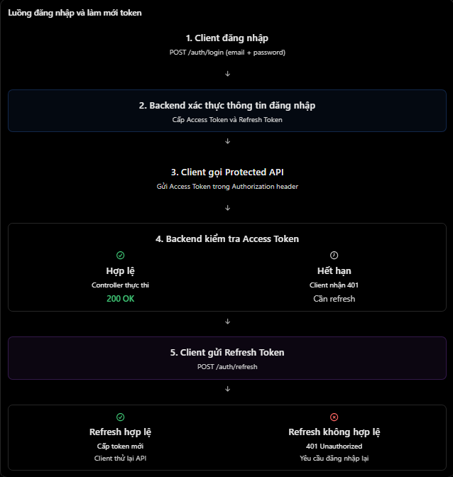

# ExpressJS: JWT Access Token và Refresh Token

## Mục lục

- [Access token và refresh token](#access-token-và-refresh-token)
- [Authentication flow](#authentication-flow)
- [Tạo và xác minh token](#tạo-và-xác-minh-token)
- [Refresh token rotation](#refresh-token-rotation)
- [Lưu trữ token](#lưu-trữ-token)
- [Các lỗi thường gặp](#các-lỗi-thường-gặp)
- [Câu hỏi ôn tập](#câu-hỏi-ôn-tập)

## Access token và refresh token

| Tiêu chí | Access token | Refresh token |
| --- | --- | --- |
| Mục đích | Gọi protected API. | Xin access token mới mà không đăng nhập lại. |
| Thời hạn | Ngắn, ví dụ 15 phút. | Dài hơn, ví dụ 7 ngày. |
| Sử dụng | Gửi theo từng protected request. | Chỉ gửi đến refresh/logout endpoint. |
| Nếu bị lộ | Giới hạn thiệt hại nhờ thời hạn ngắn. | Rủi ro cao hơn; cần bảo vệ và quản lý phiên. |

Ví dụ access token được gửi qua Bearer header:

```http
GET /api/v1/users/me HTTP/1.1
Authorization: Bearer <access-token>
```

Refresh token không dùng để gọi protected API thông thường. Nó chỉ dùng với endpoint như `POST /api/v1/auth/refresh` để nhận access token mới.

## Authentication flow



Flow cơ bản:

1. Client gửi credential đến `POST /api/v1/auth/login`.
2. Server xác minh credential, trả access token ngắn hạn và cấp refresh token dài hạn.
3. Client dùng access token cho protected API.
4. Khi access token hết hạn, client gọi refresh endpoint với refresh token.
5. Server verify refresh token, kiểm tra refresh session còn hợp lệ, rồi cấp access token mới.
6. Với token rotation, server đồng thời cấp refresh token mới và vô hiệu hoá token cũ.

> Không phải mọi `401` đều do access token hết hạn. Client không nên refresh lặp vô hạn; chỉ refresh theo authentication policy của ứng dụng.

## Tạo và xác minh token

Ví dụ này dùng JWT ký bởi `HS256`, secret khác nhau cho access và refresh token, cùng `issuer`/`audience` để giới hạn token đúng ngữ cảnh.

```js
const jwt = require("jsonwebtoken");

function createAccessToken(userId) {
  return jwt.sign({}, process.env.JWT_ACCESS_SECRET, {
    algorithm: "HS256",
    subject: String(userId),
    issuer: "learning-express-api",
    audience: "learning-express-client",
    expiresIn: "15m",
  });
}

function verifyAccessToken(token) {
  return jwt.verify(token, process.env.JWT_ACCESS_SECRET, {
    algorithms: ["HS256"],
    issuer: "learning-express-api",
    audience: "learning-express-client",
  });
}
```

| Thực hành | Lý do |
| --- | --- |
| Access và refresh dùng secret/key khác nhau | Tránh một loại token được xác minh nhầm như loại kia. |
| Khai báo `algorithms: ["HS256"]` khi verify | Chỉ chấp nhận thuật toán hệ thống chọn. |
| Kiểm tra `issuer`, `audience`, `sub` | Token phải được phát hành cho đúng hệ thống và subject hợp lệ. |
| Access token ngắn hạn | Giảm khoảng thời gian bị lạm dụng nếu token bị lộ. |
| Dùng `jwt.verify()` | `jwt.decode()` không xác minh chữ ký nên không dùng cho authentication. |

JWT thường được **ký**, không tự được mã hoá. Không cho password, refresh token khác hoặc dữ liệu nhạy cảm vào payload.

## Refresh token rotation

Refresh token có giá trị cao hơn access token: ai sở hữu nó có thể tiếp tục xin access token. Vì vậy, server nên duy trì refresh session để hỗ trợ logout, revoke, đa thiết bị và replay detection.

Một refresh session có thể lưu:

| Dữ liệu | Mục đích |
| --- | --- |
| `userId` | Gắn session với user. |
| `sessionId` / token ID (`jti`) | Nhận diện session và token cụ thể. |
| `tokenHash` | Không phải lưu refresh token thô. |
| `expiresAt`, `revokedAt`, `usedAt` | Kiểm tra thời hạn, logout và token reuse. |
| Device/IP metadata (tuỳ nhu cầu) | Quản lý và hiển thị các phiên đăng nhập. |

**Rotation** nghĩa là mỗi lần refresh thành công:

1. Refresh token cũ bị đánh dấu đã dùng/vô hiệu.
2. Server cấp access token mới **và refresh token mới**.
3. Nếu refresh token cũ bị dùng lại, server coi đó là dấu hiệu replay và có thể revoke cả token family/session, buộc user đăng nhập lại.

Refresh token không nhất thiết phải là JWT. Opaque random token kết hợp với server-side session store là lựa chọn phổ biến. Nếu dùng JWT refresh token, server vẫn cần state nếu muốn thu hồi hoặc phát hiện reuse một cách đáng tin cậy.

## Lưu trữ token

Với browser-based app, một hướng phổ biến là:

- Access token: giữ ngắn hạn trong memory phía client và gửi qua `Authorization` header.
- Refresh token: cookie `HttpOnly`, `Secure`, `SameSite` phù hợp, có path hẹp như `/api/v1/auth`.

`HttpOnly` làm JavaScript không đọc được refresh token; `Secure` yêu cầu HTTPS. Cookie tự động gửi cùng request nên cần xem xét CSRF protection, đặc biệt khi dùng cross-site cookies (`SameSite=None`).

Với mobile app, dùng secure storage của nền tảng như Keychain hoặc Android Keystore-backed storage. Không log JWT, `Authorization` header hay refresh token.

## Các lỗi thường gặp

| Hiểu nhầm | Cách hiểu đúng |
| --- | --- |
| Access token hết hạn thì luôn phải đăng nhập lại | Không, có thể refresh nếu refresh session vẫn hợp lệ. |
| Refresh token gọi được mọi protected API | Không. Chỉ dùng trong token refresh flow. |
| `jwt.decode()` đủ để kiểm tra token | Sai. Phải verify chữ ký và claims. |
| JWT logout thì tự động vô hiệu | Không nhất thiết. Cần session/revocation strategy. |
| Refresh token hợp lệ thì không cần kiểm tra gì thêm | Cần kiểm tra type, claims và trạng thái refresh session. |
| Lưu refresh token dạng plain text trong database là bình thường | Nên lưu hash/verifier để giảm thiệt hại khi database bị lộ. |
| Refresh token rotation chỉ là tạo token mới | Token cũ phải bị vô hiệu và cần xử lý token reuse. |

## Câu hỏi ôn tập

1. **Access token và refresh token khác nhau thế nào?**  
   Access token dùng cho protected API và sống ngắn; refresh token dùng để xin access token mới và sống dài hơn.

2. **Vì sao refresh token không nên dùng cho mọi API?**  
   Nó có thời hạn dài và phạm vi sử dụng khác; lộ refresh token gây rủi ro lớn hơn.

3. **Refresh token có cần lưu database không?**  
   Không bắt buộc, nhưng server-side session state rất hữu ích cho logout, revoke, đa thiết bị và rotation/reuse detection.

4. **Refresh token rotation là gì?**  
   Là thay refresh token sau mỗi refresh thành công và vô hiệu token cũ để phát hiện replay.

5. **Vì sao không dùng `jwt.decode()`?**  
   Vì nó chỉ đọc payload, không kiểm tra token có được ký hợp lệ hay không.

## Thực hành

Chạy ví dụ login, protected route, refresh cookie, rotation và logout tại [Access and Refresh Token Example](../Example/jwt-access-token-refresh-token-example.js).

## Tham khảo

- [RFC 9700: OAuth 2.0 Security Best Current Practice](https://www.rfc-editor.org/rfc/rfc9700.html)
- [RFC 8725: JWT Best Current Practices](https://www.rfc-editor.org/rfc/rfc8725.html)
