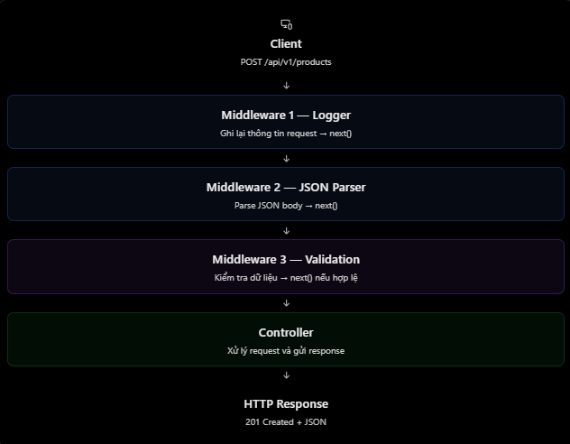

# ExpressJS: Middleware Chain và Thứ tự Middleware

## Mục lục

- [Middleware chain là gì?](#middleware-chain-là-gì)
- [Thứ tự middleware hoạt động](#thứ-tự-middleware-hoạt-động)
- [Middleware dừng request](#middleware-dừng-request)
- [`express.json()` phải đặt trước route](#expressjson-phải-đặt-trước-route)
- [Error-handling middleware](#error-handling-middleware)
- [Các lỗi thường gặp](#các-lỗi-thường-gặp)
- [Câu hỏi ôn tập](#câu-hỏi-ôn-tập)

## Middleware chain là gì?

Express xử lý một request bằng một chuỗi middleware và route handler phù hợp. Chuỗi này thường được gọi là **middleware chain**.



Mỗi middleware có thể:

- Thực thi code, ví dụ logging hoặc kiểm tra token.
- Đọc hoặc bổ sung dữ liệu vào `req`/`res`.
- Gọi `next()` để chuyển quyền xử lý sang middleware/handler kế tiếp.
- Gửi response để kết thúc request-response cycle.
- Chuyển lỗi bằng `next(error)` đến error handler.

> Một middleware phải gửi response hoặc gọi `next()`. Nếu không làm cả hai, request sẽ bị treo.

## Thứ tự middleware hoạt động

Express chạy các middleware phù hợp **theo thứ tự chúng được đăng ký**. Middleware đăng ký trước sẽ chạy trước, miễn là nó gọi `next()`.

```js
const express = require("express");
const app = express();

const middlewareA = (req, res, next) => {
  console.log("Middleware A");
  next();
};

const middlewareB = (req, res, next) => {
  console.log("Middleware B");
  next();
};

app.use(middlewareA);
app.use(middlewareB);

app.get("/users", (req, res) => {
  console.log("Controller");
  return res.status(200).json({ message: "Success" });
});

app.listen(3000);
```

Khi gọi `GET /users`, console in:

```text
Middleware A
Middleware B
Controller
```

Không phải mọi middleware đều chạy cho mọi request. Middleware chỉ tham gia khi request khớp mount path/route của nó và chain chưa bị dừng bởi response hoặc error flow.

## Middleware dừng request

Middleware có thể chủ động kết thúc request, ví dụ khi người dùng không có quyền truy cập:

```js
const requireAdmin = (req, res, next) => {
  const isAdmin = false;

  if (!isAdmin) {
    return res.status(403).json({ message: "Access denied" });
  }

  return next();
};

app.get("/admin/users", requireAdmin, (req, res) => {
  return res.json({ message: "Only admins can see this" });
});
```

Vì `requireAdmin` đã gửi response `403`, handler phía sau không được chạy. Sau khi gọi `res.json()`, `res.send()` hoặc một method gửi response khác, không nên gọi `next()` một cách tuỳ tiện: handler tiếp theo có thể cố gửi response lần hai.

## `express.json()` phải đặt trước route

`express.json()` là middleware parse JSON body. Nó phải được đăng ký trước route/middleware cần đọc `req.body`.

```js
// Đúng: body được parse trước khi route handler chạy.
app.use(express.json());

app.post("/products", (req, res) => {
  console.log(req.body);
  return res.json({ message: "Success" });
});
```

Đoạn sau không đúng nếu không có parser nào khác chạy trước route:

```js
app.post("/products", (req, res) => {
  console.log(req.body); // Chưa có JSON body đã parse.
  return res.json({ message: "Success" });
});

app.use(express.json());
```

Nguyên tắc: middleware chuẩn bị dữ liệu cho handler nào thì phải chạy trước handler đó.

## Error-handling middleware

Gọi `next(error)` sẽ bỏ qua các middleware/route handler thông thường còn lại và đi vào error-handling middleware. Error handler có đủ bốn tham số `(err, req, res, next)` và đặt sau routes.

```js
app.get("/products/:id", (req, res, next) => {
  const error = new Error("Product not found");
  error.statusCode = 404;
  return next(error);
});

app.use((err, req, res, next) => {
  return res.status(err.statusCode ?? 500).json({
    message: err.message || "Internal server error",
  });
});
```

Trong Express 5, nếu middleware `async` throw error hoặc Promise của nó bị reject, Express tự chuyển lỗi đó cho error handler. Dù vậy, error handler vẫn cần được định nghĩa.

## Các lỗi thường gặp

| Hiểu nhầm | Cách hiểu đúng |
| --- | --- |
| Middleware chạy theo thứ tự bất kỳ | Express xử lý middleware phù hợp theo thứ tự đăng ký. |
| Middleware nào cũng phải gọi `next()` | Không. Middleware đã gửi response thì không cần gọi `next()`. |
| Không gọi `next()` thì Express tự đi tiếp | Sai. Nếu không có response, request bị treo. |
| `express.json()` đặt ở đâu cũng được | Sai. Nó phải chạy trước handler cần đọc JSON body. |
| Đã `res.json()` vẫn nên gọi `next()` | Thường không nên; dễ dẫn đến gửi response hai lần. |
| Error handler có thể chỉ nhận ba tham số | Sai. Express nhận diện error handler qua bốn tham số `(err, req, res, next)`. |

## Câu hỏi ôn tập

1. **Middleware chain là gì?**  
   Là chuỗi middleware và handler phù hợp được Express thực thi cho một request.

2. **Vì sao thứ tự middleware quan trọng?**  
   Middleware được đăng ký trước chạy trước; thứ tự sai có thể khiến handler thiếu dữ liệu hoặc không bao giờ được chạy.

3. **Nếu middleware không gọi `next()` thì sao?**  
   Nếu nó cũng không gửi response, request sẽ bị treo.

4. **Middleware có thể dừng request không?**  
   Có. Nó có thể gửi response, ví dụ `400`, `401` hoặc `403`, thay vì gọi `next()`.

5. **Vì sao `express.json()` phải đứng trước route?**  
   Vì route chỉ đọc được JSON body sau khi middleware này parse body và gán nó vào `req.body`.

## Thực hành

Chạy ví dụ logger → JSON parser → validation → controller → error handler tại [Middleware Chain Example](../Example/middleware-chain-example.js).

## Tham khảo

- [Express: Writing middleware](https://expressjs.com/en/guide/writing-middleware/)
- [Express: Error handling](https://expressjs.com/en/guide/error-handling/)
