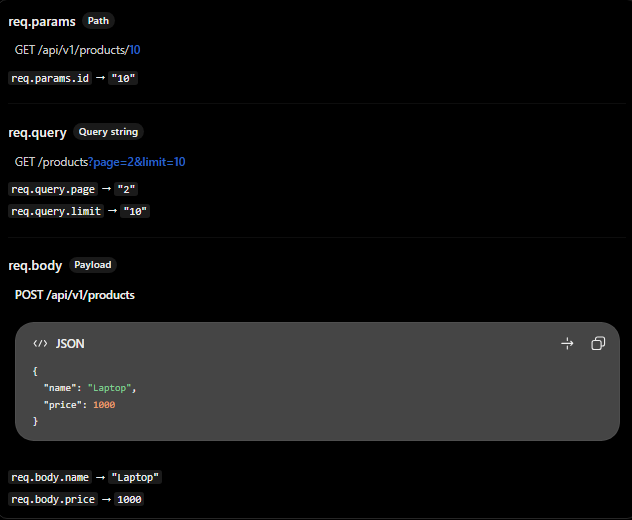

# ExpressJS: `req.params`, `req.query` và `req.body`

## Mục lục

- [Tổng quan](#tổng-quan)
- [`req.params`: dữ liệu trên URL path](#reqparams-dữ-liệu-trên-url-path)
- [`req.query`: dữ liệu trên query string](#reqquery-dữ-liệu-trên-query-string)
- [`req.body`: dữ liệu trong request body](#reqbody-dữ-liệu-trong-request-body)
- [Kết hợp trong REST API](#kết-hợp-trong-rest-api)
- [Các lỗi thường gặp](#các-lỗi-thường-gặp)
- [Câu hỏi ôn tập](#câu-hỏi-ôn-tập)

## Tổng quan

Cả ba thuộc tính đều lấy dữ liệu từ HTTP request, nhưng dữ liệu nằm ở vị trí và phục vụ mục đích khác nhau.

| Thuộc tính | Dữ liệu lấy từ | Mục đích phổ biến | Ví dụ |
| --- | --- | --- | --- |
| `req.params` | Các segment động trên URL path. | Xác định resource cụ thể. | `/users/:id` → `req.params.id` |
| `req.query` | Query string sau dấu `?`. | Tìm kiếm, lọc, sắp xếp, phân trang. | `/products?page=2` → `req.query.page` |
| `req.body` | HTTP request body đã được parser xử lý. | Tạo mới hoặc cập nhật dữ liệu. | `{ "name": "An" }` → `req.body.name` |



> Dù dữ liệu đến từ đâu, chúng đều do client kiểm soát. Backend cần chuyển kiểu, kiểm tra và validation trước khi dùng cho nghiệp vụ hoặc database.

## `req.params`: dữ liệu trên URL path

`req.params` chứa các giá trị của route parameter, được khai báo bằng dấu `:` trong path. Nó thường dùng để nhận diện resource cụ thể.

```js
app.get("/users/:id", (req, res) => {
  const userId = req.params.id;

  return res.json({ userId });
});
```

Khi client gọi `GET /users/15`, response là:

```json
{
  "userId": "15"
}
```

Route parameter thường là chuỗi, kể cả khi URL trông như số. Hãy chuyển kiểu và kiểm tra tính hợp lệ khi cần:

```js
const userId = Number(req.params.id);

if (!Number.isInteger(userId)) {
  return res.status(400).json({ message: "User ID must be an integer" });
}
```

Tên property phải khớp tên parameter trong route:

```js
app.get("/users/:userId", (req, res) => {
  return res.json({ userId: req.params.userId });
});
```

## `req.query`: dữ liệu trên query string

`req.query` thường dùng cho các tuỳ chọn của việc đọc danh sách như pagination, filtering, searching và sorting.

```js
app.get("/products", (req, res) => {
  const { page, limit, search } = req.query;

  return res.json({ page, limit, search });
});
```

Request `GET /products?page=2&limit=10&search=laptop` cho kết quả cơ bản:

```json
{
  "page": "2",
  "limit": "10",
  "search": "laptop"
}
```

Query string không phải một phần của route path để matching. Cả `GET /products?page=1` và `GET /products?page=2` đều khớp với `app.get("/products", ...)`.

Nên đặt default, parse và giới hạn giá trị trước khi dùng:

```js
const page = Number(req.query.page ?? 1);
const limit = Number(req.query.limit ?? 10);

if (!Number.isInteger(page) || page < 1) {
  return res.status(400).json({ message: "page must be a positive integer" });
}

if (!Number.isInteger(limit) || limit < 1 || limit > 100) {
  return res.status(400).json({ message: "limit must be between 1 and 100" });
}
```

> Tuỳ query parser và input, giá trị trong `req.query` có thể không chỉ là một string. Không nên tin tưởng kiểu dữ liệu đầu vào mà chưa kiểm tra.

## `req.body`: dữ liệu trong request body

`req.body` thường dùng cho `POST`, `PUT` và `PATCH`, khi client gửi dữ liệu để tạo hoặc cập nhật resource.

```js
import express from "express";

const app = express();

app.use(express.json());

app.post("/users", (req, res) => {
  const { name, email } = req.body;

  return res.status(201).json({ name, email });
});
```

Request ví dụ:

```http
POST /users HTTP/1.1
Content-Type: application/json

{
  "name": "An",
  "email": "an@example.com"
}
```

Sau khi `express.json()` parse body, có thể truy cập:

```js
req.body.name; // "An"
req.body.email; // "an@example.com"
```

`express.json()` chỉ parse body có `Content-Type: application/json`. Nếu client gửi form URL-encoded, cần parser tương ứng như `express.urlencoded()`. Không có parser phù hợp, `req.body` sẽ là `undefined`.

```js
app.use(express.json());
app.use(express.urlencoded({ extended: true }));
```

## Kết hợp trong REST API

Giả sử có Product API:

| Nhu cầu | HTTP request | Dữ liệu đọc |
| --- | --- | --- |
| Lấy product ID `5` | `GET /products/5` | `req.params.id` |
| Tìm laptop, trang 2 | `GET /products?search=laptop&page=2` | `req.query.search`, `req.query.page` |
| Tạo product | `POST /products` | `req.body` |
| Sửa giá product ID `5` | `PATCH /products/5` | `req.params.id` và `req.body.price` |

Ví dụ kết hợp `params` và `body`:

```js
app.patch("/products/:id", (req, res) => {
  const productId = Number(req.params.id);
  const { price } = req.body;

  if (!Number.isInteger(productId) || typeof price !== "number") {
    return res.status(400).json({ message: "Invalid input" });
  }

  return res.status(200).json({
    productId,
    updatedPrice: price,
  });
});
```

Trong dự án thực tế, controller thường truyền `productId` và dữ liệu đã validate xuống service; service sau đó gọi database, chẳng hạn `prisma.product.update()`.

## Các lỗi thường gặp

| Hiểu nhầm | Cách hiểu đúng |
| --- | --- |
| `req.params.id` luôn là number | Route parameter thường là string; cần chuyển kiểu và validate nếu dùng số. |
| `req.query.page` luôn là number | Cần parse và kiểm tra giá trị trước khi dùng. |
| Query string làm route không khớp | Query string không thuộc path được dùng để matching route. |
| `req.query` dùng để đọc JSON body | JSON body được đọc qua `req.body` sau khi parser xử lý. |
| Quên `express.json()` vẫn đọc được JSON | Không. Cần body parser phù hợp với `Content-Type`. |
| `req.body` luôn là object hợp lệ | Không. Cần validate cả shape, kiểu và giá trị của dữ liệu. |

## Câu hỏi ôn tập

1. **`req.params`, `req.query` và `req.body` khác nhau như thế nào?**  
   `params` lấy từ URL path, `query` lấy từ query string và `body` lấy từ request body đã parse.

2. **Khi nào dùng `req.params`?**  
   Khi cần xác định resource trong URL, ví dụ `/users/:id`.

3. **Khi nào dùng `req.query`?**  
   Khi có tuỳ chọn đọc dữ liệu như pagination, filtering, sorting hoặc searching.

4. **`express.json()` làm gì?**  
   Đây là middleware parse JSON request body và gán dữ liệu đã parse vào `req.body`.

5. **Có thể dùng `req.params` và `req.body` trong cùng request không?**  
   Có. Ví dụ `PATCH /products/:id` lấy `id` từ params và các trường muốn sửa từ body.

## Thực hành

Xem source code chạy được tại [Params, Query and Body Example](../Example/req.params-req.query-req.body-example.js).

## Tham khảo

- [Express routing: Route parameters](https://expressjs.com/en/5x/guide/routing/)
- [Express: `express.json()`](https://expressjs.com/en/5x/api/express/)
