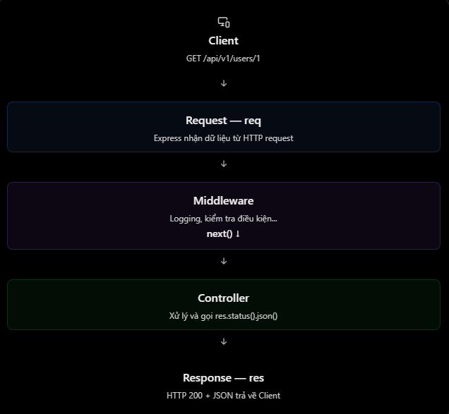

# ExpressJS: Request, Response và `next()`

## Mục lục

- [Tổng quan](#tổng-quan)
- [Request (`req`)](#request-req)
- [Response (`res`)](#response-res)
- [Hàm `next()`](#hàm-next)
- [Chuyển lỗi với `next(err)`](#chuyển-lỗi-với-nexterr)
- [Các lỗi và hiểu nhầm thường gặp](#các-lỗi-và-hiểu-nhầm-thường-gặp)
- [Câu hỏi ôn tập](#câu-hỏi-ôn-tập)

## Tổng quan

Khi client gọi một API, Express truyền ba đối số quan trọng vào middleware hoặc route handler:

| Thành phần | Vai trò | Ví dụ |
| --- | --- | --- |
| `req` | Chứa thông tin request client gửi lên. | `req.body`, `req.params`, `req.query`, `req.headers` |
| `res` | Dùng để tạo và gửi response từ server về client. | `res.status()`, `res.json()`, `res.send()` |
| `next` | Hàm chuyển quyền xử lý sang middleware/handler kế tiếp. | `next()`, `next(error)` |



Một middleware cần làm **một trong hai việc**: gửi response để kết thúc request-response cycle, hoặc gọi `next()` để nhường quyền xử lý. Nếu không làm cả hai, request sẽ bị treo.

## Request (`req`)

`req` là đối tượng chứa HTTP request từ client. Ví dụ client gửi:

```http
GET /api/v1/users/10?active=true HTTP/1.1
Authorization: Bearer token123
```

```js
app.get("/api/v1/users/:id", (req, res) => {
  console.log(req.params.id); // "10"
  console.log(req.query.active); // "true"
  console.log(req.get("Authorization")); // "Bearer token123"

  return res.json({ message: "Success" });
});
```

| Thuộc tính | Nguồn dữ liệu | Ví dụ từ request trên |
| --- | --- | --- |
| `req.params` | Tham số trên route path. | `req.params.id` là `"10"` |
| `req.query` | Query string sau dấu `?`. | `req.query.active` là `"true"` |
| `req.headers` hoặc `req.get()` | HTTP headers. | `req.get("Authorization")` |
| `req.body` | Request body; cần middleware như `express.json()` để parse JSON. | `{ "name": "An" }` |

> `req.params` và `req.query` thường là chuỗi. Hãy chuyển kiểu và kiểm tra dữ liệu trước khi sử dụng, ví dụ `Number(req.params.id)`.

## Response (`res`)

`res` là đối tượng Express dùng để xây dựng và gửi HTTP response về client.

| Method | Chức năng |
| --- | --- |
| `res.status(code)` | Thiết lập HTTP status code, nhưng **chưa** gửi response. |
| `res.json(data)` | Gửi response JSON và kết thúc response. |
| `res.send(data)` | Gửi text, HTML, Buffer hoặc dữ liệu khác. |
| `res.sendStatus(code)` | Thiết lập status rồi gửi status message dạng text. |

```js
app.get("/api/v1/users", (req, res) => {
  return res.status(200).json({
    message: "Get users successfully",
    data: [
      { id: 1, name: "An" },
      { id: 2, name: "Binh" },
    ],
  });
});
```

Response trả về:

```json
{
  "message": "Get users successfully",
  "data": [
    { "id": 1, "name": "An" },
    { "id": 2, "name": "Binh" }
  ]
}
```

`return` trước `res.json()` không bắt buộc để gửi response, nhưng là thói quen tốt: nó dừng việc chạy phần code còn lại trong handler, tránh vô tình gửi response lần hai.

## Hàm `next()`

`next()` chuyển quyền xử lý sang middleware hoặc handler phù hợp tiếp theo trong middleware chain.

```js
import express from "express";

const app = express();

const logger = (req, res, next) => {
  console.log(`${req.method} ${req.originalUrl}`);
  next();
};

app.get("/users", logger, (req, res) => {
  console.log("Controller running");

  return res.status(200).json({
    message: "Get users successfully",
  });
});

app.listen(3000);
```

Khi gọi `GET /users`, thứ tự xử lý là:

1. Request đi vào middleware `logger`.
2. `logger` ghi log và gọi `next()`.
3. Express gọi route handler kế tiếp.
4. Route handler gửi JSON response.

Nếu middleware không gọi `next()` **và** cũng không gửi response, request sẽ chờ mãi:

```js
const logger = (req, res, next) => {
  console.log("Middleware running");
  // Không gọi next() và cũng không gửi response.
};
```

## Chuyển lỗi với `next(err)`

`next(err)` bỏ qua các middleware/handler thông thường còn lại và chuyển lỗi đến error-handling middleware. Middleware xử lý lỗi phải có **đủ bốn tham số** theo thứ tự `(err, req, res, next)` và nên được đăng ký sau routes.

```js
const findUser = (req, res, next) => {
  const user = null;

  if (!user) {
    const error = new Error("User not found");
    error.statusCode = 404;
    return next(error);
  }

  req.user = user;
  return next();
};

app.get("/users/:id", findUser, (req, res) => {
  return res.json({ data: req.user });
});

app.use((err, req, res, next) => {
  console.error(err.message);

  return res.status(err.statusCode ?? 500).json({
    message: err.message || "Internal server error",
  });
});
```

> Không gọi `next()` sau khi đã gửi response, trừ khi bạn hiểu rõ luồng xử lý đó. Handler tiếp theo có thể cố gửi response lần nữa và gây lỗi `Cannot set headers after they are sent to the client`.

## Các lỗi và hiểu nhầm thường gặp

| Hiểu nhầm | Giải thích đúng |
| --- | --- |
| `next()` gửi response về client | Sai. Nó chỉ chuyển quyền xử lý. |
| Controller luôn phải gọi `next()` | Sai. Nếu controller đã gửi response thì thường không gọi `next()`. |
| `res.status(200)` đã gửi response | Sai. Cần gọi thêm method gửi dữ liệu như `json()` hoặc `send()`. |
| Middleware không gọi `next()` luôn sai | Không hẳn. Middleware có thể tự gửi response, ví dụ khi từ chối request không có token. |
| Error middleware có thể viết `(err, req, res)` | Không. Express nhận diện error middleware qua đủ bốn tham số `(err, req, res, next)`. |
| `next(err)` hoạt động như response | Sai. Nó chuyển lỗi đến error middleware; error middleware chịu trách nhiệm gửi response. |

## Câu hỏi ôn tập

1. **`req` và `res` khác nhau như thế nào?**  
   `req` chứa dữ liệu client gửi đến; `res` dùng để tạo và gửi response về client.

2. **Mục đích của `next()` là gì?**  
   Nó chuyển quyền xử lý sang middleware hoặc route handler kế tiếp trong chu trình request-response.

3. **Điều gì xảy ra khi middleware không gọi `next()`?**  
   Nếu middleware cũng không gửi response, request bị treo. Nếu nó đã gửi response, không cần gọi `next()`.

4. **`next()` khác `next(err)` ra sao?**  
   `next()` tiếp tục luồng xử lý thông thường; `next(err)` chuyển sang luồng xử lý lỗi.

## Thực hành

Xem bài thực hành có request validation, middleware logger và error handler tại [Request–Response–Next Example](../Example/request-response-next-example.md).

## Tham khảo

- [Express: Using middleware](https://expressjs.com/en/guide/using-middleware.html)
- [Express: Error handling](https://expressjs.com/guide/error-handling/)
