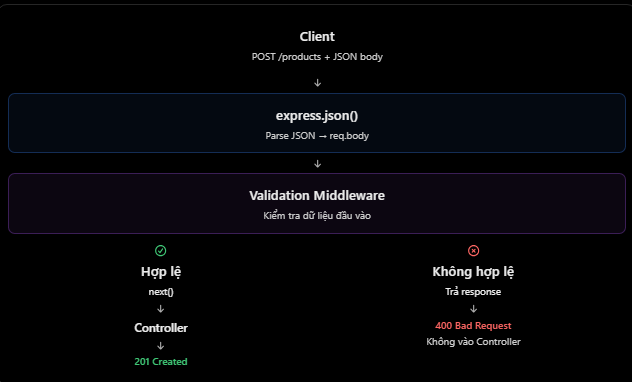

# ExpressJS: Validation cho `req.body` và `req.params`

## Mục lục

- [Validation là gì?](#validation-là-gì)
- [Validation body và params](#validation-body-và-params)
- [Validation middleware](#validation-middleware)
- [Luồng validation trong Express](#luồng-validation-trong-express)
- [Validation và database](#validation-và-database)
- [Các lỗi thường gặp](#các-lỗi-thường-gặp)
- [Câu hỏi ôn tập](#câu-hỏi-ôn-tập)

## Validation là gì?

Validation là quá trình kiểm tra dữ liệu đầu vào có đúng format, kiểu dữ liệu và business rules mà backend mong đợi hay không, trước khi xử lý hoặc lưu vào database.

Ví dụ request tạo product:

```http
POST /api/v1/products HTTP/1.1
Content-Type: application/json

{
  "name": "Laptop",
  "price": 1500
}
```

Rules có thể là:

- `name` là string, không rỗng và có giới hạn độ dài.
- `price` là number hữu hạn, lớn hơn `0`.

Request sau cần bị từ chối:

```json
{
  "name": "",
  "price": -100
}
```

> Validation phải thực hiện ở backend, kể cả khi frontend đã kiểm tra. Client có thể gọi API trực tiếp bằng curl, Postman hoặc mã tự viết.

## Validation body và params

| Tiêu chí | Body validation | Params validation |
| --- | --- | --- |
| Nguồn dữ liệu | `req.body` | `req.params` |
| Mục đích | Kiểm tra dữ liệu tạo mới/cập nhật. | Kiểm tra identifier trong URL path. |
| Ví dụ | `name`, `email`, `price` | `id`, `userId` |
| API hay gặp | `POST`, `PUT`, `PATCH` | `GET`, `PATCH`, `DELETE` |

`req.body`, `req.params` và `req.query` đều là input không đáng tin cậy. Parse JSON không đồng nghĩa với validation business rules.

## Validation middleware

### Validate body tạo product

```js
function validateCreateProduct(req, res, next) {
  const body = req.body;

  if (!body || typeof body !== "object" || Array.isArray(body)) {
    return res.status(400).json({ message: "Body must be a JSON object" });
  }

  const { name, price } = body;

  if (typeof name !== "string" || !name.trim() || name.trim().length > 100) {
    return res.status(400).json({ message: "name must be a non-empty string up to 100 characters" });
  }

  if (typeof price !== "number" || !Number.isFinite(price) || price <= 0) {
    return res.status(400).json({ message: "price must be a positive number" });
  }

  // Chỉ truyền dữ liệu đã validate/normalize sang controller.
  req.productInput = { name: name.trim(), price };
  return next();
}
```

Điểm cần nhớ:

- Kiểm tra existence, kiểu dữ liệu và range/format phù hợp với field.
- `Number.isFinite(price)` loại trừ `NaN` và `Infinity`.
- `name.trim()` chuẩn hoá khoảng trắng trước khi controller sử dụng.
- Nên định nghĩa những field được chấp nhận (allow-list), thay vì cố nhận biết mọi input xấu.

### Validate route params

`req.params.id` thường là string. Với numeric ID, kiểm tra format trước khi chuyển sang số:

```js
function validateProductId(req, res, next) {
  const rawId = req.params.id;

  if (!/^\d+$/.test(rawId)) {
    return res.status(400).json({ message: "Product ID must be a positive integer" });
  }

  const productId = Number(rawId);

  if (!Number.isSafeInteger(productId) || productId < 1) {
    return res.status(400).json({ message: "Product ID must be a positive integer" });
  }

  req.productId = productId;
  return next();
}
```

Nếu dự án sử dụng UUID thay vì numeric ID, validation rule phải đổi theo format UUID mà hệ thống chấp nhận.

## Luồng validation trong Express

Validation nên chạy trước controller:



```js
app.use(express.json());

app.post("/products", validateCreateProduct, (req, res) => {
  return res.status(201).json({
    message: "Product created",
    data: req.productInput,
  });
});

app.get("/products/:id", validateProductId, (req, res) => {
  return res.status(200).json({ productId: req.productId });
});
```

| Input | Kết quả |
| --- | --- |
| Body/params không hợp lệ | Middleware gửi lỗi `400`; controller không chạy. |
| Input hợp lệ | Middleware gọi `next()`; controller xử lý dữ liệu đã validate. |

`400 Bad Request` là lựa chọn phổ biến khi request input không hợp lệ. Một số API dùng `422 Unprocessable Content` cho validation theo ngữ nghĩa; điều quan trọng là chọn một quy ước và dùng nhất quán.

## Validation và database

Luồng điển hình:

```text
Client → Validation middleware → Controller → Service → Prisma → PostgreSQL
```

Request validation từ chối input sai sớm và mang lại response thân thiện. Tuy nhiên, nó **không thay thế** database constraints. Database vẫn cần các constraint như `NOT NULL`, `UNIQUE`, foreign key và `CHECK` để bảo vệ tính toàn vẹn dữ liệu trước mọi đường ghi dữ liệu.

Trong dự án lớn, schema validation library như Zod hoặc Joi giúp tái sử dụng rules và trả validation errors có cấu trúc. Dù dùng thư viện nào, controller chỉ nên nhận dữ liệu đã được validate.

## Các lỗi thường gặp

| Hiểu nhầm | Cách hiểu đúng |
| --- | --- |
| Frontend đã validate thì backend không cần | Sai. Server-side validation luôn cần thiết. |
| `req.params.id` tự động là number | Sai. Cần kiểm tra và chuyển kiểu theo format ID của API. |
| `express.json()` tự validate input | Sai. Nó chỉ parse JSON body. |
| Chỉ cần `if (price)` là đủ | Sai. Cần kiểm tra kiểu, số hữu hạn và range. |
| Validation lỗi vẫn gọi `next()` | Không. Nếu đã gửi error response, phải dừng normal flow. |
| Validation thay thế database constraints | Không. Cần cả validation và database constraints. |
| Chỉ chặn các chuỗi “nguy hiểm” | Không đủ. Ưu tiên allow-list cho kiểu, format và range chấp nhận được. |

## Câu hỏi ôn tập

1. **Validation input là gì?**  
   Là kiểm tra input có thoả rules của backend trước khi xử lý hoặc lưu trữ.

2. **Body validation và params validation khác nhau thế nào?**  
   Body validation kiểm tra dữ liệu payload; params validation kiểm tra giá trị động trong URL path.

3. **Vì sao backend vẫn cần validation khi frontend đã có?**  
   Vì client-side validation có thể bị bypass; backend là trust boundary phải tự kiểm tra input.

4. **Áp dụng validation trong Express như thế nào?**  
   Viết middleware, trả error response khi input sai; chỉ gọi `next()` khi input hợp lệ.

5. **Có thể dùng công cụ nào?**  
   Có thể validate thủ công hoặc dùng schema library như Zod/Joi.

## Thực hành

Chạy ví dụ validate `req.body`, `req.params` và PATCH body tại [Validation Body and Params Example](../Example/validation-body-params-example.js).

## Tham khảo

- [Express: Request body is untrusted input](https://expressjs.com/en/5x/api/request/)
- [OWASP Input Validation Cheat Sheet](https://cheatsheetseries.owasp.org/cheatsheets/Input_Validation_Cheat_Sheet.html)
