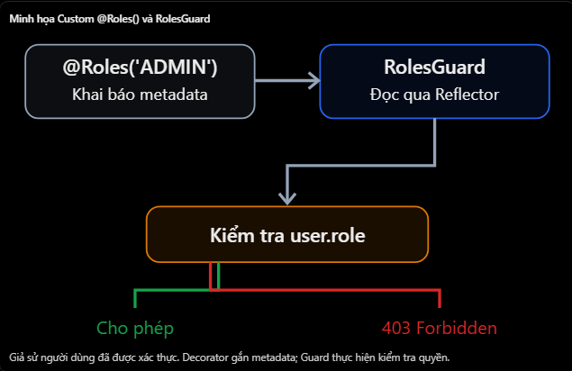

# NestJS: Built-in Decorator và Custom Decorator cơ bản

## Mục lục

- [Decorator là gì?](#1-decorator-trong-nestjs-là-gì)
- [Built-in Decorator](#2-built-in-decorator-là-gì)
- [Custom Decorator](#3-custom-decorator-là-gì)
- [Custom @CurrentUser()](#4-ví-dụ-thực-tế---custom-currentuser)
- [Custom @Roles()](#5-ví-dụ-thực-tế---custom-roles)
- [So sánh Built-in và Custom](#6-so-sánh-built-in-và-custom-decorator)
- [Các hiểu nhầm thường gặp](#7-một-số-hiểu-nhầm-thường-gặp)
- [Câu hỏi ôn tập](#8-câu-hỏi-ôn-tập)

## 15. Built-in Decorator và Custom Decorator cơ bản

### 1. Decorator trong NestJS là gì?

- Decorator là một cú pháp trong TypeScript cho phép gắn thêm thông tin hoặc hành vi vào class, method, property hoặc parameter.
- NestJS sử dụng decorator rất nhiều để khai báo Controller, Service, route, Dependency Injection và các cơ chế xử lý request. Ví dụ

```ts
@Controller("users")
export class UsersController {
  @Get(":id")
  findOne(@Param("id") id: string) {
    return { id };
  }
}
```

- Trong đoạn code trên:
  - Controller('users'): Khai báo Controller với route prefix /users.
  - @Get(':id'): Khai báo endpoint HTTP GET.
  - @Param('id'): Lấy tham số id từ URL.
- Khi client gọi:

```http
GET /users/10
```

- NestJS sẽ sử dụng các decorator này để xác định handler cần thực thi và giá trị cần truyền vào tham số id.
- Điểm quan trọng: Decorator giúp chúng ta khai báo cách NestJS xử lý ứng dụng, thay vì phải tự cấu hình mọi thứ bằng code thủ công.

### 2. Built-in Decorator là gì?

- Built-in Decorator là những decorator đã được NestJS cung cấp sẵn.
- Một số decorator cơ bản:

| Decorator | Công dụng |
| --- | --- |
| `@Module()` | Khai báo module |
| `@Controller()` | Khai báo Controller |
| `@Get()`, `@Post()` | Khai báo HTTP route |
| `@Body()` | Lấy request body |
| `@Param()` | Lấy route parameters |
| `@Query()` | Lấy query parameters |
| `@Injectable()` | Đánh dấu class tham gia hệ thống DI |
| `@UseGuards()` | Áp dụng Guard |
| `@UseInterceptors()` | Áp dụng Interceptor |
| `@UseFilters()` | Áp dụng Exception Filter |
- Ví dụ

```ts
@Post()
@UseGuards(JwtAuthGuard)
create(@Body() dto: CreateUserDto) {
  return this.usersService.create(dto);
}
```

- Ở đây NestJS đã cung cấp đầy đủ các decorator cần thiết để tạo một endpoint POST có xác thực JWT.
- Bạn không cần tự xây dựng decorator mới để thay thế những thứ đã có sẵn.

### 3. Custom Decorator là gì?

- Custom Decorator là decorator do lập trình viên tự định nghĩa để tái sử dụng logic hoặc khai báo metadata theo nhu cầu của ứng dụng.
- Giả sử bạn đang xây dựng API NestJS với JWT Authentication.
- Sau khi JWT được xác thực, JwtAuthGuard gắn thông tin người dùng vào:

```ts
request.user = {
  id: 10,
  email: "nhat@example.com",
  role: "ADMIN",
};
```

- Bây giờ bạn muốn lấy thông tin user trong Controller.

**Cách thông thường**

```ts
@Get('profile')
@UseGuards(JwtAuthGuard)
getProfile(@Req() req) {
  return req.user;
}
```

- Cách này hoạt động bình thường. Nhưng nếu bạn có 20 endpoint cần lấy thông tin user, việc viết @Req() và truy cập req.user nhiều lần sẽ khiến code lặp lại. Chúng ta có thể tự tạo một decorator tên là @CurrentUser().

### 4. Ví dụ thực tế - Custom @CurrentUser()

- Đây là một dạng Custom Parameter Decorator, tức decorator được sử dụng cho tham số của phương thức.

**current-user.decorator.ts**

```ts
import { createParamDecorator, ExecutionContext } from "@nestjs/common";

export const CurrentUser = createParamDecorator(
  (data: string | undefined, ctx: ExecutionContext) => {
    const request = ctx.switchToHttp().getRequest();

    return data ? request.user?.[data] : request.user;
  },
);
```

- Giải thích
  - createParamDecorator(): Hàm NestJS cung cấp để tạo custom parameter decorator.
  - data: Tham số được truyền vào decorator.
  - ExecutionContext: Cho phép truy cập request hiện tại.
  - request.user: Thông tin user đã được Guard xác thực và gắn vào request.
- Áp dụng chúng vào Controller:

**users.controller.ts**

```ts
@Controller("users")
export class UsersController {
  @Get("profile")
  @UseGuards(JwtAuthGuard)
  getProfile(@CurrentUser() user: any) {
    return user;
  }
}
```

- Khi client gọi:

```http
GET /users/profile
Authorization: Bearer <access_token>
```

- Nếu JWT hợp lệ và JwtAuthGuard đã gắn user vào request, Controller có thể nhận trực tiếp thông tin user thông qua @CurrentUser(). Và chúng ta không cần viết `@Req() req` rồi truy cập `req.user` ở mọi Controller nữa.

**Có thể lấy một thuộc tính cụ thể không?**

- Có. Với decorator vừa tạo:

```ts
@Get('my-id')
@UseGuards(JwtAuthGuard)
getMyId(@CurrentUser('id') userId: number) {
  return { userId };
}
```

- Giả sử request.user là:

```ts
{
  id: 10,
  role: 'ADMIN',
}
```

- Thì @CurrentUser('id') sẽ lấy ra giá trị 10. Đây là một cách làm rất phổ biến trong các dự án sử dụng NestJS và JWT.
- Điểm quan trọng: @CurrentUser() không tự xác thực JWT. Nó chỉ lấy dữ liệu từ request. Vì vậy, với route cần đăng nhập, bạn vẫn cần Authentication Guard hoặc một cơ chế xác thực tương ứng.

### 5. Ví dụ thực tế - Custom @Roles()

- Ngoài việc lấy thông tin request, Custom Decorator còn có thể dùng để khai báo metadata. Giả sử API quản trị có yêu cầu chỉ ADMIN được phép truy cập.
- Bạn muốn code có dạng:

```tsx
@Roles('ADMIN')
```

- Thay vì phải viết lại thông tin role ở nhiều nơi.

**Tạo Roles Decorator**

- roles.decorator.ts

```tsx
import { SetMetadata } from "@nestjs/common";

export const Roles = (...roles: string[]) => SetMetadata("roles", roles);
```

- Ở đây:
  - SetMetadata() là hàm decorator được NestJS cung cấp.
  - 'roles' là metadata key.
  - roles là danh sách role mà endpoint yêu cầu.
- Áp dụng:

```tsx
@Controller("admin")
export class AdminController {
  @Get("dashboard")
  @Roles("ADMIN")
  @UseGuards(JwtAuthGuard, RolesGuard)
  getDashboard() {
    return { message: "Admin Dashboard" };
  }
}
```

- Nhưng có một điểm cực kỳ quan trọng:
  - @Roles('ADMIN') chỉ khai báo metadata, không tự kiểm tra quyền truy cập.
  - Chúng ta vẫn cần RolesGuard để đọc metadata đó.
- Ví dụ phần quan trọng của RolesGuard:

```tsx
const roles = this.reflector.get<string[]>("roles", context.getHandler());
```

- Reflector đọc metadata đã được khai báo bởi @Roles() để Guard quyết định quyền truy cập.



- Nếu dùng metadata ở cả cấp Controller và method, Reflector còn có getAllAndOverride() hoặc getAllAndMerge() để đọc kết hợp

### 6. So sánh Built-in và Custom Decorator

| Tiêu chí | Built-in Decorator | Custom Decorator |
| --- | --- | --- |
| Ai định nghĩa? | NestJS | Lập trình viên |
| Mục đích | Cung cấp chức năng framework | Đáp ứng nhu cầu riêng |
| Ví dụ | `@Body()`, `@Param()` | `@CurrentUser()` |
| Metadata | `@SetMetadata()` | `@Roles()` có thể dùng `SetMetadata()` |
| Tái sử dụng | Có | Có |

### 7. Một số hiểu nhầm thường gặp

1. Custom Decorator luôn thay thế Guard
   - Sai. Custom Decorator có thể cung cấp metadata để Guard sử dụng, nhưng không tự động thực thi Authorization.
2. @CurrentUser() tự giải mã JWT
   - Sai. Nó lấy thông tin đã được một bước xác thực trước đó gắn vào request.
3. Decorator chỉ dùng trên class
   - Sai. Có thể áp dụng trên class, method, property và parameter tùy loại decorator.
4. Mọi API đều cần Custom Decorator
   - Sai. Chỉ nên tạo khi có nhu cầu rõ ràng hoặc muốn tái sử dụng logic.
5. @Roles() là Built-in Decorator của NestJS
   - Sai. Trong ví dụ này, @Roles() là Custom Decorator do chúng ta tạo.

### 8. Câu hỏi ôn tập

1. Decorator trong NestJS là gì?
   - Decorator dùng để gắn metadata hoặc hành vi vào class, method, property hoặc parameter.
2. Sự khác nhau giữa built-in và custom decorator là gì?
   - Built-in decorator do NestJS cung cấp, còn custom decorator do lập trình viên tạo cho nhu cầu cụ thể.
3. Làm thế nào để tạo custom parameter decorator?
   - Dùng `createParamDecorator()` từ NestJS để tạo và tái sử dụng parameter decorator.
4. Mục đích của `@CurrentUser()` decorator là gì?
   - Nó cho phép truy cập trực tiếp user đã được xác thực trong Controller.
5. Mục đích của SetMetadata() là gì?
   - Nó gắn metadata tùy chỉnh vào class hoặc route handler.

## Thực hành

Xem [Built-in–Custom Decorator Example](../Example/builtin-custom-decorator-example.ts). File này dùng built-in `@Controller`, `@Get`, `@UseGuards`; custom parameter decorator `@CurrentUser()`; và custom metadata decorator `@Roles()` được `RolesGuard` đọc qua `Reflector`.
