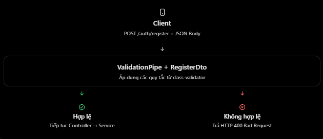
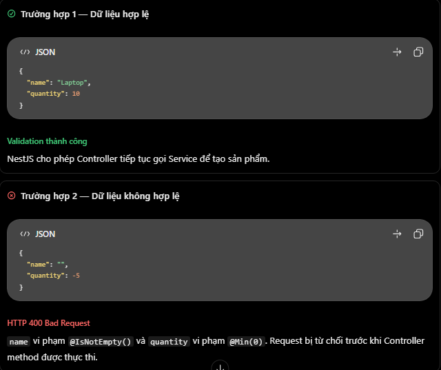

# NestJS: DTO và class-validator

## Mục lục

- [DTO là gì?](#1-dto-là-gì-trong-nestjs)
- [class-validator là gì?](#2-class-validator-là-gì)
- [DTO và validation hoạt động thế nào?](#3-dto-và-class-validator-hoạt-động-như-thế-nào)
- [Ví dụ Products API](#4-ví-dụ-thực-tế--nestjs--prisma--postgresql)
- [Dữ liệu hợp lệ và không hợp lệ](#5-khi-client-gửi-dữ-liệu-đúng-và-sai)
- [DTO và TypeScript interface](#6-dto-khác-gì-với-interface-của-typescript)
- [Các hiểu nhầm thường gặp](#7-những-hiểu-nhầm-thường-gặp)
- [Câu hỏi ôn tập](#8-câu-hỏi-ôn-tập)

## 7. DTO và class-validator

### 1. DTO là gì trong NestJS?

- DTO (Data Transfer Object) là một đối tượng dùng để định nghĩa cấu trúc dữ liệu được truyền giữa các thành phần hoặc qua API. Trong NestJS, DTO thường được sử dụng để mô tả dữ liệu mà Backend mong đợi nhận từ Client.
- Ví dụ, khi người dùng đăng ký tài khoản:

```json
{
  "name": "Nhat",
  "email": "nhat@gmail.com",
  "password": "12345678"
}
```

- Backend cần biết dữ liệu đầu vào phải đáp ứng những yêu cầu nào. Chúng ta có thể định nghĩa DTO:

```ts
export class RegisterDto {
  name: string;
  email: string;
  password: string;
}
```

- DTO giúp định nghĩa dữ liệu mong đợi, nhưng chỉ khai báo các kiểu TypeScript như trên không có nghĩa dữ liệu đã được kiểm tra ở runtime. Đây là điểm cần phân biệt rõ.

### 2. class-validator là gì?

- class-validator là thư viện cho phép sử dụng các decorator để khai báo quy tắc kiểm tra dữ liệu trên các property của class.

```ts
import { IsString, IsNotEmpty, IsEmail, MinLength } from "class-validator";

export class RegisterDto {
  @IsString()
  @IsNotEmpty()
  name: string;

  @IsEmail()
  email: string;

  @IsString()
  @MinLength(8)
  password: string;
}
```

- Ý nghĩa là:

| Decorator | Chức năng |
| --- | --- |
| `@IsString()` | Kiểm tra giá trị là string. |
| `@IsNotEmpty()` | Không cho phép giá trị rỗng. |
| `@IsEmail()` | Kiểm tra định dạng email. |
| `@MinLength(8)` | Chuỗi phải có ít nhất 8 ký tự. |
| `@IsInt()` | Kiểm tra giá trị là số nguyên. |
| `@Min(0)` | Giá trị số phải lớn hơn hoặc bằng 0. |
| `@IsOptional()` | Bỏ qua validator khác của property khi giá trị là `null` hoặc `undefined`. |
- Như vậy:
  - DTO định nghĩa cấu trúc dữ liệu.
  - class-validator định nghĩa các quy tắc kiểm tra dữ liệu.
  - NestJS có thể sử dụng ValidationPipe để thực thi việc kiểm tra dữ liệu trước khi chuyển cho Controller.

### 3. DTO và class-validator hoạt động như thế nào?

- Giả sử Client gửi HTTP request để tạo tài khoản.
  
- Điểm quan trọng: class-validator không tự động kiểm tra mọi HTTP request chỉ vì class có decorator. Bạn cần kích hoạt cơ chế validation phù hợp, chẳng hạn ValidationPipe của NestJS.
- Nếu dữ liệu không hợp lệ, ValidationPipe mặc định ném lỗi BadRequestException với HTTP status 400.

### 4. Ví dụ thực tế — NestJS + Prisma + PostgreSQL

- Giả sử bạn xây dựng chức năng tạo sản phẩm. Client gọi: `POST /products` với các yêu cầu là name phải là string và không được rỗng, quantity phải là số nguyên từ 0 trở lên.

**A. Cài đặt thư viện**

```bash
npm install class-validator class-transformer
```

- class-transformer là dependency được sử dụng cùng với ValidationPipe

**B. Tạo DTO**

- create-product.dto.ts

```ts
import { IsString, IsNotEmpty, IsInt, Min } from "class-validator";

export class CreateProductDto {
  @IsString()
  @IsNotEmpty()
  name: string;

  @IsInt()
  @Min(0)
  quantity: number;
}
```

- DTO này định nghĩa rõ những dữ liệu mà API mong đợi nhận được.

**C. Sử dụng DTO trong Controller**

- products.controller.ts

```ts
import { Body, Controller, Post } from "@nestjs/common";
import { ProductsService } from "./products.service";
import { CreateProductDto } from "./dto/create-product.dto";

@Controller("products")
export class ProductsController {
  constructor(private readonly productsService: ProductsService) {}

  @Post()
  create(@Body() dto: CreateProductDto) {
    return this.productsService.create(dto);
  }
}
```

- Ở đây, @Body() lấy dữ liệu từ request body, còn CreateProductDto là class mô tả cấu trúc và quy tắc validation.

**D. Kích hoạt ValidationPipe**

- main.ts

```ts
import { NestFactory } from "@nestjs/core";
import { ValidationPipe } from "@nestjs/common";
import { AppModule } from "./app.module";

async function bootstrap() {
  const app = await NestFactory.create(AppModule);

  app.useGlobalPipes(
    new ValidationPipe({
      whitelist: true,
    }),
  );

  await app.listen(3000);
}

bootstrap();
```

- Ở đây:
  - ValidationPipe thực hiện kiểm tra dữ liệu dựa trên những validation decorator đã khai báo.
  - whitelist: true loại bỏ các property không có validation decorator tương ứng trong DTO.
- Ví dụ, nếu Client gửi thêm isAdmin: true, property này sẽ bị loại bỏ trước khi đến Controller.
- Không có nghĩa request sẽ bị từ chối; muốn từ chối property ngoài danh sách thì có thể sử dụng thêm forbidNonWhitelisted: true.

**E. Service tương tác với Prisma**

- Giả sử Prisma model Product có hai trường tương ứng name và quantity:

```ts
@Injectable()
export class ProductsService {
  constructor(private readonly prisma: PrismaService) {}

  create(dto: CreateProductDto) {
    return this.prisma.product.create({
      data: {
        name: dto.name,
        quantity: dto.quantity,
      },
    });
  }
}
```

- Service chỉ thực hiện logic khi dữ liệu đã vượt qua bước validation.

## 5. Khi Client gửi dữ liệu đúng và sai



### 6. DTO khác gì với Interface của TypeScript?

```ts
interface CreateProductDto {
  name: string;
  quantity: number;
}
```

- Interface có thể giúp TypeScript kiểm tra kiểu dữ liệu trong quá trình phát triển, nhưng Interface sẽ bị loại bỏ khi biên dịch sang JavaScript. Ngược lại:

```ts
class CreateProductDto {
  @IsString()
  name: string;
}
```

- Class vẫn tồn tại ở runtime, cho phép hệ thống validation của NestJS sử dụng metadata và các decorator để kiểm tra dữ liệu. Vì vậy, khi sử dụng class-validator cùng ValidationPipe, DTO nên được định nghĩa bằng class thay vì Interface.

### 7. Những hiểu nhầm thường gặp

1. Khai báo email: string đồng nghĩa với validation
   - Không đúng. TypeScript chỉ kiểm tra kiểu ở compile time. Dữ liệu HTTP có thể chứa bất kỳ giá trị nào.
2. @Body() tự động kiểm tra dữ liệu
   - Không. @Body() chịu trách nhiệm lấy dữ liệu. Validation cần thêm cơ chế như ValidationPipe.
3. DTO và Prisma Model là một
   - Không giống nhau:
     - DTO thường mô tả dữ liệu gửi hoặc nhận qua API.
     - Prisma Model mô tả cấu trúc dữ liệu được ánh xạ với database.
   - Ví dụ model User có thể chứa passwordHash, nhưng DTO trả thông tin user cho Client không nên chứa trường nhạy cảm này.
4. quantity: number tự chuyển "10" thành 10.
   - Không đúng. Khai báo TypeScript không tự chuyển đổi dữ liệu tại runtime. Nếu Client gửi string "10" thì @IsInt() không chấp nhận nó như number trong cấu hình validation ví dụ trên.

### 8. Câu hỏi ôn tập

1. Class-validator là gì?
   - Class-validator là một thư viện sử dụng decorators để xác định các quy tắc xác thực cho các thuộc tính của lớp
2. DTO là gì?
   - DTO (Data Transfer Object) xác định cấu trúc dữ liệu được truyền giữa client và server.
3. Điều gì xảy ra khi xác thực DTO thất bại?
   - Khi sử dụng ValidationPipe, NestJS thường trả về phản hồi 400 Bad Request với lỗi xác thực
4. Tại sao chúng ta nên sử dụng lớp thay vì interface cho xác thực DTO?
   - Bởi vì interfaces sẽ bị loại bỏ lúc chạy, trong khi các lớp vẫn có sẵn để xác thực bằng cách sử dụng decorators và siêu dữ liệu thời gian chạy
5. Tại sao chúng ta sử dụng DTO với class-validator?
   - DTO kết hợp class-validator giúp xác thực dữ liệu đầu vào, cải thiện khả năng bảo trì và ngăn dữ liệu không hợp lệ đi vào logic nghiệp vụ.

## Thực hành

Xem [DTO Class Validator Example](../Example/dto-class-validator-example.ts). File này dùng `CreateProductDto`, `ValidationPipe` toàn cục, `whitelist`, `forbidNonWhitelisted` và `transform`. Hãy gửi body hợp lệ/không hợp lệ tới `POST /products` để quan sát response thành công hoặc lỗi `400`.
