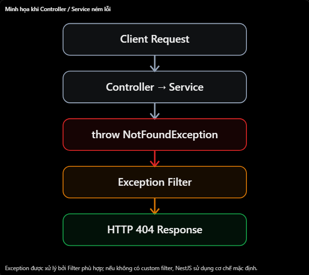

# NestJS: Exception Filter và HttpException

## Mục lục

- [HttpException là gì?](#1-httpexception-trong-nestjs-là-gì)
- [HttpException với Prisma](#2-ví-dụ-thực-tế--httpexception-với-prisma)
- [Exception Filter](#3-exception-filter-là-gì)
- [So sánh HttpException và Filter](#4-httpexception-vs-exception-filter)
- [Xử lý lỗi Prisma](#5-ví-dụ-thực-tế--xử-lý-lỗi-prisma)
- [Các lỗi thường gặp](#6-những-lỗi-thường-gặp-khi-xử-lý-exception)
- [Câu hỏi ôn tập](#7-câu-hỏi-ôn-tập)

## 14. Exception Filter và HttpException

### 1. HttpException trong NestJS là gì?

- HttpException là một class được NestJS cung cấp để biểu diễn lỗi HTTP
- Ví dụ, client gọi:

```http
GET /users/999
```

- Nhưng trong PostgreSQL không tồn tại user có ID 999. Nếu bạn muốn thông báo rằng user không tồn tại, có thể sử dụng:

```ts
throw new HttpException("User not found", HttpStatus.NOT_FOUND);
```

- NestJS sẽ trả về

```json
{
  "statusCode": 404,
  "message": "User not found"
}
```

- Cú pháp cơ bản

```ts
throw new HttpException(message, statusCode);
```

- Trong đó:
  - message: Nội dung lỗi gửi về client.
  - statusCode: Mã trạng thái HTTP như 400, 401, 403, 404 hoặc 500.
- Điểm cần nhớ: throw sẽ ném ra một exception, ngắt luồng xử lý bình thường. NestJS có cơ chế bắt exception và tạo HTTP error response cho client.

**Các Built-in Exception thường gặp**

- NestJS cung cấp nhiều exception có sẵn, kế thừa từ HttpException, nên bạn không cần tự viết new HttpException() cho mọi trường hợp.
| Exception | HTTP | Khi nào sử dụng |
| --- | --- | --- |
| `BadRequestException` | 400 | Request không hợp lệ |
| `UnauthorizedException` | 401 | Chưa được xác thực hợp lệ |
| `ForbiddenException` | 403 | Không có quyền truy cập |
| `NotFoundException` | 404 | Không tìm thấy tài nguyên |
| `ConflictException` | 409 | Xung đột dữ liệu |
| `InternalServerErrorException` | 500 | Lỗi xử lý nội bộ |
- Ví dụ:

```ts
throw new NotFoundException("User not found");
```

- Tương đương về HTTP status và message với:

```ts
throw new HttpException("User not found", HttpStatus.NOT_FOUND);
```

- Trong dự án thực tế, mình khuyến khích dùng các exception có sẵn để code ngắn gọn và dễ đọc.

### 2. Ví dụ thực tế — HttpException với Prisma

- Giả sử bạn đang xây dựng API:

```http
GET /users/5
```

- Controller gọi UsersService, sau đó Service dùng Prisma để truy vấn PostgreSQL.

**users.service.ts**

```tsx
import { Injectable, NotFoundException } from "@nestjs/common";

@Injectable()
export class UsersService {
  constructor(private readonly prisma: PrismaService) {}

  async findOne(id: number) {
    const user = await this.prisma.user.findUnique({
      where: { id },
    });

    if (!user) {
      throw new NotFoundException("User not found");
    }

    return user;
  }
}
```

- Ở đây:
  1. Prisma truy vấn user bằng findUnique().
  2. Nếu không tìm thấy user, Prisma trả về null.
  3. Service kiểm tra !user.
  4. Nếu user không tồn tại, NotFoundException được ném ra.
  5. NestJS chuyển exception thành HTTP 404 response.

- Controller:

```tsx
@Controller("users")
export class UsersController {
  constructor(private readonly usersService: UsersService) {}

  @Get(":id")
  findOne(@Param("id", ParseIntPipe) id: number) {
    return this.usersService.findOne(id);
  }
}
```

- Một điều quan trọng: findUnique() trả về null khi không tìm thấy dữ liệu, nhưng không tự ném NotFoundException. Chúng ta phải xử lý tình huống đó.

### 3. Exception Filter là gì?

- Exception Filter là thành phần chịu trách nhiệm bắt và xử lý exception, quyết định error response sẽ được trả về client như thế nào.
- NestJS đã có built-in Exception Filter để xử lý những lỗi thông thường.
- Vì vậy, khi viết

```tsx
throw new NotFoundException("User not found");
```

- Bạn không bắt buộc phải tự viết Exception Filter. NestJS đã có thể trả về HTTP 404.
- Vậy khi nào cần Custom Exception Filter?
- Ví dụ, bạn muốn tất cả HTTP error response có cấu trúc thống nhất:

```json
{
  "statusCode": 404,
  "message": "User not found",
  "timestamp": "2026-11-03T04:00:00.000Z",
  "path": "/users/999"
}
```

- Khi đó, Custom Exception Filter sẽ rất hữu ích.

**Luồng xử lý exception**


**Custom Exception Filter**

- http-exception.filter.ts

```ts
import {
  ArgumentsHost,
  Catch,
  ExceptionFilter,
  HttpException,
} from "@nestjs/common";
import type { Request, Response } from 'express';

@Catch(HttpException)
export class HttpExceptionFilter implements ExceptionFilter {
  catch(exception: HttpException, host: ArgumentsHost) {
    const ctx = host.switchToHttp();

    const response = ctx.getResponse<Response>();
    const request = ctx.getRequest<Request>();

    const status = exception.getStatus();

    response.status(status).json({
      statusCode: status,
      message: exception.message,
      timestamp: new Date().toISOString(),
      path: request.url,
    });
  }
}
```

- Giải thích các thành phần:

| Thành phần | Công dụng |
| --- | --- |
| `@Catch(HttpException)` | Bắt HttpException và class kế thừa. |
| `ExceptionFilter` | Interface định nghĩa Filter. |
| `catch()` | Hàm xử lý exception. |
| `ArgumentsHost` | Cung cấp context để lấy request/response. |
| `exception.getStatus()` | Lấy HTTP status. |
| `response.status().json()` | Trả HTTP response tùy chỉnh. |
- Ví dụ này giả định NestJS sử dụng Express adapter. Với Fastify, cách gửi response sẽ khác.

**Áp dụng Custom Exception Filter**

```ts
@Get(':id')
@UseFilters(HttpExceptionFilter)
findOne(@Param('id', ParseIntPipe) id: number) {
  return this.usersService.findOne(id);
}
```

- Khi Service ném NotFoundException, Filter sẽ bắt và tạo response theo cấu trúc bạn đã định nghĩa.
- Lưu ý: Custom Filter bên trên chỉ bắt HttpException và các lớp con, không bắt mọi loại lỗi JavaScript. Muốn bắt tất cả exception có thể dùng @Catch(), nhưng phải xử lý cả các lỗi không có HTTP status.

### 4. HttpException vs Exception Filter

| Tiêu chí | HttpException | Exception Filter |
| --- | --- | --- |
| Vai trò | Biểu diễn lỗi HTTP | Bắt và xử lý lỗi |
| Cách dùng | `throw new ...` | `@Catch()` và `catch()` |
| Mục đích | Thông báo điều gì đã sai | Quyết định cách trả lỗi |
| Ví dụ | User không tồn tại | Chuẩn hóa response lỗi |

- Có thể ghi nhớ như sau: HttpException nói lỗi gì xảy ra, còn Exception Filter quyết định xử lý và trả lỗi đó như thế nào.
- Ví dụ thực tế:

```ts
throw new ConflictException("Email already exists");
```

- Service chịu trách nhiệm xác định lỗi nghiệp vụ. Exception Filter có thể định dạng response:

```json
{
  "statusCode": 409,
  "message": "Email already exists",
  "path": "/users"
}
```

### 5. Ví dụ thực tế — Xử lý lỗi Prisma

- Đây là phần bổ sung thực tế để liên hệ với NestJS + Prisma + PostgreSQL.
- Giả sử database có email unique:

```prisma
model User {
  id    Int    @id @default(autoincrement())
  email String @unique
}
```

- Khi tạo user có email đã tồn tại, Prisma có thể ném lỗi P2002, tương ứng với unique constraint violation. Trong Service, bạn có thể chuyển lỗi đó thành 409 Conflict:

```tsx
import { ConflictException, Injectable } from "@nestjs/common";
import { Prisma } from "@prisma/client";

@Injectable()
export class UsersService {
  constructor(private readonly prisma: PrismaService) {}

  async create(email: string) {
    try {
      return await this.prisma.user.create({
        data: { email },
      });
    } catch (error) {
      if (
        error instanceof Prisma.PrismaClientKnownRequestError &&
        error.code === "P2002"
      ) {
        throw new ConflictException("Email already exists");
      }

      throw error;
    }
  }
}
```

- Giả định ví dụ sử dụng Prisma Client với namespace Prisma được import từ @prisma/client; đường dẫn import có thể khác khi dùng Prisma Client generator mới.
- Ý tưởng chính:
  - Prisma phát hiện lỗi ở database.
  - Service chuyển lỗi đã biết thành exception phù hợp với REST API.
  - Exception Filter hoặc bộ xử lý mặc định của NestJS trả HTTP response.
- Đối với các lỗi chưa biết, throw error giúp giữ nguyên lỗi thay vì tự ý biến mọi trường hợp thành lỗi 409.

### 6. Những lỗi thường gặp khi xử lý Exception

| Hiểu nhầm | Giải thích đúng |
| --- | --- |
| Mọi lỗi đều trả HTTP 500 | Lỗi đã xác định nên trả status phù hợp. |
| Phải tạo custom filter mới dùng được HttpException | NestJS có sẵn cơ chế xử lý. |
| `findUnique()` không tìm thấy tự ném 404 | Nó thường trả `null`. |
| `@Catch(HttpException)` bắt tất cả exception | Chỉ bắt HttpException và class kế thừa. |
| Có lỗi Prisma thì trả trực tiếp message gốc | Không nên để lộ thông tin nội bộ DB. |
| Custom Exception Filter thay thế mọi `try/catch` | `try/catch` vẫn cần khi muốn phục hồi hoặc chuyển đổi lỗi cụ thể. |

- Một lưu ý bảo mật: Với lỗi không xác định, NestJS mặc định có thể trả HTTP 500 với thông báo chung "Internal server error" thay vì tiết lộ chi tiết nội bộ.

### 7. Câu hỏi ôn tập

1. HttpException trong NestJS là gì?
   - HttpException là class có sẵn để ném lỗi HTTP với message và status cụ thể.
2. Exception Filter là gì trong NestJS?
   - Exception Filter bắt exception và kiểm soát cách gửi error response cho client.
3. Sự khác nhau giữa HttpException và Exception Filter là gì?
   - HttpException biểu diễn lỗi HTTP, còn Exception Filter xử lý và định dạng response lỗi.
4. Làm thế nào để bạn trả về lỗi 404 trong NestJS
   - Có thể ném `NotFoundException` khi yêu cầu tài nguyên đó không tồn tại
5. @Catch() có thể làm được gì
   - Nó chỉ định loại exception mà Exception Filter sẽ bắt.

## Thực hành

Xem [Exception Filter–HttpException Example](../Example/exceptionfilter-httpexception-example.ts). File này ném `NotFoundException` và `ConflictException` trong service, sau đó áp dụng `HttpExceptionFilter` toàn cục để trả response lỗi có `statusCode`, `message`, `timestamp` và `path`.
