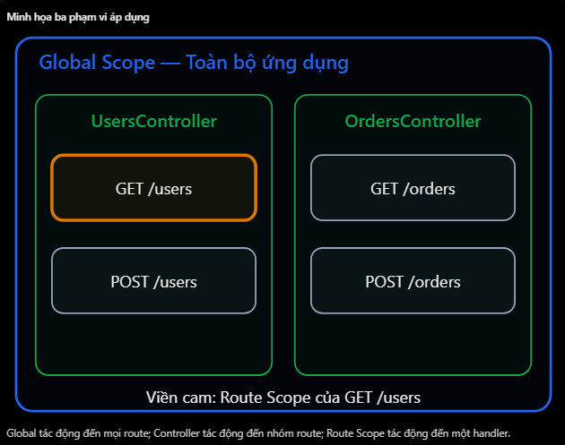

# NestJS: Global Pipe / Guard / Interceptor

## Mục lục

- [Global trong NestJS](#1-global-trong-nestjs-nghĩa-là-gì)
- [Global Pipe](#2-global-pipe---validation-toàn-ứng-dụng)
- [Global Guard](#3-global-guard---authentication-toàn-ứng-dụng)
- [Global Interceptor](#4-global-interceptor---xử-lý-response-toàn-ứng-dụng)
- [Cách đăng ký global](#5-tổng-hợp-các-cách-đăng-ký-global)
- [Thứ tự khi nhiều scope](#6-thứ-tự-chạy-khi-có-nhiều-scope)
- [Các lỗi thường gặp](#7-những-lỗi-và-hiểu-nhầm-thường-gặp)
- [Câu hỏi ôn tập](#8-câu-hỏi-ôn-tập)

## 17. Global Pipe / Guard / Interceptor

### 1. Global trong NestJS nghĩa là gì?

- Trong NestJS, Pipe, Guard và Interceptor có thể được áp dụng ở ba cấp độ:
  - Global scope: Áp dụng cho toàn bộ ứng dụng.
  - Controller scope: Áp dụng cho các route trong một Controller.
  - Route scope: Chỉ áp dụng cho một route handler cụ thể.
- Ví dụ hệ thống có những API:

```http
POST   /auth/login
GET    /users/profile
GET    /products
POST   /orders
DELETE /users/:id
```

- Nếu muốn tất cả các API đều sử dụng một ValidationPipe, bạn không cần thêm @UsePipes() vào từng Controller. Thay vào đó, chỉ cần đăng ký Global Pipe một lần.
  

**So sánh**

| Cấp độ | Cách khai báo | Phạm vi |
| --- | --- | --- |
| Global | `app.useGlobal...()` hoặc `APP_*` | Toàn ứng dụng |
| Controller | `@UseGuards()` trên class | Mọi route của Controller |
| Route | `@UseGuards()` trên method | Route cụ thể |

- Ví dụ @UseGuards() ở hai vị trí:

```ts
@UseGuards(JwtAuthGuard)
@Controller("users")
export class UsersController {
  @Get("profile")
  getProfile() {}

  @Get("settings")
  getSettings() {}
}
```

- Cả hai API đều sử dụng JwtAuthGuard vì Guard được áp dụng ở Controller scope. Nếu chuyển @UseGuards() xuống chỉ một method, nó sẽ chỉ áp dụng riêng cho method đó.

### 2. Global Pipe - Validation toàn ứng dụng

- Đây là trường hợp thường xuyên sử dụng nhất trong NestJS.
- Giả sử bạn có rất nhiều DTO để kiểm tra request body. Thay vì thêm:

```tsx
@UsePipes(new ValidationPipe())
```

- vào từng Controller, bạn có thể cấu hình trong main.ts.

**main.ts**

```tsx
import { NestFactory } from "@nestjs/core";
import { ValidationPipe } from "@nestjs/common";
import { AppModule } from "./app.module";

async function bootstrap() {
  const app = await NestFactory.create(AppModule);

  app.useGlobalPipes(
    new ValidationPipe({
      whitelist: true,
      forbidNonWhitelisted: true,
      transform: true,
    }),
  );

  await app.listen(3000);
}

bootstrap();
```

**Ý nghĩa từng thuộc tính**
| Thuộc tính | Công dụng |
| --- | --- |
| `whitelist: true` | Loại bỏ thuộc tính không được cho phép bởi DTO validation decorators. |
| `forbidNonWhitelisted: true` | Báo lỗi thay vì tự loại bỏ thuộc tính không hợp lệ. |
| `transform: true` | Chuyển dữ liệu thành DTO instance và hỗ trợ chuyển kiểu phù hợp. |

- Ví dụ DTO:

```ts
export class CreateUserDto {
  @IsString()
  name: string;

  @IsEmail()
  email: string;
}
```

- Client gửi:

```json
{
  "name": "Nhat",
  "email": "nhat@example.com",
  "isAdmin": true
}
```

- Vì isAdmin không được khai báo với validation decorator trong DTO, request sẽ bị từ chối với HTTP 400 khi dùng cấu hình trên.
- Điểm quan trọng: Global Pipe không có nghĩa mọi dữ liệu client gửi đều được kiểm tra tự động. ValidationPipe dựa vào DTO, metadata kiểu dữ liệu và validation decorators để thực hiện kiểm tra phù hợp.

### 3. Global Guard - Authentication toàn ứng dụng

- Giả sử Backend có 50 API cần xác thực JWT. Nếu bạn thêm vào từng route, code sẽ lặp lại khá nhiều. Bạn có thể đăng ký Guard toàn cục.

```ts
@UseGuards(JwtAuthGuard)
```

**main.ts**

```ts
app.useGlobalGuards(new JwtAuthGuard());
```

- Đây là cú pháp cơ bản, phù hợp khi Guard không cần NestJS inject dependency qua constructor. Tuy nhiên, trong thực tế, JwtAuthGuard thường sử dụng JwtService. Ví dụ

```ts
constructor(private readonly jwtService: JwtService) {}
```

- Vì vậy, nên sử dụng cơ chế Dependency Injection của NestJS để đăng ký Guard toàn cục.

#### Đăng ký bằng APP_GUARD

**app.module.ts - Ví dụ rút gọn**

```ts
import { Module } from "@nestjs/common";
import { APP_GUARD } from "@nestjs/core";
import { AuthModule } from "./auth/auth.module";
import { JwtAuthGuard } from "./auth/jwt-auth.guard";

@Module({
  imports: [AuthModule],
  providers: [
    {
      provide: APP_GUARD,
      useClass: JwtAuthGuard,
    },
  ],
})
export class AppModule {}
```

- Ví dụ giả định JwtService được export từ AuthModule và có thể inject vào JwtAuthGuard. Trong dự án thực tế, bạn cũng có thể đăng ký APP_GUARD trong AuthModule nơi các dependency được quản lý.
- APP_GUARD giúp NestJS tạo Global Guard thông qua hệ thống Dependency Injection. Nhưng có một vấn đề. Giả sử bạn đăng ký JwtAuthGuard toàn cục. Khi đó endpoint:

```http
POST /auth/login
```

- Cũng chịu sự kiểm tra của Global Guard. Vậy người dùng chưa đăng nhập thì làm sao gọi API login?
- Một cách phổ biến là khai báo route công khai bằng custom decorator:

```tsx
@Public()
@Post('login')
login(@Body() dto: LoginDto) {
  return this.authService.login(dto);
}
```

- Và Global Guard được thiết kế để đọc metadata @Public() thông qua Reflector, từ đó bỏ qua yêu cầu JWT ở những route công khai.
- Lưu ý: @Public() không tự có tác dụng bỏ qua Guard. Bạn phải xây dựng logic tương ứng trong Guard.

### 4. Global Interceptor - Xử lý response toàn ứng dụng

- Giả sử bạn muốn chuẩn hóa response cho nhiều API: Từ

```json
{
  "id": 1,
  "name": "Nhat"
}
```

- Thành

```json
{
  "data": {
    "id": 1,
    "name": "Nhat"
  }
}
```

- Bạn có thể sử dụng TransformInterceptor

**transform.interceptor.ts**

```tsx
@Injectable()
export class TransformInterceptor implements NestInterceptor {
  intercept(context: ExecutionContext, next: CallHandler) {
    return next.handle().pipe(
      map((data) => ({
        data,
      })),
    );
  }
}
```

- Sau đó đăng ký toàn cục trong main.ts:

```tsx
app.useGlobalInterceptors(new TransformInterceptor());
```

- Mọi route handler thông thường sẽ chịu sự xử lý của Global Interceptor. Ví dụ:

```http
GET /users/1
GET /products
GET /orders
```

- Các response tương ứng đều có thể được bọc vào thuộc tính data.
- Lưu ý thực tế: Nên xử lý ngoại lệ cho các response đặc biệt như file streaming, HTTP 204 hoặc API sử dụng @Res() trực tiếp. Không nên áp dụng một kiểu biến đổi cho mọi response một cách máy móc.

### Nếu Interceptor cần Dependency Injection?

- Tương tự Global Guard, sử dụng:

```tsx
import { APP_INTERCEPTOR } from "@nestjs/core";

@Module({
  providers: [
    {
      provide: APP_INTERCEPTOR,
      useClass: TransformInterceptor,
    },
  ],
})
export class AppModule {}
```

- NestJS cũng hỗ trợ APP_PIPE, APP_GUARD và APP_INTERCEPTOR để đăng ký thành phần toàn cục thông qua provider system.

### 5. Tổng hợp các cách đăng ký Global

| Thành phần | `main.ts` | Module provider |
| --- | --- | --- |
| Pipe | `app.useGlobalPipes()` | `APP_PIPE` |
| Guard | `app.useGlobalGuards()` | `APP_GUARD` |
| Interceptor | `app.useGlobalInterceptors()` | `APP_INTERCEPTOR` |

- Khi nào chọn cách nào?
  - Sử dụng app.useGlobal...() khi thành phần có thể được khởi tạo trực tiếp và không cần NestJS tự inject dependencies.
  - Sử dụng APP\_\* khi muốn thành phần tham gia Dependency Injection, chẳng hạn Global Guard sử dụng JwtService hoặc Interceptor sử dụng một Service khác.

### 6. Thứ tự chạy khi có nhiều scope

- Giả sử cùng một request chịu tác động của nhiều Guard. Thông thường thứ tự sẽ là

```text
Global Guard
    ↓
Controller Guard
    ↓
Route Guard
    ↓
Interceptor Before
    ↓
Pipe
    ↓
Controller
```

- Đối với Interceptor, chiều trả response chạy ngược lại:

```text
Route Interceptor After
    ↓
Controller Interceptor After
    ↓
Global Interceptor After
    ↓
Response
```

- Lưu ý: Thêm Guard vào route không tự động thay thế hay tắt Global Guard. Nếu muốn route công khai, cần cơ chế xử lý riêng như @Public().

### 7. Những lỗi và hiểu nhầm thường gặp

| Hiểu nhầm | Giải thích đúng |
| --- | --- |
| Global Guard chỉ chạy cho route có `@UseGuards()` | Global Guard áp dụng trên toàn ứng dụng. |
| Dùng `@UseGuards()` ở route sẽ ghi đè Global Guard | Không, các Guard phù hợp vẫn được thực thi. |
| Global ValidationPipe tự kiểm tra mọi request | Validation dựa vào DTO và metadata phù hợp. |
| Có thể dùng `new JwtAuthGuard()` khi Guard cần inject JwtService | Nên đăng ký qua provider/DI thay vì tự khởi tạo thiếu dependency. |
| Global Interceptor chỉ tác động Controller | Nó có thể xử lý luồng trước và sau handler. |
| Global Guard tự động bỏ qua login | Cần thiết kế ngoại lệ cho public routes. |

### 8. Câu hỏi ôn tập

1. Global Pipe là gì trong NestJs?
   - Global Pipe áp dụng cho toàn ứng dụng và có thể xác thực hoặc chuyển đổi dữ liệu.
2. Làm thế nào để bạn đăng kí Global Guard?
   - Có thể dùng `app.useGlobalGuards()` hoặc đăng ký provider `APP_GUARD`.
3. Mục đích của Global Interceptor là gì?
   - Nó áp dụng xử lý chung như transform response hoặc logging cho toàn ứng dụng.
4. Sự khác biệt giữa Global Scope và Route Scope là gì?
   - Global scope áp dụng trên toàn ứng dụng, còn route scope chỉ áp dụng cho một route handler.
5. Tại sao chúng ta sử dụng APP_GUARD thay vì useGlobalGuards()?
   - `APP_GUARD` cho phép NestJS quản lý Guard thông qua DI.

## Thực hành

Xem [Global Pipe–Guard–Interceptor Example](../Example/global-pipe-guard-interceptor-example.ts). File này đăng ký `APP_PIPE`, `APP_GUARD` và `APP_INTERCEPTOR` qua providers. `@Public()` đánh dấu route login để Global Guard bỏ qua; các route khác cần `Bearer user-token`, body DTO được Global Pipe validate và response được Global Interceptor bọc trong `data`.
