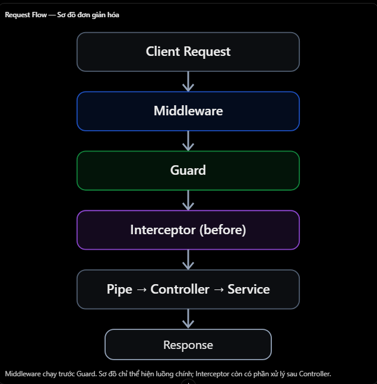

# NestJS: Guard vs Middleware

## Mục lục

- [Guard và Middleware là gì?](#1-guard-và-middleware-là-gì)
- [Thứ tự hoạt động](#2-thứ-tự-hoạt-động-trong-nestjs)
- [Ví dụ Middleware](#3-ví-dụ-middleware-thực-tế)
- [Ví dụ Guard](#4-ví-dụ-guard-thực-tế)
- [Bảng so sánh](#5-bảng-so-sánh-guard-vs-middleware)
- [Khi nào dùng?](#6-khi-nào-sử-dụng-cái-nào)
- [Các lỗi thường gặp](#7-những-lỗi-và-hiểu-nhầm-thường-gặp)
- [Câu hỏi ôn tập](#8-câu-hỏi-ôn-tập)

## 12. Guard vs Middleware

### 1. Guard và Middleware là gì?

- Cả hai đều có khả năng xử lý request trước khi request đến Controller, nhưng mục đích thiết kế của chúng khác nhau.
  
- Ví dụ hệ thống có API:

```http
GET /api/v1/admin/users
Authorization: Bearer <token>
```

- Middleware có thể ghi log request:

```text
[GET] /api/v1/admin/users
```

- Guard sẽ kiểm tra người dùng đã đăng nhập và có quyền ADMIN hay chưa.
- Nói ngắn gọn:
  - Middleware: Xử lý request.
  - Guard: Kiểm soát quyền truy cập.
- Đây là sự khác biệt về trách nhiệm chính, không có nghĩa Middleware hoàn toàn không thể từ chối request.

### 2. Thứ tự hoạt động trong NestJS

- Điểm cần nhớ là: Middleware chạy trước Guard trong NestJS request lifecycle thông thường. Một luồng rút gọn có thể hiểu là: `Middleware → Guard → Interceptor (before) → Pipe → Controller`.



### 3. Ví dụ Middleware thực tế

- Giả sử bạn muốn ghi log tất cả request đi vào hệ thống.

**logger.middleware.ts**

```ts
import { Injectable, NestMiddleware } from "@nestjs/common";
import { Request, Response, NextFunction } from "express";

@Injectable()
export class LoggerMiddleware implements NestMiddleware {
  use(req: Request, res: Response, next: NextFunction) {
    console.log(`${req.method} ${req.originalUrl}`);

    next();
  }
}
```

- Giải thích:
  - req: Thông tin request
  - res: Response object
  - next(): Chuyển quyền xử lý sang bước tiếp theo
- Đăng ký Middleware trong Module:

```ts
@Module({
  controllers: [UsersController],
})
export class UsersModule implements NestModule {
  configure(consumer: MiddlewareConsumer) {
    consumer.apply(LoggerMiddleware).forRoutes(UsersController);
  }
}
```

- Khi client gọi API:

```http
GET /users/profile
```

- Middleware ghi log:

```text
GET /users/profile
```

- Sau đó gọi next() để tiếp tục xử lý. Lưu ý: Nếu Middleware không gọi next() và cũng không kết thúc response, request có thể bị treo.

### 4. Ví dụ Guard thực tế

- Giả sử API chỉ dành cho ADMIN.

**admin.guard.ts**

```ts
import { Injectable, CanActivate, ExecutionContext } from "@nestjs/common";

@Injectable()
export class AdminGuard implements CanActivate {
  canActivate(context: ExecutionContext): boolean {
    const req = context.switchToHttp().getRequest();

    return req.user?.role === "ADMIN";
  }
}
```

- Áp dụng trong Controller:

```ts
@Controller("admin")
export class AdminController {
  @Get("dashboard")
  @UseGuards(JwtAuthGuard, AdminGuard)
  getDashboard() {
    return { message: "Welcome Admin" };
  }
}
```

- Giả sử JwtAuthGuard đã xác thực JWT và gắn user vào request. Khi đó:
  - ADMIN: Được truy cập.
  - USER: Bị từ chối với 403.
  - Không có JWT hợp lệ: JwtAuthGuard trả 401 nếu được thiết kế ném UnauthorizedException.
- Bạn có thể thấy Middleware dùng next() để chuyển tiếp, còn Guard dùng canActivate() để đưa ra quyết định truy cập.

### 5. Bảng so sánh Guard vs Middleware

| Tiêu chí | Middleware | Guard |
| --- | --- | --- |
| Mục đích chính | Xử lý request chung | Kiểm soát truy cập |
| Thứ tự | Chạy trước Guard | Chạy sau Middleware |
| Interface | `NestMiddleware` | `CanActivate` |
| Method | `use()` | `canActivate()` |
| Cho phép tiếp tục | `next()` | `true` |
| Từ chối | Gửi response hoặc báo lỗi | `false` hoặc throw exception |
| Truy cập route metadata | Không có `ExecutionContext` | Có `ExecutionContext` |
| Trường hợp điển hình | Logging, xử lý header | Authentication, Authorization |

**Sự khác biệt quan trọng: ExecutionContext**

- Guard có ExecutionContext nên biết request sắp được xử lý bởi Controller và handler nào. Ví dụ:

```tsx
const handler = context.getHandler();
const controller = context.getClass();
```

- Nhờ vậy Guard có thể kiểm tra metadata gắn với route, chẳng hạn quyền truy cập do decorator quy định. Middleware không có sẵn ExecutionContext để làm điều đó. Đây là một trong những lý do NestJS khuyến khích sử dụng Guard cho Authorization thay vì Middleware.

### 6. Khi nào sử dụng cái nào?

- Giả sử bạn đang xây dựng Backend NestJS + Prisma + PostgreSQL.
| Yêu cầu | Nên dùng |
| --- | --- |
| Ghi log HTTP request | Middleware |
| Đọc một header chung | Middleware |
| Gắn request ID | Middleware |
| Xác thực JWT cho protected route | Guard |
| Kiểm tra quyền ADMIN | Guard |
| Kiểm tra quyền truy cập tài nguyên | Guard hoặc Service tùy nghiệp vụ |
- Một ví dụ gần với hệ thống quản lý gia đình:

```http
DELETE /families/123/members/456
```

- Middleware có thể ghi log request. JwtAuthGuard kiểm tra danh tính. Guard phân quyền có thể kiểm tra người dùng có quyền quản lý thành viên trong gia đình 123 hay không, dựa trên dữ liệu từ Prisma. Với các quy tắc nghiệp vụ phức tạp, Service vẫn cần thực thi các điều kiện phù hợp, đặc biệt khi thao tác dữ liệu có thể được gọi từ nhiều nơi.

### 7. Những lỗi và hiểu nhầm thường gặp

1. Middleware không thể dùng để Authentication
   - Sai. Middleware có thể xác thực, nhưng Guard thường phù hợp hơn khi cần bảo vệ route và đọc metadata.
2. Guard chạy trước Middleware
   - Sai trong request lifecycle NestJS thông thường.
3. Guard trả false nghĩa là lỗi 401
   - Sai. Mặc định là 403.
4. Middleware và Guard có thể thay thế nhau hoàn toàn
   - Sai. Chúng có trách nhiệm và API khác nhau.
5. Frontend ẩn chức năng là đủ bảo mật
   - Sai. Backend vẫn phải kiểm tra quyền.

### 8. Câu hỏi ôn tập

1. Sự khác nhau giữa Middleware và Guard trong NestJS là gì?
   - Middleware xử lý request chung, còn Guard quyết định request có được phép truy cập route handler hay không.
2. Cái nào chạy trước, Middleware hay Guard?
   - Middleware chạy trước Guard trong request lifecycle NestJS thông thường.
3. Tại sao nên ưu tiên Guard để Authorization?
   - Bởi vì Guard có thể truy cập đến ExecutionContext và route metadata
4. Mục đích của `next()` trong Middleware là gì?
   - Nó chuyển quyền xử lý tới bước tiếp theo trong chuỗi xử lý request.
5. Liệu Middleware có thể thực hiện Authentication không?
   - Có thể, nhưng Guard phù hợp hơn với Authentication và Authorization ở route-level.

## Thực hành

Xem [Guard vs Middleware Example](../Example/guard-middleware-example.ts). File này có middleware gắn `requestId` và ghi log trước; tiếp theo `ApiKeyGuard` kiểm tra header `x-api-key` bằng `ExecutionContext`. Request thiếu key bị Guard chặn sau khi middleware đã chạy, còn request hợp lệ mới đến Controller.
