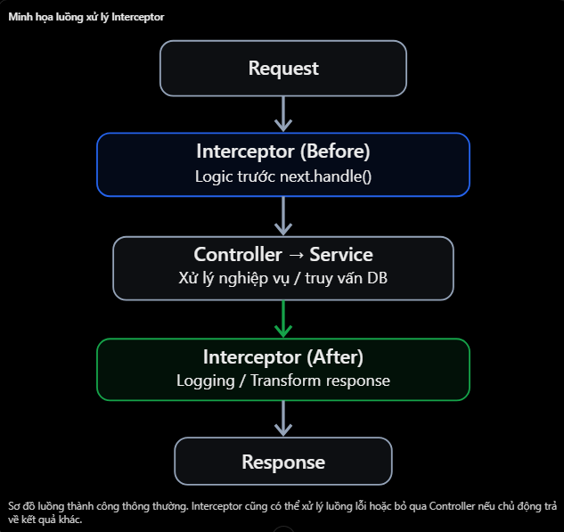
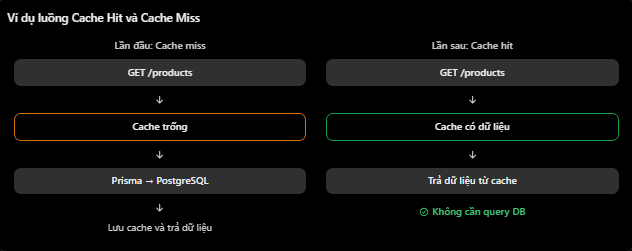

# NestJS: Interceptor — Logging, Transform Response, Caching

## Mục lục

- [Interceptor là gì?](#1-interceptor-trong-nestjs-là-gì)
- [Interceptor hoạt động thế nào?](#2-interceptor-hoạt-động-như-thế-nào)
- [Logging Interceptor](#3-ứng-dụng-thứ-nhất--logging-interceptor)
- [Transform Response](#4-ứng-dụng-thứ-hai--transform-response)
- [Caching Interceptor](#5-ứng-dụng-thứ-ba--caching-interceptor)
- [So sánh Middleware, Guard, Interceptor](#6-so-sánh-nhanh-middleware-guard-và-interceptor)
- [Các lỗi thường gặp](#7-các-lỗi-và-hiểu-nhầm-thường-gặp)
- [Câu hỏi ôn tập](#8-câu-hỏi-ôn-tập)

## 13. Interceptor: Logging, Transform Response, Caching

### 1. Interceptor trong NestJS là gì?

- Interceptor là một thành phần trong NestJS có khả năng thực thi logic trước hoặc sau khi Controller xử lý request.
- Interceptor còn có thể thay đổi dữ liệu trả về hoặc bỏ qua việc gọi Controller trong một số tình huống, chẳng hạn khi kết quả đã có trong cache.
- Ví dụ, client gọi:

```http
GET /api/v1/users/1
```

- Controller trả về

```json
{
  "id": 1,
  "name": "Nhat"
}
```

- Interceptor có thể biến đổi response thành:

```json
{
  "data": {
    "id": 1,
    "name": "Nhat"
  }
}
```

- Mà không cần thay đổi logic trong Controller hoặc Service. Đây chính là một ứng dụng của Interceptor: Transform Response.

### 2. Interceptor hoạt động như thế nào?



- Trong NestJS, Interceptor thường sử dụng ba thành phần:
| Thành phần | Vai trò |
| --- | --- |
| `NestInterceptor` | Interface định nghĩa Interceptor. |
| `intercept()` | Phương thức xử lý của Interceptor. |
| `next.handle()` | Trả về Observable đại diện cho quá trình thực thi handler tiếp theo. |
- Ví dụ cơ bản:

```ts
import {
  Injectable,
  NestInterceptor,
  ExecutionContext,
  CallHandler,
} from "@nestjs/common";
import { Observable } from "rxjs";

@Injectable()
export class ExampleInterceptor implements NestInterceptor {
  intercept(context: ExecutionContext, next: CallHandler): Observable<any> {
    console.log("Before Controller");

    return next.handle();
  }
}
```

- Ở đây:
  - ExecutionContext: Cho phép truy cập thông tin request và route handler.
  - CallHandler: Đại diện cho bước xử lý tiếp theo.
  - next.handle(): Trả về một Observable để Interceptor có thể tiếp tục, quan sát hoặc biến đổi kết quả.
- Kiến thức bổ sung: NestJS sử dụng RxJS Observable trong Interceptor. Bạn chỉ cần hiểu pipe(), tap() và map() ở mức cơ bản cho Item này.

### 3. Ứng dụng thứ nhất — Logging Interceptor

- Mục đích: Ghi lại thông tin request và thời gian xử lý API.
- Ví dụ bạn muốn biết API /users mất bao nhiêu thời gian để xử lý.

**logging.interceptor.ts**

```ts
import {
  Injectable,
  NestInterceptor,
  ExecutionContext,
  CallHandler,
  Logger,
} from "@nestjs/common";
import { Observable } from "rxjs";
import { finalize } from "rxjs/operators";

@Injectable()
export class LoggingInterceptor implements NestInterceptor {
  private readonly logger = new Logger(LoggingInterceptor.name);

  intercept(context: ExecutionContext, next: CallHandler): Observable<any> {
    const req = context.switchToHttp().getRequest();
    const start = Date.now();

    this.logger.log(`Request: ${req.method} ${req.url}`);

    return next.handle().pipe(
      finalize(() => {
        const duration = Date.now() - start;
        this.logger.log(`Finished in ${duration}ms`);
      }),
    );
  }
}
```

- Giả sử Controller mất 150ms để xử lý:

```text
Request: GET /users
Finished in 150ms
```

- Giải thích:
  - Date.now(): Lấy thời điểm bắt đầu.
  - next.handle(): Tiếp tục luồng thực thi Controller.
  - pipe(): Cho phép gắn các RxJS operator.
  - finalize(): Chạy khi Observable kết thúc, kể cả khi có lỗi.
- Ở đây mình sử dụng finalize() để ghi nhận thời gian khi luồng kết thúc.
- Bạn cũng có thể thấy tap() trong ví dụ logging. tap() thường dùng cho side effects như ghi log mà không chủ động thay đổi giá trị response.

**Logging Interceptor khác Logging Middleware như thế nào?**
| Middleware | Interceptor |
| --- | --- |
| Ghi log ở đầu request | Có thể ghi log trước và sau handler |
| Dùng `req`, `res`, `next()` | Dùng `ExecutionContext`, `next.handle()` |
| Phù hợp logging HTTP chung | Phù hợp đo thời gian và quan sát kết quả xử lý |

- Cả hai đều có thể dùng để logging. Không nhất thiết phải sử dụng Interceptor cho mọi trường hợp.

### 4. Ứng dụng thứ hai — Transform Response

- Đây là tính năng thường gặp khi xây dựng REST API. Giả sử API có cấu trúc response không thống nhất:

```json
{
  "id": 1,
  "name": "Nhat"
}
```

- Bạn muốn chuẩn hóa thành:

```json
{
  "data": {
    "id": 1,
    "name": "Nhat"
  }
}
```

- Thay vì sửa từng Controller, bạn có thể sử dụng Interceptor.

**transform.interceptor.ts**

```ts
import {
  Injectable,
  NestInterceptor,
  ExecutionContext,
  CallHandler,
} from "@nestjs/common";
import { Observable } from "rxjs";
import { map } from "rxjs/operators";

@Injectable()
export class TransformInterceptor implements NestInterceptor {
  intercept(context: ExecutionContext, next: CallHandler): Observable<any> {
    return next.handle().pipe(
      map((data) => ({
        data,
      })),
    );
  }
}
```

- Áp dụng vào Controller:

```ts
@Controller("users")
export class UsersController {
  @Get()
  @UseInterceptors(TransformInterceptor)
  findAll() {
    return [
      { id: 1, name: "Nhat" },
      { id: 2, name: "Minh" },
    ];
  }
}
```

- Response cuối cùng:

```json
{
  "data": [
    { "id": 1, "name": "Nhat" },
    { "id": 2, "name": "Minh" }
  ]
}
```

- Điểm cần nhớ:
  - map() biến đổi dữ liệu trả về từ Observable.
  - Controller vẫn tập trung vào nghiệp vụ.
  - Interceptor chịu trách nhiệm chuẩn hóa response.
- Lưu ý: Không nên áp dụng cùng một kiểu bọc response cho mọi API một cách máy móc, ví dụ API trả 204 No Content, file streaming hoặc response đặc biệt. Việc sử dụng @Res() trực tiếp cũng có thể làm cơ chế response mapping thông thường không hoạt động như mong đợi.

### 5. Ứng dụng thứ ba — Caching Interceptor

- Caching là kỹ thuật lưu tạm dữ liệu để những request sau có thể sử dụng lại mà không cần truy vấn database mỗi lần.
- Giả sử hệ thống bán hàng có API:

```http
GET /products
```

- API này truy vấn PostgreSQL thông qua Prisma.
  

**Cách sử dụng CacheInterceptor**

```bash
npm install @nestjs/cache-manager cache-manager
```

- Đăng ký trong Module:

```ts
import { Module } from "@nestjs/common";
import { CacheModule } from "@nestjs/cache-manager";

@Module({
  imports: [
    CacheModule.register({
      ttl: 10000, // 10 giây
    }),
  ],
  controllers: [ProductsController],
})
export class ProductsModule {}
```

- Áp dụng trong Controller

```tsx
import { CacheInterceptor } from "@nestjs/cache-manager";

@Controller("products")
export class ProductsController {
  constructor(private readonly prisma: PrismaService) {}

  @Get()
  @UseInterceptors(CacheInterceptor)
  async findAll() {
    return this.prisma.product.findMany();
  }
}
```

- Ví dụ giả định PrismaService đã được đăng ký và export phù hợp để Controller có thể inject.
- Kết quả:
  - Request đầu tiên: Cache chưa có dữ liệu, gọi Prisma để query PostgreSQL.
  - Request tiếp theo: Nếu cache còn hiệu lực, trả về kết quả đã lưu.
  - Khi cache hết hạn: Request tiếp theo lại thực hiện query và cập nhật cache.
- `ttl` là _Time To Live_ — thời gian dữ liệu được lưu trong cache. Với API caching hiện tại, giá trị cấu hình ở trên tính bằng mili giây.
- Theo tài liệu NestJS hiện tại, CacheInterceptor mặc định cache các endpoint GET, và bộ nhớ cache mặc định là in-memory.

**Những lưu ý quan trọng về caching:**

- Không nên tùy tiện cache API chứa dữ liệu cá nhân như `/users/profile`; cache key mặc định có thể không phân biệt người dùng.
- Khi dữ liệu PostgreSQL được cập nhật, cache có thể vẫn chứa dữ liệu cũ đến khi bị xóa hoặc hết hạn.
- Không nên cache API thay đổi nghiệp vụ như tạo thanh toán hoặc xóa thành viên.

- Kiến thức bổ sung: Redis thường được sử dụng làm cache store khi hệ thống có nhiều instance backend

### 6. So sánh nhanh Middleware, Guard và Interceptor

| Thành phần | Nhiệm vụ chính |
| --- | --- |
| Middleware | Xử lý request chung |
| Guard | Quyết định quyền truy cập |
| Interceptor | Xử lý trước/sau handler, biến đổi response hoặc cache |

- Ví dụ đối với API GET /products:
- Middleware có thể ghi log request, Guard kiểm tra quyền nếu route yêu cầu xác thực, còn Interceptor có thể ghi thời gian thực thi hoặc trả kết quả cache.

### 7. Các lỗi và hiểu nhầm thường gặp

| Hiểu nhầm | Kiến thức đúng |
| --- | --- |
| Interceptor chỉ chạy trước Controller | Có thể xử lý cả trước và sau. |
| `next.handle()` giống `next()` của Middleware hoàn toàn | Khác nhau: `next.handle()` cung cấp Observable để xử lý luồng. |
| `tap()` và `map()` giống nhau | `tap()` thường dùng cho side effect, `map()` biến đổi giá trị. |
| Cache luôn trả dữ liệu mới nhất | Cache có thể chứa dữ liệu cũ. |
| CacheInterceptor luôn gọi Controller | Cache hit có thể trả kết quả mà không cần gọi Controller. |

### 8. Câu hỏi ôn tập

1. Interceptor trong NestJs là gì?
   - Interceptor có thể thực thi logic trước hoặc sau route handler, transform response hoặc implement caching.
2. Mục đích của next.handle() là gì?
   - Nó trả về Observable của bước xử lý tiếp theo, cho phép quan sát hoặc biến đổi kết quả.
3. Sự khác nhau giữa Guard và Interceptors là gì?
   - Guard kiểm soát quyền truy cập route, còn Interceptor có thể quan sát luồng và sửa response.
4. Làm thế nào để chúng ta có thể thay đổi phản hồi API trong NestJS
   - Dùng Interceptor với RxJS operator `map()` để chuyển đổi response.
5. Làm thế nào để có thể ghi nhận thời gian thực thi của API?
   - Dùng Interceptor để ghi thời điểm bắt đầu và tính thời lượng sau khi handler hoàn tất.

## Thực hành

Xem [Logging–TransformResponse–Caching Example](../Example/logging-transformresponse-caching-example.ts). File này kết hợp `LoggingInterceptor`, `TransformResponseInterceptor` và `CacheInterceptor` trên `GET /products`. Gọi endpoint hai lần trong TTL để thấy controller chỉ chạy lần đầu, nhưng response ở cả hai lần vẫn được bọc trong `data`.
