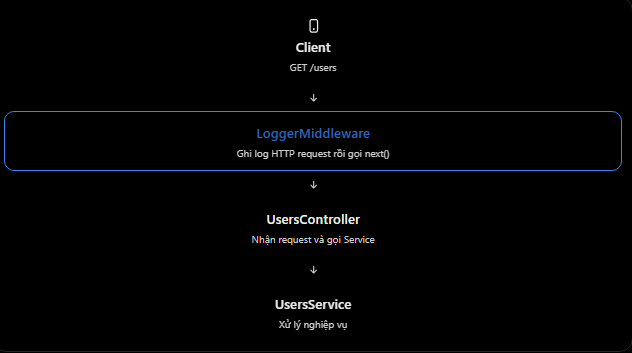

# NestJS: Middleware

## Mục lục

- [Middleware là gì?](#1-middleware-là-gì-trong-nestjs)
- [Cách viết middleware](#2-cách-viết-middleware-trong-nestjs)
- [next()](#3-next-là-gì-và-tại-sao-quan-trọng)
- [Đăng ký vào Module](#4-đăng-ký-middleware-vào-module)
- [Ví dụ logging](#5-ví-dụ-thực-tế--logging-middleware)
- [Phạm vi áp dụng](#6-middleware-áp-dụng-cho-những-route-nào)
- [So sánh ExpressJS](#7-so-sánh-middleware-trong-expressjs-và-nestjs)
- [Các lỗi thường gặp](#8-những-lỗi-và-hiểu-nhầm-thường-gặp)
- [Câu hỏi ôn tập](#9-kiến-thức-ôn-tập)

## 10. Middleware

### 1. Middleware là gì trong NestJS?

- Middleware là một function hoặc class được thực thi trong quá trình xử lý HTTP request, trước khi request đến Controller method. Middleware có thể:
  - Ghi log thông tin request.
  - Đọc hoặc chỉnh sửa req và res.
  - Kiểm tra thông tin cơ bản từ request.
  - Kết thúc request hoặc chuyển quyền xử lý sang middleware tiếp theo.
- Ví dụ, client gọi: `GET /users`
  
- Sơ đồ trên được giản lược để tập trung vào Middleware. Thực tế NestJS còn có Guard, Interceptor và Pipe trong request lifecycle

### 2. Cách viết Middleware trong NestJS

- NestJS hỗ trợ hai cách viết phổ biến.

**Cách 1 - Class-based Middleware**

```ts
import { Injectable, NestMiddleware } from "@nestjs/common";

import { Request, Response, NextFunction } from "express";

@Injectable()
export class LoggerMiddleware implements NestMiddleware {
  use(req: Request, res: Response, next: NextFunction) {
    console.log(`${req.method} ${req.path}`);

    next();
  }
}
```

- Giải thích các thành phần:

| Thành phần | Chức năng |
| --- | --- |
| `@Injectable()` | Cho phép class tham gia cơ chế DI. |
| `NestMiddleware` | Interface mô tả hợp đồng của class middleware. |
| `use()` | Method xử lý request trong middleware. |
| `req` | Thông tin request từ client. |
| `res` | Đối tượng HTTP response. |
| `next()` | Chuyển quyền xử lý sang thành phần tiếp theo. |
- Ví dụ client gửi GET /users, Middleware sẽ ghi:

```text
GET /users
```

- Sau đó next() cho phép request tiếp tục được xử lý.

**Cách 2 - Functional Middleware**

- Nếu không cần inject Service, bạn có thể viết một function:

```ts
import { Request, Response, NextFunction } from "express";

export function logger(req: Request, res: Response, next: NextFunction) {
  console.log(`${req.method} ${req.path}`);
  next();
}
```

- Cả hai cách đều hợp lệ. Class-based Middleware thuận tiện khi cần Dependency Injection; functional middleware phù hợp với các xử lý đơn giản.
- Lưu ý: Ví dụ sử dụng Express adapter mặc định của NestJS. Nếu sử dụng Fastify, cách làm việc với các đối tượng request/response có thể khác.

### 3. next() là gì và tại sao quan trọng?

- Bạn đã gặp next() ở ExpressJS. Trong NestJS, ý nghĩa cơ bản vẫn giống nhau.

```ts
use(req: Request, res: Response, next: NextFunction) {
  console.log('Middleware executed');

  next();
}
```

- Sau khi thực hiện logic, next() chuyển quyền xử lý sang bước tiếp theo. Nhưng giả sử bạn quên next():

```ts
use(req: Request, res: Response, next: NextFunction) {
  console.log('Middleware executed');

  // Không gọi next()
}
```

- Middleware không chuyển quyền xử lý đi tiếp. Nếu Middleware cũng không tự kết thúc response thì request có thể bị treo, khiến client tiếp tục chờ phản hồi. Ngược lại, Middleware có thể chủ động gửi response và kết thúc request. Khi đó, nó không cần gọi next().

### 4. Đăng ký Middleware vào Module

- Khác với Service, chúng ta thường không đăng ký Middleware bằng cách đơn giản đưa nó vào providers rồi mong nó tự chạy. Với class-based Middleware, NestJS cung cấp NestModule và MiddlewareConsumer để cấu hình. Ví dụ

**users.module.ts**

```ts
import { Module, NestModule, MiddlewareConsumer } from "@nestjs/common";

import { UsersController } from "./users.controller";
import { UsersService } from "./users.service";
import { LoggerMiddleware } from "./logger.middleware";

@Module({
  controllers: [UsersController],
  providers: [UsersService],
})
export class UsersModule implements NestModule {
  configure(consumer: MiddlewareConsumer) {
    consumer.apply(LoggerMiddleware).forRoutes("users");
  }
}
```

- Có ba thành phần đáng chú ý:
  - implements NestModule cho biết Module triển khai interface hỗ trợ cấu hình Middleware.
  - configure() là method để khai báo Middleware sẽ được áp dụng như thế nào.
  - consumer.apply().forRoutes() cho biết sử dụng Middleware nào và áp dụng cho những route nào.
- Ở ví dụ trên:

```ts
consumer.apply(LoggerMiddleware).forRoutes("users");
```

- LoggerMiddleware được áp dụng cho các route phù hợp với đường dẫn users. NestJS cũng hỗ trợ truyền Controller hoặc mô tả cụ thể HTTP method vào forRoutes().

### 5. Ví dụ thực tế — Logging Middleware

- Giả sử hệ thống Family Care cần ghi nhận mỗi khi Client gửi HTTP request đến API quản lý gia đình.Chúng ta tạo: `logger.middleware.ts`

```ts
import { Injectable, NestMiddleware, Logger } from "@nestjs/common";

import { Request, Response, NextFunction } from "express";

@Injectable()
export class LoggerMiddleware implements NestMiddleware {
  private readonly logger = new Logger("HTTP");

  use(req: Request, res: Response, next: NextFunction) {
    this.logger.log(`${req.method} ${req.path}`);

    next();
  }
}
```

- Trong FamiliesModule:

```ts
@Module({
  controllers: [FamiliesController],
  providers: [FamiliesService],
})
export class FamiliesModule implements NestModule {
  configure(consumer: MiddlewareConsumer) {
    consumer.apply(LoggerMiddleware).forRoutes(FamiliesController);
  }
}
```

- Khi Client gọi:

```http
GET /families
```

- Middleware ghi log, sau đó request tiếp tục đến Controller và Service. Nếu cần ghi log các request thất bại, thời gian xử lý hay status code sau khi hoàn tất response thì nên cân nhắc thêm các kỹ thuật phù hợp; không nên ghi thông tin nhạy cảm như JWT hoặc password vào log.

### 6. Middleware áp dụng cho những route nào?

- Bạn có thể kiểm soát phạm vi hoạt động của Middleware.

**Áp dụng cho một HTTP method cụ thể**

```ts
consumer.apply(LoggerMiddleware).forRoutes({
  path: "users",
  method: RequestMethod.GET,
});
```

- Middleware chỉ áp dụng cho route GET /users tương ứng.

**Loại trừ một route**

```tsx
consumer
  .apply(LoggerMiddleware)
  .exclude({
    path: "users",
    method: RequestMethod.GET,
  })
  .forRoutes(UsersController);
```

- Cấu hình này loại trừ GET /users khỏi các route được áp dụng Middleware trong UsersController.

**Global Middleware**

- Có thể đăng ký functional middleware tại main.ts:

```tsx
const app = await NestFactory.create(AppModule);

app.use(logger);

await app.listen(3000);
```

- app.use() áp dụng Middleware ở phạm vi ứng dụng. Tuy nhiên, Middleware đăng ký theo cách này không sử dụng trực tiếp DI container như class middleware được cấu hình qua Module.

### 7. So sánh Middleware trong ExpressJS và NestJS

| ExpressJS | NestJS |
| --- | --- |
| `app.use()` hoặc `router.use()` | `app.use()` hoặc `MiddlewareConsumer` |
| Function `(req, res, next)` | Function hoặc class `NestMiddleware` |
| Có `next()` | Có `next()` |
| Tự tổ chức middleware | Có thể tổ chức theo Module |
| Dependency thường truyền thủ công | Class middleware hỗ trợ DI |

- Về bản chất, cơ chế tiếp tục xử lý request rất giống nhau. Điểm khác biệt đáng nhớ là NestJS tích hợp Middleware vào kiến trúc Module và Dependency Injection.

### 8. Những lỗi và hiểu nhầm thường gặp

1. Nghĩ có @Injectable() thì Middleware tự chạy.
   - Không đúng. Class Middleware còn cần được đăng ký áp dụng vào route thông qua cấu hình phù hợp.
2. Quên gọi next().
   - Nếu không gọi next() và cũng không kết thúc response, request có thể bị treo.
3. Nghĩ Middleware chỉ dùng cho Authentication.
   - Không đúng. Middleware còn dùng cho logging, đọc thông tin request, gắn metadata hoặc những công việc xử lý chung khác.
4. Nghĩ Middleware chạy sau Controller.
   - Không đúng. Middleware được thực thi trước route handler trong request lifecycle.
5. Đưa toàn bộ business logic vào Middleware.
   - Không nên. Middleware phù hợp với những tác vụ xử lý request mang tính chung. Nghiệp vụ như tạo đơn hàng hay tính tổng tiền vẫn nên đặt trong Service.

### 9. Kiến thức ôn tập

1. Middleware trong NestJs là gì?
   - Middleware là function hoặc class chạy trước route handler; nó có thể đọc/chỉnh sửa request, response hoặc chuyển xử lý sang bước tiếp theo.
2. Mục đích của next() trong Middleware là gì?
   - `next()` truyền quyền kiểm soát cho middleware hoặc handler tiếp theo. Không gọi nó và cũng không trả response có thể khiến request treo.
3. Làm thế nào để đăng kí Middleware trong NestJS?
   - Có thể triển khai `NestModule` và dùng `MiddlewareConsumer` trong method `configure()` để áp dụng middleware cho route cụ thể.
4. Sự khác nhau giữa class-based và function Middleware là gì?
   - Class-based middleware hỗ trợ DI; functional middleware đơn giản và phù hợp khi không cần dependency.
5. Những trường hợp thường xuyên sử dụng Middleware là gì?
   - Các trường hợp phổ biến gồm logging, gắn request metadata và xử lý chung cho request.

## Thực hành

Xem [Middleware Example](../Example/middleware-example.ts). File này có class middleware inject `RequestLogService`, gắn `x-request-id` vào response, gọi `next()` và được áp dụng cho `UsersController` qua `MiddlewareConsumer` trong `AppModule`.
