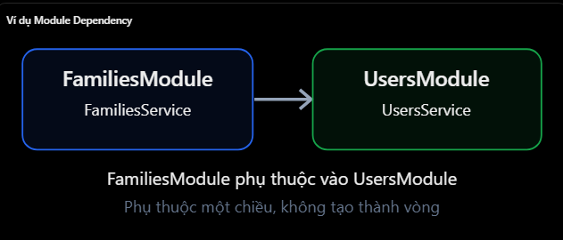
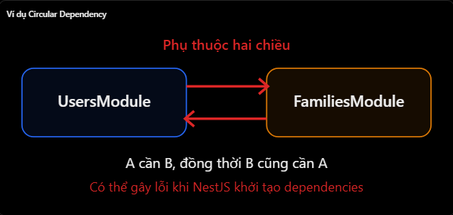
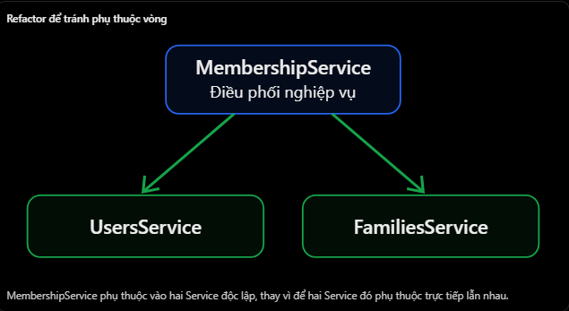

# NestJS: Module Dependency và Circular Dependency

## Mục lục

- [Module Dependency là gì?](#1-module-dependency-là-gì)
- [Circular Dependency là gì?](#2-circular-dependency-là-gì)
- [Xử lý bằng forwardRef()](#3-cách-xử-lý-circular-dependency-với-forwardref)
- [Có nên dùng forwardRef()?](#4-có-nên-sử-dụng-forwardref-thường-xuyên-không)
- [Các hiểu nhầm thường gặp](#5-những-lỗi-và-hiểu-nhầm-thường-gặp)
- [Câu hỏi ôn tập](#6-câu-hỏi-ôn-tập)

## 19. Module Dependency và Circular Dependency cơ bản

### 1. Module Dependency là gì?

- Module Dependency là mối quan hệ phụ thuộc giữa các Module trong NestJS, xảy ra khi một Module cần sử dụng provider được cung cấp bởi Module khác.
- Giả sử hệ thống có:
  - UsersModule: Quản lý người dùng.
  - FamiliesModule: Quản lý gia đình.
  - AuthModule: Xử lý xác thực.
- Khi FamiliesService cần lấy thông tin user, nó có thể sử dụng UsersService thay vì tự viết lại logic tìm user.
  

#### 1. Ví dụ code

users.module.ts

```ts
@Module({
  providers: [UsersService],
  exports: [UsersService],
})
export class UsersModule {}
```

families.module.ts

```ts
@Module({
  imports: [UsersModule],
  providers: [FamiliesService],
})
export class FamiliesModule {}
```

families.service.ts

```ts
@Injectable()
export class FamiliesService {
  constructor(private readonly usersService: UsersService) {}

  async getFamilyManager(userId: number) {
    return this.usersService.findOne(userId);
  }
}
```

- Giả sử UsersService đã có phương thức findOne().

| Từ khóa | Vai trò |
| --- | --- |
| `imports` | Import Module khác để sử dụng provider mà Module đó export. |
| `exports` | Cho phép Module khác sử dụng provider được export. |
- Điểm quan trọng: Chỉ import UsersModule chưa đủ nếu UsersService không được export và không có cơ chế cung cấp provider khác phù hợp.
- Trong NestJS, provider được đóng gói trong phạm vi Module theo mặc định.

### 2. Circular Dependency là gì?

- Circular Dependency (phụ thuộc vòng) xảy ra khi hai hoặc nhiều Module hoặc Provider phụ thuộc ngược lại lẫn nhau, tạo thành một vòng khép kín.
- Ví dụ:
  - UsersModule cần FamiliesModule.
  - FamiliesModule lại cần UsersModule.
    
- Ví dụ code:

```ts
// users.module.ts
@Module({
  imports: [FamiliesModule],
})
export class UsersModule {}

// families.module.ts
@Module({
  imports: [UsersModule],
})
export class FamiliesModule {}
```

- Đây là một trường hợp Circular Dependency ở cấp Module.
- NestJS có thể gặp khó khăn khi phân giải mối quan hệ này, dẫn đến lỗi khi khởi tạo ứng dụng, chẳng hạn:

```text
Nest cannot create the UsersModule instance.
The module at index [0] of the "imports" array
is undefined.
```

- Tuy nhiên, thông báo tương tự cũng có thể do import sai đường dẫn hoặc một Module thực sự là undefined, nên không thể chỉ nhìn một thông báo mà kết luận chắc chắn là circular dependency.

#### Circular Dependency không chỉ xảy ra ở Module

- Nó còn xảy ra ở cấp Service/Provider. Ví dụ

```ts
@Injectable()
export class UsersService {
  constructor(private readonly familiesService: FamiliesService) {}
}
```

- Đồng thời:

```ts
@Injectable()
export class FamiliesService {
  constructor(private readonly usersService: UsersService) {}
}
```

- Hai Service phụ thuộc trực tiếp vào nhau, tạo thành circular dependency ở cấp Provider.
- Đây là điểm quan trọng: Circular Dependency có thể xuất hiện ở cả Module và Provider.

### 3. Cách xử lý Circular Dependency với forwardRef()

- NestJS cung cấp hàm forwardRef() để hỗ trợ xử lý những trường hợp phụ thuộc vòng không thể tránh khỏi.

#### Trường hợp 1 - Circular Dependency giữa Modules

users.module.ts

```ts
import { Module, forwardRef } from "@nestjs/common";

@Module({
  imports: [forwardRef(() => FamiliesModule)],
  providers: [UsersService],
  exports: [UsersService],
})
export class UsersModule {}
```

families.module.ts

```ts
import { Module, forwardRef } from "@nestjs/common";

@Module({
  imports: [forwardRef(() => UsersModule)],
  providers: [FamiliesService],
  exports: [FamiliesService],
})
export class FamiliesModule {}
```

- Nhờ forwardRef(), NestJS có thể tham chiếu đến các Module theo cách giúp phân giải dependency vòng.
- Lưu ý: Hai Module trong ví dụ cần được cấu hình forwardRef() ở cả hai phía.

#### Trường hợp 2 - Circular Dependency giữa Services

- Nếu UsersService và FamiliesService cũng inject lẫn nhau, cần xử lý thêm ở cấp Provider.
  users.service.ts

```tsx
import { Injectable, Inject, forwardRef } from "@nestjs/common";

@Injectable()
export class UsersService {
  constructor(
    @Inject(forwardRef(() => FamiliesService))
    private readonly familiesService: FamiliesService,
  ) {}
}
```

families.service.ts

```tsx
@Injectable()
export class FamiliesService {
  constructor(
    @Inject(forwardRef(() => UsersService))
    private readonly usersService: UsersService,
  ) {}
}
```

- Các Service được giả định đã import và đăng ký trong Module tương ứng. Ở đây:
  - forwardRef() ở imports xử lý vòng phụ thuộc giữa Modules.
  - @Inject(forwardRef(...)) xử lý vòng phụ thuộc giữa Providers.
- NestJS hỗ trợ cách làm này, nhưng thứ tự khởi tạo các provider trong vòng phụ thuộc không được bảo đảm.

### 4. Có nên sử dụng forwardRef() thường xuyên không?

- Không nên. forwardRef() giúp giải quyết vấn đề dependency, nhưng không loại bỏ bản chất phụ thuộc vòng trong thiết kế.
- Nếu hệ thống có quá nhiều Circular Dependencies, code có thể trở nên:
  - Khó bảo trì và debug.
  - Các Service phụ thuộc chặt chẽ lẫn nhau.
  - Khó viết unit test.
  - Khó tách riêng các chức năng.

#### Cách tốt hơn: Refactor để loại bỏ vòng phụ thuộc

- Giả sử UsersService và FamiliesService đang cần gọi lẫn nhau để thực hiện chức năng thêm thành viên vào gia đình.
- Thay vì để chúng phụ thuộc hai chiều, bạn có thể tạo một Service điều phối như MembershipService.
  
- Ví dụ:

```tsx
@Injectable()
export class MembershipService {
  constructor(
    private readonly usersService: UsersService,
    private readonly familiesService: FamiliesService,
  ) {}

  async addMember(userId: number, familyId: number) {
    // Kiểm tra user và family
    // Sau đó thực hiện nghiệp vụ thêm thành viên
  }
}
```

- Khi đó MembershipModule có thể import UsersModule và FamiliesModule, còn hai Module kia không cần import ngược nhau chỉ để phục vụ nghiệp vụ thêm thành viên.
- Đây là cách thiết kế thường dễ bảo trì hơn.
- Cách ghi nhớ là: forwardRef() là giải pháp kỹ thuật khi không thể tránh dependency vòng. Tuy nhiên, nên ưu tiên cải thiện kiến trúc để các Module có trách nhiệm rõ ràng và ít phụ thuộc lẫn nhau.

### 5. Những lỗi và hiểu nhầm thường gặp

| Hiểu nhầm | Giải thích đúng |
| --- | --- |
| Module import Module khác là circular dependency | Không, phụ thuộc một chiều là bình thường. |
| Chỉ khai báo provider trong `providers` là Module khác dùng được | Cần export provider và import Module phù hợp. |
| Circular dependency chỉ xảy ra giữa Module | Có thể xảy ra giữa Provider. |
| `forwardRef()` loại bỏ hoàn toàn dependency vòng | Không, nó hỗ trợ NestJS phân giải dependency. |
| `forwardRef()` luôn là giải pháp tốt nhất | Nên xem xét refactor trước. |
| Module nào cũng nên import lẫn nhau | Dễ tạo phụ thuộc chặt chẽ, khó bảo trì. |

### 6. Câu hỏi ôn tập

1. Module Dependency là gì
   - Module Dependency xảy ra khi một module cần provider được module khác cung cấp.
2. Circular Dependency là gì?
   - Circular Dependency xảy ra khi hai hoặc nhiều module/provider phụ thuộc lẫn nhau trong một chu kỳ.
3. Mục đích của imports và exports là gì?
   - `imports` cho module truy cập provider được export từ module khác; `exports` công khai provider đó.
4. Làm thế nào để bạn giải quyết Circular Dependencies trong NestJS
   - Có thể dùng `forwardRef()` khi cần thiết, nhưng nên ưu tiên refactor để loại bỏ vòng phụ thuộc.

## Thực hành

Xem [Module Dependency–Circular Dependency Example](../Example/moduledependency-circulardependency-example.ts). File này có `UsersModule` và `FamiliesModule` import nhau bằng `forwardRef()`, đồng thời hai service inject lẫn nhau qua token + `@Inject(forwardRef(...))`. Endpoint `/users/1/family` cho thấy vòng dependency đã được NestJS phân giải; phần comment cũng chỉ ra hướng refactor phù hợp hơn cho dự án thật.
