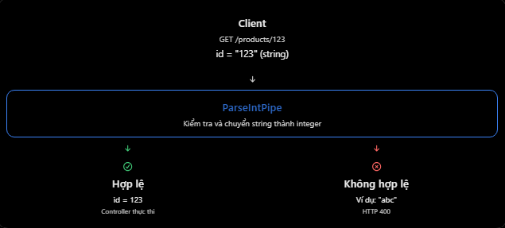

# NestJS: Pipe — ValidationPipe, ParseIntPipe, transform

## Mục lục

- [Pipe là gì?](#1-pipe-là-gì-trong-nestjs)
- [ValidationPipe](#2-validationpipe-là-gì)
- [Kích hoạt ValidationPipe](#3-cách-kích-hoạt-validationpipe)
- [ParseIntPipe](#4-parseintpipe-là-gì)
- [transform: true](#5-transform-true-hoạt-động-thế-nào)
- [Ví dụ Products API](#6-ví-dụ-thực-tế-với-nestjs--prisma--postgresql)
- [Phạm vi áp dụng Pipe](#7-có-thể-áp-dụng-pipe-ở-đâu)
- [Các lỗi thường gặp](#8-những-lỗi-và-hiểu-nhầm-thường-gặp)
- [Câu hỏi ôn tập](#9-câu-hỏi-ôn-tập)

## 9. Pipe — ValidationPipe, ParseIntPipe, transform

### 1. Pipe là gì trong NestJS?

- Trong NestJS, Pipe là thành phần được sử dụng để kiểm tra (Validation) hoặc chuyển đổi (Transformation) dữ liệu đầu vào trước khi dữ liệu được truyền đến Controller method. Pipe có hai nhiệm vụ chính:
  - Validation: Kiểm tra dữ liệu có hợp lệ không. Nếu không hợp lệ, Pipe có thể ném Exception.
  - Transformation: Chuyển đổi dữ liệu đầu vào sang định dạng mong muốn, ví dụ string thành number.
- Ví dụ Client gửi request:

```http
GET /products/123
```

- Mặc định, 123 trong URL được nhận dưới dạng string "123". Nếu Backend cần ID ở dạng number, chúng ta có thể dùng Pipe để chuyển đổi.
  
- Điểm quan trọng: Nếu Pipe ném Exception, Controller method sẽ không được thực thi.

### 2. ValidationPipe là gì?

- ValidationPipe là Pipe có sẵn trong NestJS, dùng để kiểm tra dữ liệu đầu vào dựa trên các validation decorator đã khai báo trong DTO. Ví dụ

```ts
import { IsEmail, MinLength, IsString } from "class-validator";

export class RegisterDto {
  @IsEmail()
  email: string;

  @IsString()
  @MinLength(8)
  password: string;
}
```

- Trong Controller

```ts
@Post('register')
register(@Body() dto: RegisterDto) {
  return this.authService.register(dto);
}
```

- Nếu ứng dụng bật ValidationPipe, NestJS sẽ kiểm tra dữ liệu dựa trên DTO trước khi gọi method register(). Giả sử Client gửi

```json
{
  "email": "abc123",
  "password": "123"
}
```

- Kết quả: HTTP 400 Bad Request. Vì email không đúng định dạng và password có ít hơn 8 ký tự.

### 3. Cách kích hoạt ValidationPipe

- Thông thường, bạn có thể cấu hình trong `main.ts`:

```ts
import { ValidationPipe } from "@nestjs/common";

app.useGlobalPipes(
  new ValidationPipe({
    transform: true,
    whitelist: true,
  }),
);
```

- Hai tùy chọn quan trọng:

| Option | Ý nghĩa |
| --- | --- |
| `transform: true` | Chuyển dữ liệu đầu vào thành DTO instance và hỗ trợ chuyển đổi một số kiểu dữ liệu. |
| `whitelist: true` | Loại bỏ property không có validation decorator tương ứng trong DTO. |
- Ví dụ DTO chỉ có name được gắn validator:

```ts
export class CreateUserDto {
  @IsString()
  name: string;
}
```

- Client gửi:

```json
{
  "name": "Nhat",
  "isAdmin": true
}
// Với whitelist: true, Controller chỉ nhận:
{
  "name": "Nhat"
}
```

- Thuộc tính isAdmin đã bị loại bỏ. Nếu muốn từ chối hẳn request chứa các property ngoài whitelist thay vì tự loại bỏ, có thể kết hợp forbidNonWhitelisted: true.

### 4. ParseIntPipe là gì?

- ParseIntPipe là một Built-in Pipe trong NestJS, dùng để chuyển dữ liệu thành số nguyên và từ chối những giá trị không thể chuyển đổi hợp lệ. Ví dụ

```ts
import { Controller, Get, Param, ParseIntPipe } from "@nestjs/common";

@Controller("products")
export class ProductsController {
  @Get(":id")
  findOne(@Param("id", ParseIntPipe) id: number) {
    return {
      id,
      type: typeof id,
    };
  }
}
```

- Client gửi

```http
GET /products/10
```

- Response

```json
{
  "id": 10,
  "type": "number"
}
```

- Nhưng nếu Client gửi:

```http
GET /products/abc
```

- NestJS trả HTTP 400 Bad Request vì "abc" không phải chuỗi biểu diễn số nguyên hợp lệ. Lưu ý: ParseIntPipe vừa chuyển đổi dữ liệu, vừa kiểm tra giá trị. Nó không chỉ đơn thuần gọi parseInt() rồi chấp nhận mọi kết quả.

### 5. transform: true hoạt động thế nào?

- Giả sử chưa bật transform: true:

```ts
@Get(':id')
findOne(@Param('id') id: number) {
  return typeof id;
}
```

- Với GET /products/10, giá trị id vẫn thường là string vì number trong TypeScript không tự chuyển kiểu ở runtime. Nhưng khi bật

```ts
new ValidationPipe({
  transform: true,
});
```

- NestJS hỗ trợ chuyển đổi tự động các tham số nguyên thủy của route và query dựa trên kiểu khai báo. Ví dụ, @Param('id') id: number có thể nhận giá trị number 10. Tuy nhiên, cần phân biệt:
  - Route/Query primitive parameters: Có thể được tự động chuyển đổi dựa trên metadata khi bật transform: true.
  - Property bên trong DTO: Không nên mặc định cho rằng "10" sẽ tự trở thành 10. Thường cần @Type(() => Number) hoặc cấu hình chuyển đổi rõ ràng.
- Vì vậy, nếu bạn muốn kiểm tra ID phải là số nguyên hợp lệ, ParseIntPipe vẫn là lựa chọn rõ ràng và phù hợp.

### 6. Ví dụ thực tế với NestJS + Prisma + PostgreSQL

- Giả sử bạn xây dựng API tạo sản phẩm và lấy sản phẩm theo ID. Prisma model Product có id là Int, name là String và quantity là Int.

**A. DTO**

```ts
import { Type } from "class-transformer";
import { IsString, IsInt, Min } from "class-validator";

export class CreateProductDto {
  @IsString()
  name: string;

  @Type(() => Number)
  @IsInt()
  @Min(0)
  quantity: number;
}
```

**B. Controller**

```tsx
@Controller("products")
export class ProductsController {
  constructor(private readonly productsService: ProductsService) {}

  @Get(":id")
  findOne(@Param("id", ParseIntPipe) id: number) {
    return this.productsService.findOne(id);
  }

  @Post()
  create(@Body() dto: CreateProductDto) {
    return this.productsService.create(dto);
  }
}
```

**C. Service**

```tsx
@Injectable()
export class ProductsService {
  constructor(private readonly prisma: PrismaService) {}

  findOne(id: number) {
    return this.prisma.product.findUnique({
      where: { id },
    });
  }

  create(dto: CreateProductDto) {
    return this.prisma.product.create({
      data: dto,
    });
  }
}
```

- Giả sử ValidationPipe đã được kích hoạt toàn cục như trên, NestJS sẽ xử lý dữ liệu đầu vào trước khi Controller gọi Service. Với request `POST /products`:

```json
{
  "name": "Laptop",
  "quantity": "10"
}
```

- @Type(() => Number) chuyển quantity thành 10; @IsInt() và @Min(0) kiểm tra nó hợp lệ. Sau đó Controller mới chuyển dữ liệu sang Service.

### 7. Có thể áp dụng Pipe ở đâu?

- Ngoài cách cấu hình toàn cục trong main.ts, NestJS còn cho phép áp dụng Pipe tại một số phạm vi khác.
| Phạm vi | Ví dụ |
| --- | --- |
| Global | `app.useGlobalPipes(...)` |
| Controller | `@UsePipes(...)` trên class |
| Route handler | `@UsePipes(...)` trên method |
| Parameter | `@Param('id', ParseIntPipe)` |
- Ví dụ chỉ bật validation cho một method:

```ts
@Post()
@UsePipes(new ValidationPipe())
create(@Body() dto: CreateProductDto) {
  return this.productsService.create(dto);
}
```

### 8. Những lỗi và hiểu nhầm thường gặp

1. Nghĩ ValidationPipe và class-validator là một
   - Không đúng. class-validator định nghĩa và thực thi các quy tắc validation, còn ValidationPipe tích hợp những quy tắc đó vào luồng xử lý request của NestJS.
2. Nghĩ transform: true đồng nghĩa với dữ liệu luôn hợp lệ.
   - Không đúng. Transformation và validation là hai công việc khác nhau. Ví dụ chuyển "abc" thành số có thể cho ra NaN, vẫn cần validator phù hợp.
3. Sử dụng ParseIntPipe cho mọi loại ID.
   - Không phải ID nào cũng là số nguyên. Nếu ID trong Prisma là UUID, ParseIntPipe không phù hợp. Bạn có thể sử dụng ParseUUIDPipe khi cần kiểm tra định dạng UUID.
4. Nghĩ Pipe chạy sau khi Controller đã xử lý xong.
   - Sai. Pipe xử lý các argument trước khi Controller method được gọi. Nếu Pipe ném Exception, method đó sẽ không chạy.

### 9. Câu hỏi ôn tập

1. Pipe trong NestJS là gì?
   - Pipe là thành phần xác thực hoặc chuyển đổi dữ liệu trước khi dữ liệu đến Controller.
2. ValidationPipe sử dụng cho điều gì?
   - ValidationPipe xác thực dữ liệu theo quy tắc trên DTO; dữ liệu không hợp lệ thường nhận HTTP 400 Bad Request.
3. ParseIntPipe làm được gì?
   - ParseIntPipe chuyển giá trị thành số nguyên và ném lỗi khi chuyển đổi thất bại.
4. `transform: true` làm gì trong ValidationPipe?
   - Nó cho phép chuyển dữ liệu thành DTO instance và áp dụng transformation phù hợp.
5. Điều gì sẽ xảy ra khi Pipe ném 1 ngoại lệ?
   - Controller không thực thi; NestJS bắt exception và trả response lỗi.

## Thực hành

Xem [ValidationPipe–ParseIntPipe–Transform Example](../Example/validationpipe-parseintpipe-transform-example.ts). File này có `GET /products/:id` dùng `ParseIntPipe` và `POST /products` dùng DTO với `@Type(() => Number)`, `ValidationPipe({ transform: true })`, `whitelist` và `forbidNonWhitelisted`.
