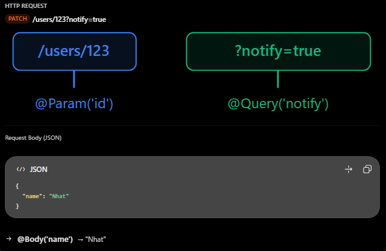

# NestJS: @Body, @Param, @Query

## Mục lục

- [Ba parameter decorators là gì?](#1-body-param-query-là-gì)
- [@Param() — URL path](#2-param--lấy-dữ-liệu-từ-url-path)
- [@Query() — query string](#3-query--lấy-dữ-liệu-từ-query-string)
- [@Body() — request body](#4-body--lấy-dữ-liệu-từ-request-body)
- [Kết hợp cả ba decorator](#5-ví-dụ-thực-tế-kết-hợp-cả-ba-decorator)
- [Các lỗi thường gặp](#6-những-lỗi-thường-gặp)
- [Câu hỏi ôn tập](#7-câu-hỏi-ôn-tập)

## 4. @Body, @Param, @Query

### 1. @Body, @Param, @Query là gì?

- Trong NestJS, cả ba đều là Parameter Decorators, giúp Controller lấy dữ liệu từ HTTP request mà client gửi lên. Điểm khác nhau là vị trí lấy dữ liệu.

| Decorator | Lấy dữ liệu từ | Mục đích |
| --- | --- | --- |
| `@Body()` | Request body | Nhận dữ liệu gửi lên, thường dùng khi tạo hoặc cập nhật. |
| `@Param()` | URL path | Lấy tham số động trong đường dẫn, ví dụ `id`. |
| `@Query()` | URL query string | Lấy tham số tìm kiếm, lọc, phân trang, sắp xếp. |
- Ví dụ một HTTP request:
  

### 2. @Param() — Lấy dữ liệu từ URL Path

- Giả sử API cần tìm user theo ID.

```ts
@Controller("users")
export class UsersController {
  @Get(":id")
  findOne(@Param("id") id: string) {
    return `User ID: ${id}`;
  }
}
```

- Client gửi:

```http
GET /users/123
```

- Kết quả là:

```text
User ID: 123
```

- Có hai cách sử dụng:

```ts
@Param() params: { id: string }
// Nhận toàn bộ object chứa route parameters.
@Param('id') id: string
// Chỉ nhận giá trị của id.
```

- Khi nào dùng? Khi cần xác định một resource cụ thể, ví dụ /users/123, /products/456 hoặc /orders/789.

### 3. @Query() — Lấy dữ liệu từ Query String

- Giả sử bạn xây dựng API tìm kiếm sản phẩm:

```http
GET /products?category=laptop&sort=asc
```

- Controller:

```ts
@Controller("products")
export class ProductsController {
  @Get()
  findAll(@Query("category") category?: string, @Query("sort") sort?: string) {
    return { category, sort };
  }
}
```

- Response:

```json
{
  "category": "laptop",
  "sort": "asc"
}
```

- Bạn cũng có thể dùng @Query() để lấy tất cả query parameters. Khi nào dùng? Khi cần lọc dữ liệu, tìm kiếm, sắp xếp hoặc phân trang.
- Lưu ý: Query parameters không bắt buộc phải xuất hiện trong URL. Nếu một parameter không được gửi lên thì giá trị tương ứng thường là undefined, trước khi có cơ chế giá trị mặc định hoặc chuyển đổi khác.

### 4. @Body() — Lấy dữ liệu từ Request Body

- Giả sử client muốn tạo một user mới:

```http
POST /users
Content-Type: application/json
```

- Body:

```json
{
  "name": "Nhat",
  "email": "nhat@gmail.com"
}
```

- Controller:

```ts
@Controller("users")
export class UsersController {
  @Post()
  create(@Body() data: { name: string; email: string }) {
    return data;
  }
}
```

- Trong trường hợp này, @Body() nhận toàn bộ object chứa name và email. Nếu chỉ muốn lấy một trường

```ts
@Body('email') email: string
```

- Thì biến email sẽ nhận giá trị "nhat@gmail.com".
- Khi nào dùng? Thường sử dụng khi client gửi dữ liệu cần tạo hoặc cập nhật, ví dụ đăng ký tài khoản, tạo đơn hàng, chỉnh sửa thông tin người dùng.

### 5. Ví dụ thực tế kết hợp cả ba decorator

- Giả sử trong dự án Family Care, bạn muốn cập nhật thông tin thành viên gia đình và tùy chọn gửi thông báo.

```ts
import { Controller, Patch, Param, Query, Body } from "@nestjs/common";

@Controller("families")
export class FamiliesController {
  @Patch(":id/members/:memberId")
  updateMember(
    @Param("id") familyId: string,
    @Param("memberId") memberId: string,
    @Query("notify") notify: string,
    @Body() data: { nickname: string },
  ) {
    return {
      familyId,
      memberId,
      notify,
      nickname: data.nickname,
    };
  }
}
```

- Client gửi:

```http
PATCH /families/10/members/25?notify=true
```

- Body:

```json
{
  "nickname": "Dad"
}
```

- Response

```JSON
{
  "familyId": "10",
  "memberId": "25",
  "notify": "true",
  "nickname": "Dad"
}
```

- Chú ý: "true" là string, không phải boolean. Đây là một điểm rất dễ nhầm khi trả lời phỏng vấn!

### 6. Những lỗi thường gặp

1. Nghĩ TypeScript tự chuyển đổi kiểu dữ liệu.

```ts
@Get(':id')
findOne(@Param('id') id: number) {
  return typeof id;
}
```

- Nếu chưa cấu hình cơ chế transform phù hợp, request GET /users/123 vẫn cho giá trị id là string dù bạn khai báo TypeScript là number. Có thể dùng ParseIntPipe để chuyển đổi và kiểm tra:

```ts
@Get(':id')
findOne(@Param('id', ParseIntPipe) id: number) {
  return this.usersService.findOne(id);
}
```

2. Nhầm @Param và @Query.
   - GET /users/123 → Dùng @Param('id').
   - GET /users?id=123 → Dùng @Query('id').
3. Cho rằng @Body() tự động validate dữ liệu.

- Không. @Body() chỉ lấy dữ liệu từ request. Nó không tự đảm bảo rằng email hợp lệ hay name không được để trống.

### 7. Câu hỏi ôn tập

1. Sự khác nhau giữa @Body, @Param, và @Query trong NestJS là gì?

- `@Body()` trích xuất dữ liệu từ request body, `@Param()` trích xuất tham số trên route và `@Query()` trích xuất tham số trong query string.

2. Khi nào bạn sử dụng @Param()?

- Sử dụng khi cần truy cập một giá trị động từ đường dẫn URL, như User ID.

3. Khi nào nên sử dụng Query()?

- Khi cần lọc, tìm kiếm, sắp xếp hoặc phân trang.

4. Mục đích của @Body() là gì?

- `@Body()` trích xuất dữ liệu được gửi từ client trong HTTP request body, thường dùng khi tạo hoặc cập nhật tài nguyên.

5. Liệu tham số route và query có tự động đổi sang số?

- Không. Chúng thường được nhận dưới dạng chuỗi và có thể dùng Pipe như `ParseIntPipe` để xác thực, chuyển đổi.

## Thực hành

Xem [Body–Param–Query Example](../Example/body-param-query-example.ts). File này có API Products chạy được: lọc/tìm kiếm bằng `@Query()`, lấy hoặc cập nhật sản phẩm bằng `@Param('id')`, và tạo/cập nhật bằng `@Body()`. Endpoint `PATCH /products/:id?notify=true` kết hợp cả ba decorator trong một request.
