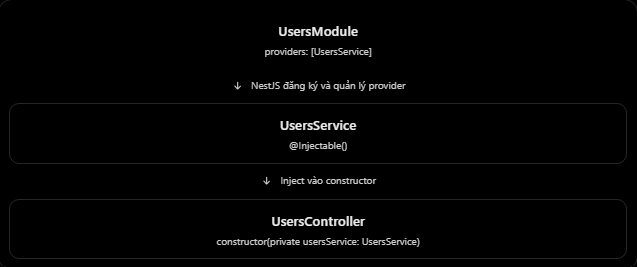

# NestJS: @Injectable() và Provider

## Mục lục

- [@Injectable() là gì?](#1-injectable-là-gì-trong-nestjs)
- [Provider là gì?](#2-provider-là-gì)
- [@Injectable() và Provider phối hợp](#3-injectable-và-provider-hoạt-động-cùng-nhau-như-thế-nào)
- [Ví dụ Prisma](#4-ví-dụ-thực-tế-với-prisma-và-postgresql)
- [Provider được NestJS quản lý](#5-nestjs-quản-lý-provider-như-thế-nào)
- [Các lỗi thường gặp](#6-những-lỗi-và-hiểu-nhầm-thường-gặp)
- [Provider và Dependency Injection](#7-phân-biệt-với-dependency-injection)
- [Câu hỏi ôn tập](#8-câu-hỏi-ôn-tập)

## 5. @Injectable() và Provider

### 1. @Injectable là gì trong NestJS?

- Trong NestJS, `@Injectable()` là decorator đánh dấu một class có thể được NestJS quản lý và sử dụng trong hệ thống Dependency Injection (DI). Nói đơn giản: thay vì tự khởi tạo đối tượng bằng `new`, NestJS có thể tạo và cung cấp đối tượng đó cho thành phần cần sử dụng.

```ts
import { Injectable } from "@nestjs/common";

@Injectable()
export class UsersService {
  findAll() {
    return ["Nhat", "Minh"];
  }
}
```

- Ở đây:
  - @Injectable() đánh dấu UsersService để tham gia cơ chế DI của NestJS.
  - UsersService chứa logic lấy danh sách user.
  - NestJS có thể tạo và inject UsersService vào Controller khi Service được đăng ký hợp lệ.
- Lưu ý: Chỉ thêm @Injectable() không có nghĩa Service đã tự động được đăng ký vào tất cả Module.

### 2. Provider là gì?

- Provider là một dependency được đăng ký để NestJS quản lý và cung cấp cho các thành phần khác. Trong thực tế, Provider thường là:
  - Service - Xử lý logic nghiệp vụ
  - Repository - Thao tác với database
  - Logger Service - Ghi log hệ thống
  - PrismaService - Cung cấp khả năng truy cập database
- Ví dụ:

```ts
@Module({
  controllers: [UsersController],
  providers: [UsersService],
})
export class UsersModule {}
```

- providers: [UsersService] cho NestJS biết rằng UsersService là một provider thuộc UsersModule.
- Phân biệt hai khái niệm:

| `@Injectable()` | Provider |
| --- | --- |
| Là decorator. | Là dependency được NestJS đăng ký và quản lý. |
| Đặt trên class. | Thường được đăng ký trong `providers`. |
| Giúp class tham gia cơ chế DI. | Có thể được NestJS tạo và inject vào thành phần khác. |
- Một class dùng làm Service thường có @Injectable(), nhưng không phải mọi provider đều bắt buộc được khai báo bằng decorator này. NestJS còn hỗ trợ provider dựa trên value, factory và các cách đăng ký khác.

### 3. @Injectable và Provider hoạt động cùng nhau như thế nào?

- Hãy xem ví dụ thực tế.
  

**users.service.ts**

```ts
import { Injectable } from "@nestjs/common";

@Injectable()
export class UsersService {
  findAll() {
    return ["User A", "User B"];
  }
}
```

**users.controller.ts**

```ts
import { Controller, Get } from "@nestjs/common";
import { UsersService } from "./users.service";

@Controller("users")
export class UsersController {
  constructor(private readonly usersService: UsersService) {}

  @Get()
  findAll() {
    return this.usersService.findAll();
  }
}
```

**users.module.ts**

```ts
import { Module } from "@nestjs/common";
import { UsersController } from "./users.controller";
import { UsersService } from "./users.service";

@Module({
  controllers: [UsersController],
  providers: [UsersService],
})
export class UsersModule {}
```

- Khi client gửi GET /users, NestJS sẽ sử dụng instance UsersService đã được cung cấp cho UsersController, sau đó gọi findAll() và trả về danh sách user. Bạn không cần tự viết:

```ts
const usersService = new UsersService();
```

- Vì NestJS đã có cơ chế quản lý và cung cấp provider.

### 4. Ví dụ thực tế với Prisma và PostgreSQL

- Giả sử trong dự án NestJS, ProductsService cần truy vấn danh sách sản phẩm từ PostgreSQL thông qua Prisma.

```ts
import { Injectable } from "@nestjs/common";
import { PrismaService } from "../prisma/prisma.service";

@Injectable()
export class ProductsService {
  constructor(private readonly prisma: PrismaService) {}

  findAll() {
    return this.prisma.product.findMany();
  }
}
```

- Ở đây:
  - ProductsService là một provider.
  - PrismaService cũng là một provider.
  - NestJS cung cấp PrismaService cho ProductsService thông qua constructor.
- Giả sử PrismaModule đã đăng ký và export PrismaService, cấu hình ProductsModule sẽ là:

```tsx
@Module({
  imports: [PrismaModule],
  providers: [ProductsService],
  controllers: [ProductsController],
})
export class ProductsModule {}
```

### 5. NestJS quản lý Provider như thế nào?

- Mặc định, provider trong NestJS có singleton scope. Điều này có nghĩa là NestJS thường tạo một instance của provider và tái sử dụng nó trong phạm vi ứng dụng khi provider được chia sẻ đúng cách.
- Ví dụ UsersService được inject vào cả UsersController và OrdersService. Nếu cả hai sử dụng cùng một provider được export từ UsersModule, chúng có thể dùng chung instance đó.

### 6. Những lỗi và hiểu nhầm thường gặp

1. Có @Injectable() nhưng quên đăng ký Provider.

   ```ts
   @Injectable()
   export class UsersService {}
   ```

   - Nếu Controller cần inject UsersService nhưng Module không đăng ký hoặc không có quyền truy cập provider này, NestJS thường báo lỗi không thể resolve dependency khi khởi tạo.

2. Đưa Service vào imports thay vì providers.

   ```ts
   @Module({
     imports: [UsersService], // Sai
   })
   export class UsersModule {}
   ```

   - Trong cách đăng ký thông thường, Service thuộc providers còn Module thuộc imports.

3. Nghĩ Provider và Service là hai thứ hoàn toàn giống nhau.

- Không chính xác. Service là một loại Provider phổ biến. Nhưng Provider là khái niệm rộng hơn, có thể bao gồm Repository, Logger, Factory hoặc những dependency khác.

4. Nghĩ @Injectable() tự động khiến Service dùng được ở mọi Module.

- Không. Muốn Module khác sử dụng Service, cần cấu hình exports và imports phù hợp

### 7. Phân biệt với Dependency Injection

- Hai khái niệm này liên quan chặt chẽ:
  - Provider: Dependency được đăng ký và quản lý bởi NestJS.
  - Dependency Injection: Cơ chế cung cấp dependency cho đối tượng cần sử dụng nó.
- Ví dụ

```ts
constructor(private readonly usersService: UsersService) {}
```

- Đây là ví dụ về constructor-based Dependency Injection.

### 8. Câu hỏi ôn tập

1. `@Injectable()` trong NestJS là gì?
   - Là decorator đánh dấu class có thể tham gia Dependency Injection của NestJS.
2. Provider trong NestJS là gì?
   - Là dependency được NestJS quản lý, ví dụ Service, Repository và database service.
3. Sự khác nhau giữa @Injectable() và Provider là gì?
   - `@Injectable()` là decorator, còn Provider là dependency đã đăng ký mà NestJS có thể quản lý và inject.

4. Làm thế nào để đăng kí Provider trong NestJS?
   - Đăng ký Provider trong mảng `providers` của một Module.
5. Sẽ ra sao nếu Provider yêu cầu không được đăng ký?
   - NestJS không thể resolve dependency và ném lỗi khi ứng dụng khởi tạo.

## Thực hành

Xem [Injectable–Provider Example](../Example/injectable-provider-example.ts). File này minh hoạ class provider `QuotesService`, value provider `APP_NAME`, factory provider `REQUEST_PREFIX`, và cách NestJS inject chúng qua constructor thay vì khởi tạo bằng `new`.
