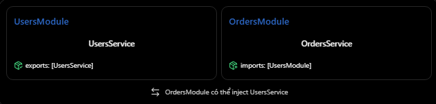

# NestJS: @Module — imports, controllers, providers, exports

## Mục lục

- [@Module là gì?](#1-module-là-gì-trong-nestjs)
- [Phân biệt bốn thuộc tính](#2-phân-biệt-bốn-thuộc-tính)
- [Cơ chế imports và exports](#3-cơ-chế-imports-và-exports-hoạt-động-như-thế-nào)
- [Nếu không có exports](#4-nếu-không-có-exports-thì-sao)
- [Ví dụ Prisma và PostgreSQL](#5-ví-dụ-thực-tế-với-prisma-và-postgresql)
- [Các hiểu nhầm thường gặp](#6-những-hiểu-nhầm-thường-gặp)

## 2. @Module — imports, controllers, providers, exports

### 1. @Module là gì trong NestJS?

- Trong NestJS, @Module() là một decorator dùng để khai báo một Module và cung cấp metadata giúp NestJS biết cách tổ chức các thành phần trong ứng dụng. Ví dụ một hệ thống E-Commerce có thể được chia thành:
  - UsersModule: Quản lý người dùng
  - ProductsModule: Quản lý sản phẩm
  - OrdersModule: Quản lý đơn hàng
  - AuthModule: Xác thực người dùng
- Mỗi Module quản lý các thành phần liên quan đến chức năng của mình, cú pháp cơ bản là

```ts
import { Module } from "@nestjs/common";
import { UsersController } from "./users.controller";
import { UsersService } from "./users.service";

@Module({
  imports: [],
  controllers: [UsersController],
  providers: [UsersService],
  exports: [],
})
export class UsersModule {}
```

- Bốn thuộc tính quan trọng trong @Module() là imports, controllers, providers và exports. Theo tài liệu NestJS, Module mặc định đóng gói các provider của nó; provider chỉ được sử dụng ở module khác khi được chia sẻ theo cơ chế phù hợp.

### 2. Phân biệt bốn thuộc tính

| Thuộc tính | Chức năng | Cách nhớ |
| --- | --- | --- |
| `imports` | Nhập các Module khác để sử dụng provider mà chúng export. | Tôi cần dùng gì từ bên ngoài? |
| `controllers` | Đăng ký các Controller thuộc Module. | Ai xử lý HTTP request? |
| `providers` | Đăng ký Service, Repository hoặc provider khác. | Tôi quản lý dependency nào? |
| `exports` | Cho phép Module khác sử dụng provider được chia sẻ. | Tôi cho bên ngoài dùng gì? |

- Lưu ý: `imports` và `exports` thường hoạt động cùng nhau để các Module có thể sử dụng Provider của nhau

### 3. Cơ chế imports và exports hoạt động như thế nào?

- Giả sử OrdersService cần sử dụng UsersService để kiểm tra người dùng trước khi tạo đơn
  
- Để làm được điều đó ta cấu hình như sau

**A. UsersModule - Export UsersService**

```ts
// users.module.ts
import { Module } from "@nestjs/common";
import { UsersService } from "./users.service";

@Module({
  providers: [UsersService],
  exports: [UsersService],
})
export class UsersModule {}
```

- Ở đây:
  - providers: [UsersService] đăng ký UsersService vào UsersModule.
  - exports: [UsersService] cho phép module khác sử dụng UsersService khi import UsersModule.

**B. OrdersModule - Import UsersModule**

```ts
// orders.module.ts
import { Module } from "@nestjs/common";
import { UsersModule } from "../users/users.module";
import { OrdersService } from "./orders.service";

@Module({
  imports: [UsersModule],
  providers: [OrdersService],
})
export class OrdersModule {}
```

- Khi đó, OrdersService có thể nhận UsersService qua constructor

```ts
// orders.service.ts
import { Injectable } from "@nestjs/common";
import { UsersService } from "../users/users.service";

@Injectable()
export class OrdersService {
  constructor(private readonly usersService: UsersService) {}

  async checkUser(userId: string) {
    return this.usersService.findById(userId);
  }
}
```

- Ví dụ này giả sử UsersService có method findById(). NestJS sẽ sử dụng cơ chế Dependency Injection để cung cấp UsersService cho OrdersService, thay vì bạn phải tự tạo new UsersService().

### 4. Nếu không có exports thì sao?

- Giả sử UsersModule được viết lại:

```tsx
@Module({
  providers: [UsersService],
  // Không exports UsersService
})
export class UsersModule {}
```

- Trong khi OrdersModule vẫn có:

```tsx
@Module({
  imports: [UsersModule],
  providers: [OrdersService],
})
export class OrdersModule {}
```

- Lúc này OrdersService muốn inject UsersService sẽ gặp lỗi dependency resolution khi NestJS khởi tạo ứng dụng. Một thông báo lỗi thường gặp là:

```text
Nest can't resolve dependencies of the OrdersService (?).
Please make sure that the argument UsersService
is available in the OrdersModule context.
```

- Nguyên nhân là UsersService chỉ được đăng ký bên trong UsersModule, nhưng chưa được export để module khác sử dụng.

### 5. Ví dụ thực tế với Prisma và PostgreSQL

- Một trường hợp gần với các dự án bạn đã làm là nhiều Service cần sử dụng chung PrismaService. Ta có thể tạo một PrismaModule riêng.

```ts
// prisma.module.ts
import { Module } from "@nestjs/common";
import { PrismaService } from "./prisma.service";

@Module({
  providers: [PrismaService],
  exports: [PrismaService],
})
export class PrismaModule {}
```

- Sau đó, UsersModule có thể import PrismaModule:

```ts
// users.module.ts
import { Module } from "@nestjs/common";
import { UsersService } from "./users.service";
import { UsersController } from "./users.controller";
import { PrismaModule } from "../prisma/prisma.module";

@Module({
  imports: [PrismaModule],
  controllers: [UsersController],
  providers: [UsersService],
  exports: [UsersService],
})
export class UsersModule {}
```

- Tương tự, OrdersModule có thể sử dụng cả PrismaService và UsersService:

```ts
// orders.module.ts
import { Module } from "@nestjs/common";
import { PrismaModule } from "../prisma/prisma.module";
import { UsersModule } from "../users/users.module";
import { OrdersService } from "./orders.service";
import { OrdersController } from "./orders.controller";

@Module({
  imports: [PrismaModule, UsersModule],
  controllers: [OrdersController],
  providers: [OrdersService],
})
export class OrdersModule {}
```

- Như vậy OrdersService có thể inject

```ts
constructor(
  private readonly prisma: PrismaService,
  private readonly usersService: UsersService,
) {}
```

- Điển đáng chú ý:
  - OrdersModule import PrismaModule để sử dụng PrismaService.
  - OrdersModule import UsersModule để sử dụng UsersService.
  - OrdersService không cần tự khởi tạo các dependency đó.
  - UsersModule và OrdersModule có thể dùng chung instance PrismaService được cung cấp từ PrismaModule theo scope mặc định.
- Đây là một lợi ích quan trọng của kiến trúc module trong NestJS

### 6. Những hiểu nhầm thường gặp

1. imports chứa Service hoặc Controller.
   - Sai trong cách đăng ký Module thông thường.

   ```ts
    // Sai
   @Module({
   imports: [UsersService],
   })
   ```

   - imports dành cho Module, còn UsersService thường được đăng ký trong providers.

2. @Injectable() là đủ để sử dụng Service ở mọi nơi.
   - Không đúng. @Injectable() giúp class tham gia cơ chế DI, nhưng provider vẫn cần được đăng ký và phải nằm trong phạm vi mà module sử dụng có thể truy cập.
3. exports có nghĩa là export TypeScript.
   - Hai điều này khác nhau:

   ```ts
   export class UsersService {}
   ```

   - Đây là cơ chế export của TypeScript/JavaScript.

   ```ts
    @Module({
   exports: [UsersService],
   })
   ```

   - Đây là cơ chế chia sẻ provider giữa các Module trong NestJS.
   - Có export class không đồng nghĩa với việc provider tự động được chia sẻ giữa các module.

4. Import một Module nghĩa là có thể sử dụng tất cả provider bên trong nó
   - Không. Theo mặc định, module chỉ được sử dụng các provider mà module được import công khai qua exports.
5. Cần đăng ký UsersService trong providers của tất cả Module.
   - Không nên làm như vậy nếu mục tiêu là chia sẻ cùng một instance.

## Thực hành

Xem ví dụ chạy được tại [Module imports–controllers–providers–exports Example](../Example/module-imports-controllers-providers-exports-example.ts). Ví dụ có `UsersModule` export `UsersService`, sau đó `OrdersModule` import `UsersModule` để inject `UsersService` vào `OrdersService`; `OrdersController` cung cấp endpoint để quan sát kết quả.
