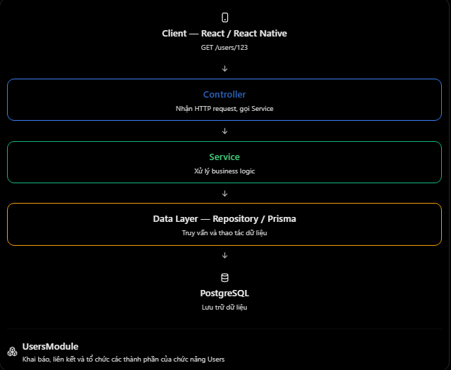

# NestJS: Module → Controller → Service → Data Layer

## Mục lục

- [Kiến trúc NestJS là gì?](#1-kiến-trúc-nestjs-là-gì)
- [Vai trò của từng thành phần](#2-vai-trò-của-từng-thành-phần)
- [Ví dụ thực tế với NestJS + Prisma](#3-ví-dụ-thực-tế-với-nestjs--prisma)
- [Luồng xử lý request](#4-khi-request-thực-sự-chạy-chuyện-gì-xảy-ra)
- [So sánh với ExpressJS](#5-nestjs-khác-với-expressjs-như-thế-nào)
- [Các lỗi thường gặp](#6-những-lỗi-thường-gặp)
- [Câu hỏi ôn tập](#7-câu-hỏi-ôn-tập)

## Kiến trúc Module → Controller → Service → Data Layer

### 1. Kiến trúc NestJS là gì?

- Trong ExpressJS, chúng ta có thể tự tổ chức ứng dụng thành Router, Controller, Service và Repository. Còn với NestJS, framework khuyến khích một kiến trúc có cấu trúc rõ ràng, sử dụng các Module để tổ chức những thành phần liên quan thành từng nhóm chức năng. Một cách tổ chức phổ biến là:
  
- Điểm quan trọng: Module không phải là tầng mà HTTP Request phải chạy qua đầu tiên. Nó chủ yếu giúp NestJS tổ chức và kết nối các thành phần khi khởi tạo ứng dụng

### 2. Vai trò của từng thành phần

| Thành phần | Nhiệm vụ chính |
| --- | --- |
| Module | Tổ chức các thành phần thuộc cùng một chức năng và cấu hình sự phụ thuộc. |
| Controller | Nhận request, lấy dữ liệu từ request và trả response. |
| Service | Xử lý business logic, điều phối các thao tác. |
| Data Layer | Truy vấn, tạo, sửa, xóa dữ liệu thông qua Prisma/ORM hoặc SQL. |

- Ví dụ trong hệ thống quản lý gia đình. Khi người dùng muốn xem thông tin thành viên:
  - FamilyModule: Tổ chức cá thành phần quản lý gia đình
  - FamilyController: Nhận req GET/families/123
  - FamilyService: Xử lý nghiệp vụ tìm gia đình, kiểm tra các điều kiện cần thiết.
  - FamilyRepository: Sử dụng Prisma để đọc dữ liệu tư PostgreSQL
- Phân chia như vậy giúp tránh việc một Controller phải chịu trách nhiệm cho tất cả mọi thứ

### 3. Ví dụ thực tế với NestJS + Prisma

- Giả sử chúng ta có API: GET /users/123, mục tiêu là lấy thông tin một user theo ID từ PostgreSQL. Nếu user không tồn tại thì trả về lỗi 404, và cấu trúc thư mục lúc này sẽ là

```Plain text
src/
├── app.module.ts
├── prisma/
│   └── prisma.service.ts
└── users/
    ├── users.module.ts
    ├── users.controller.ts
    ├── users.service.ts
    └── users.repository.ts
```

- Ở ví dụ này, giả sử PrismaService đã được cấu hình và Prisma có modle User với các trường id, email.

**A. Controller - Nhận HTTP request**

- user.controller.ts

```tsx
import { Controller, Get, Param } from "@nestjs/common";
import { UsersService } from "./users.service";

@Controller("users")
export class UsersController {
  constructor(private readonly usersService: UsersService) {}

  @Get(":id")
  findById(@Param("id") id: string) {
    return this.usersService.findById(id);
  }
}
```

- Controller chịu trách nhiệm nhận `GET /users/123`, lấy id = "123" rồi gọi UsersSerivce. Nó không tự viết câu lệnh truy vấn database

**B. Service - Xử lý business logic**

- users.service.ts

```tsx
import { Injectable, NotFoundException } from "@nestjs/common";
import { UsersRepository } from "./users.repository";

@Injectable()
export class UsersService {
  constructor(private readonly usersRepo: UsersRepository) {}

  async findById(id: string) {
    const user = await this.usersRepo.findById(id);

    if (!user) {
      throw new NotFoundException("User not found");
    }

    return user;
  }
}
```

- Service chịu trách nhiệm điều phối việc lấy thông tin user và xử lý trường hợp user không tồn tại. Ở đây `NotFoundException` giúp NestJS trả HTTP 404 thay vì trả null như một kết quả thành công

**C. Data Layer - Truy vấn database**

- users.repository.ts

```tsx
import { Injectable } from "@nestjs/common";
import { PrismaService } from "../prisma/prisma.service";

@Injectable()
export class UsersRepository {
  constructor(private readonly prisma: PrismaService) {}

  findById(id: string) {
    return this.prisma.user.findUnique({
      where: { id },
      select: {
        id: true,
        email: true,
      },
    });
  }
}
```

- Repository chịu trách nhiệm làm việc với Prisma, truy vẫn bảng tương ứng với Model `User`, `select` giúp chỉ lấy những trường chúng ta cần trả về, không vô tình lấy thêm dữ liệu nhạy cảm như password hash

**D. Module - Tổ chức các thành phần**

- users.module.ts và trong app.module.ts

```tsx
import { Module } from "@nestjs/common";
import { UsersController } from "./users.controller";
import { UsersService } from "./users.service";
import { UsersRepository } from "./users.repository";
import { PrismaService } from "../prisma/prisma.service";

@Module({
  controllers: [UsersController],
  providers: [UsersService, UsersRepository, PrismaService],
})
export class UsersModule {}
```

```tsx
import { Module } from "@nestjs/common";
import { UsersModule } from "./users/users.module";

@Module({
  imports: [UsersModule],
})
export class AppModule {}
```

- Đây là ví dụ tối giản để thấy các thành phần kết nối với nhau. Trong dự án có nhiều module, bạn thường sẽ tổ chức PrismaService thành một PrismaModule dùng chung thay vì đăng ký lại ở từng module

### 4. Khi request thực sự chạy, chuyện gì xảy ra?

- Với `GET /users/123`, luồng xử lý chính như sau:
  1. UsersController.findById("123")
  2. UsersSerivce.findById("123")
  3. UserRepository.findById("123")
  4. Prisma truy vẫn dưới DB
  5. Dữ liệu quay lại Repository -> Service -> Controller -> Client
- Nếu tồn tại user như trên, res sẽ là

```JSON
{
  "id": "123",
  "email": "user@example.com"
}
```

- Nếu không tồn tại user trên, Service sẽ ném `NotFoundException`, NestJS xử lý và trả HTTP 404

### 5. NestJS khác với ExpressJS như thế nào

| ExpressJS | NestJS |
| --- | --- |
| Router và Controller do developer tự tổ chức | Controller được khai báo qua decorator |
| Service, Repository tùy cách thiết kế | Service, Provider được tích hợp vào hệ thống module |
| Thường tự tạo và truyền dependency | Có sẵn cơ chế Dependency Injection |
| Không bắt buộc cấu trúc module | Dùng Module làm đơn vị tổ chức ứng dụng |

- Điểm cần hiểu là NestJS không tự động đảm bảo code sạch. Nó cung cấp kiến trúc và công cụ để lập trình viên phân chia trách nhiệm rõ ràng hơn

### 6. Những lỗi thường gặp

1. Module là nơi xử lý HTTP request?
   - Không. Controller xử lý các route, còn Module khai báo và tổ chức các thành phần.
2. Mọi business logic đều để trong Controller?
   - Không nên. Controller cần gọn; nghiệp vụ nên nằm trong Service.
3. Service bắt buộc phải có Repository?
   - Không. Với ứng dụng nhỏ, Service có thể gọi trực tiếp PrismaService. Repository là một lớp tổ chức bổ sung, không bắt buộc trong NestJS.
4. Repository nên quyết định quyền truy cập của user?
   - Không nhất thiết. Các quy tắc nghiệp vụ hoặc phân quyền thường nằm ở Service và các thành phần bảo vệ request phù hợp.
5. Tách nhiều file là đã có kiến trúc tốt?
   - Chưa chắc. Điều quan trọng là mỗi thành phần có trách nhiệm rõ ràng.

### 7. Câu hỏi ôn tập

1. Kiến trúc của 1 ứng dụng NestJS là gì ?

- NestJS sử dụng kiến trúc module. Modules tổ chức các thành phần, Controllers xử lý các HTTP requests, Services chứa các logic nghiệp vụ và Data Layer tương tác với Database

2. Vai trò của 1 Module trong NestJS là gì?

- 1 Module tổ chức các controllers và các provider. Nó luôn xác định các phần khác nhau của ứng dụng được kết nối

3. Sự khác nhau giữa Controller và Service là gì?

- Controller xử lý những HTTP req và trả về res, trong khi Service thì xử lý logic nghiệp vụ và các hoạt động của ứng dụng

4. Mục đích của Data Layer là gì?

- Data Layer xử lý thuật toán database như tạo,đọc, cập nhật hoặc xóa dữ liệu. Nó có thể sử dụng ORM như Prisma

5. Liệu Repository có bắt buộc trong mỗi ứng dụng NestJS

- Không. Repository không bắt buộc, Service có thể tương tác trực tiếp với Prisma, nhưng Repository có thể giúp phân tách quyền truy cập cơ sở dữ liệu từ logic nghiệp vụ.

## Thực hành

Ví dụ chạy được, gom các phần vào một file để dễ đối chiếu luồng `Module → Controller → Service → Repository`, nằm tại [NestJS Module–Controller–Service–Data Layer Example](../Example/structuremodule-controller-service-datalayer-example.ts). Ví dụ dùng dữ liệu trong bộ nhớ để tập trung vào kiến trúc; khi dùng Prisma, chỉ cần thay nội dung repository bằng lời gọi `PrismaService`.
