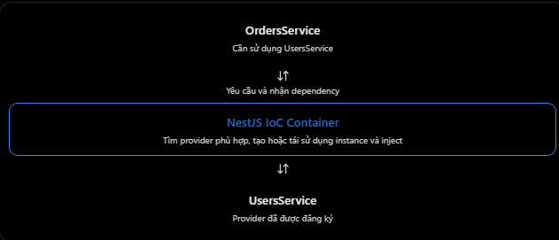

# NestJS: Dependency Injection là gì và lợi ích

## Mục lục

- [Dependency Injection là gì?](#1-dependency-injection-di-là-gì)
- [NestJS thực hiện DI như thế nào?](#2-nestjs-thực-hiện-dependency-injection-như-thế-nào)
- [Ví dụ Prisma và PostgreSQL](#3-ví-dụ-thực-tế-với-nestjs--prisma)
- [Lợi ích của DI](#4-dependency-injection-mang-lại-những-lợi-ích-gì)
- [DI, Provider, @Injectable và IoC](#5-dependency-injection-khác-với-injectable-như-thế-nào)
- [Các lỗi thường gặp](#6-những-lỗi-và-hiểu-nhầm-thường-gặp)
- [Câu hỏi ôn tập](#7-câu-hỏi-ôn-tập)

## 6. Dependency Injection là gì và lợi ích

### 1. Dependency Injection (DI) là gì?

- Dependency Injection (DI) là một Design Pattern trong đó một class nhận các dependency từ bên ngoài thay vì tự khởi tạo chúng bên trong. Giả sử OrdersService cần sử dụng UsersService để kiểm tra thông tin người dùng.

**Cách 1 - Không sử dụng Dependency Injection**

```ts
class OrdersService {
  private usersService = new UsersService();

  createOrder() {
    return this.usersService.findAll();
  }
}
```

- Vấn đề ở đây là OrdersService tự tạo UsersService bằng new. Điều này khiến OrdersService phụ thuộc chặt chẽ vào cách tạo UsersService. Ví dụ, nếu muốn thay UsersService thật bằng một phiên bản giả lập khi testing, chúng ta sẽ khó thực hiện hơn.

**Cách 2 - Sử dụng Dependency Injection**

```ts
@Injectable()
export class OrdersService {
  constructor(private readonly usersService: UsersService) {}

  createOrder() {
    return this.usersService.findAll();
  }
}
```

- Ở đây, OrdersService không tự khởi tạo UsersService. Thay vào đó, NestJS cung cấp instance của UsersService thông qua constructor. Cách này gọi là Constructor-based Dependency Injection, và đây là kiểu DI phổ biến nhất trong NestJS.

### 2. NestJS thực hiện Dependency Injection như thế nào?

- NestJS có một hệ thống gọi là IoC Container (Inversion of Control Container). Bạn có thể hiểu đơn giản: đây là hệ thống quản lý việc đăng ký, khởi tạo và cung cấp các dependency.
  
- Quá trình đơn giản như sau:
  1. NestJS đọc metadata của các Module và Provider.
  2. NestJS xác định OrdersService cần UsersService.
  3. IoC Container tìm provider UsersService trong phạm vi module phù hợp.
  4. NestJS tạo hoặc tái sử dụng instance rồi truyền vào constructor của OrdersService.
- Như vậy, chúng ta không cần quản lý thủ công việc khởi tạo tất cả dependency.

### 3. Ví dụ thực tế với NestJS + Prisma

- Giả sử bạn đang xây dựng một API quản lý user bằng NestJS, Prisma và PostgreSQL.

**A. PrismaService - Provider truy cập database**

```ts
import { Injectable } from "@nestjs/common";
import { PrismaClient } from "@prisma/client";

@Injectable()
export class PrismaService extends PrismaClient {}
```

- Ví dụ trên minh họa cách tổ chức PrismaService với Prisma Client theo cấu hình thông dụng.

**B. UsersService - Nhận PrismaService qua DI**

```ts
import { Injectable } from "@nestjs/common";
import { PrismaService } from "../prisma/prisma.service";

@Injectable()
export class UsersService {
  constructor(private readonly prisma: PrismaService) {}

  findAll() {
    return this.prisma.user.findMany();
  }
}
```

- Điểm đáng chú ý là:

```ts
constructor(
  private readonly prisma: PrismaService,
) {}
```

- Đây chính là Dependency Injection. `UsersService` cần `PrismaService`, nhưng không tự tạo đối tượng bằng `new PrismaService()`.

**C. UsersController - Nhận UsersService qua DI**

```tsx
@Controller("users")
export class UsersController {
  constructor(private readonly usersService: UsersService) {}

  @Get()
  findAll() {
    return this.usersService.findAll();
  }
}
```

- Vậy trong ứng dụng này có hai quan hệ DI: PrismaService → UsersService → UsersController
- Khi client gửi GET /users, Controller gọi Service, Service sử dụng Prisma để truy vấn PostgreSQL.
- Lưu ý: PrismaService và UsersService vẫn phải được đăng ký trong Module hoặc được cung cấp thông qua Module đã import/export đúng cách

### 4. Dependency Injection mang lại những lợi ích gì?

| Lợi ích | Giải thích |
| --- | --- |
| Loose coupling | Giảm sự phụ thuộc vào cách khởi tạo dependency. |
| Testability | Dễ thay dependency thật bằng mock khi testing. |
| Maintainability | Dễ bảo trì, sửa đổi hoặc thay thế thành phần. |
| Reusability | Có thể tái sử dụng provider ở các thành phần khác. |
| Lifecycle management | NestJS quản lý vòng đời instance theo scope đã cấu hình. |

- Ví dụ, trong production, UsersService sử dụng PrismaService thật để truy vấn PostgreSQL. Nhưng khi viết unit test, chúng ta có thể cung cấp một mock Prisma:

```ts
const mockPrisma = {
  user: {
    findMany: async () => [{ id: "1", name: "Test User" }],
  },
};
```

- Sau đó cấu hình test để inject mockPrisma thay cho PrismaService thật. Nhờ vậy, việc test UsersService không nhất thiết phải kết nối đến PostgreSQL. Đây là một lợi ích rất quan trọng của DI trong các dự án thực tế.

### 5. Dependency Injection khác với @Injectable như thế nào?

| Khái niệm | Ý nghĩa |
| --- | --- |
| `@Injectable()` | Decorator giúp class tham gia vào hệ thống DI. |
| Provider | Dependency được đăng ký và quản lý bởi NestJS. |
| Dependency Injection | Cơ chế cung cấp dependency cho thành phần cần sử dụng. |
| IoC Container | Hệ thống quản lý, khởi tạo và giải quyết dependency. |

- Hãy nhớ rằng: @Injectable() không phải Dependency Injection. Nó là một thành phần hỗ trợ cơ chế DI trong NestJS.

### 6. Những lỗi và hiểu nhầm thường gặp

1. Nghĩ có constructor là NestJS tự động inject được mọi dependency.
   - Không đúng. NestJS chỉ giải quyết được dependency khi provider tương ứng đã được đăng ký và có thể truy cập trong phạm vi module.
   ```ts
   constructor(
   private readonly usersService: UsersService,
   ) {}
   ```
2. Nghĩ Dependency Injection luôn tạo instance mới.
   - Không đúng. Theo mặc định, NestJS sử dụng singleton scope, nghĩa là provider được tái sử dụng thay vì tạo mới ở mỗi lần inject.
3. Nghĩ DI chỉ dành cho Service.
   - Không đúng. DI còn được sử dụng với Repository, Logger, PrismaService và những provider khác.
4. Nghĩ sử dụng DI thì class hoàn toàn không còn phụ thuộc vào class khác.
   - Không chính xác. Ví dụ OrdersService vẫn phụ thuộc vào UsersService, nhưng không cần tự quyết định cách tạo instance của nó. Điều này giúp giảm sự gắn kết giữa các thành phần, đặc biệt khi kết hợp với abstraction hoặc injection token.

- Ngoài ra về DI và IoC. Hai khái niệm này có liên quan nhưng không hoàn toàn giống nhau:
  - IoC (Inversion of Control): Nguyên tắc chuyển quyền kiểm soát một số công việc, như khởi tạo dependency, sang một hệ thống bên ngoài.
  - DI (Dependency Injection): Một kỹ thuật cụ thể để thực hiện IoC, bằng cách cung cấp dependency từ bên ngoài.
- Trong NestJS, IoC Container là hệ thống thực hiện cơ chế Dependency Injection.

### 7. Câu hỏi ôn tập

1. Dependency Injection là gì trong NestJS?
   - DI là một design pattern trong đó các phần phụ thuộc được cung cấp cho một lớp thay vì được tạo bên trong lớp đó
2. Những lợi ích của DI là gì?
   - Nó giảm sự liên kết chặt chẽ và khiến code dễ kiểm tra, bảo trì, tái sử dụng.
3. Cách DI hoạt động trong NestJS như thế nào?
   - NestJS sử dụng IoC Container để resolve provider đã đăng ký và đưa chúng vào class, thường qua constructor.
4. DI dựa trên hàm tạo là gì?
   - Là cách truyền dependency vào class qua constructor của class đó.
5. Tại sao DI lại hữu ích cho kiểm tra unit?
   - Nó cho phép thay dependency thật bằng mock, nhờ đó có thể kiểm tra thành phần một cách độc lập.

## Thực hành

Xem [What Is Dependency Injection Example](../Example/whatisdependencyinjection-example.ts). Ví dụ cho `OrdersService` nhận `UsersService` và `PaymentGateway` từ NestJS qua constructor. `PaymentGateway` dùng injection token, nên có thể thay implementation thật bằng fake/mock mà không sửa `OrdersService`.
