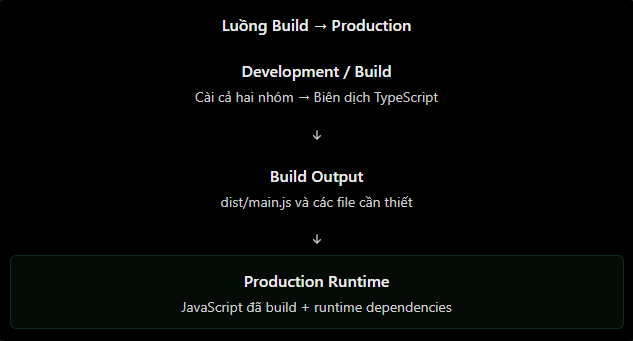

# dependencies và devDependencies

## 1. Khác nhau ở đâu?

Cả `dependencies` và `devDependencies` đều được khai báo trong `package.json`. Khác biệt nằm ở **vai trò của package trong vòng đời ứng dụng**, không nằm ở tên package.

| Nhóm | Dùng khi nào? | Ví dụ thường gặp |
| --- | --- | --- |
| `dependencies` | Ứng dụng cần package để chạy ở runtime/production. | `express`, `@nestjs/core`, `bcrypt`, `jsonwebtoken`, `@prisma/client` |
| `devDependencies` | Package phục vụ phát triển, kiểm thử, lint hoặc build. | `typescript`, `eslint`, `jest`, `nodemon`, `prisma` |

Quy tắc đơn giản: nếu code chạy trên server production trực tiếp `import`/`require` package đó, package cần nằm trong `dependencies`. Nếu package chỉ dùng để phát triển hoặc tạo artifact trước khi chạy, nó thường thuộc `devDependencies`.

## 2. Ví dụ trong package.json

```json
{
  "name": "backend-api",
  "version": "1.0.0",
  "scripts": {
    "start": "node dist/app.js",
    "dev": "nodemon src/app.js",
    "test": "jest",
    "lint": "eslint ."
  },
  "dependencies": {
    "express": "^5.1.0",
    "bcrypt": "^6.0.0"
  },
  "devDependencies": {
    "eslint": "^9.0.0",
    "jest": "^30.0.0",
    "nodemon": "^3.1.0"
  }
}
```

| Package | Nhóm phù hợp | Lý do |
| --- | --- | --- |
| `express` | `dependencies` | Server cần nó để nhận và xử lý HTTP request. |
| `bcrypt` | `dependencies` | Ứng dụng runtime dùng nó để hash/verify password. |
| `nodemon` | `devDependencies` | Chỉ hỗ trợ tự khởi động lại server khi phát triển. |
| `jest` | `devDependencies` | Chạy test, không cần để phục vụ request production. |
| `eslint` | `devDependencies` | Kiểm tra chất lượng code trong development/CI. |

## 3. Cài đúng nhóm package

### Cài runtime dependency

```bash
npm install express
```

Theo mặc định, `npm install <package>` lưu package vào `dependencies`.

### Cài development dependency

```bash
npm install -D nodemon
```

`-D` là dạng ngắn của `--save-dev`; cả hai đều lưu package vào `devDependencies`.

Để chuyển package đã cài giữa hai nhóm, dùng lệnh cài lại với cờ phù hợp hoặc chỉnh `package.json` rồi chạy `npm install` để cập nhật lockfile. Đừng chỉ chuyển thư mục trong `node_modules`.

## 4. Cài dependency trong development và production

Trong môi trường development, `npm install` thường cài cả hai nhóm. Khi omit list chứa `dev` — ví dụ dùng `npm ci --omit=dev` hoặc cấu hình production — npm vẫn resolve chúng vào lockfile nhưng không cài chúng xuống `node_modules`.

| Lệnh | Ý nghĩa |
| --- | --- |
| `npm install` | Cài theo manifest/lockfile; mặc định không bỏ qua dev dependencies. |
| `npm install -D jest` | Thêm Jest vào `devDependencies`. |
| `npm ci` | Cài sạch, chính xác theo lockfile. |
| `npm ci --omit=dev` | Cài sạch theo lockfile nhưng không cài dev dependencies trên disk. |

`NODE_ENV=production` thường làm npm mặc định omit `dev` trong lúc cài. Tuy nhiên, hãy ưu tiên ghi rõ `--omit=dev` trong lệnh deploy/CI để ý định rõ ràng và tránh phụ thuộc cấu hình môi trường ngầm.

## 5. Build và runtime là hai giai đoạn khác nhau

Với backend TypeScript, công cụ build thường là dev dependency, nhưng artifact sau build có thể cần runtime dependencies để chạy:

```json
{
  "scripts": {
    "build": "tsc",
    "start:prod": "node dist/main.js"
  },
  "dependencies": {
    "@nestjs/common": "^11.0.0",
    "@nestjs/core": "^11.0.0"
  },
  "devDependencies": {
    "typescript": "^5.8.0"
  }
}
```

Quy trình deploy an toàn thường gồm:

1. Cài đầy đủ dependency để build và test: `npm ci`.
2. Chạy test/build để tạo `dist`.
3. Trong runtime image/stage, chỉ cài production dependencies: `npm ci --omit=dev`.
4. Chạy artifact bằng `node dist/main.js`.



Không chạy `npm ci --omit=dev` trước khi build nếu build cần TypeScript, Nest CLI, Prisma CLI hoặc tool chỉ nằm trong `devDependencies`. Với Docker, cách phổ biến là dùng multi-stage build để tách build tools khỏi runtime image.

## 6. Một vài trường hợp cần suy nghĩ

- `typescript` thường là dev dependency nếu project compile ra JavaScript trước khi deploy; nhưng có thể là runtime dependency nếu production thật sự chạy compiler/loader TypeScript.
- Với Prisma, `prisma` thường là dev dependency cho generate/migration, còn `@prisma/client` là dependency vì code production import client này.
- Test runner, formatter, linter và bundler thường là dev dependencies.
- Package dùng trong build nhưng được bundle hoàn toàn vào output có thể không cần hiện diện ở runtime; hãy kiểm tra artifact thay vì phân loại theo thói quen.

## 7. Hiểu nhầm thường gặp

| Hiểu nhầm | Giải thích đúng |
| --- | --- |
| devDependencies không quan trọng | Chúng có thể bắt buộc để lint, test, generate code hoặc build artifact. |
| Bất kỳ package nào cũng cho vào devDependencies | Nếu runtime import nó, production phải có nó trong `dependencies`. |
| `--omit=dev` xoá devDependencies khỏi package.json | Không; nó chỉ không cài chúng vào `node_modules`. |
| Production luôn cần TypeScript compiler | Không nếu ứng dụng đã được build thành JavaScript trước đó. |
| `npm install` luôn cài dev dependencies | Không khi cấu hình omit `dev`, chẳng hạn ở production. |
| Chỉ cần dependency trực tiếp trong lockfile | Lockfile vẫn resolve toàn bộ tree, gồm transitive dependencies. |

## 8. Câu hỏi ôn tập

### 1. Làm sao quyết định một package thuộc `dependencies` hay `devDependencies`?

Nếu code chạy ở production trực tiếp `import` hoặc `require` package đó, package thuộc `dependencies`. Nếu nó chỉ phục vụ development, test, lint hoặc build trước khi deploy, nó thường thuộc `devDependencies`.

### 2. Vì sao TypeScript có thể là dev dependency nhưng Express lại là dependency?

TypeScript thường chỉ cần để biên dịch source thành JavaScript trước khi deploy, nên không cần ở runtime. Express được JavaScript production import để tạo HTTP server, nên phải có trong `dependencies`.

### 3. Vì sao không nên chạy `npm ci --omit=dev` trước bước build TypeScript?

Lệnh này không cài các package trong `devDependencies`. Nếu compiler TypeScript, Nest CLI hoặc tool build nằm trong nhóm đó, bước build sẽ không tìm thấy chúng và thất bại. Hãy build sau `npm ci`, rồi chỉ omit dev dependencies ở runtime stage.

### 4. `npm ci --omit=dev` thay đổi `package.json` hay chỉ thay đổi những gì được cài xuống disk?

Nó không sửa `package.json` hoặc lockfile. npm vẫn resolve toàn bộ dependency tree theo lockfile, nhưng không cài các dev dependencies vào `node_modules` trên disk.
