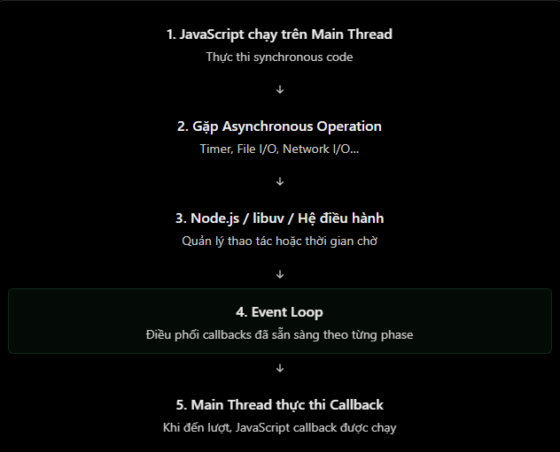

# Event Loop trong Node.js

## 1. Event loop là gì?

**Event loop** là cơ chế giúp Node.js điều phối thời điểm chạy các callback JavaScript bất đồng bộ. Nhờ đó, khi ứng dụng đang chờ I/O như đọc tệp, gọi database hoặc nhận dữ liệu mạng, main thread không cần đứng yên chờ kết quả.

Luồng tư duy cơ bản:

1. JavaScript đồng bộ chạy trên main thread.
2. Khi gặp một thao tác bất đồng bộ, Node.js đăng ký công việc đó với cơ chế phù hợp.
3. Main thread tiếp tục chạy các công việc khác.
4. Khi kết quả sẵn sàng, callback hoặc phần tiếp tục của Promise được xếp lịch để chạy khi main thread rảnh.

> Event loop không tạo nhiều JavaScript thread để chạy các callback cùng lúc. Trong một Node.js process thông thường, callback JavaScript vẫn chạy lần lượt trên main thread.



## 2. Thành phần chính cần biết

Sơ đồ event loop thường được đơn giản hoá thành một hàng đợi duy nhất. Thực tế, Node.js có nhiều phase và hàng đợi khác nhau.

| Thành phần/phase | Vai trò chính |
| --- | --- |
| Timers | Chạy callback của `setTimeout()` và `setInterval()` khi đủ điều kiện thời gian. |
| Pending callbacks | Xử lý một số callback I/O được hoãn. |
| Poll | Nhận và xử lý nhiều sự kiện I/O; có thể chờ I/O mới. |
| Check | Chạy callback của `setImmediate()`. |
| Close callbacks | Xử lý một số callback đóng, ví dụ sự kiện `close`. |
| `process.nextTick()` queue | Hàng đợi ưu tiên riêng của Node.js, không phải event-loop phase. |
| Promise microtask queue | Hàng đợi cho Promise callbacks và phần tiếp tục sau `await`, cũng không phải event-loop phase. |

Chi tiết nội bộ thay đổi theo phiên bản Node.js/libuv. Khi học cơ bản, hãy tập trung vào thứ tự giữa synchronous code, `process.nextTick`, Promise microtasks và các callback được lên lịch sau đó.

## 3. Thứ tự thực thi thường gặp

```js
console.log("A");

setTimeout(() => {
  console.log("B - timer");
}, 0);

Promise.resolve().then(() => {
  console.log("C - promise");
});

process.nextTick(() => {
  console.log("D - nextTick");
});

console.log("E");
```

Khi chạy đoạn mã trên trong Node.js, thứ tự thường là:

```text
A
E
D - nextTick
C - promise
B - timer
```

Giải thích:

1. `A` và `E` là synchronous code nên chạy ngay.
2. Sau khi call stack hiện tại rỗng, Node.js ưu tiên xử lý `process.nextTick()`.
3. Promise microtask được xử lý tiếp theo.
4. Callback timer chỉ chạy khi timer đủ điều kiện và event loop đến thời điểm phù hợp.

Không nên lạm dụng `process.nextTick()` trong vòng lặp đệ quy: nó có thể liên tục chiếm quyền ưu tiên, làm I/O và timer bị chậm (starvation).

## 4. `setTimeout(0)` và `setImmediate()`

`setTimeout(callback, 0)` không có nghĩa callback chạy ngay lập tức; `0` chỉ là mốc thời gian tối thiểu. Thứ tự giữa `setTimeout(..., 0)` và `setImmediate()` **không nên được xem là cố định** khi được lên lịch từ top-level code, vì còn phụ thuộc ngữ cảnh và phiên bản runtime.

Trong callback I/O, `setImmediate()` thường được chạy trước timer `setTimeout(..., 0)` vì nó nằm ở check phase sau poll phase. Thay vì dựa vào thứ tự này cho nghiệp vụ, hãy dùng Promise/`await` hoặc luồng điều khiển rõ ràng hơn.

## 5. Ví dụ thực tế trong Express

```js
app.get("/users", async (req, res) => {
  const users = await prisma.user.findMany();

  res.json({ users });
});

app.get("/health", (req, res) => {
  res.json({ status: "ok" });
});
```

Nếu request `/users` đang chờ database, hàm `async` tạm dừng tại `await`; main thread có thể xử lý request `/health`. Khi Promise truy vấn database hoàn tất, phần code sau `await` được lên lịch để tiếp tục. Database xử lý SQL; event loop chỉ giúp điều phối phần JavaScript khi kết quả đã sẵn sàng.

## 6. Khi event loop bị chặn

```js
app.get("/heavy", (req, res) => {
  const start = Date.now();

  while (Date.now() - start < 5000) {
    // Giữ main thread bận khoảng 5 giây.
  }

  res.json({ message: "Done" });
});
```

Trong vòng lặp này, main thread luôn bận chạy JavaScript. Timer, Promise callback và request HTTP khác phải chờ, nên event loop không thể giúp server vẫn phản hồi nhanh. Với CPU-bound work, hãy cân nhắc `worker_threads`, job queue hoặc một service riêng.

## 7. Hiểu nhầm thường gặp

| Hiểu nhầm | Giải thích đúng |
| --- | --- |
| Event loop chạy nhiều callback JavaScript song song | Callback JavaScript thường chạy lần lượt trên main thread. |
| `setTimeout(fn, 0)` chạy ngay | Callback vẫn phải đợi timer đủ điều kiện và event loop có cơ hội chạy nó. |
| `setImmediate()` luôn trước/sau `setTimeout(0)` | Thứ tự phụ thuộc ngữ cảnh; không nên dựa vào đó như một bảo đảm chung. |
| Event loop trực tiếp chạy SQL hoặc network I/O | Các hệ thống bên dưới thực hiện I/O; event loop điều phối callback JavaScript sau đó. |
| `async`/`await` tự làm CPU-bound code không chặn | Chỉ `await` một thao tác bất đồng bộ thực sự mới nhường main thread. |
| Event loop không thể bị block | JavaScript đồng bộ chạy lâu vẫn block main thread. |

## 8. Câu hỏi ôn tập

1. Vì sao `process.nextTick()` thường chạy trước `Promise.then()` trong Node.js?
2. Tại sao không nên coi `setTimeout(fn, 0)` là chạy ngay?
3. Một route đang `await` database khác gì một route chạy vòng lặp CPU dài?
4. Tại sao lạm dụng `process.nextTick()` có thể làm chậm I/O?

## 9. Ví dụ thực hành

Ví dụ Express nằm ở [NodeJS/Example/event-loop.js](../Example/event-loop.js). Cài dependency từ thư mục `NodeJS` (chỉ cần làm lại sau khi xoá `node_modules`):

```bash
cd NodeJS
npm install
npm run start:event-loop
```

Thử các endpoint:

- `GET /order`: xem thứ tự synchronous code, `nextTick`, Promise, timer và `setImmediate`.
- `GET /delayed`: mô phỏng tác vụ I/O chờ 2 giây.
- `GET /health`: có thể phản hồi trong khi `/delayed` đang chờ.
- `GET /heavy?ms=3000`: minh hoạ main thread bị chặn; chỉ dùng để học.
