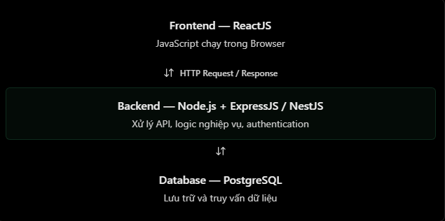

# Node.js cơ bản

## 1. Node.js là gì?

**Node.js** là môi trường chạy (JavaScript runtime) cho phép thực thi JavaScript bên ngoài trình duyệt. Node.js sử dụng JavaScript engine **V8** và cung cấp các API để làm việc với hệ điều hành, mạng, tệp và tiến trình.

Node.js thường được dùng để:

- Xây dựng backend, REST API hoặc GraphQL API.
- Làm việc với cơ sở dữ liệu qua thư viện/driver phù hợp.
- Đọc, ghi tệp; xử lý dữ liệu hoặc tác vụ nền.
- Viết command-line tool, script tự động hoá và công cụ phát triển.
- Xây dựng ứng dụng thời gian thực như chat hoặc notification.

> Node.js không phải là ngôn ngữ lập trình và cũng không phải framework. Ngôn ngữ là JavaScript; Express và NestJS là các framework có thể chạy trên Node.js.



## 2. Node.js khác trình duyệt như thế nào?

Cả Node.js và trình duyệt đều có thể chạy JavaScript, nhưng chúng phục vụ môi trường khác nhau nên API được cung cấp cũng khác nhau.

| Tiêu chí          | Trình duyệt                                            | Node.js                             |
| ----------------- | ------------------------------------------------------ | ----------------------------------- |
| Mục đích chính    | Hiển thị giao diện, tương tác người dùng               | Server, API, CLI và tác vụ nền      |
| JavaScript engine | Tuỳ trình duyệt: V8, SpiderMonkey, JavaScriptCore, ... | V8                                  |
| DOM / `document`  | Có                                                     | Không có mặc định                   |
| `window`          | Có                                                     | Không có mặc định                   |
| `process`         | Không có Node.js `process`                             | Có                                  |
| File system       | Bị giới hạn bởi sandbox của trình duyệt                | Có qua `node:fs`                    |
| HTTP              | `fetch`, Web APIs                                      | `fetch`, `node:http`, thư viện HTTP |

`fetch()` hiện có ở trình duyệt và các bản Node.js hiện đại; vì vậy không nên xem nó là API chỉ của trình duyệt.

### Ví dụ: mã dành cho trình duyệt

```js
const title = document.querySelector("h1");
title.textContent = "Hello Browser!";
```

Đoạn mã này dùng DOM. Nếu chạy trực tiếp trong Node.js, thông thường sẽ nhận lỗi `ReferenceError: document is not defined`.

### Ví dụ: làm việc với tệp trong Node.js

```js
const fs = require("node:fs");

fs.writeFileSync("hello.txt", "Hello Node.js!", "utf8");
console.log("File created!");
```

`node:fs` là module tích hợp sẵn của Node.js. `writeFileSync()` tạo mới hoặc ghi đè nội dung tệp; nên ưu tiên các API bất đồng bộ trong server để không chặn xử lý các yêu cầu khác.

## 3. Bất đồng bộ và event loop

JavaScript chạy mã ứng dụng trên một luồng chính. Node.js không vì thế mà chỉ xử lý được một việc tại một thời điểm: với I/O như đọc tệp, truy vấn mạng hoặc database, Node.js đăng ký tác vụ và tiếp tục xử lý công việc khác. Khi tác vụ hoàn tất, callback hoặc Promise tương ứng sẽ được đưa về **event loop** để chạy.

Điều này đặc biệt phù hợp với ứng dụng có nhiều tác vụ I/O. Tuy nhiên, các phép tính CPU nặng chạy lâu trên luồng chính vẫn có thể chặn event loop. Với trường hợp đó, hãy cân nhắc tối ưu thuật toán, chạy tác vụ nền, hoặc dùng `worker_threads`/một dịch vụ riêng.

```js
const fs = require("node:fs/promises");

async function readConfig() {
  const content = await fs.readFile("config.json", "utf8");
  return JSON.parse(content);
}
```

## 4. REST API tối giản bằng Node.js

Không cần framework, Node.js đã có module `node:http` để tạo HTTP server. Framework như Express/NestJS giúp tổ chức route, middleware, validation và xử lý lỗi thuận tiện hơn khi dự án lớn.

```js
const http = require("node:http");

const server = http.createServer((request, response) => {
  if (request.method === "GET" && request.url === "/users") {
    response.writeHead(200, {
      "Content-Type": "application/json; charset=utf-8",
    });
    response.end(JSON.stringify({ users: ["Nhat", "Minh"] }));
    return;
  }

  response.writeHead(404, {
    "Content-Type": "application/json; charset=utf-8",
  });
  response.end(JSON.stringify({ message: "Not found" }));
});

server.listen(3000, () =>
  console.log("Server running at http://localhost:3000"),
);
```

Khi client gửi `GET http://localhost:3000/users`, server trả về JSON. Node.js cung cấp runtime và API HTTP; code server hoặc framework quyết định cách route và xử lý request/response.

## 5. Hiểu nhầm thường gặp

| Hiểu nhầm                                         | Giải thích đúng                                                   |
| ------------------------------------------------- | ----------------------------------------------------------------- |
| Node.js là ngôn ngữ lập trình                     | JavaScript là ngôn ngữ; Node.js là runtime.                       |
| Node.js là framework                              | Express, NestJS, Fastify... mới là framework.                     |
| Node.js chỉ dùng cho backend                      | Nó còn dùng cho CLI, tooling, script và background job.           |
| Node.js có `window` và `document` như trình duyệt | Không có mặc định vì Node.js không cung cấp DOM.                  |
| Node.js tự động nhanh cho mọi tác vụ              | Nó mạnh ở I/O bất đồng bộ; CPU-bound work có thể chặn event loop. |

## 6. Câu hỏi ôn tập

1. Vì sao một đoạn mã dùng `document` không chạy trực tiếp được trong Node.js?
2. Phân biệt Node.js, JavaScript và Express/NestJS.
3. Khi nào một tác vụ có thể làm chậm toàn bộ server Node.js?
4. Module tích hợp sẵn nào giúp tạo HTTP server và làm việc với tệp?

## 7. Ví dụ thực hành

Các ví dụ trong thư mục `NodeJS/Example` dùng ExpressJS. Cài dependency một lần từ thư mục `NodeJS`:

```bash
cd NodeJS
npm install
```

Sau đó chạy file [NodeJS/Example/nodejs-basics.js](../Example/nodejs-basics.js):

```bash
npm run start:basics
```

Sau đó mở `http://localhost:3000/health` hoặc gọi `GET /users`. Nhấn `Ctrl + C` để dừng server.
