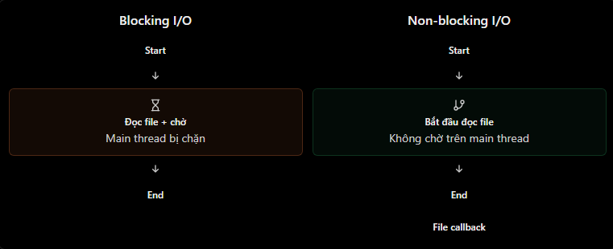

# Non-blocking I/O và Asynchronous Programming

## 1. I/O là gì?

**I/O** (Input/Output) là việc chương trình trao đổi dữ liệu với hệ thống bên ngoài. Trong backend Node.js, các I/O phổ biến gồm:

- Đọc hoặc ghi file.
- Gọi cơ sở dữ liệu qua Prisma, driver PostgreSQL/MySQL, ...
- Gửi HTTP request đến dịch vụ khác.
- Giao tiếp qua network, socket hoặc message queue.

Ví dụ sau là database I/O vì ứng dụng phải gửi yêu cầu và chờ database trả dữ liệu:

```js
const user = await prisma.user.findUnique({
  where: { email: "user@example.com" },
});
```

## 2. Blocking I/O và non-blocking I/O

| Loại | Điều xảy ra trên main thread | API Node.js ví dụ |
| --- | --- | --- |
| Blocking I/O | Main thread phải chờ thao tác xong mới chạy được dòng tiếp theo. | `fs.readFileSync()` |
| Non-blocking I/O | Main thread đăng ký thao tác rồi có thể làm việc khác trong lúc chờ kết quả. | `fs.readFile()`, `fs.promises.readFile()` |

### Blocking I/O

```js
const fs = require("node:fs");

console.log("Start");
const data = fs.readFileSync("data.txt", "utf8");
console.log(data);
console.log("End");
```

Nếu đọc file thành công, thứ tự là `Start` → nội dung file → `End`. Trong lúc `readFileSync()` chờ I/O, main thread bị block; đây là điều nên tránh trong request handler của server.

### Non-blocking I/O

```js
const fs = require("node:fs/promises");

async function readData() {
  console.log("Start");
  const filePromise = fs.readFile("data.txt", "utf8");
  console.log("Continue doing other work");

  const data = await filePromise;
  console.log(data);
}
```

Sau khi khởi động `readFile()`, main thread có thể tiếp tục chạy JavaScript khác. Khi file đã đọc xong, phần sau `await` được lên lịch để tiếp tục.



> Non-blocking không làm I/O hoàn thành nhanh hơn. Nó chỉ giúp main thread không phải đứng chờ trong thời gian I/O chưa hoàn tất.

## 3. Asynchronous programming là gì?

Lập trình bất đồng bộ là cách tổ chức mã để bắt đầu một tác vụ, sau đó nhận kết quả của nó vào thời điểm sau. Node.js thường biểu diễn tác vụ bất đồng bộ bằng ba cách:

| Cách | Ví dụ |
| --- | --- |
| Callback | `fs.readFile(path, callback)` |
| Promise | `readFile(path).then(...).catch(...)` |
| `async` / `await` | `const data = await readFile(path)` |

`async`/`await` là cú pháp giúp code Promise dễ đọc hơn; nó không tự biến một API đồng bộ thành non-blocking.

```js
async function getUsers() {
  const users = await prisma.user.findMany();
  return users;
}
```

Khi Promise từ `findMany()` còn pending, chỉ hàm `getUsers()` tạm dừng ở `await`. Main thread vẫn có thể xử lý callback khác. Ngược lại, một vòng lặp CPU nặng bên trong hàm `async` vẫn block main thread nếu không có điểm `await` một thao tác bất đồng bộ thực sự.

## 4. Ví dụ với ExpressJS

```js
app.get("/users", async (req, res, next) => {
  try {
    const users = await prisma.user.findMany();
    res.json({ data: users });
  } catch (error) {
    next(error);
  }
});

app.get("/health", (req, res) => {
  res.json({ status: "ok" });
});
```

Giả sử `/users` đang chờ database:

1. Express gọi route handler `/users`.
2. `findMany()` bắt đầu I/O tới database.
3. Route handler tạm dừng tại `await` khi Promise chưa hoàn tất.
4. Node.js có thể xử lý `/health` hoặc request khác.
5. Khi database trả kết quả, handler `/users` tiếp tục và gửi response.

Điều này không có nghĩa database do event loop thực thi. Database thực hiện câu SQL; event loop điều phối thời điểm JavaScript xử lý kết quả.

## 5. Khi async vẫn bị block

```js
app.get("/heavy", async (req, res) => {
  const start = Date.now();

  while (Date.now() - start < 5000) {
    // CPU-bound synchronous work: vẫn block main thread.
  }

  res.json({ message: "Done" });
});
```

Từ khoá `async` ở đây không giúp vòng lặp trở nên bất đồng bộ. Để xử lý CPU-bound work, hãy cân nhắc tối ưu thuật toán, dùng `worker_threads`, job queue hoặc service riêng.

## 6. Hiểu nhầm thường gặp

| Hiểu nhầm | Giải thích đúng |
| --- | --- |
| Non-blocking nghĩa là code luôn chạy nhanh hơn | Lợi ích chính là main thread không chờ I/O; thời gian I/O có thể không đổi. |
| `async`/`await` luôn non-blocking | Phụ thuộc API được `await`; CPU-bound synchronous code vẫn block. |
| `await` chặn toàn bộ Node.js | Nó chỉ tạm dừng async function hiện tại khi Promise đang pending. |
| `readFileSync()` và `readFile()` giống nhau | Một API chặn main thread, API kia hỗ trợ đọc bất đồng bộ. |
| Async code không cần xử lý lỗi | Vẫn cần `try/catch`, `.catch()` hoặc middleware lỗi phù hợp. |

## 7. Câu hỏi ôn tập

1. Non-blocking I/O khác blocking I/O ở điểm nào?
2. Vì sao `await` không tự biến vòng lặp CPU dài thành non-blocking?
3. Trong lúc route chờ database, Node.js có thể làm gì khác?
4. Khi nào nên dùng `fs.readFileSync()` và khi nào không nên dùng trong server?

## 8. Ví dụ thực hành

Ví dụ Express nằm tại [NodeJS/Example/nonblocking-asynchronous.js](../Example/nonblocking-asynchronous.js). Cài dependency một lần (hoặc sau khi xoá `node_modules`):

```bash
cd NodeJS
npm install
npm run start:nonblocking
```

Sau đó, gọi `/users` và ngay lập tức gọi `/health`: `/health` có thể phản hồi trong khi `/users` vẫn chờ. Route `/heavy?ms=3000` chỉ dùng để thấy CPU-bound work chặn main thread.
