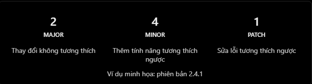
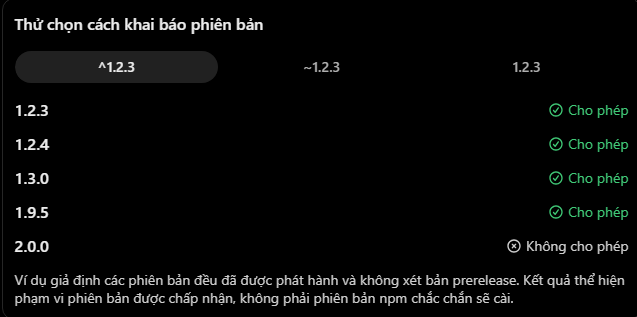
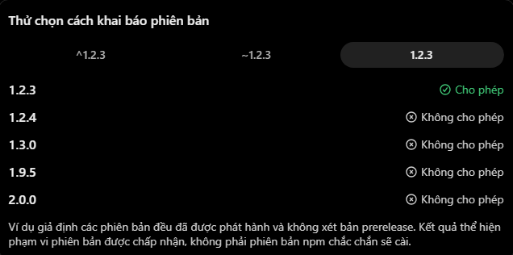
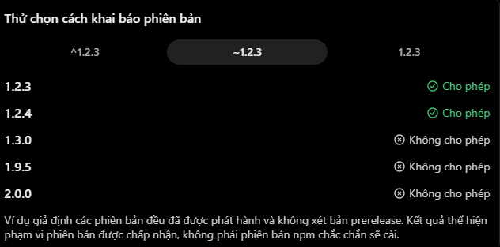

# Semantic Versioning và version range trong npm

## 1. Semantic Versioning là gì?

**Semantic Versioning (SemVer)** là quy ước đặt phiên bản phần mềm theo cấu trúc:

```text
MAJOR.MINOR.PATCH
Ví dụ: 2.4.1
```



| Thành phần | Khi nào tăng? | Ví dụ |
| --- | --- | --- |
| MAJOR | Có thay đổi public API không tương thích ngược. | `1.9.0` → `2.0.0` |
| MINOR | Thêm chức năng tương thích ngược hoặc đánh dấu API cũ là deprecated. | `1.2.4` → `1.3.0` |
| PATCH | Sửa bug tương thích ngược. | `1.2.4` → `1.2.5` |

SemVer chỉ có ý nghĩa khi package tác giả tuân thủ quy ước. Một patch hoặc minor version vẫn có thể có lỗi, vì vậy cập nhật dependency vẫn cần test.

> Phiên bản `0.y.z` được SemVer xem là giai đoạn phát triển ban đầu: public API có thể chưa ổn định và thay đổi bất cứ lúc nào.

## 2. Pre-release và build metadata

SemVer còn hỗ trợ:

```text
1.2.3-alpha.1   # pre-release
1.2.3+build.45  # build metadata
```

- Pre-release có hậu tố sau `-`, ví dụ `alpha`, `beta`, `rc.1`. Nó có độ ưu tiên thấp hơn bản release tương ứng: `1.2.3-rc.1 < 1.2.3`.
- Build metadata có hậu tố sau `+`. Nó không làm thay đổi thứ tự ưu tiên phiên bản: `1.2.3+build.1` và `1.2.3+build.2` có cùng precedence.

Thông thường, npm range không tự nhận pre-release trừ khi range đã nhắc rõ đến pre-release phù hợp. Hãy cẩn thận khi cài bản alpha/beta/rc.

## 3. Fixed version, caret và tilde

Ví dụ trong `package.json`:

```json
{
  "dependencies": {
    "package-a": "^1.2.3",
    "package-b": "~1.2.3",
    "package-c": "1.2.3"
  }
}
```

| Cú pháp | Range tương đương | Ý nghĩa |
| --- | --- | --- |
| `^1.2.3` | `>=1.2.3 <2.0.0` | Cho phép minor và patch trong major 1. |
| `~1.2.3` | `>=1.2.3 <1.3.0` | Cho phép patch trong dòng 1.2.x. |
| `1.2.3` | Chỉ `1.2.3` | Phiên bản cố định. |







### Quy tắc quan trọng của caret với 0.x

Caret cho phép thay đổi mà không đổi **chữ số khác 0 đầu tiên**:

| Range | Range tương đương |
| --- | --- |
| `^1.2.3` | `>=1.2.3 <2.0.0` |
| `^0.2.3` | `>=0.2.3 <0.3.0` |
| `^0.0.3` | `>=0.0.3 <0.0.4` |

Do `0.x` chưa ổn định theo SemVer, caret thận trọng hơn so với `1.x`. Đừng ghi nhớ đơn giản rằng `^` luôn chỉ chặn major version.

### Một vài biến thể của tilde

| Range | Range tương đương |
| --- | --- |
| `~1.2.3` | `>=1.2.3 <1.3.0` |
| `~1.2` | `>=1.2.0 <1.3.0` |
| `~1` | `>=1.0.0 <2.0.0` |

Vì vậy, “tilde chỉ cho phép patch” chỉ đúng khi minor đã được chỉ rõ, ví dụ `~1.2.3`.

## 4. Version range và package-lock.json

`package.json` khai báo range mà dự án chấp nhận, còn `package-lock.json` ghi dependency tree cụ thể đã được resolve.

Giả sử:

```json
{
  "dependencies": {
    "express": "^5.1.0"
  }
}
```

Nếu lockfile đang khoá Express tại `5.1.0`, `npm ci` cài đúng dependency tree đã khoá. Khi `5.2.0` xuất hiện, `npm install` cũng không bắt buộc tự nâng cấp nếu lockfile hiện tại còn hợp lệ. Dấu `^` không có nghĩa mỗi lần cài npm sẽ luôn lấy bản mới nhất trong range.

Để chủ động cập nhật các package trong range, có thể dùng:

```bash
npm update
```

Sau khi cập nhật, review thay đổi của `package-lock.json` và chạy test. Nếu muốn npm lưu version cố định khi cài package mới:

```bash
npm install express@5.1.0 --save-exact
```

`--save-exact` ghi `5.1.0` thay vì range mặc định vào `package.json`. Dù dùng version cố định hay range, lockfile vẫn quan trọng để tái tạo toàn bộ dependency tree.

## 5. Chọn range nào?

| Tình huống | Lựa chọn thường dùng | Lý do |
| --- | --- | --- |
| Ứng dụng có lockfile và CI | `^` hoặc range phù hợp + commit lockfile | Cho phép cập nhật có kiểm soát, nhưng CI vẫn reproducible. |
| Cần giới hạn update trong một minor line | `~1.2.3` | Chỉ nhận patch của 1.2.x. |
| Cần kiểm soát chính xác dependency trực tiếp | `1.2.3` hoặc `--save-exact` | Không tự mở rộng range cho direct dependency. |
| Package đang ở `0.x` | Đọc kỹ changelog và range caret | Compatibility có thể thay đổi sớm hơn major 1. |

Không có range nào thay thế được test, review dependency update và lockfile.

## 6. Hiểu nhầm thường gặp

| Hiểu nhầm | Giải thích đúng |
| --- | --- |
| `^1.2.3` cho phép lên `2.0.0` | Không, upper bound là trước `2.0.0`. |
| `~1.2.3` cho phép lên `1.3.0` | Không, upper bound là trước `1.3.0`. |
| `1.2.3` cho phép `1.2.4` | Không, đây là fixed version. |
| `^0.2.3` cho phép `0.3.0` | Không, upper bound là trước `0.3.0`. |
| Patch version luôn an toàn tuyệt đối | SemVer là quy ước; vẫn cần test. |
| `^` luôn cài bản mới nhất mỗi lần `npm install` | Lockfile hợp lệ giữ dependency tree đã resolve. |
| Bản `beta` tương đương bản release | Pre-release có độ ưu tiên thấp hơn release và có thể chưa ổn định. |

## 7. Câu hỏi ôn tập

### 1. Semantic Versioning là gì?

SemVer là quy ước phiên bản `MAJOR.MINOR.PATCH`. MAJOR biểu thị thay đổi không tương thích ngược, MINOR thêm tính năng tương thích ngược, PATCH sửa bug tương thích ngược.

### 2. `^1.2.3` khác `~1.2.3` như thế nào?

`^1.2.3` chấp nhận các phiên bản từ `1.2.3` đến trước `2.0.0`, nên nhận được cả minor và patch. `~1.2.3` chỉ chấp nhận từ `1.2.3` đến trước `1.3.0`, nên chỉ nhận patch trong dòng 1.2.x.

### 3. Version cố định có ý nghĩa gì trong package.json?

Khai báo `1.2.3` yêu cầu đúng version `1.2.3` cho dependency trực tiếp; nó không cho phép npm chọn `1.2.4`. Lockfile vẫn cần để khoá cả dependencies con.

### 4. Vì sao `^0.2.3` không giống `^1.2.3`?

Với caret, npm không đổi chữ số khác 0 đầu tiên. Vì thế `^0.2.3` chỉ tới trước `0.3.0`, trong khi `^1.2.3` tới trước `2.0.0`.

### 5. npm có luôn cài version mới nhất mà range cho phép không?

Không. Nếu `package-lock.json` hợp lệ, `npm install` thường giữ dependency tree đã khoá. Dùng `npm update` hoặc thay đổi dependency một cách chủ động, sau đó review lockfile và chạy test.
