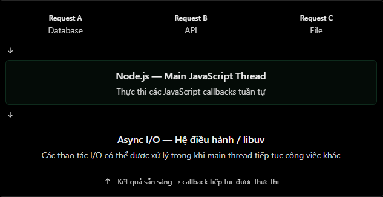

# Node.js và mô hình single-threaded

## 1. “Single-threaded” nghĩa là gì?

**Thread** là một luồng thực thi trong tiến trình. Trong Node.js, mã JavaScript của một tiến trình thông thường được thực thi trên **một main thread**. Vì vậy, tại một thời điểm chỉ có một đoạn JavaScript đồng bộ chạy trên main thread đó.

```js
console.log("Task A");
console.log("Task B");
console.log("Task C");
```

Kết quả luôn theo thứ tự:

```text
Task A
Task B
Task C
```

Điều này không có nghĩa toàn bộ Node.js chỉ có đúng một thread. Node.js có thể dùng các thread nền của hệ thống/libuv cho một số công việc I/O và có thể chạy thêm JavaScript trong `worker_threads`. Tuy nhiên, callback JavaScript của một ứng dụng Node thông thường vẫn quay lại chạy trên main thread.

## 2. Vì sao một main thread vẫn phục vụ được nhiều request?

Node.js phù hợp với nhiều tác vụ **I/O-bound** như gọi database, đọc tệp hoặc gọi dịch vụ khác. Khi khởi tạo một thao tác I/O bất đồng bộ, main thread không cần đứng chờ kết quả. Nó có thể chuyển sang xử lý callback hoặc request khác; khi I/O hoàn tất, callback tương ứng được event loop sắp xếp để chạy trên main thread.

Ví dụ trình tự có thể là:

1. Request A bắt đầu truy vấn database bất đồng bộ.
2. Trong lúc chờ database, main thread xử lý request B.
3. Database trả kết quả cho A; callback của A được đưa vào hàng đợi để chạy khi main thread rảnh.



Đây là **concurrency**: nhiều công việc cùng tiến triển xen kẽ. Nó không đồng nghĩa với việc callback JavaScript của các request chạy song song trên nhiều main thread.

## 3. Ví dụ: I/O không chặn main thread

```js
app.get("/slow", (request, response) => {
  setTimeout(() => {
    response.json({ message: "Slow response" });
  }, 3000);
});

app.get("/fast", (request, response) => {
  response.json({ message: "Fast response" });
});
```

Nếu gọi `/slow` rồi gọi `/fast` ngay sau đó, `/fast` có thể trả về trước. `setTimeout()` chỉ đăng ký một timer; nó không làm callback JavaScript chạy ở thread riêng. Sau thời gian chờ, callback vẫn chạy trên main thread khi event loop có thể xử lý nó.

## 4. Khi nào single-threaded trở thành vấn đề?

Một đoạn JavaScript đồng bộ, dùng CPU lâu sẽ chiếm main thread và trì hoãn mọi callback khác. Ví dụ dưới đây cố tình chặn server:

```js
app.get("/block", (request, response) => {
  const start = Date.now();

  while (Date.now() - start < 5000) {
    // Tác vụ CPU-bound, giữ main thread bận trong khoảng 5 giây.
  }

  response.json({ message: "Done" });
});
```

Trong khoảng thời gian này, server không thể chạy JavaScript callback để trả lời nhanh các request khác. Kết nối có thể vẫn được hệ điều hành nhận, nhưng việc xử lý response bị trễ cho đến khi main thread rảnh.

Với CPU-bound work, các hướng xử lý phổ biến là:

- Tối ưu thuật toán hoặc chia nhỏ công việc để không chiếm main thread quá lâu.
- Dùng `worker_threads` cho tác vụ tính toán nặng trong cùng ứng dụng.
- Chuyển tác vụ dài sang job queue hoặc dịch vụ chuyên biệt.
- Chạy nhiều process/instance để tận dụng nhiều lõi CPU khi phù hợp.

## 5. Phân biệt I/O-bound và CPU-bound

| Loại công việc | Ví dụ | Tác động lên main thread |
| --- | --- | --- |
| I/O-bound | Chờ database, network, file bất đồng bộ | Thường nhường main thread khi đang chờ |
| CPU-bound | Nén dữ liệu lớn, xử lý ảnh, vòng lặp tính toán dài | Có thể chặn main thread nếu chạy đồng bộ |

## 6. Hiểu nhầm thường gặp

| Hiểu nhầm | Giải thích đúng |
| --- | --- |
| Single-threaded nghĩa là Node.js chỉ xử lý một request | Node.js có thể quản lý nhiều I/O cùng lúc; JavaScript callback vẫn chạy lần lượt trên main thread. |
| `setTimeout()` tạo một JavaScript thread mới | Nó đăng ký timer; callback chạy lại trên main thread. |
| I/O bất đồng bộ khiến JavaScript chạy song song | I/O có thể diễn ra ngoài main thread, nhưng callback JavaScript không tự chạy song song. |
| Node.js hoàn toàn chỉ có một thread | Ngoài main thread còn có cơ chế nền và `worker_threads` khi ứng dụng sử dụng. |
| Garbage collector hoặc `async/await` giải quyết CPU blocking | Chúng không làm vòng lặp CPU đồng bộ tự trở nên không chặn. |

## 7. Câu hỏi ôn tập

1. Vì sao `/fast` có thể trả về trước `/slow` trong ví dụ timer?
2. Tại sao một vòng lặp `while` dài có thể làm chậm mọi request khác?
3. Concurrency khác parallelism như thế nào trong bối cảnh Node.js?
4. Khi nào nên cân nhắc dùng `worker_threads`?

## 8. Ví dụ thực hành

Các ví dụ trong thư mục `NodeJS/Example` dùng ExpressJS. Cài dependency một lần từ thư mục `NodeJS`:

```bash
cd NodeJS
npm install
```

Sau đó chạy file [NodeJS/Example/single-threaded.js](../Example/single-threaded.js):

```bash
npm run start:single-threaded
```

Trong hai terminal khác nhau, thử gửi đồng thời các request sau:

```bash
curl http://localhost:3000/slow
curl http://localhost:3000/fast
```

`/fast` sẽ phản hồi trước `/slow`. Sau đó gọi `/block?ms=3000` và ngay lập tức gọi `/fast`; request `/fast` sẽ bị trì hoãn. Chỉ dùng `/block` để học tập, không dùng kiểu xử lý này trong server thật.
