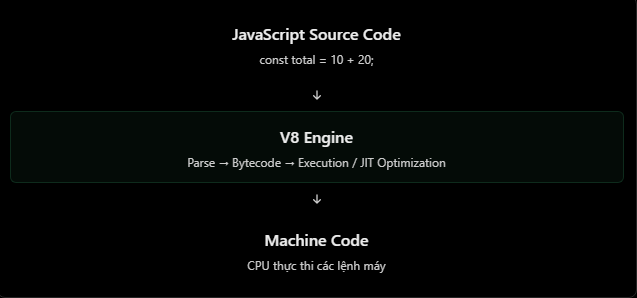

# V8 Engine

## 1. V8 Engine là gì?

**V8** là JavaScript engine mã nguồn mở, ban đầu do Google phát triển. Engine là thành phần đọc và thực thi mã JavaScript. V8 được dùng trong Chrome và Node.js.

Có thể phân biệt đơn giản:

- **JavaScript**: ngôn ngữ mà lập trình viên viết.
- **V8**: engine thực thi JavaScript.
- **Node.js**: runtime tích hợp V8, đồng thời bổ sung API cho hệ điều hành, mạng, file system, tiến trình và nhiều khả năng khác.

```js
const first = 10;
const second = 20;

console.log(first + second); // 30
```

Khi chạy bằng Node.js, V8 thực thi phép gán, phép cộng và lời gọi `console.log()` trong đoạn mã trên. Bản thân `console` là API do runtime cung cấp, không phải một ngôn ngữ JavaScript độc lập.

## 2. V8 xử lý mã JavaScript như thế nào?

Ở mức khái quát, V8 đi qua các bước sau:

1. **Parse** mã nguồn để kiểm tra cú pháp và tạo biểu diễn nội bộ của chương trình.
2. **Tạo bytecode** để trình thông dịch thực thi nhanh khi mã lần đầu được chạy.
3. **Tối ưu hoá JIT**: với các đoạn mã chạy nhiều lần và có thông tin kiểu/shape ổn định, V8 có thể biên dịch thành mã máy tối ưu hơn.
4. **Deoptimization**: nếu giả định tối ưu không còn đúng, V8 có thể quay về dạng ít tối ưu hơn để vẫn đảm bảo kết quả chính xác.
5. **Garbage collection (GC)**: tự động thu hồi bộ nhớ của các object không còn có thể truy cập.



Tên và cấu trúc các thành phần nội bộ của V8 có thể thay đổi theo phiên bản. Điều quan trọng cần nhớ là V8 không chỉ biên dịch toàn bộ mã một lần trước khi chạy; nó kết hợp thông dịch, biên dịch đúng lúc (JIT) và tối ưu hoá khi chương trình đang chạy.

### Garbage collection

Khi một object không còn được tham chiếu từ các giá trị còn sống của chương trình, V8 có thể thu hồi vùng nhớ của object đó. Lập trình viên JavaScript không tự `free` bộ nhớ, nhưng vẫn cần tránh giữ tham chiếu không cần thiết, ví dụ cache không giới hạn hoặc event listener không được huỷ.

## 3. V8 và Node.js: phần nào làm việc gì?

| Thành phần | V8 Engine | Node.js |
| --- | --- | --- |
| Vai trò | JavaScript engine | JavaScript runtime |
| Thực thi JavaScript | Có | Tích hợp V8 để thực thi |
| Parse, bytecode, JIT, GC | Có | Sử dụng khả năng của V8 |
| `node:fs`, `node:http`, `process` | Không cung cấp | Cung cấp |
| Event loop và I/O bất đồng bộ | Không phải trách nhiệm riêng của V8 | Node.js phối hợp với libuv và các API Node |
| DOM (`window`, `document`) | Không cung cấp | Không cung cấp mặc định |

Ví dụ với một HTTP server: Node.js nhận kết nối, cung cấp API request/response và điều phối I/O; V8 thực thi callback JavaScript mà ứng dụng viết. Vì vậy, nói “V8 trực tiếp xử lý HTTP request” là không chính xác.

```js
const http = require("node:http");

http
  .createServer((request, response) => {
    const result = 10 + 20; // Biểu thức JavaScript do V8 thực thi.
    response.end(JSON.stringify({ result }));
  })
  .listen(3000);
```

## 4. Kiểm tra thông tin V8 trong Node.js

Node.js công khai phiên bản V8 qua `process.versions.v8`:

```bash
node -p "process.versions.v8"
```

Hoặc trong mã JavaScript:

```js
console.log(process.versions.v8);
```

Module tích hợp `node:v8` cũng cung cấp một số thông tin chẩn đoán, chẳng hạn thống kê heap:

```js
const v8 = require("node:v8");

console.log(v8.getHeapStatistics());
```

Các giá trị cụ thể phụ thuộc phiên bản Node.js, hệ điều hành và trạng thái chạy hiện tại của tiến trình.

## 5. Hiểu nhầm thường gặp

| Hiểu nhầm | Giải thích đúng |
| --- | --- |
| V8 và Node.js là một | V8 là engine; Node.js là runtime sử dụng V8. |
| V8 chỉ được dùng trong Node.js | Chrome cũng sử dụng V8. |
| V8 cung cấp `node:fs` hoặc `node:http` | Đây là các module do Node.js cung cấp. |
| V8 trực tiếp xử lý event loop và HTTP | Runtime như Node.js điều phối các phần này; V8 chạy mã JavaScript. |
| GC khiến mọi vấn đề bộ nhớ tự biến mất | GC thu hồi object không còn truy cập được, nhưng không xử lý các tham chiếu bị giữ nhầm hoặc cache tăng vô hạn. |
| JIT luôn làm mọi đoạn code nhanh hơn | Tối ưu hoá phụ thuộc vào dữ liệu chạy thực tế; CPU-bound code vẫn cần được đo đạc và tối ưu cẩn thận. |

## 6. Câu hỏi ôn tập

1. Phân biệt JavaScript, V8 và Node.js.
2. Vì sao Node.js có thể dùng `node:fs` nhưng V8 không tự cung cấp module này?
3. JIT optimisation và deoptimization có ý nghĩa gì ở mức khái quát?
4. Garbage collector có tự sửa memory leak do cache không giới hạn không? Vì sao?

## 7. Ví dụ thực hành

Các ví dụ trong thư mục `NodeJS/Example` dùng ExpressJS. Cài dependency một lần từ thư mục `NodeJS`:

```bash
cd NodeJS
npm install
```

Sau đó chạy file [NodeJS/Example/v8-engine.js](../Example/v8-engine.js):

```bash
npm run start:v8
```

Gọi `GET /v8-info` để xem phiên bản V8 và thống kê heap, hoặc `GET /sum` để xem một biểu thức JavaScript được thực thi trong route handler.
