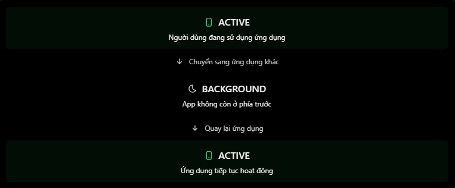

# React Native Theory

## 11. App lifecycle: foreground / background

### 1. App lifecycle là gì?

App lifecycle là vòng đời hoạt động của một ứng dụng mobile. Nó mô tả các trạng thái mà app trải qua khi người dùng mở app, chuyển sang app khác, khóa màn hình hoặc quay trở lại app.

Trong React Native, API quan trọng nhất để theo dõi trạng thái này là `AppState`.

| Trạng thái | Ý nghĩa | Ví dụ |
| --- | --- | --- |
| `active` | App đang ở foreground và có thể tương tác | Người dùng đang sử dụng màn hình Home |
| `background` | App đã chuyển xuống nền | Người dùng chuyển sang Zalo hoặc về Home screen |
| `inactive` | Trạng thái chuyển tiếp, chủ yếu trên iOS | Đang chuyển app, mở Control Center, nhận cuộc gọi |

Foreground là khi app đang ở phía trước để người dùng tương tác. Background là khi app không còn là app đang tương tác trực tiếp.

Điểm quan trọng: app ở background không có nghĩa là app đã bị đóng hoặc bị hủy. Hệ điều hành có thể giữ app trong bộ nhớ, tạm dừng hoạt động hoặc kết thúc tiến trình khi cần.

### 2. AppState là gì?

`AppState` là API chính thức của React Native, dùng để:

- Đọc trạng thái hiện tại của app.
- Lắng nghe khi app chuyển giữa foreground/background.
- Xử lý một số event liên quan như memory warning hoặc focus/blur trên Android.

| API | Chức năng |
| --- | --- |
| `AppState.currentState` | Lấy trạng thái hiện tại của app |
| `AppState.addEventListener("change", callback)` | Lắng nghe khi trạng thái app thay đổi |
| `subscription.remove()` | Hủy listener khi không còn cần thiết |
| `AppState.addEventListener("memoryWarning", callback)` | Lắng nghe cảnh báo bộ nhớ |
| `AppState.addEventListener("focus", callback)` | Android: app nhận focus |
| `AppState.addEventListener("blur", callback)` | Android: app mất focus |

Lưu ý: trong một số trường hợp khởi động app, `AppState.currentState` có thể chưa sẵn sàng ngay lập tức vì trạng thái được lấy từ native side.

### 3. Ví dụ cơ bản

```jsx
import React, { useEffect, useState } from "react";
import { AppState, Text, View } from "react-native";

export default function HomeScreen() {
  const [appState, setAppState] = useState(AppState.currentState);

  useEffect(() => {
    const subscription = AppState.addEventListener("change", (nextState) => {
      setAppState(nextState);
    });

    return () => {
      subscription.remove();
    };
  }, []);

  return (
    <View>
      <Text>App State: {appState}</Text>
    </View>
  );
}
```

Giải thích:

- `AppState.currentState`: lấy trạng thái ban đầu của app.
- `addEventListener("change", ...)`: đăng ký listener theo dõi trạng thái.
- `setAppState(nextState)`: cập nhật UI khi trạng thái thay đổi.
- `subscription.remove()`: dọn dẹp listener khi component unmount.

### 4. Flow lifecycle thường gặp

Minh họa:



Flow phổ biến:

```txt
User mở app
        ↓
active
        ↓
User chuyển sang app khác / khóa màn hình
        ↓
background
        ↓
User quay lại app
        ↓
active
```

Trên iOS, có thể xuất hiện trạng thái `inactive` ở giữa các bước chuyển đổi.

### 5. Ví dụ thực tế: Refresh dữ liệu khi quay lại app

Giả sử đang xây ứng dụng giao hàng. Người dùng đang xem danh sách đơn hàng, sau đó chuyển sang app khác. Khi quay lại, app nên tải lại danh sách đơn hàng vì trạng thái giao hàng có thể đã thay đổi.

```jsx
import { useEffect, useRef } from "react";
import { AppState } from "react-native";

export default function OrderScreen() {
  const previousState = useRef(AppState.currentState);

  useEffect(() => {
    const subscription = AppState.addEventListener("change", (nextState) => {
      const wasInBackground = previousState.current !== "active";
      const isNowActive = nextState === "active";

      if (wasInBackground && isNowActive) {
        console.log("Refresh orders from API");
      }

      previousState.current = nextState;
    });

    return () => {
      subscription.remove();
    };
  }, []);

  return null;
}
```

Flow:

```txt
background / inactive
        ↓
active
        ↓
Refresh orders
```

Ở đây:

- `useRef` lưu trạng thái trước đó mà không làm component render lại.
- Khi app chuyển từ trạng thái không active sang `active`, ta gọi logic refresh.
- `AppState` theo dõi trạng thái toàn app, không phải việc chuyển giữa các screen trong React Navigation.

### 6. AppState không phải screen lifecycle

`AppState` khác với lifecycle của từng màn hình.

| Tình huống | Nên dùng gì? |
| --- | --- |
| App chuyển foreground/background | `AppState` |
| Màn hình trong React Navigation được focus | `useFocusEffect` hoặc listener `focus` |
| Component mount/unmount | `useEffect` cleanup |
| Cần chạy background task thật sự | Native background task / background fetch / location background service |

Ví dụ: người dùng chuyển từ `HomeScreen` sang `ProfileScreen` trong cùng app. Lúc đó `AppState` vẫn có thể là `active`, vì app vẫn đang foreground.

### 7. Android vs iOS

| Trường hợp | Điều cần nhớ |
| --- | --- |
| Người dùng chuyển sang app khác | App có thể chuyển sang `background` |
| iOS | Có thêm trạng thái `inactive` |
| Android | Có event `focus` / `blur`; đôi khi `AppState` không đổi |
| App ở background | Không được giả định JavaScript tiếp tục chạy vô hạn |
| App bị hệ điều hành kill | Listener không còn chạy |
| Quên cleanup listener | Có thể gây listener trùng lặp |

Đặc biệt, `AppState` không phải công cụ để đảm bảo chạy background service. Android và iOS đều có giới hạn thực thi nền riêng.

### 8. memoryWarning

React Native cũng hỗ trợ event `memoryWarning`.

```jsx
useEffect(() => {
  const subscription = AppState.addEventListener("memoryWarning", () => {
    console.log("Memory warning: clear cache if needed");
  });

  return () => {
    subscription.remove();
  };
}, []);
```

Khi nhận memory warning, app có thể cân nhắc:

- Xóa cache tạm.
- Giảm dữ liệu giữ trong memory.
- Hủy tác vụ không cần thiết.

### 9. Android focus và blur

Trên Android, `AppState` có thêm event `focus` và `blur`.

Ví dụ: khi người dùng kéo notification drawer xuống, app có thể mất focus nhưng `AppState` vẫn không chuyển sang `background`.

```jsx
useEffect(() => {
  const focusSubscription = AppState.addEventListener("focus", () => {
    console.log("Android app gained focus");
  });

  const blurSubscription = AppState.addEventListener("blur", () => {
    console.log("Android app lost focus");
  });

  return () => {
    focusSubscription.remove();
    blurSubscription.remove();
  };
}, []);
```

### 10. Những lỗi và hiểu nhầm thường gặp

| Lỗi hoặc hiểu nhầm | Cách hiểu đúng |
| --- | --- |
| Nghĩ background nghĩa là app đã bị đóng | App có thể vẫn còn trong memory |
| Nghĩ AppState dùng để biết screen nào đang mở | AppState theo dõi toàn app, không theo dõi screen |
| Quên cleanup listener | Cần gọi `subscription.remove()` trong cleanup |
| Gọi API mỗi lần AppState thay đổi mà không kiểm tra state trước | Nên chỉ refresh khi quay lại `active` |
| Nghĩ AppState đảm bảo chạy background task | Không đúng; cần background task/native API phù hợp |
| Không xử lý `inactive` trên iOS | Có thể bỏ lỡ trạng thái chuyển tiếp |
| Dùng `removeEventListener` theo API cũ | Nên dùng object subscription và gọi `remove()` |

### 11. File example

File example cho phần này:

```txt
ReactNative/Example/app-lifecycle.jsx
```

Có thể copy component `App` trong file example vào project React Native hoặc Expo để chạy thử.

### 12. Câu hỏi thường gặp

1. `AppState` trong React Native là gì?
   - `AppState` là API cho phép kiểm tra app đang ở foreground/background và lắng nghe khi trạng thái app thay đổi.
2. Sự khác nhau giữa `active` và `background` là gì?
   - `active` là app đang ở foreground và có thể tương tác. `background` là app không còn ở phía trước.
3. Làm thế nào để phát hiện người dùng quay lại app?
   - Dùng `AppState.addEventListener("change", callback)`, lưu trạng thái trước đó, và kiểm tra khi app chuyển từ không active sang `active`.
4. Vì sao cần xóa AppState listener?
   - Để tránh listener trùng lặp, memory leak và xử lý event không cần thiết khi component đã unmount.
5. `AppState` có dùng để chạy background service không?
   - Không. `AppState` chỉ báo trạng thái app. Nếu cần background task thật sự, cần dùng API/thư viện phù hợp với Android/iOS.
