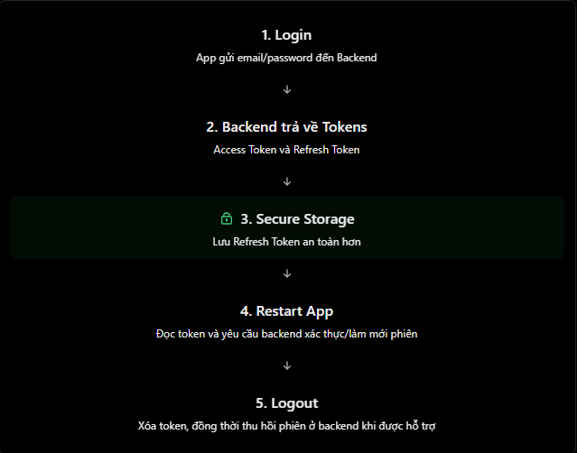

# React Native Theory

## 8. AsyncStorage và Secure Storage

### 1. AsyncStorage vs Secure Storage là gì?

`AsyncStorage` và `Secure Storage` đều dùng để lưu dữ liệu trên thiết bị, giúp app có thể đọc lại dữ liệu sau khi đóng và mở lại ứng dụng.

Điểm khác biệt quan trọng nhất nằm ở mức độ bảo mật.

| Tiêu chí | AsyncStorage | Secure Storage |
| --- | --- | --- |
| Mục đích | Lưu dữ liệu thông thường | Lưu dữ liệu nhạy cảm |
| Mã hóa | Không mã hóa mặc định | Dùng cơ chế bảo mật của hệ điều hành |
| Kiểu dữ liệu | Key-value, string | Key-value, string |
| Tồn tại sau restart app | Có | Có |
| Ví dụ | Theme, language, onboarding flag, settings | Refresh token, credential nhỏ |
| Nên lưu token nhạy cảm? | Không | Có thể dùng, nhưng vẫn cần kiểm tra bảo mật tổng thể |

Với Secure Storage, React Native thường dùng:

- `expo-secure-store`: phù hợp với dự án Expo.
- `react-native-keychain`: thường dùng trong React Native CLI.

Các thư viện Secure Storage tận dụng cơ chế bảo mật của hệ điều hành, ví dụ iOS Keychain và Android Keystore.

### 2. Cài đặt

AsyncStorage:

```bash
npm install @react-native-async-storage/async-storage
```

Với Expo SecureStore:

```bash
npx expo install expo-secure-store
```

Với React Native CLI, có thể dùng `react-native-keychain`:

```bash
npm install react-native-keychain
```

### 3. Cách sử dụng AsyncStorage

Ví dụ app cần ghi nhớ người dùng đã chọn dark mode.

```jsx
import AsyncStorage from "@react-native-async-storage/async-storage";

const THEME_KEY = "@app/theme";

async function saveTheme(theme) {
  await AsyncStorage.setItem(THEME_KEY, theme);
}

async function getTheme() {
  const theme = await AsyncStorage.getItem(THEME_KEY);
  return theme;
}

async function removeTheme() {
  await AsyncStorage.removeItem(THEME_KEY);
}
```

Giải thích:

- `setItem(key, value)`: lưu dữ liệu.
- `getItem(key)`: đọc dữ liệu, trả về string hoặc `null` nếu không tồn tại.
- `removeItem(key)`: xóa dữ liệu theo key.
- `await`: chờ thao tác bất đồng bộ hoàn thành.

Nên đặt key có prefix như `@app/theme` để tránh trùng tên với key khác.

### 4. Lưu object trong AsyncStorage

AsyncStorage chỉ lưu string. Nếu muốn lưu object, cần dùng `JSON.stringify()` khi lưu và `JSON.parse()` khi đọc.

```jsx
const USER_KEY = "@app/user";

const user = {
  id: "u1",
  name: "Nhat",
};

async function saveUser() {
  await AsyncStorage.setItem(USER_KEY, JSON.stringify(user));
}

async function getUser() {
  const raw = await AsyncStorage.getItem(USER_KEY);
  return raw ? JSON.parse(raw) : null;
}
```

Lưu ý: ví dụ trên chỉ minh họa cơ chế lưu object. Không nên lưu thông tin nhạy cảm của người dùng bằng AsyncStorage.

### 5. Cách sử dụng Secure Storage với Expo SecureStore

Ví dụ backend trả về `refreshToken` sau khi đăng nhập thành công. Với Expo, có thể lưu token bằng `expo-secure-store`.

```jsx
import * as SecureStore from "expo-secure-store";

const REFRESH_TOKEN_KEY = "refreshToken";

async function saveRefreshToken(refreshToken) {
  await SecureStore.setItemAsync(REFRESH_TOKEN_KEY, refreshToken);
}

async function getRefreshToken() {
  const token = await SecureStore.getItemAsync(REFRESH_TOKEN_KEY);
  return token;
}

async function removeRefreshToken() {
  await SecureStore.deleteItemAsync(REFRESH_TOKEN_KEY);
}
```

Giải thích:

- `setItemAsync(key, value)`: lưu dữ liệu bảo mật.
- `getItemAsync(key)`: đọc dữ liệu đã lưu, trả về string hoặc `null`.
- `deleteItemAsync(key)`: xóa dữ liệu theo key.

Với `expo-secure-store`, dữ liệu được lưu bằng Android Keystore trên Android và Keychain trên iOS.

### 6. Cách sử dụng Secure Storage với react-native-keychain

Với React Native CLI, có thể dùng `react-native-keychain`.

```jsx
import * as Keychain from "react-native-keychain";

async function saveRefreshToken(refreshToken) {
  await Keychain.setGenericPassword("session", refreshToken, {
    service: "auth",
  });
}

async function getRefreshToken() {
  const credentials = await Keychain.getGenericPassword({
    service: "auth",
  });

  return credentials ? credentials.password : null;
}

async function removeRefreshToken() {
  await Keychain.resetGenericPassword({
    service: "auth",
  });
}
```

Giải thích:

- `setGenericPassword()`: lưu credential vào secure storage.
- `getGenericPassword()`: đọc credential đã lưu.
- `resetGenericPassword()`: xóa credential.
- `service`: phân biệt nhóm credential được lưu.

Trong ví dụ này, refresh token được lưu trong trường `password`.

### 7. Flow thực tế: Login -> Restart App -> Logout

Minh họa:



Flow thường gặp:

```txt
User login thành công
        ↓
Server trả về accessToken và refreshToken
        ↓
accessToken giữ trong memory/state
refreshToken lưu trong Secure Storage
        ↓
User đóng và mở lại app
        ↓
App đọc refreshToken từ Secure Storage
        ↓
Gọi API refresh session hoặc verify token
        ↓
Nếu hợp lệ -> vào app
Nếu không hợp lệ -> yêu cầu login lại
        ↓
User logout
        ↓
Xóa token khỏi memory và Secure Storage
```

Điểm quan trọng: có token trong storage không có nghĩa là phiên đăng nhập còn hợp lệ. App vẫn cần kiểm tra với backend hoặc refresh session.

### 8. Android và iOS khác nhau thế nào?

Với `expo-secure-store`:

- Android: dữ liệu được lưu trong `SharedPreferences` và mã hóa bằng khóa được bảo vệ bởi Android Keystore.
- iOS: dữ liệu được lưu bằng Keychain.

Về persistence:

- Dữ liệu thường tồn tại sau khi tắt/mở app và sau khi update app.
- Trên Android, dữ liệu SecureStore không được giữ sau khi uninstall app.
- Trên iOS, Keychain có thể vẫn còn sau khi uninstall rồi cài lại cùng bundle id, nhưng không nên phụ thuộc hoàn toàn vào hành vi này.

### 9. Nên lưu gì ở đâu?

| Dữ liệu | Nên lưu ở đâu? | Lý do |
| --- | --- | --- |
| Theme | AsyncStorage | Không nhạy cảm |
| Language | AsyncStorage | Không nhạy cảm |
| Onboarding completed | AsyncStorage | Không nhạy cảm |
| Cart draft | AsyncStorage hoặc database local | Tùy kích thước dữ liệu |
| Access token ngắn hạn | Memory/state | Giảm rủi ro bị đọc lại từ storage |
| Refresh token | Secure Storage | Nhạy cảm hơn access token |
| Password người dùng | Không nên tự lưu | Nên dùng hệ thống auth/token an toàn |

### 10. Những lỗi và hiểu nhầm thường gặp

| Lỗi hoặc hiểu nhầm | Cách hiểu đúng |
| --- | --- |
| Lưu refresh token trong AsyncStorage | Nên dùng Secure Storage |
| Quên `JSON.stringify()` khi lưu object | AsyncStorage chỉ lưu string |
| Quên `JSON.parse()` khi đọc object | Dữ liệu đọc ra vẫn là string |
| Dùng `getItem()` như hàm đồng bộ | Cần `await` hoặc xử lý Promise |
| Nghĩ state sẽ tồn tại sau restart app | State thường mất khi app restart |
| Nghĩ Secure Storage bảo mật tuyệt đối | Secure Storage giảm rủi ro, không loại bỏ mọi nguy cơ |
| App mở lại thấy token là cho login ngay | Vẫn cần kiểm tra hiệu lực phiên đăng nhập |
| Lưu dữ liệu quá lớn vào Secure Storage | Secure Storage phù hợp với chuỗi nhỏ, nhạy cảm |

### 11. File example

File example cho phần này:

```txt
ReactNative/Example/asyncstorage-securestorage.jsx
```

Có thể copy component `App` trong file example vào project React Native hoặc Expo đã cài `@react-native-async-storage/async-storage` và `expo-secure-store` để chạy thử.

### 12. Câu hỏi thường gặp

1. Sự khác nhau giữa AsyncStorage và Secure Storage là gì?
   - AsyncStorage là storage key-value bất đồng bộ, persistent, nhưng không mã hóa mặc định. Secure Storage dùng cơ chế bảo mật của hệ điều hành để bảo vệ dữ liệu nhạy cảm.
2. Nên lưu token xác thực ở đâu?
   - Refresh token nên lưu trong Secure Storage. Access token ngắn hạn có thể giữ trong memory/state tùy kiến trúc auth.
3. Làm thế nào để lưu object trong AsyncStorage?
   - Dùng `JSON.stringify()` trước khi lưu và `JSON.parse()` sau khi đọc.
4. AsyncStorage có giữ dữ liệu sau khi restart app không?
   - Có. AsyncStorage duy trì dữ liệu sau khi đóng/mở app, nhưng không nên dùng để lưu thông tin nhạy cảm.
5. Secure Storage có bảo mật tuyệt đối không?
   - Không. Nó giúp giảm rủi ro bằng cơ chế bảo mật nền tảng, nhưng app vẫn cần thiết kế auth đúng, xử lý logout, refresh token và revoke token phía server.
