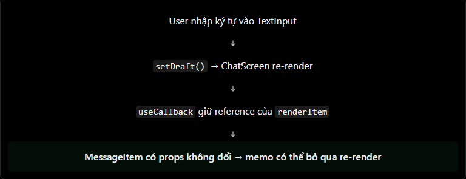

# React Native Theory

## 13. `memo`, `useCallback` và tối ưu re-render

### 1. Component re-render khi nào?

Trong React Native, một component có thể re-render khi:

- State của chính component thay đổi.
- Component cha re-render và render lại component con.
- Props mà component nhận được thay đổi.
- Context mà component đang sử dụng thay đổi.

Re-render là hành vi bình thường của React và không đồng nghĩa với việc toàn bộ native view bị tạo lại. Sau khi component chạy lại, React sẽ so sánh kết quả render mới với kết quả trước đó rồi chỉ cập nhật phần giao diện thực sự thay đổi.

Vấn đề hiệu năng thường xuất hiện khi một màn hình re-render thường xuyên và có nhiều component con tốn chi phí render, ví dụ như màn hình chat, danh bạ hoặc danh sách sản phẩm. Khi đó, `memo` và `useCallback` có thể giúp giảm những lần render không cần thiết.

### 2. So sánh `memo` và `useCallback`

| Tiêu chí              | `memo`                             | `useCallback`                             |
| --------------------- | ---------------------------------- | ----------------------------------------- |
| Áp dụng cho           | Component                          | Function bên trong component              |
| Ghi nhớ               | Kết quả render gần nhất theo props | Tham chiếu của function                   |
| Điều kiện tái sử dụng | Các props không thay đổi           | Các dependencies không thay đổi           |
| Mục đích thường gặp   | Bỏ qua re-render của component con | Giữ function prop hoặc dependency ổn định |

#### `memo`

`memo` bọc một component và cho phép React bỏ qua re-render khi component cha render lại nhưng các props của component con vẫn không đổi.

```jsx
import { memo } from "react";
import { Text } from "react-native";

const UserItem = memo(function UserItem({ name }) {
  console.log("UserItem render");

  return <Text>{name}</Text>;
});
```

Mặc định, React so sánh từng prop cũ và mới bằng `Object.is`. Vì vậy:

- Primitive như string, number và boolean thường dễ giữ ổn định.
- Object, array và function mới được tạo ở mỗi lần render có reference khác nhau, dù nội dung trông giống nhau.
- `memo` không ngăn re-render khi state nội bộ hoặc context mà component sử dụng thay đổi.
- `memo` là một tối ưu hiệu năng, không phải sự bảo đảm rằng component sẽ không bao giờ render lại.

#### `useCallback`

`useCallback` lưu lại một function definition giữa các lần render. React trả về cùng một function reference cho đến khi một dependency thay đổi.

```jsx
import { useCallback } from "react";

const handlePress = useCallback(() => {
  console.log("Button pressed");
}, []);
```

`useCallback` không cache kết quả của function và cũng không ngăn function được thực thi. Hook này thường hữu ích khi:

- Truyền callback xuống component con đã được bọc bằng `memo`.
- Function là dependency của một hook khác.
- API hoặc custom hook cần một function reference ổn định.

### 3. Vì sao `memo` thường đi cùng `useCallback`?

Xét component con đã được bọc bằng `memo`:

```jsx
const MemoButton = memo(function MemoButton({ onPress }) {
  return <Pressable onPress={onPress}>{/* ... */}</Pressable>;
});
```

Nếu component cha truyền một function mới ở mỗi lần render, prop `onPress` luôn có reference mới:

```jsx
<MemoButton onPress={() => handleLogin()} />
```

Khi đó, `memo` thấy prop đã thay đổi và không thể bỏ qua re-render. Có thể giữ callback ổn định như sau:

```jsx
const handlePressLogin = useCallback(() => {
  handleLogin();
}, [handleLogin]);

<MemoButton onPress={handlePressLogin} />;
```

Tuy nhiên, `useCallback` chỉ có ích cho `MemoButton` nếu các prop còn lại của component cũng ổn định. Chỉ một object, array hoặc function mới cũng đủ làm component con re-render.

### 4. Ví dụ thực tế: tối ưu màn hình chat

Giả sử người dùng nhập nội dung vào `TextInput`. Mỗi ký tự làm state `draft` thay đổi và khiến `ChatScreen` re-render. Các tin nhắn cũ không thay đổi, vì vậy ta muốn tránh render lại từng `MessageItem`.

```jsx
import React, { memo, useCallback, useState } from "react";
import { FlatList, Text, TextInput, View } from "react-native";

const messages = [
  { id: "1", text: "Hello" },
  { id: "2", text: "How are you?" },
  { id: "3", text: "I am fine!" },
];

const MessageItem = memo(function MessageItem({ text }) {
  console.log("MessageItem render:", text);

  return <Text>{text}</Text>;
});

export default function ChatScreen() {
  const [draft, setDraft] = useState("");

  const renderItem = useCallback(({ item }) => {
    return <MessageItem text={item.text} />;
  }, []);

  const keyExtractor = useCallback((item) => item.id, []);

  return (
    <View style={{ flex: 1 }}>
      <TextInput
        value={draft}
        onChangeText={setDraft}
        placeholder="Type a message"
      />

      <FlatList
        data={messages}
        keyExtractor={keyExtractor}
        renderItem={renderItem}
      />
    </View>
  );
}
```

Trong ví dụ trên:

1. `setDraft` làm `ChatScreen` re-render.
2. `messages`, `renderItem` và `keyExtractor` vẫn giữ reference cũ.
3. Các prop `text` của `MessageItem` không đổi.
4. `memo` có thể bỏ qua re-render của các tin nhắn cũ.



`messages` được khai báo bên ngoài component vì đây là dữ liệu tĩnh. Với dữ liệu lấy từ API hoặc có thể thay đổi, thông thường danh sách sẽ nằm trong state; khi cập nhật, cần tránh tạo lại các item không thay đổi nếu muốn tận dụng tốt `memo`.

### 5. Dependency và stale closure

Mọi giá trị reactive được đọc bên trong callback cần có trong dependency array, trừ các giá trị có reference ổn định như setter trả về từ `useState`.

Ví dụ sai:

```jsx
const handleSelect = useCallback(() => {
  console.log(selectedId);
}, []);
```

Callback trên giữ lại `selectedId` của lần render đầu tiên. Khi `selectedId` thay đổi, callback vẫn có thể đọc giá trị cũ. Cách sửa:

```jsx
const handleSelect = useCallback(() => {
  console.log(selectedId);
}, [selectedId]);
```

Khi chỉ cần state hiện tại để tính state tiếp theo, updater function có thể giúp giảm dependency:

```jsx
const handleAddMessage = useCallback((newMessage) => {
  setMessages((currentMessages) => [...currentMessages, newMessage]);
}, []);
```

Không nên xóa dependency chỉ để giữ callback ổn định. Hãy tuân theo cảnh báo của rule `react-hooks/exhaustive-deps`.

### 6. Những lỗi và hiểu nhầm thường gặp

| Hiểu nhầm                                               | Cách hiểu đúng                                                                                          |
| ------------------------------------------------------- | ------------------------------------------------------------------------------------------------------- |
| Parent re-render thì mọi child chắc chắn phải re-render | React sẽ gọi lại child thông thường, nhưng một child dùng `memo` có thể được bỏ qua nếu props không đổi |
| `memo` chặn mọi re-render                               | State nội bộ, context hoặc props thay đổi vẫn làm component re-render                                   |
| `useCallback` làm function chạy nhanh hơn               | Nó chỉ giữ function reference ổn định; phần thân function vẫn chạy bình thường                          |
| Dùng `useCallback` là component con tự hết re-render    | Component con cần được memo hóa và các prop khác cũng phải ổn định                                      |
| Dependency `[]` luôn tốt hơn                            | Dependency thiếu có thể tạo stale closure và gây lỗi logic                                              |
| Càng dùng nhiều memoization thì app càng nhanh          | Memoization cũng có chi phí so sánh, lưu trữ và làm code phức tạp hơn                                   |

### 7. Khi nào nên tối ưu?

Nên cân nhắc `memo` và `useCallback` khi:

- Component con render tương đối tốn chi phí.
- Component cha re-render thường xuyên.
- Props của component con thường giữ nguyên.
- Danh sách dài hoặc item có giao diện phức tạp.
- Đã quan sát thấy vấn đề qua React DevTools Profiler, log render hoặc trải nghiệm thực tế.

Chưa cần tối ưu nếu component nhỏ, render nhanh hoặc props thay đổi ở hầu hết các lần render. Trước tiên, hãy giữ state gần nơi sử dụng, tránh Effect không cần thiết và đo hiệu năng trước khi thêm memoization.

> Mẹo nhớ: `memo` giúp ổn định việc render của **component**, còn `useCallback` giúp ổn định reference của **function**.

### 8. File ví dụ

Ví dụ hoàn chỉnh nằm tại:

```txt
ReactNative/Example/memo-usecallback-optimizerender.jsx
```

Ví dụ cho phép chuyển đổi giữa hai chế độ trên cùng một danh sách:

- Danh sách chưa tối ưu nhận function prop mới sau mỗi lần parent re-render.
- Danh sách đã tối ưu kết hợp `memo` và `useCallback` để giữ props ổn định.
- Khi nhập vào `TextInput`, có thể mở console để so sánh số lần render của item.

Có thể copy component `App` vào một dự án React Native hoặc Expo để chạy thử.

### 9. Câu hỏi thường gặp

#### 1. `memo` trong React Native là gì?

`memo` là API tối ưu hiệu năng cho phép React bỏ qua re-render của một component khi các props của nó không thay đổi.

#### 2. Mục đích của `useCallback` là gì?

`useCallback` giữ cùng một function reference giữa các lần render cho đến khi một dependency thay đổi.

#### 3. `memo` và `useCallback` làm việc cùng nhau như thế nào?

`memo` so sánh props để quyết định có bỏ qua re-render của component con hay không. `useCallback` giúp function prop giữ nguyên reference, nhờ đó function không trở thành một prop mới ngoài ý muốn.

#### 4. Có nên dùng `memo` và `useCallback` ở mọi nơi không?

Không. Chỉ nên dùng khi chúng giải quyết một vấn đề hiệu năng có thật hoặc giúp đáp ứng yêu cầu về reference ổn định. Tối ưu không cần thiết có thể làm code khó đọc và khó bảo trì hơn.

#### 5. `useCallback(fn, deps)` có giống `useMemo(() => fn, deps)` không?

Hai cách có ý nghĩa gần tương đương về việc giữ function reference, nhưng `useCallback` diễn đạt đúng mục đích và không cần bọc thêm một function trả về.
