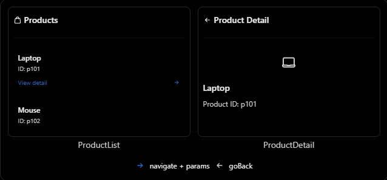

# React Native Theory

## 7. Passing Params, navigate và goBack

### 1. Sơ lược

Sau khi hiểu `Stack Navigator`, phần tiếp theo là cách chuyển màn hình, truyền dữ liệu sang màn hình khác và quay lại màn hình trước.

| Khái niệm | Chức năng |
| --- | --- |
| `navigation.navigate()` | Điều hướng đến một screen |
| `params` | Dữ liệu truyền đến screen đích |
| `route.params` | Đọc dữ liệu đã được truyền vào screen |
| `navigation.goBack()` | Quay lại màn hình trước đó |
| `navigation.canGoBack()` | Kiểm tra có thể quay lại hay không |

Ví dụ flow thường gặp:

```txt
ProductList
    ↓ navigate("ProductDetail", { productId: "p101" })
ProductDetail
    ↓ goBack()
ProductList
```

### 2. navigation.navigate()

`navigation.navigate()` dùng để chuyển từ màn hình hiện tại sang một screen khác đã được đăng ký trong navigator.

Chuyển màn hình không truyền params:

```jsx
navigation.navigate("ProductDetail");
```

Chuyển màn hình và truyền params:

```jsx
navigation.navigate("ProductDetail", {
  productId: "p101",
});
```

Trong đó:

- `"ProductDetail"` là tên screen đã đăng ký trong navigator.
- `{ productId: "p101" }` là object chứa params cần truyền.

Params nên được truyền dưới dạng object để dễ mở rộng:

```jsx
navigation.navigate("ProductDetail", {
  productId: "p101",
  source: "home_banner",
});
```

Không nên truyền kiểu này:

```jsx
navigation.navigate("ProductDetail", "p101");
```

### 3. route.params

Ở màn hình đích, có thể đọc params thông qua `route.params`.

```jsx
function ProductDetailScreen({ route }) {
  const { productId } = route.params;

  return <Text>Product ID: {productId}</Text>;
}
```

Kết quả hiển thị:

```txt
Product ID: p101
```

Nếu params có thể không tồn tại, nên dùng optional chaining hoặc fallback value:

```jsx
function ProductDetailScreen({ route }) {
  const productId = route.params?.productId ?? "unknown";

  return <Text>Product ID: {productId}</Text>;
}
```

### 4. navigation.goBack()

`navigation.goBack()` dùng để quay lại màn hình trước đó trong navigation history.

```jsx
navigation.goBack();
```

Trong `Stack Navigator`, thao tác này thường đưa người dùng trở về màn hình nằm ngay phía dưới màn hình hiện tại trong stack.

Không cần truyền tên screen cho `goBack()`:

```jsx
navigation.goBack();
```

Không nên viết:

```jsx
navigation.goBack("ProductList");
```

Nếu không chắc có màn hình trước đó hay không, có thể kiểm tra bằng `canGoBack()`:

```jsx
if (navigation.canGoBack()) {
  navigation.goBack();
}
```

Minh họa:



### 5. Ví dụ thực tế: ProductList -> ProductDetail -> Back

Giả sử đang xây một ứng dụng e-commerce. Màn hình danh sách sản phẩm chỉ truyền `productId` sang màn hình chi tiết.

```tsx
import React from "react";
import { Pressable, Text, View } from "react-native";
import { NavigationContainer } from "@react-navigation/native";
import {
  createNativeStackNavigator,
  type NativeStackScreenProps,
} from "@react-navigation/native-stack";

type RootStackParamList = {
  ProductList: undefined;
  ProductDetail: { productId: string };
};

const Stack = createNativeStackNavigator<RootStackParamList>();

type ListProps = NativeStackScreenProps<RootStackParamList, "ProductList">;
type DetailProps = NativeStackScreenProps<RootStackParamList, "ProductDetail">;

function ProductListScreen({ navigation }: ListProps) {
  return (
    <Pressable
      onPress={() =>
        navigation.navigate("ProductDetail", {
          productId: "p101",
        })
      }
    >
      <Text>View Laptop</Text>
    </Pressable>
  );
}

function ProductDetailScreen({ navigation, route }: DetailProps) {
  const { productId } = route.params;

  return (
    <View>
      <Text>Product ID: {productId}</Text>

      <Pressable onPress={() => navigation.goBack()}>
        <Text>Go Back</Text>
      </Pressable>
    </View>
  );
}

export default function App() {
  return (
    <NavigationContainer>
      <Stack.Navigator>
        <Stack.Screen name="ProductList" component={ProductListScreen} />
        <Stack.Screen name="ProductDetail" component={ProductDetailScreen} />
      </Stack.Navigator>
    </NavigationContainer>
  );
}
```

Giải thích:

- `RootStackParamList`: định nghĩa screen nào nhận params gì.
- `ProductList: undefined`: màn hình này không yêu cầu params.
- `ProductDetail: { productId: string }`: màn hình này cần `productId`.
- `navigation.navigate()`: chuyển sang `ProductDetail` và gửi `productId`.
- `route.params`: nhận `productId` tại `ProductDetail`.
- `navigation.goBack()`: quay lại `ProductList`.

Flow hoạt động:

```txt
ProductList Screen
        ↓
Nhấn View Laptop
        ↓
navigate("ProductDetail", { productId: "p101" })
        ↓
ProductDetail Screen
        ↓
route.params.productId = "p101"
        ↓
Nhấn Go Back
        ↓
navigation.goBack()
        ↓
Trở về ProductList
```

### 6. Nên truyền dữ liệu gì qua params?

Trong ứng dụng thực tế, thường nên truyền dữ liệu tối thiểu, ví dụ `id`, `slug`, `filter`, `sort`.

Nên truyền:

```jsx
navigation.navigate("ProductDetail", {
  productId: "p101",
});
```

Không nên truyền cả object lớn:

```jsx
navigation.navigate("ProductDetail", {
  product: {
    id: "p101",
    name: "Laptop",
    price: 1200,
    reviews: [],
    relatedProducts: [],
  },
});
```

Lý do:

- Dữ liệu lớn làm navigation state nặng hơn.
- Object có thể bị lỗi thời nếu dữ liệu ở API/cache đã thay đổi.
- Params nên dễ serialize để hỗ trợ restore state, deep linking và debugging.
- Màn hình detail có thể dùng `productId` để lấy dữ liệu mới nhất từ API hoặc cache.

### 7. initialParams

Nếu muốn screen có params mặc định, có thể dùng `initialParams` khi đăng ký screen.

```jsx
<Stack.Screen
  name="ProductDetail"
  component={ProductDetailScreen}
  initialParams={{ productId: "default-product" }}
/>
```

Khi đó `route.params.productId` sẽ có giá trị mặc định nếu không có params mới được truyền vào.

### 8. Truyền dữ liệu về màn hình trước

`goBack()` chỉ quay lại màn hình trước đó, không phải API chính để gửi params.

Nếu cần truyền dữ liệu về màn hình trước, có thể dùng cách điều hướng về screen trước kèm params. Với React Navigation hiện tại, tài liệu chính thức cũng nhắc đến `popTo` cho trường hợp quay lại màn hình trước và truyền params.

Ví dụ ý tưởng:

```jsx
navigation.popTo("ProductList", {
  selectedProductId: "p101",
});
```

Sau đó màn hình `ProductList` đọc lại qua `route.params`.

Tùy version React Navigation và navigator đang dùng, API có thể khác nhau. Với người mới học, trước tiên nên nắm chắc ba phần chính:

```txt
navigate -> truyền params sang màn hình mới
route.params -> đọc params ở màn hình hiện tại
goBack -> quay lại theo lịch sử điều hướng
```

### 9. Các lỗi và hiểu nhầm thường gặp

| Lỗi hoặc hiểu nhầm | Cách hiểu đúng |
| --- | --- |
| `navigate("ProductDetail", "p101")` | Thường truyền params bằng object: `{ productId: "p101" }` |
| Đọc `navigation.params` | Dùng `route.params` |
| `navigation.goBack("ProductList")` | `goBack()` quay lại theo history, không nhận tên screen |
| Điều hướng đến sai tên screen | Tên phải khớp với screen đã đăng ký |
| Nghĩ `navigate()` luôn tạo một screen mới | Hành vi phụ thuộc navigator và navigation state |
| Gọi `goBack()` khi không có lịch sử | Có thể kiểm tra bằng `navigation.canGoBack()` |
| Truyền function/class instance qua params | Nên truyền dữ liệu serializable, nhỏ gọn |
| Truyền cả object lớn qua params | Nên truyền ID rồi lấy dữ liệu ở màn hình đích |

Điểm cần nhớ:

```txt
navigate() = đi đến một screen
goBack()   = quay lại theo navigation history
```

Hai thao tác này không hoàn toàn đối xứng nhau.

### 10. File example

File example cho phần này:

```txt
ReactNative/Example/passingparams-navigate-goBack.jsx
```

Có thể copy component `App` trong file example vào project React Native hoặc Expo đã cài React Navigation để chạy thử.

### 11. Câu hỏi thường gặp

1. Mục đích của `navigation.navigate()` là gì?
   - `navigation.navigate()` dùng để điều hướng tới một screen khác. Có thể truyền params bằng object ở tham số thứ hai.
2. Làm thế nào để truyền dữ liệu giữa các màn hình?
   - Truyền dữ liệu bằng params object trong `navigation.navigate()`, sau đó đọc bằng `route.params` ở màn hình đích.
3. Sự khác nhau giữa `navigate()` và `goBack()` là gì?
   - `navigate()` điều hướng tới một screen cụ thể. `goBack()` quay lại màn hình trước đó trong navigation history.
4. Vì sao nên truyền ID thay vì toàn bộ object qua params?
   - Truyền ID giúp navigation state nhẹ hơn, tránh dữ liệu lỗi thời và giúp màn hình đích lấy dữ liệu mới nhất từ API hoặc cache.
5. Có cần kiểm tra trước khi gọi `goBack()` không?
   - Nếu màn hình có thể được mở trực tiếp hoặc không chắc có màn hình trước đó, nên kiểm tra bằng `navigation.canGoBack()`.
