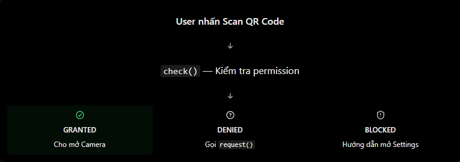

# React Native Theory

## 9. Permission: Camera, Location, Notification

### 1. Permission trong React Native là gì?

Permission là cơ chế bảo mật của Android và iOS, cho phép người dùng quyết định app có được truy cập tính năng hoặc dữ liệu nhạy cảm trên thiết bị hay không.

Ví dụ:

| Permission | Mục đích | Ví dụ thực tế |
| --- | --- | --- |
| Camera | Truy cập camera | Quét QR code, chụp ảnh |
| Location | Truy cập vị trí | Tìm cửa hàng gần bạn, tracking giao hàng |
| Notification | Cho phép hiển thị thông báo | Tin nhắn mới, nhắc lịch, trạng thái đơn hàng |

Điểm quan trọng: khai báo permission trong native config chưa đủ. Với nhiều quyền, app vẫn phải xin quyền lúc chạy và người dùng có thể cho phép hoặc từ chối.

### 2. Hai việc cần làm khi dùng permission

Khi làm permission, thường cần xử lý hai lớp:

| Lớp | Ý nghĩa |
| --- | --- |
| Native configuration | Khai báo quyền và lý do dùng quyền trong `AndroidManifest.xml`, `Info.plist` hoặc `app.json/app.config.js` |
| Runtime request | Gọi API JavaScript để xin quyền khi người dùng cần tính năng |

Ví dụ:

- iOS cần message như `NSCameraUsageDescription`.
- Android cần permission như `android.permission.CAMERA`.
- Sau đó app vẫn cần gọi API như `requestCameraPermissionsAsync()` hoặc `request()`.

### 3. Flow xử lý permission

Flow nên nhớ:



```txt
Người dùng bấm vào tính năng cần quyền
        ↓
App kiểm tra trạng thái permission
        ↓
Nếu đã granted -> chạy tính năng
        ↓
Nếu chưa granted nhưng có thể hỏi lại -> request permission
        ↓
Nếu granted sau request -> chạy tính năng
        ↓
Nếu denied/blocked -> hiển thị hướng dẫn phù hợp
```

Không nên xin tất cả quyền ngay khi mở app. Nên xin quyền đúng thời điểm, khi người dùng thực sự bấm vào tính năng cần quyền.

### 4. Trạng thái permission thường gặp

Nếu dùng Expo module, response thường có các field như:

| Field | Ý nghĩa |
| --- | --- |
| `status` | Trạng thái permission hiện tại |
| `granted` | Boolean cho biết quyền đã được cấp hay chưa |
| `canAskAgain` | Có thể hiển thị prompt xin quyền lại hay không |

Nếu dùng `react-native-permissions`, các trạng thái thường gặp:

| Trạng thái | Ý nghĩa |
| --- | --- |
| `RESULTS.GRANTED` | Đã được cấp quyền |
| `RESULTS.DENIED` | Chưa được cấp hoặc bị từ chối nhưng vẫn có thể yêu cầu |
| `RESULTS.BLOCKED` | Không thể yêu cầu lại bằng dialog thông thường |
| `RESULTS.UNAVAILABLE` | Tính năng/quyền không khả dụng trên thiết bị |
| `RESULTS.LIMITED` | Được cấp quyền với giới hạn nhất định |

Lưu ý: với `react-native-permissions`, trên Android `check()` không trả về `RESULTS.BLOCKED`; cần gọi `request()` để biết quyền có bị blocked hay không.

### 5. Cài đặt với Expo

Nếu dùng Expo, có thể cài các package:

```bash
npx expo install expo-camera expo-location expo-notifications
```

Ví dụ khai báo trong `app.json`:

```json
{
  "expo": {
    "plugins": [
      [
        "expo-camera",
        {
          "cameraPermission": "Allow this app to access your camera."
        }
      ],
      [
        "expo-location",
        {
          "locationWhenInUsePermission": "Allow this app to use your location."
        }
      ],
      [
        "expo-notifications",
        {
          "icon": "./assets/notification-icon.png",
          "color": "#2563eb"
        }
      ]
    ]
  }
}
```

Trong Expo Go, một số cấu hình native có thể chưa phản ánh đầy đủ như production build. Khi app cần permission nghiêm túc, nên kiểm tra trên development build hoặc production build.

### 6. Xin quyền Camera với Expo Camera

```jsx
import { Camera } from "expo-camera";

async function requestCameraPermission() {
  const permission = await Camera.requestCameraPermissionsAsync();

  if (permission.granted) {
    console.log("Camera granted");
    return true;
  }

  if (!permission.canAskAgain) {
    console.log("Camera blocked. User must enable it in Settings.");
  }

  return false;
}
```

Code trên chỉ xử lý permission. Nếu muốn mở camera thật, cần render camera view hoặc dùng tính năng quét/chụp tương ứng của module.

### 7. Xin quyền Location với Expo Location

Với vị trí, thường chia thành:

- Foreground location: app lấy vị trí khi đang được sử dụng.
- Background location: app lấy vị trí khi chạy nền, cần lý do rõ ràng và cấu hình kỹ hơn.

Ví dụ xin foreground location:

```jsx
import * as Location from "expo-location";

async function requestLocationPermission() {
  const permission = await Location.requestForegroundPermissionsAsync();

  if (!permission.granted) {
    return null;
  }

  const currentLocation = await Location.getCurrentPositionAsync({});
  return currentLocation.coords;
}
```

Lưu ý:

- Không nên xin background location nếu app không thật sự cần.
- iOS có khái niệm `When In Use` và `Always`.
- Android có thể phân biệt vị trí gần đúng và chính xác tùy phiên bản/hành vi hệ điều hành.

### 8. Xin quyền Notification với Expo Notifications

Notification có chút khác biệt vì nó không chỉ là quyền truy cập dữ liệu, mà còn liên quan đến việc hệ điều hành có cho phép app hiển thị thông báo hay không.

```jsx
import { Platform } from "react-native";
import * as Notifications from "expo-notifications";

async function requestNotificationPermission() {
  if (Platform.OS === "android") {
    await Notifications.setNotificationChannelAsync("default", {
      name: "Default",
      importance: Notifications.AndroidImportance.DEFAULT,
    });
  }

  const permission = await Notifications.requestPermissionsAsync({
    ios: {
      allowAlert: true,
      allowBadge: true,
      allowSound: true,
    },
  });

  return permission.granted;
}
```

Lưu ý:

- Trên Android 13+, notification là runtime permission.
- Với Android, nên tạo notification channel trước khi hiển thị hoặc xin quyền notification trong một số flow.
- Xin quyền notification không đồng nghĩa với việc đã có push token. Nếu cần push notification, còn cần setup project, lấy push token và gửi token về backend.

### 9. Dùng react-native-permissions

Nếu dùng React Native CLI hoặc muốn một API thống nhất cho nhiều quyền, có thể dùng `react-native-permissions`.

```bash
npm install react-native-permissions
```

Ví dụ xin quyền camera:

```jsx
import { Alert, Platform } from "react-native";
import {
  check,
  openSettings,
  PERMISSIONS,
  request,
  RESULTS,
} from "react-native-permissions";

async function ensureCameraPermission() {
  const permission =
    Platform.OS === "android"
      ? PERMISSIONS.ANDROID.CAMERA
      : PERMISSIONS.IOS.CAMERA;

  let status = await check(permission);

  if (status === RESULTS.DENIED) {
    status = await request(permission);
  }

  if (status === RESULTS.GRANTED) {
    return true;
  }

  if (status === RESULTS.BLOCKED) {
    Alert.alert("Permission blocked", "Please enable Camera in Settings.", [
      { text: "Cancel" },
      { text: "Settings", onPress: () => openSettings() },
    ]);
  }

  return false;
}
```

Với notification:

```jsx
import { requestNotifications, RESULTS } from "react-native-permissions";

const { status } = await requestNotifications(["alert", "sound", "badge"]);

if (status === RESULTS.GRANTED) {
  console.log("Notifications allowed");
}
```

### 10. Android vs iOS

| Android | iOS |
| --- | --- |
| Khai báo quyền trong `AndroidManifest.xml` hoặc app config | Khai báo lý do dùng quyền trong `Info.plist` hoặc app config |
| Ví dụ `android.permission.CAMERA` | Ví dụ `NSCameraUsageDescription` |
| Android 13+ có runtime permission `POST_NOTIFICATIONS` | iOS yêu cầu authorization để hiển thị notification |
| Một số quyền có near/precise location | Location có `When In Use` và `Always` |
| Permission có thể bị revoke khi app lâu không dùng | Người dùng có thể thay đổi quyền trong Settings |

Ví dụ Android:

```xml
<uses-permission android:name="android.permission.CAMERA" />
```

Ví dụ iOS:

```xml
<key>NSCameraUsageDescription</key>
<string>We need camera access to scan QR codes.</string>
```

### 11. Những lỗi và hiểu nhầm thường gặp

| Lỗi hoặc hiểu nhầm | Cách hiểu đúng |
| --- | --- |
| Nghĩ gọi `request()` là luôn được cấp quyền | Người dùng có thể từ chối |
| Không xử lý denied/blocked | App cần giải thích và hướng dẫn người dùng |
| Xin tất cả quyền ngay khi mở app | Nên xin quyền đúng lúc người dùng cần tính năng |
| Nghĩ Camera, Location, Notification có cùng API | Mỗi loại quyền có API/hành vi riêng |
| Quên native configuration | JavaScript request không thay thế cấu hình Android/iOS |
| Thấy location permission granted là tracking nền được luôn | Background location cần permission/cấu hình riêng |
| Xin notification permission là có push token ngay | Push notification còn cần token, project setup và backend |
| Không kiểm tra trên thiết bị thật | Permission behavior trên simulator/emulator có thể khác thiết bị thật |

### 12. File example

File example cho phần này:

```txt
ReactNative/Example/permission-camera-location-notification.jsx
```

Có thể copy component `App` trong file example vào project Expo đã cài `expo-camera`, `expo-location` và `expo-notifications` để chạy thử.

### 13. Câu hỏi thường gặp

1. Permission trong React Native là gì?
   - Permission là cơ chế cho phép người dùng kiểm soát app có được truy cập tính năng nhạy cảm như camera, vị trí hoặc notification hay không.
2. Sự khác nhau giữa `check()` và `request()` là gì?
   - `check()` đọc trạng thái hiện tại. `request()` yêu cầu hệ điều hành hiển thị prompt xin quyền nếu còn có thể hỏi người dùng.
3. Nếu người dùng từ chối quyền camera thì nên làm gì?
   - App nên giải thích vì sao cần quyền. Nếu còn có thể hỏi lại, xin lại đúng thời điểm. Nếu bị blocked, hướng dẫn người dùng vào Settings.
4. Camera, Location và Notification có xử lý giống nhau không?
   - Không hoàn toàn. Camera thường là quyền truy cập phần cứng, Location có foreground/background, còn Notification liên quan đến authorization hiển thị thông báo và push setup.
5. Khi nào nên xin quyền?
   - Nên xin khi người dùng bắt đầu dùng tính năng cần quyền, ví dụ bấm `Scan QR`, `Use my location` hoặc `Enable notifications`.
