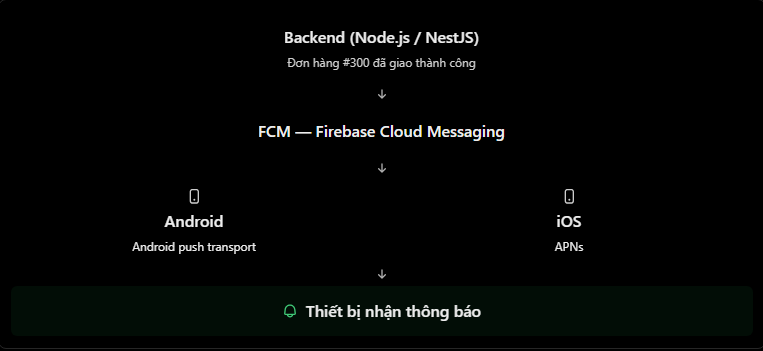
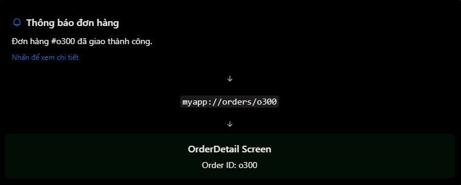

# React Native Theory

## 12. Push Notification và Basic Deep Link

### 1. Push Notification là gì?

Push Notification là thông báo được gửi từ một hệ thống bên ngoài, thường là backend thông qua dịch vụ push, đến thiết bị của người dùng.

Ví dụ trong app e-commerce: khi đơn hàng được giao thành công, backend gửi một thông báo đến điện thoại người dùng, ngay cả khi người dùng không đang mở app.

Minh họa:



Flow tổng quát:

```txt
Mobile app lấy push token
        ↓
Gửi token về backend
        ↓
Backend lưu token theo user/device
        ↓
Khi có sự kiện mới, backend gửi notification qua push service
        ↓
Thiết bị nhận notification
```

### 2. Push token là gì?

Push token là token định danh một app instance trên một thiết bị, dùng để gửi push notification đến đúng thiết bị đó.

Tùy hệ sinh thái, bạn có thể gặp các loại token khác nhau:

| Token | Dùng khi nào? | Ghi chú |
| --- | --- | --- |
| Expo Push Token | Dùng Expo Push Service | Lấy bằng `Notifications.getExpoPushTokenAsync()` |
| FCM Token | Android/Firebase Cloud Messaging | Dùng trực tiếp với FCM hoặc qua thư viện Firebase |
| APNs Token | iOS Apple Push Notification service | Dùng trực tiếp với APNs hoặc qua provider |

Lưu ý:

- Push token khác với JWT access token/refresh token trong authentication.
- Push token có thể thay đổi, nên app cần gửi token mới về backend khi token được tạo hoặc cập nhật.
- Không nên dùng push token như token đăng nhập.

### 3. Cài đặt push notification với Expo

Nếu dùng Expo:

```bash
npx expo install expo-notifications expo-device
```

Ví dụ lấy Expo Push Token:

```jsx
import * as Device from "expo-device";
import * as Notifications from "expo-notifications";
import { Platform } from "react-native";

async function registerForPushNotificationsAsync() {
  if (Platform.OS === "android") {
    await Notifications.setNotificationChannelAsync("default", {
      name: "Default",
      importance: Notifications.AndroidImportance.DEFAULT,
    });
  }

  if (!Device.isDevice) {
    throw new Error("Push notifications need a physical device.");
  }

  const { status: existingStatus } =
    await Notifications.getPermissionsAsync();

  let finalStatus = existingStatus;

  if (existingStatus !== "granted") {
    const { status } = await Notifications.requestPermissionsAsync();
    finalStatus = status;
  }

  if (finalStatus !== "granted") {
    throw new Error("Notification permission not granted.");
  }

  const token = await Notifications.getExpoPushTokenAsync();
  return token.data;
}
```

Điểm cần nhớ:

- Remote push notification cần chạy trên thiết bị thật.
- Với Android, nên tạo notification channel.
- Trong project production, `getExpoPushTokenAsync()` thường cần project id/EAS project config đúng.
- Token nên được gửi về backend để backend gửi notification khi cần.

### 4. Xử lý notification khi app đang mở

Khi app đang foreground, notification có thể không tự hiển thị giống lúc app ở background. App thường cần tự quyết định hiển thị UI nào.

Với Expo:

```jsx
import { useEffect } from "react";
import { Alert } from "react-native";
import * as Notifications from "expo-notifications";

export default function HomeScreen() {
  useEffect(() => {
    const subscription = Notifications.addNotificationReceivedListener(
      (notification) => {
        const { title, body } = notification.request.content;
        Alert.alert(title ?? "Notification", body ?? "");
      },
    );

    return () => {
      subscription.remove();
    };
  }, []);

  return null;
}
```

Với React Native Firebase:

```jsx
import { useEffect } from "react";
import { Alert } from "react-native";
import messaging from "@react-native-firebase/messaging";

export default function HomeScreen() {
  useEffect(() => {
    const unsubscribe = messaging().onMessage(async (remoteMessage) => {
      Alert.alert(
        remoteMessage.notification?.title ?? "Notification",
        remoteMessage.notification?.body ?? "",
      );
    });

    return unsubscribe;
  }, []);

  return null;
}
```

`Alert.alert()` chỉ là UI trong app. Nó không phải notification trong notification tray của hệ điều hành.

### 5. Foreground, background và quit state

| Trạng thái app | Behavior thường gặp |
| --- | --- |
| Foreground | App nhận event; thường tự xử lý UI |
| Background | Hệ điều hành có thể hiển thị notification |
| Quit / terminated | Notification có thể hiển thị, nhưng xử lý khi user nhấn cần API riêng |

Lưu ý:

- Android 13+ yêu cầu runtime permission `POST_NOTIFICATIONS` để hiển thị notification.
- iOS cần request authorization để hiển thị notification.
- Behavior còn phụ thuộc payload, thư viện, cấu hình native và chính sách hệ điều hành.

### 6. Deep Link là gì?

Deep Link là đường dẫn giúp mở app hoặc đưa người dùng đến một màn hình cụ thể bên trong app.

Ví dụ:

```txt
myapp://orders/o300
```

Nếu app đã cấu hình deep link, link trên có thể mở app và điều hướng thẳng đến màn hình `OrderDetail` với `orderId = "o300"`.

Minh họa:



Deep link không bắt buộc phải đi kèm push notification. Người dùng cũng có thể mở deep link từ email, SMS, website hoặc QR code.

### 7. Linking API trong React Native

React Native cung cấp `Linking` để xử lý URL.

| API | Khi nào dùng? |
| --- | --- |
| `Linking.getInitialURL()` | Lấy URL đã dùng để mở app khi app chưa chạy |
| `Linking.addEventListener("url", callback)` | Lắng nghe URL mới khi app đang mở |
| `Linking.openURL(url)` | Mở một URL |

Ví dụ:

```jsx
import { useEffect } from "react";
import { Linking } from "react-native";

export default function App() {
  useEffect(() => {
    Linking.getInitialURL().then((url) => {
      if (url) {
        console.log("Initial URL:", url);
      }
    });

    const subscription = Linking.addEventListener("url", ({ url }) => {
      console.log("Incoming URL:", url);
    });

    return () => {
      subscription.remove();
    };
  }, []);

  return null;
}
```

### 8. Deep link với React Navigation

Với React Navigation, cách khuyến nghị là truyền `linking` prop vào `NavigationContainer`.

```jsx
import { NavigationContainer } from "@react-navigation/native";
import { createNativeStackNavigator } from "@react-navigation/native-stack";

const Stack = createNativeStackNavigator();

const linking = {
  prefixes: ["myapp://", "https://app.example.com"],
  config: {
    screens: {
      Home: "home",
      OrderDetail: "orders/:orderId",
    },
  },
};

export default function App() {
  return (
    <NavigationContainer linking={linking}>
      <Stack.Navigator>
        <Stack.Screen name="Home" component={HomeScreen} />
        <Stack.Screen name="OrderDetail" component={OrderDetailScreen} />
      </Stack.Navigator>
    </NavigationContainer>
  );
}
```

Trong `OrderDetailScreen`:

```jsx
function OrderDetailScreen({ route }) {
  const { orderId } = route.params;

  return <Text>Order ID: {orderId}</Text>;
}
```

Khi app nhận link:

```txt
myapp://orders/o300
```

React Navigation sẽ map path `orders/:orderId` sang screen `OrderDetail` và truyền `orderId = "o300"`.

### 9. Cấu hình native cho deep link

Với Expo, có thể khai báo scheme trong `app.json`:

```json
{
  "expo": {
    "scheme": "myapp"
  }
}
```

Nếu dùng Expo với React Navigation, thường dùng `expo-linking` để tạo prefix phù hợp giữa Expo Go, dev client và production build:

```bash
npx expo install expo-linking
```

```jsx
import * as Linking from "expo-linking";

const linking = {
  prefixes: [Linking.createURL("/"), "https://app.example.com"],
};
```

Với React Native CLI, cần cấu hình URL scheme/native intent trong Android và iOS.

### 10. Kết hợp Push Notification và Deep Link

Câu hỏi thực tế: làm sao mở màn hình order cụ thể khi người dùng nhấn vào notification?

Flow:

```txt
Backend gửi notification có orderId hoặc url
        ↓
User nhận notification
        ↓
User nhấn notification
        ↓
App đọc data trong notification
        ↓
App mở deep link hoặc navigate đến screen phù hợp
```

Ví dụ payload minh họa:

```json
{
  "to": "ExponentPushToken[xxxxxxxxxxxxxxxxxxxxxx]",
  "title": "Order Delivered",
  "body": "Your order has been delivered!",
  "data": {
    "url": "myapp://orders/o300",
    "orderId": "o300"
  }
}
```

Với Expo, khi user nhấn notification:

```jsx
import { Linking } from "react-native";
import * as Notifications from "expo-notifications";

const subscription =
  Notifications.addNotificationResponseReceivedListener((response) => {
    const url = response.notification.request.content.data?.url;

    if (typeof url === "string") {
      Linking.openURL(url);
    }
  });
```

Với React Navigation, có thể custom `linking.getInitialURL()` và `linking.subscribe()` để nhận URL từ cả deep link thường và notification response.

### 11. Những lỗi và hiểu nhầm thường gặp

| Hiểu nhầm | Cách hiểu đúng |
| --- | --- |
| Push notification luôn hiển thị khi app foreground | App thường cần tự xử lý UI foreground |
| Push token chính là JWT token | Hai token có mục đích khác nhau |
| Deep link chỉ dùng với push notification | Deep link còn dùng với URL, email, website, QR |
| Cấu hình `linking` trong React Navigation là đủ | Vẫn cần cấu hình native scheme/app link |
| Nhấn notification tự mở đúng detail | Cần xử lý data notification và navigation/deep link |
| Push notification đảm bảo giao ngay lập tức | Việc giao nhận phụ thuộc mạng, OS, battery policy, service |
| Gửi object lớn trong notification data | Nên gửi id/url nhỏ gọn, rồi app fetch dữ liệu |
| Quên cleanup listener | Có thể gây xử lý trùng sự kiện |

### 12. File example

File example cho phần này:

```txt
ReactNative/Example/pushnotification-basicdeeplink.jsx
```

Có thể copy component `App` trong file example vào project Expo đã cài `expo-notifications`, `expo-linking`, `@react-navigation/native` và `@react-navigation/native-stack` để chạy thử.

### 13. Câu hỏi thường gặp

1. Push Notification trong React Native là gì?
   - Là thông báo được gửi từ server đến thiết bị người dùng thông qua dịch vụ push như Expo Push Service, FCM hoặc APNs.
2. Deep Link là gì?
   - Deep Link là URL có thể mở app hoặc điều hướng người dùng đến một màn hình cụ thể bên trong app.
3. FCM Token, Expo Push Token và JWT khác nhau thế nào?
   - FCM/Expo Push Token dùng để gửi notification đến thiết bị/app instance. JWT dùng để xác thực user với backend.
4. Làm sao mở màn hình cụ thể khi user nhấn notification?
   - Gửi kèm `url` hoặc `id` trong notification data. Khi user nhấn notification, app đọc data và mở deep link hoặc navigate đến screen tương ứng.
5. Deep link có cần cấu hình native không?
   - Có. Ngoài cấu hình `linking` trong React Navigation, cần khai báo scheme/app link/universal link ở native config hoặc `app.json`.
