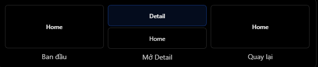
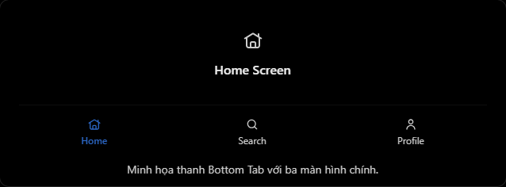
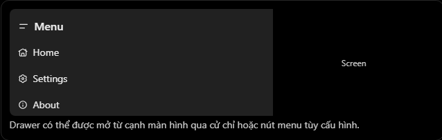
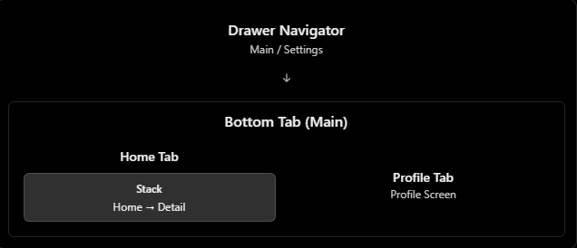

# React Native Theory

## 6. React Navigation: Stack, Bottom Tab, Drawer

### 1. React Navigation là gì?

`React Navigation` là thư viện giúp quản lý việc điều hướng giữa các màn hình trong ứng dụng React Native.

Ví dụ trong một app mobile:

- Đang ở màn hình `Home`, nhấn vào sản phẩm để chuyển sang `Product Detail`.
- Nhấn tab `Profile` để chuyển sang màn hình hồ sơ.
- Mở menu cạnh màn hình và chọn `Settings`.

React Navigation cung cấp nhiều loại navigator để tổ chức các luồng điều hướng khác nhau.

| Navigator | Chức năng chính | Ví dụ |
| --- | --- | --- |
| `Stack Navigator` | Điều hướng theo ngăn xếp màn hình | `Home -> Detail` |
| `Bottom Tab Navigator` | Chuyển giữa các khu vực chính bằng tab dưới | `Home`, `Search`, `Profile` |
| `Drawer Navigator` | Điều hướng bằng menu kéo từ cạnh màn hình | `Home`, `Settings`, `About` |

### 2. Cài đặt cơ bản

Các package thường dùng:

```bash
npm install @react-navigation/native
```

Với Expo:

```bash
npx expo install react-native-screens react-native-safe-area-context
```

Với React Native CLI:

```bash
npm install react-native-screens react-native-safe-area-context
```

Nếu dùng đủ `Native Stack`, `Bottom Tab` và `Drawer`:

```bash
npm install @react-navigation/native-stack @react-navigation/bottom-tabs @react-navigation/drawer
```

`Drawer Navigator` cần thêm dependency cho gesture và animation.

Với Expo:

```bash
npx expo install react-native-gesture-handler react-native-reanimated react-native-worklets
```

Với React Native CLI:

```bash
npm install react-native-gesture-handler react-native-reanimated react-native-worklets
```

Lưu ý: với `react-native-reanimated`, project có thể cần cấu hình thêm Babel plugin theo hướng dẫn của thư viện.

### 3. Stack Navigator

`Stack Navigator` điều hướng theo mô hình ngăn xếp. Màn hình mới được đặt lên trên màn hình hiện tại. Khi quay lại, màn hình trên cùng được lấy ra khỏi stack.

Mô hình này gần giống Stack trong DSA: Last In, First Out.

Minh họa:



Ví dụ:

```jsx
import { createNativeStackNavigator } from "@react-navigation/native-stack";

const Stack = createNativeStackNavigator();

function HomeStack() {
  return (
    <Stack.Navigator>
      <Stack.Screen name="Home" component={HomeScreen} />
      <Stack.Screen name="Detail" component={DetailScreen} />
    </Stack.Navigator>
  );
}
```

Khi nên dùng Stack:

- Màn hình chi tiết.
- Flow đăng nhập/đăng ký.
- Flow checkout.
- Các màn hình đi sâu dần theo từng bước.

### 4. Bottom Tab Navigator

`Bottom Tab Navigator` tạo thanh tab ở phía dưới màn hình, giúp người dùng chuyển giữa các khu vực chính của app.

Minh họa:



Ví dụ:

```jsx
import { createBottomTabNavigator } from "@react-navigation/bottom-tabs";

const Tab = createBottomTabNavigator();

function MainTabs() {
  return (
    <Tab.Navigator>
      <Tab.Screen name="HomeTab" component={HomeStack} />
      <Tab.Screen name="Profile" component={ProfileScreen} />
    </Tab.Navigator>
  );
}
```

Khi nên dùng Bottom Tab:

- App có vài khu vực chính cần truy cập thường xuyên.
- Người dùng cần chuyển qua lại nhanh giữa các màn hình chính.
- Ví dụ: `Home`, `Search`, `Notifications`, `Profile`.

Điểm cần nhớ: Bottom Tab không đơn giản là đẩy màn hình mới lên stack. Mỗi tab thường đại diện cho một nhánh điều hướng riêng.

### 5. Drawer Navigator

`Drawer Navigator` tạo menu điều hướng ở cạnh màn hình. Menu này thường được mở bằng gesture kéo hoặc nút menu.

Minh họa:



Ví dụ:

```jsx
import { createDrawerNavigator } from "@react-navigation/drawer";

const Drawer = createDrawerNavigator();

function RootDrawer() {
  return (
    <Drawer.Navigator>
      <Drawer.Screen name="Main" component={MainTabs} />
      <Drawer.Screen name="Settings" component={SettingsScreen} />
    </Drawer.Navigator>
  );
}
```

Khi nên dùng Drawer:

- App có nhiều khu vực phụ không cần xuất hiện thường trực trên tab.
- Cần menu như `Settings`, `About`, `Help`, `Logout`.
- App có cấu trúc giống dashboard hoặc admin.

Mẹo dễ nhớ:

```txt
Stack      = đi sâu vào một luồng màn hình
Bottom Tab = chuyển giữa các khu vực chính
Drawer     = mở menu điều hướng cạnh màn hình
```

### 6. Nested Navigators

Một app thực tế thường kết hợp nhiều navigator bằng cách lồng navigator này vào navigator khác. Cách này gọi là `nested navigators`.

Ví dụ cấu trúc:

```txt
NavigationContainer
└── Drawer.Navigator
    ├── Main
    │   └── Tab.Navigator
    │       ├── HomeTab
    │       │   └── Stack.Navigator
    │       │       ├── Home
    │       │       └── Detail
    │       └── Profile
    └── Settings
```

Minh họa:



Lý do thường đặt `Drawer` ở ngoài cùng:

- Drawer có thể mở trên toàn app.
- Bên trong Drawer có thể chứa tab chính.
- Bên trong từng tab có thể có stack riêng để đi vào màn hình detail.

### 7. Ví dụ thực tế: Kết hợp Stack, Bottom Tab và Drawer

Code dưới đây minh họa cấu trúc hoàn chỉnh. Giả sử các package navigation và dependencies đã được cài đặt.

```jsx
import "react-native-gesture-handler";
import React from "react";
import { Pressable, Text, View } from "react-native";
import { NavigationContainer } from "@react-navigation/native";
import { createNativeStackNavigator } from "@react-navigation/native-stack";
import { createBottomTabNavigator } from "@react-navigation/bottom-tabs";
import { createDrawerNavigator } from "@react-navigation/drawer";

const Stack = createNativeStackNavigator();
const Tab = createBottomTabNavigator();
const Drawer = createDrawerNavigator();

function HomeScreen({ navigation }) {
  return (
    <View>
      <Text>Home</Text>
      <Pressable onPress={() => navigation.navigate("Detail")}>
        <Text>Open Detail</Text>
      </Pressable>
    </View>
  );
}

function DetailScreen() {
  return <Text>Product Detail</Text>;
}

function ProfileScreen() {
  return <Text>My Profile</Text>;
}

function SettingsScreen() {
  return <Text>Settings</Text>;
}

function HomeStack() {
  return (
    <Stack.Navigator>
      <Stack.Screen name="Home" component={HomeScreen} />
      <Stack.Screen name="Detail" component={DetailScreen} />
    </Stack.Navigator>
  );
}

function MainTabs() {
  return (
    <Tab.Navigator>
      <Tab.Screen
        name="HomeTab"
        component={HomeStack}
        options={{ headerShown: false, title: "Home" }}
      />
      <Tab.Screen name="Profile" component={ProfileScreen} />
    </Tab.Navigator>
  );
}

export default function App() {
  return (
    <NavigationContainer>
      <Drawer.Navigator>
        <Drawer.Screen
          name="Main"
          component={MainTabs}
          options={{ headerShown: false, title: "Main" }}
        />
        <Drawer.Screen name="Settings" component={SettingsScreen} />
      </Drawer.Navigator>
    </NavigationContainer>
  );
}
```

Giải thích:

- `NavigationContainer`: quản lý navigation state của toàn app.
- `Stack.Navigator`: đăng ký `Home` và `Detail` theo dạng stack.
- `Tab.Navigator`: chuyển giữa `HomeTab` và `Profile`.
- `Drawer.Navigator`: cho phép mở `Main` và `Settings` từ menu cạnh màn hình.
- `navigation.navigate("Detail")`: chuyển từ `Home` sang `Detail`.
- `headerShown: false`: ẩn header của navigator cha/con khi cần, tránh nhiều header chồng nhau.

### 8. Những lỗi và hiểu nhầm thường gặp

| Lỗi hoặc hiểu nhầm | Cách hiểu đúng |
| --- | --- |
| Nghĩ cả ba navigator hoạt động giống Stack | Bottom Tab và Drawer có cách tổ chức điều hướng khác Stack |
| Quên `NavigationContainer` | App cần `NavigationContainer` ở root khi dùng cấu hình dynamic |
| Viết `component={<HomeScreen />}` | `component` nhận component reference: `component={HomeScreen}` |
| Nghĩ một app chỉ dùng được một loại navigator | Có thể kết hợp nhiều navigator bằng nesting |
| Drawer luôn hiển thị | Drawer thường ẩn và chỉ mở khi cần |
| Bị hai header chồng nhau | Cần cấu hình `headerShown: false` ở navigator phù hợp |
| Gọi `navigate("Detail")` từ màn hình không thuộc Stack có `Detail` | Route name phải tồn tại trong navigator hiện tại hoặc navigator cha/con phù hợp |

### 9. File example

File example cho phần này:

```txt
ReactNative/Example/reactnavigation-stack-bottomtab-drawer.jsx
```

Có thể copy component `App` trong file example vào project React Native hoặc Expo đã cài React Navigation để chạy thử.

### 10. Câu hỏi thường gặp

1. React Navigation là gì?
   - React Navigation là thư viện dùng để quản lý điều hướng giữa các màn hình trong ứng dụng React Native. Nó cung cấp nhiều navigator như Stack, Bottom Tab và Drawer.
2. Stack Navigator khác Bottom Tab Navigator như thế nào?
   - Stack Navigator dùng để đi sâu vào một luồng màn hình như `Home -> Detail`. Bottom Tab Navigator dùng để chuyển giữa các khu vực chính như `Home`, `Search`, `Profile`.
3. Khi nào nên dùng Drawer Navigator?
   - Dùng Drawer khi app cần menu điều hướng bên cạnh cho các section như `Settings`, `About`, `Help` hoặc những màn hình không cần đặt trong tab chính.
4. Có thể kết hợp nhiều navigator trong cùng một app không?
   - Có. Có thể lồng navigator bằng `nested navigators`, ví dụ Drawer chứa Bottom Tab, và mỗi tab chứa Stack riêng.
5. Vì sao cần `NavigationContainer`?
   - `NavigationContainer` quản lý navigation state của app và kết nối các navigator với hệ thống điều hướng.
