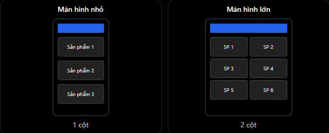

# React Native Theory

## 5. Responsive UI trên nhiều kích thước màn hình

### 1. Responsive UI là gì?

Responsive UI là cách thiết kế giao diện có thể tự thích nghi với nhiều kích thước màn hình khác nhau mà không bị vỡ layout, tràn nội dung hoặc khiến người dùng khó thao tác.

Ví dụ cùng một ứng dụng React Native:

- Điện thoại nhỏ: hiển thị sản phẩm thành một cột.
- Điện thoại lớn: có thể hiển thị sản phẩm thành hai cột.
- Tablet: có thể hiển thị nhiều cột hơn để tận dụng không gian.

Minh họa:



Điểm quan trọng: responsive không đơn thuần là phóng to hoặc thu nhỏ component. Responsive còn có thể thay đổi cách bố trí giao diện để phù hợp với không gian hiện có.

### 2. Các kỹ thuật responsive quan trọng

| Kỹ thuật | Khi nào sử dụng |
| --- | --- |
| Flexbox | Khi cần component co giãn và sắp xếp theo không gian có sẵn |
| Percentage `%` | Khi muốn kích thước phụ thuộc vào parent |
| `useWindowDimensions` | Khi cần lấy chiều rộng/cao hiện tại để thay đổi layout |
| `flexWrap` | Khi muốn item tự xuống dòng nếu không đủ chỗ |
| `maxWidth` / `minWidth` | Khi muốn giới hạn kích thước để UI không quá to hoặc quá nhỏ |

### 3. Flexbox và Percentage

Ví dụ:

```jsx
import { View } from "react-native";

export default function ExampleBox() {
  return (
    <View style={{ flex: 1, padding: 20 }}>
      <View
        style={{
          width: "80%",
          height: 100,
          backgroundColor: "skyblue",
        }}
      />
    </View>
  );
}
```

Giải thích:

- `flex: 1`: container chiếm không gian còn lại mà parent cấp cho nó.
- `width: "80%"`: view con rộng bằng 80% chiều rộng của parent.
- `height: 100`: chiều cao cố định.

Lưu ý: percentage cần parent có kích thước được xác định. Vì vậy, `width: "80%"` không phải lúc nào cũng có nghĩa là 80% chiều rộng màn hình.

### 4. useWindowDimensions

`useWindowDimensions` là hook của React Native dùng để lấy kích thước cửa sổ ứng dụng hiện tại.

```jsx
import { Text, useWindowDimensions } from "react-native";

export default function HomeScreen() {
  const { width, height } = useWindowDimensions();

  return (
    <Text>
      Width: {width}, Height: {height}
    </Text>
  );
}
```

`useWindowDimensions()` tự cập nhật khi kích thước cửa sổ thay đổi, ví dụ khi xoay màn hình hoặc chạy app trên tablet/foldable/web.

Ví dụ tạo breakpoint:

```jsx
const { width } = useWindowDimensions();

const isWideScreen = width >= 600;
```

Có thể quy ước:

```txt
width < 600   -> layout màn hình hẹp
width >= 600  -> layout màn hình rộng
```

### 5. Dimensions vs useWindowDimensions

Cả hai đều có thể lấy kích thước màn hình, nhưng khác nhau ở cách cập nhật.

| API | Cách hoạt động | Khi nào dùng |
| --- | --- | --- |
| `Dimensions.get("window")` | Lấy kích thước tại thời điểm gọi | Logic ngoài component hoặc trường hợp không cần tự render lại |
| `useWindowDimensions()` | Hook tự cập nhật khi kích thước thay đổi | UI trong function component cần responsive |

Với UI trong function component, thường ưu tiên `useWindowDimensions` vì component sẽ tự render lại khi kích thước thay đổi.

### 6. Ví dụ thực tế: Responsive Product Screen

Giả sử đang xây màn hình danh sách sản phẩm:

- Màn hình hẹp: 1 cột.
- Màn hình rộng từ `600` trở lên: 2 cột.

```jsx
import React from "react";
import {
  StyleSheet,
  Text,
  useWindowDimensions,
  View,
} from "react-native";

const products = [
  { id: "1", name: "Laptop" },
  { id: "2", name: "Mouse" },
  { id: "3", name: "Keyboard" },
];

export default function ProductScreen() {
  const { width } = useWindowDimensions();
  const isWide = width >= 600;

  return (
    <View style={styles.container}>
      <Text style={styles.title}>Products</Text>

      <View style={styles.grid}>
        {products.map((product) => (
          <View
            key={product.id}
            style={[styles.card, { width: isWide ? "48%" : "100%" }]}
          >
            <Text>{product.name}</Text>
          </View>
        ))}
      </View>
    </View>
  );
}

const styles = StyleSheet.create({
  container: {
    flex: 1,
    padding: 16,
  },
  title: {
    fontSize: 20,
    fontWeight: "700",
    marginBottom: 16,
  },
  grid: {
    flexDirection: "row",
    flexWrap: "wrap",
    justifyContent: "space-between",
  },
  card: {
    borderColor: "#cccccc",
    borderRadius: 8,
    borderWidth: 1,
    marginBottom: 12,
    padding: 16,
  },
});
```

Flow hoạt động:

```txt
useWindowDimensions lấy width hiện tại
        ↓
Kiểm tra width >= 600
        ↓
false -> card width 100%, layout 1 cột
true  -> card width 48%, layout 2 cột
        ↓
Khi kích thước thay đổi, component render lại
```

Đây là ví dụ đơn giản với ít sản phẩm. Nếu danh sách có nhiều item, nên cân nhắc dùng `FlatList` với `numColumns`.

### 7. Responsive với FlatList

Với danh sách dài, nên dùng `FlatList` thay vì `map`. Có thể thay đổi số cột dựa trên chiều rộng màn hình.

```jsx
const { width } = useWindowDimensions();
const columns = width >= 900 ? 3 : width >= 600 ? 2 : 1;

<FlatList
  key={columns}
  data={products}
  numColumns={columns}
  keyExtractor={(item) => item.id}
  renderItem={({ item }) => <ProductCard product={item} />}
/>;
```

Lưu ý: khi `numColumns` thay đổi, thường cần truyền `key={columns}` cho `FlatList` để React Native tạo lại layout danh sách theo số cột mới.

### 8. Những lỗi và hiểu nhầm thường gặp

#### 1. Hardcode kích thước quá lớn

```jsx
<View style={{ width: 400 }} />
```

Trên thiết bị có vùng hiển thị nhỏ hơn `400`, view có thể bị tràn ngang.

#### 2. Lấy kích thước một lần rồi cho rằng nó không đổi

```jsx
const width = Dimensions.get("window").width;
```

Nếu khai báo ngoài component và chỉ thực thi khi module được tải, giá trị không tự thay đổi khi xoay thiết bị.

#### 3. Nghĩ responsive chỉ là thay đổi width

Responsive còn cần quan tâm đến:

- Nội dung dài.
- Kích thước chữ khi người dùng tăng font hệ thống.
- Hướng màn hình.
- Safe area.
- Không gian hiển thị thực tế.
- Trạng thái bàn phím đang mở.

#### 4. Dùng percentage nhưng parent không có kích thước rõ ràng

Nếu parent chưa có kích thước xác định, percentage có thể không cho kết quả như mong đợi.

#### 5. Quên giới hạn chiều rộng trên màn hình lớn

Trên tablet, một card hoặc form rộng 100% màn hình có thể quá khó đọc. Có thể dùng `maxWidth` và `alignSelf: "center"` để giới hạn.

```jsx
content: {
  width: "100%",
  maxWidth: 720,
  alignSelf: "center",
}
```

### 9. File example

File example cho phần này:

```txt
ReactNative/Example/responsiveui.jsx
```

Có thể copy component `App` trong file example vào project React Native hoặc Expo để chạy thử.

### 10. Câu hỏi thường gặp

1. Responsive UI trong React Native là gì?
   - Responsive UI là cách thiết kế layout có thể thích ứng với nhiều kích thước màn hình, hướng màn hình và không gian hiển thị khác nhau mà vẫn dễ sử dụng.
2. `useWindowDimensions` trong React Native là gì?
   - `useWindowDimensions` là hook cung cấp chiều rộng và chiều cao hiện tại của cửa sổ app. Hook này tự cập nhật khi kích thước cửa sổ thay đổi.
3. Sự khác nhau giữa `Dimensions` và `useWindowDimensions` là gì?
   - `Dimensions` trả về kích thước tại thời điểm gọi. `useWindowDimensions` tự cập nhật component khi kích thước thay đổi.
4. Có thể tạo responsive layout bằng những cách nào?
   - Có thể dùng Flexbox, percentage, `useWindowDimensions`, breakpoint, `flexWrap`, `maxWidth` và `minWidth`.
5. Khi nào nên dùng `FlatList` cho responsive UI?
   - Khi hiển thị danh sách dài. Có thể kết hợp `FlatList` với `numColumns` để thay đổi số cột theo chiều rộng màn hình.
