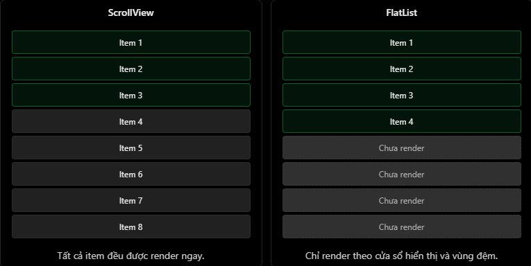

# React Native Theory

## 2. ScrollView vs FlatList

### 1. Sơ lược

`ScrollView` và `FlatList` đều là component giúp người dùng cuộn nội dung trên màn hình. Tuy nhiên, hai component này khác nhau ở cách render và trường hợp sử dụng.

| Tiêu chí | ScrollView | FlatList |
| --- | --- | --- |
| Mục đích | Cuộn nội dung thông thường | Hiển thị danh sách dữ liệu |
| Cách render | Render tất cả children ngay từ đầu | Render theo vùng hiển thị bằng virtualization |
| Bộ nhớ | Dễ tốn RAM nếu nội dung dài | Tiết kiệm RAM hơn với danh sách lớn |
| Dữ liệu phù hợp | Ít nội dung, UI đa dạng | Danh sách dài, item có cấu trúc giống nhau |
| Ví dụ | Settings, Profile, Form | Chat, Products, Contacts, Notifications |

Điểm quan trọng nhất:

- `ScrollView`: render toàn bộ component con, kể cả phần chưa xuất hiện trên màn hình.
- `FlatList`: dùng cơ chế virtualization, chỉ render các item trong vùng gần màn hình để tối ưu hiệu năng.

Minh họa:



### 2. ScrollView là gì?

`ScrollView` phù hợp khi màn hình có lượng nội dung vừa phải, hoặc nội dung có nhiều block giao diện khác nhau.

Ví dụ:

```jsx
import { ScrollView, Text, View } from "react-native";

export default function ProfileScreen() {
  return (
    <ScrollView>
      <View>
        <Text>Thông tin cá nhân</Text>
      </View>

      <View>
        <Text>Cài đặt tài khoản</Text>
      </View>

      <View>
        <Text>Bảo mật</Text>
      </View>
    </ScrollView>
  );
}
```

Nên dùng `ScrollView` khi:

- Màn hình là form ngắn hoặc trung bình.
- Màn hình có nhiều section khác nhau.
- Số lượng item ít và gần như cố định.
- Cần cuộn toàn bộ nội dung như trang Settings hoặc Profile.

Không nên dùng `ScrollView` để render danh sách hàng trăm hoặc hàng nghìn item bằng `map`.

### 3. FlatList là gì?

`FlatList` phù hợp với danh sách dữ liệu dài, đặc biệt khi các item có cấu trúc giống nhau.

Ví dụ:

```jsx
import { FlatList, Text } from "react-native";

const members = [
  { id: "1", name: "Nhat" },
  { id: "2", name: "Duy" },
  { id: "3", name: "Nghia" },
  { id: "4", name: "Giap" },
];

export default function MemberScreen() {
  return (
    <FlatList
      data={members}
      keyExtractor={(item) => item.id}
      renderItem={({ item }) => <Text>{item.name}</Text>}
    />
  );
}
```

Ba props cơ bản cần nhớ:

| Prop | Ý nghĩa |
| --- | --- |
| `data` | Mảng dữ liệu cần hiển thị |
| `renderItem` | Hàm trả về UI cho từng item |
| `keyExtractor` | Hàm tạo key riêng cho từng item |

Nên dùng `FlatList` khi:

- Danh sách có nhiều item.
- Item có cấu trúc lặp lại.
- Dữ liệu có thể tăng dần theo thời gian.
- Cần tối ưu hiệu năng khi cuộn.

### 4. Ví dụ so sánh

Giả sử đang xây màn hình quản lý thành viên trong gia đình.

#### Dùng ScrollView

```jsx
import { ScrollView, Text } from "react-native";

const members = ["Nhat", "Duy", "Nghia", "Giap"];

export default function MemberScreen() {
  return (
    <ScrollView>
      {members.map((name) => (
        <Text key={name}>{name}</Text>
      ))}
    </ScrollView>
  );
}
```

Ở ví dụ trên:

- `ScrollView` giúp màn hình có thể cuộn.
- `map()` tạo một `Text` cho mỗi thành viên.
- Toàn bộ danh sách được render ngay từ đầu.

Cách này ổn với danh sách ngắn. Nếu danh sách có hàng nghìn thành viên, app có thể tốn bộ nhớ và render chậm.

#### Dùng FlatList

```jsx
import { FlatList, Text } from "react-native";

const members = [
  { id: "1", name: "Nhat" },
  { id: "2", name: "Duy" },
  { id: "3", name: "Nghia" },
  { id: "4", name: "Giap" },
];

export default function MemberScreen() {
  return (
    <FlatList
      data={members}
      keyExtractor={(item) => item.id}
      renderItem={({ item }) => <Text>{item.name}</Text>}
    />
  );
}
```

Ở ví dụ trên:

- `FlatList` nhận dữ liệu qua prop `data`.
- `renderItem` quyết định mỗi item hiển thị như thế nào.
- `keyExtractor` giúp React Native định danh từng item.
- Danh sách được render theo vùng hiển thị, không render toàn bộ ngay từ đầu.

### 5. Một số props thường dùng của FlatList

| Prop | Công dụng |
| --- | --- |
| `ListHeaderComponent` | Hiển thị phần đầu danh sách |
| `ListFooterComponent` | Hiển thị phần cuối danh sách |
| `ItemSeparatorComponent` | Hiển thị đường phân cách giữa các item |
| `ListEmptyComponent` | UI khi danh sách rỗng |
| `onEndReached` | Gọi callback khi cuộn gần cuối danh sách |
| `onEndReachedThreshold` | Quy định khoảng cách gần cuối để gọi `onEndReached` |
| `refreshing` | Trạng thái đang refresh |
| `onRefresh` | Callback khi kéo để refresh |

Ví dụ danh sách rỗng:

```jsx
<FlatList
  data={[]}
  keyExtractor={(item) => item.id}
  renderItem={({ item }) => <Text>{item.name}</Text>}
  ListEmptyComponent={<Text>Chưa có dữ liệu</Text>}
/>
```

### 6. Lỗi hoặc hiểu nhầm thường gặp

#### 1. Nghĩ FlatList chỉ render đúng các item đang nhìn thấy

Không hoàn toàn. `FlatList` thường render thêm một số item ở vùng đệm để thao tác cuộn mượt hơn.

#### 2. Nghĩ FlatList luôn tốt hơn ScrollView

Không đúng. Với màn hình ít nội dung và cấu trúc đa dạng như Settings, Profile hoặc Form, `ScrollView` thường đơn giản và phù hợp hơn.

#### 3. Dùng ScrollView cho danh sách rất dài

Không nên. `ScrollView` render tất cả item ngay từ đầu nên dễ gây chậm, giật hoặc tốn RAM khi danh sách lớn.

#### 4. Quên keyExtractor trong FlatList

Nếu không có key ổn định, React Native khó quản lý item khi render lại danh sách.

```jsx
keyExtractor={(item) => item.id}
```

#### 5. Nghĩ FlatList tự động gọi API để tải thêm dữ liệu

Không đúng. `FlatList` hỗ trợ `onEndReached`, nhưng lập trình viên phải tự viết logic gọi API, nối thêm dữ liệu và xử lý loading.

#### 6. Bọc FlatList trong ScrollView cùng chiều cuộn

Không nên làm vậy vì có thể làm hỏng virtualization và gây warning. Nếu cần header hoặc footer cho danh sách, hãy dùng `ListHeaderComponent` và `ListFooterComponent`.

Mẹo dễ nhớ:

```txt
ScrollView = render tất cả trong một lần
FlatList  = render danh sách trong một cửa sổ hiển thị
```

### 7. File example

File example cho phần này:

```txt
ReactNative/Example/scrollview-flatlist.jsx
```

Có thể copy component `App` trong file example vào project React Native hoặc Expo để chạy thử.

### 8. Câu hỏi thường gặp

1. Sự khác nhau giữa `ScrollView` và `FlatList` là gì?
   - `ScrollView` render tất cả nội dung ngay từ đầu. `FlatList` dùng virtualization để render danh sách theo vùng hiển thị, nên phù hợp hơn với danh sách lớn.
2. Khi nào nên dùng `ScrollView`?
   - Dùng `ScrollView` cho màn hình có ít nội dung, form, profile hoặc settings page có cấu trúc đa dạng.
3. Khi nào nên dùng `FlatList`?
   - Dùng `FlatList` khi hiển thị danh sách dài, item có cấu trúc giống nhau hoặc dữ liệu có thể tăng dần.
4. Vì sao `FlatList` tốt hơn cho danh sách lớn?
   - Vì `FlatList` không render toàn bộ item cùng lúc. Nó render các item gần vùng nhìn thấy để giảm bộ nhớ và thời gian render.
5. `FlatList` có tự động tải thêm dữ liệu khi cuộn xuống không?
   - Không. `FlatList` chỉ cung cấp callback như `onEndReached`. Bạn cần tự viết logic gọi API và cập nhật danh sách.
