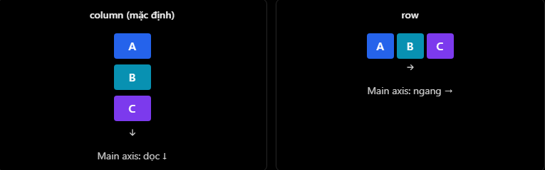

# React Native Theory

## 4. StyleSheet và Flexbox

### 1. StyleSheet là gì?

`StyleSheet` là API của React Native giúp định nghĩa và tổ chức style cho component. Nó có vai trò tương tự việc viết CSS trong ReactJS, nhưng cú pháp style trong React Native là JavaScript object.

Ví dụ:

```jsx
import { StyleSheet, Text, View } from "react-native";

export default function HomeScreen() {
  return (
    <View style={styles.container}>
      <Text style={styles.title}>Hello React Native</Text>
    </View>
  );
}

const styles = StyleSheet.create({
  container: {
    flex: 1,
    backgroundColor: "#ffffff",
    padding: 20,
  },
  title: {
    fontSize: 20,
    fontWeight: "700",
  },
});
```

Giải thích:

- `StyleSheet.create()`: tạo object chứa các style có tên để dễ tái sử dụng.
- `styles.container`: lấy style `container` đã định nghĩa.
- `flex: 1`: cho phép component chiếm phần không gian còn lại trong parent.
- `padding: 20`: tạo khoảng cách bên trong component.
- `fontSize: 20`: thiết lập kích thước chữ.

### 2. Khác biệt với CSS trên web

Trong React Native, style dùng `camelCase` thay vì kebab-case như CSS.

| CSS trên web | React Native |
| --- | --- |
| `background-color` | `backgroundColor` |
| `font-size` | `fontSize` |
| `padding: 20px` | `padding: 20` |
| CSS file / CSS Modules | Style object / `StyleSheet.create()` |

Một vài điểm cần nhớ:

- Kích thước dạng số trong React Native không dùng `px`.
- React Native dùng đơn vị độc lập mật độ màn hình, thường hiểu gần giống `dp` trên Android và `point` trên iOS.
- Có thể dùng inline style như `style={{ padding: 20 }}`, nhưng `StyleSheet.create()` giúp code dễ đọc và dễ quản lý hơn.
- Không viết style kiểu CSS web như `background-color` hoặc `padding: "20 px"`.

### 3. Flexbox trong React Native

Flexbox là hệ thống layout giúp sắp xếp và căn chỉnh component theo chiều ngang hoặc chiều dọc.

Ba thuộc tính quan trọng nhất:

| Thuộc tính | Chức năng |
| --- | --- |
| `flexDirection` | Quyết định hướng sắp xếp component con |
| `justifyContent` | Căn chỉnh theo trục chính |
| `alignItems` | Căn chỉnh theo trục phụ |

Điểm khác với web: `flexDirection` mặc định trong React Native là `column`, không phải `row`.

Minh họa:



### 4. flexDirection

`flexDirection` quyết định component con được xếp theo hướng nào.

| Giá trị | Ý nghĩa |
| --- | --- |
| `column` | Xếp từ trên xuống dưới, đây là mặc định trong React Native |
| `row` | Xếp từ trái sang phải |
| `column-reverse` | Xếp từ dưới lên trên |
| `row-reverse` | Xếp từ phải sang trái |

Ví dụ xếp ngang:

```jsx
<View style={styles.row}>
  <Text>Cancel</Text>
  <Text>Save</Text>
</View>
```

```jsx
const styles = StyleSheet.create({
  row: {
    flexDirection: "row",
  },
});
```

### 5. justifyContent vs alignItems

Đây là phần rất dễ nhầm khi học React Native.

| `flexDirection` | `justifyContent` căn theo | `alignItems` căn theo |
| --- | --- | --- |
| `column` | Chiều dọc | Chiều ngang |
| `row` | Chiều ngang | Chiều dọc |

Nói ngắn gọn:

- `justifyContent`: căn theo trục chính.
- `alignItems`: căn theo trục phụ.
- Trục chính phụ thuộc vào `flexDirection`.

Ví dụ căn giữa một component theo cả chiều ngang và chiều dọc:

```jsx
<View style={styles.centerBox}>
  <Text>Hello</Text>
</View>
```

```jsx
const styles = StyleSheet.create({
  centerBox: {
    flex: 1,
    justifyContent: "center",
    alignItems: "center",
  },
});
```

Giải thích:

- `justifyContent: "center"`: căn giữa theo trục chính.
- `alignItems: "center"`: căn giữa theo trục phụ.
- Kết hợp cả hai giúp nội dung nằm giữa container theo hai chiều.

Một số giá trị thường dùng của `justifyContent`:

```txt
flex-start
center
flex-end
space-between
space-around
space-evenly
```

### 6. Ví dụ thực tế: Profile Header

Giả sử đang xây dựng header cho màn hình Profile của ứng dụng mobile.

Minh họa:


```jsx
import { StyleSheet, Text, View } from "react-native";

export default function ProfileScreen() {
  return (
    <View style={styles.container}>
      <View style={styles.header}>
        <View style={styles.avatar}>
          <Text style={styles.avatarText}>NH</Text>
        </View>

        <View style={styles.userInfo}>
          <Text style={styles.name}>Nhat</Text>
          <Text style={styles.jobTitle}>Fullstack Developer</Text>
        </View>
      </View>
    </View>
  );
}

const styles = StyleSheet.create({
  container: {
    flex: 1,
    padding: 20,
  },
  header: {
    alignItems: "center",
    flexDirection: "row",
  },
  avatar: {
    alignItems: "center",
    backgroundColor: "#2563eb",
    borderRadius: 28,
    height: 56,
    justifyContent: "center",
    width: 56,
  },
  avatarText: {
    color: "#ffffff",
    fontWeight: "700",
  },
  userInfo: {
    marginLeft: 12,
  },
  name: {
    fontSize: 18,
    fontWeight: "700",
  },
  jobTitle: {
    color: "#5f6b7a",
    marginTop: 4,
  },
});
```

Flow layout:

- `container`: chiếm phần không gian còn lại của màn hình và tạo padding.
- `header`: sắp xếp avatar và thông tin user theo chiều ngang.
- `alignItems: "center"` trong `header`: căn giữa avatar và `userInfo` theo chiều dọc.
- `avatar`: dùng `justifyContent` và `alignItems` để đặt chữ `NH` vào giữa hình tròn.
- `userInfo`: dùng `marginLeft: 12` để tạo khoảng cách với avatar.

Chỉ với `StyleSheet` và Flexbox, ta có thể tạo được layout phổ biến trong mobile app mà không cần CSS file riêng.

### 7. Ví dụ theo yêu cầu phỏng vấn

Tạo một hàng có hai nút `Cancel` và `Save`: một nút ở trái, một nút ở phải, căn giữa theo chiều dọc trong container cao `60`.

```jsx
import { StyleSheet, Text, View } from "react-native";

export default function ActionRow() {
  return (
    <View style={styles.container}>
      <Text style={styles.cancelButton}>Cancel</Text>
      <Text style={styles.saveButton}>Save</Text>
    </View>
  );
}

const styles = StyleSheet.create({
  container: {
    alignItems: "center",
    flexDirection: "row",
    height: 60,
    justifyContent: "space-between",
    paddingHorizontal: 16,
  },
  cancelButton: {
    color: "#6b7280",
    fontSize: 16,
    fontWeight: "600",
  },
  saveButton: {
    color: "#2563eb",
    fontSize: 16,
    fontWeight: "700",
  },
});
```

Trong ví dụ trên:

- `flexDirection: "row"` giúp `Cancel` và `Save` nằm ngang.
- `justifyContent: "space-between"` đẩy một phần tử sang trái và một phần tử sang phải.
- `alignItems: "center"` căn giữa theo chiều dọc.
- `height: 60` tạo chiều cao cố định cho container.

### 8. Những lỗi thường gặp

| Lỗi | Cách hiểu đúng |
| --- | --- |
| Nhầm `justifyContent` với `alignItems` | Xác định `flexDirection` trước, sau đó mới xác định trục chính và trục phụ |
| Quên mặc định là `column` | Component con sẽ xếp dọc nếu không set `flexDirection: "row"` |
| Dùng cú pháp CSS web | React Native dùng `backgroundColor`, `fontSize`, `padding: 20` |
| Nghĩ `flex: 1` luôn là fullscreen | `flex: 1` chỉ chiếm không gian còn lại trong parent |
| Viết `aligItems` | Tên đúng là `alignItems` |
| Dùng `padding: "20 px"` | Nên dùng `padding: 20` |

### 9. File example

File example cho phần này:

```txt
ReactNative/Example/stylesheet-flexbox.jsx
```

Có thể copy component `App` trong file example vào project React Native hoặc Expo để chạy thử.

### 10. Câu hỏi thường gặp

1. `StyleSheet` trong React Native là gì?
   - `StyleSheet` là API dùng để định nghĩa và tổ chức style cho React Native component. Nó giúp code style rõ ràng, dễ tái sử dụng và dễ quản lý hơn.
2. Mặc định của `flexDirection` trong React Native là gì?
   - Mặc định là `column`, nghĩa là các component con được sắp xếp theo chiều dọc.
3. Sự khác nhau giữa `justifyContent` và `alignItems` là gì?
   - `justifyContent` căn theo trục chính, còn `alignItems` căn theo trục phụ. Hai trục này phụ thuộc vào `flexDirection`.
4. Làm thế nào để căn giữa một component theo cả chiều ngang và chiều dọc?
   - Đặt `justifyContent: "center"` và `alignItems: "center"` trong container cha. Container cha cũng cần có đủ không gian, ví dụ `flex: 1` hoặc một `height` cụ thể.
5. Vì sao `flexDirection: "row"` hay đi cùng `alignItems: "center"`?
   - Khi `flexDirection` là `row`, trục chính là chiều ngang và trục phụ là chiều dọc. Vì vậy `alignItems: "center"` sẽ căn giữa các item theo chiều dọc.
