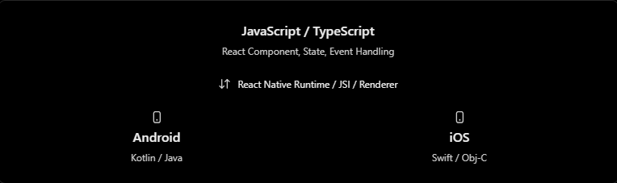
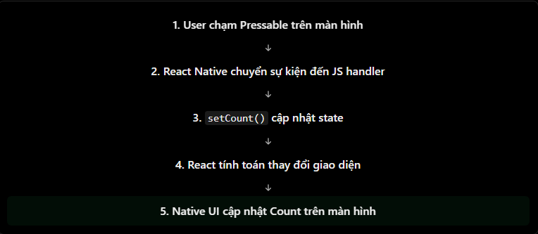

# React Native Theory

## 14. Hiểu luồng React Native: JavaScript ↔ Native Android/iOS

### 1. React Native không render HTML

Ta viết phần lớn ứng dụng React Native bằng JavaScript hoặc TypeScript, nhưng giao diện cuối cùng là giao diện native của Android và iOS.

```jsx
import { Text, View } from "react-native";

export default function App() {
  return (
    <View>
      <Text>Hello React Native</Text>
    </View>
  );
}
```

Khác với React trên web, React Native không tạo DOM hoặc HTML. React mô tả cây UI, sau đó renderer của React Native phối hợp với nền tảng để tạo và cập nhật native view tương ứng.

| React Native component | Android (minh họa)    | iOS (minh họa)               |
| ---------------------- | --------------------- | ---------------------------- |
| `View`                 | `ViewGroup`           | `UIView`                     |
| `Text`                 | `TextView`            | `UITextView` / `UILabel`     |
| `TextInput`            | `EditText`            | `UITextField` / `UITextView` |
| `Pressable`            | Native touch handling | Native touch handling        |

Ánh xạ cụ thể là chi tiết nội bộ và có thể thay đổi theo phiên bản hoặc component. Điều quan trọng cần nhớ là UI mà người dùng nhìn và thao tác là UI do hệ điều hành quản lý, không phải một trang web nằm trong WebView.



React Native cũng cho phép JavaScript gọi khả năng native (chẳng hạn thông báo hệ điều hành, camera hoặc vị trí) và nhận sự kiện từ nền tảng.

### 2. Luồng từ thao tác người dùng đến cập nhật UI

Xét một nút tăng counter:

```jsx
import { useState } from "react";
import { Pressable, Text, View } from "react-native";

export default function CounterScreen() {
  const [count, setCount] = useState(0);

  return (
    <View>
      <Text>Count: {count}</Text>

      <Pressable onPress={() => setCount((value) => value + 1)}>
        <Text>Increase</Text>
      </Pressable>
    </View>
  );
}
```

Luồng ở mức khái niệm:

1. Hệ điều hành nhận thao tác chạm trên native view.
2. React Native chuyển sự kiện `onPress` đến JavaScript.
3. Handler JavaScript gọi `setCount`.
4. React tính toán cây UI mới; renderer xác định thay đổi cần áp dụng.
5. Native UI nhận phần cập nhật cần thiết và hiển thị `Count` mới.



Đây là mô hình đơn giản hóa. Thứ tự lập lịch, ưu tiên của event và nơi thực thi một số bước phụ thuộc vào kiến trúc React Native, loại event và phiên bản React.

### 3. JavaScript thread và UI thread

Trong New Architecture, có thể hiểu cơ bản qua hai thread sau:

| Thread                  | Trách nhiệm chính                                                        | Điều gì xảy ra khi bị bận?                                    |
| ----------------------- | ------------------------------------------------------------------------ | ------------------------------------------------------------- |
| JavaScript thread       | Chạy JavaScript, React render phase và phần lớn logic ứng dụng           | Handler, state update hoặc render từ JS có thể phản hồi chậm  |
| UI thread (main thread) | Quản lý native host views; là thread duy nhất được thao tác các view này | Animation/scroll/UI native có thể bị giật hoặc không phản hồi |

Renderer hiện đại có thể phân phối công việc trên các thread và có trường hợp render đồng bộ trên UI thread cho event ưu tiên cao. Vì vậy, không nên coi bảng trên như một quy tắc tuyệt đối rằng mọi việc luôn chạy cố định trên một thread.

Ví dụ về tác động thực tế:

- Một vòng lặp hoặc phép tính nặng trong JavaScript có thể làm `onPress`, `setState` và UI phụ thuộc vào JS phản hồi chậm.
- Một tác vụ nặng trên UI thread có thể làm thao tác cuộn, animation hoặc cập nhật native bị giật.
- Animation chạy hoàn toàn ở native/UI side có thể vẫn mượt hơn animation cần JavaScript cập nhật ở mọi frame, nhưng cần đo đạc thay vì tối ưu theo cảm tính.

### 4. Native Module và Native Component

Hai khái niệm này phục vụ hai mục đích khác nhau:

| Khái niệm        | Dùng để làm gì?                                               | Ví dụ                                           |
| ---------------- | ------------------------------------------------------------- | ----------------------------------------------- |
| Native Module    | Mở API/chức năng của nền tảng cho JavaScript; không tự tạo UI | Storage, notification, camera, location         |
| Native Component | Đưa native view vào cây React để hiển thị UI                  | `View`, `TextInput`, map native, camera preview |

Ví dụ gọi một API native đã được React Native cung cấp sẵn:

```jsx
import { Alert, Pressable, Text } from "react-native";

export default function HomeScreen() {
  const handlePress = () => {
    Alert.alert("Thành công", "Hello from React Native");
  };

  return (
    <Pressable onPress={handlePress}>
      <Text>Show alert</Text>
    </Pressable>
  );
}
```

Luồng đơn giản:

```txt
User nhấn nút → JS chạy handlePress → Alert API → Android/iOS hiển thị native alert
```

Không cần viết Kotlin, Java, Swift hoặc Objective-C khi React Native hay một thư viện đã cung cấp API. Ta chỉ cần tự viết native code khi ứng dụng cần một khả năng chưa có sẵn hoặc cần tích hợp SDK native riêng.

### 5. Legacy Bridge và New Architecture

React Native có hai mô hình kiến trúc thường gặp:

| Thành phần       | Legacy Architecture                        | New Architecture                        |
| ---------------- | ------------------------------------------ | --------------------------------------- |
| Kênh JS ↔ native | Bridge bất đồng bộ                         | JSI và các binding trực tiếp hơn        |
| Dữ liệu trao đổi | Thường cần đóng gói/tuần tự hóa qua Bridge | Giảm nhiều chi phí giao tiếp qua Bridge |
| Native module    | Legacy Native Modules                      | TurboModules                            |
| UI renderer      | Renderer cũ                                | Fabric                                  |

#### Legacy Bridge

Bridge cũ chuyển message bất đồng bộ giữa JavaScript và native. Vì dữ liệu phải được đóng gói và chuyển qua hàng đợi, nhiều lần gọi nhỏ hoặc payload lớn có thể tạo chi phí đáng kể.

#### JSI, TurboModules và Fabric

New Architecture thay Bridge bằng JavaScript Interface (JSI). JSI cho phép JavaScript runtime tương tác hiệu quả hơn với các binding C++/native, mở ra các API đồng bộ trong trường hợp phù hợp. Điều này **không** có nghĩa mọi native API đều đồng bộ hoặc mọi vấn đề hiệu năng tự biến mất.

- **TurboModules** là hệ thống native module mới, hỗ trợ truy cập module hiệu quả hơn và có thể tải module theo nhu cầu.
- **Fabric** là renderer mới, phối hợp render React Native với native UI theo mô hình hiện đại hơn.
- **Codegen** có thể sinh mã kết nối từ specification TypeScript/Flow khi xây dựng module hoặc component native mới.

Từ React Native 0.76, New Architecture được bật mặc định cho project mới. Hệ sinh thái vẫn có lớp tương thích cho một số thư viện theo kiến trúc cũ, vì vậy một ứng dụng thực tế có thể chưa tận dụng mọi khả năng mới ngay lập tức.

### 6. Những hiểu nhầm thường gặp

| Hiểu nhầm                                    | Cách hiểu đúng                                                                                            |
| -------------------------------------------- | --------------------------------------------------------------------------------------------------------- |
| React Native chỉ chạy JavaScript             | Logic ứng dụng phần lớn viết bằng JS/TS, nhưng UI và quyền truy cập hệ điều hành dựa trên nền tảng native |
| React Native là WebView                      | React Native không render HTML/DOM mặc định; nó dùng native views                                         |
| JS thread và UI thread là một                | Chúng có trách nhiệm khác nhau, dù renderer có thể phối hợp công việc giữa các thread                     |
| Mọi lời gọi native đều đi qua Legacy Bridge  | New Architecture sử dụng JSI, TurboModules và Fabric thay cho mô hình Bridge cũ                           |
| JSI làm mọi lời gọi native trở thành đồng bộ | JSI cho phép các khả năng mới; tính đồng bộ/bất đồng bộ vẫn do API và thiết kế module quyết định          |
| Cần viết Swift/Kotlin cho mọi tính năng      | Nhiều API đã có trong React Native hoặc thư viện; native code chỉ cần khi khả năng chưa được cung cấp     |
| New Architecture tự làm app nhanh hơn        | Lợi ích phụ thuộc vào app; cần loại bỏ điểm nghẽn thực tế và đo hiệu năng                                 |

### 7. Khi nào cần quan tâm đến Native?

Với hầu hết màn hình thông thường, chỉ cần dùng React Native API và thư viện phù hợp. Cần tìm hiểu sâu hơn về native khi:

- Tích hợp SDK Android/iOS không có package React Native tin cậy.
- Viết Native Module hoặc Native Component riêng.
- Chẩn đoán crash chỉ xảy ra trên một nền tảng.
- Tối ưu animation, gesture, startup hoặc một điểm nghẽn đã được đo đạc.
- Làm việc với quyền, deep link, notification, background task hoặc build configuration theo từng nền tảng.

### 8. File ví dụ

Ví dụ hoàn chỉnh nằm tại:

```txt
ReactNative/Example/understandflowReactNativeJS-NativeAndroidiOS.jsx
```

Ví dụ minh họa:

- `Pressable` gửi event về JavaScript để cập nhật state.
- `useWindowDimensions` phản ánh thay đổi kích thước native window.
- `Platform` cho phép chọn nội dung theo Android/iOS.
- `Alert.alert` hiển thị alert do nền tảng quản lý.
- Console log giúp quan sát phần handler JavaScript.

Có thể copy component `App` vào một dự án React Native hoặc Expo để chạy thử.

### 9. Câu hỏi thường gặp

#### 1. React Native giao tiếp với Android/iOS như thế nào?

JavaScript mô tả UI và chạy logic ứng dụng. Renderer cùng các API/module của React Native kết nối phần JavaScript đó với native views và khả năng của Android/iOS. New Architecture dùng JSI, TurboModules và Fabric thay cho mô hình Legacy Bridge.

#### 2. JS thread và UI thread khác nhau thế nào?

JavaScript thread chạy JavaScript và phần lớn React render work. UI thread quản lý native host views. Chặn một trong hai có thể làm trải nghiệm người dùng kém đi theo những cách khác nhau.

#### 3. Native Module là gì?

Native Module là API không có UI riêng, cho phép JavaScript truy cập chức năng nền tảng như storage, notification hoặc camera. Native Component thì đưa native view vào cây UI React.

#### 4. Khác biệt chính giữa Legacy Bridge và JSI là gì?

Legacy Bridge chuyển message bất đồng bộ và thường phải tuần tự hóa dữ liệu giữa JS/native. JSI cung cấp cơ chế tương tác trực tiếp hơn với runtime, là nền tảng cho TurboModules và Fabric trong New Architecture.

#### 5. Có cần tự bật New Architecture không?

Với project mới từ React Native 0.76 trở lên, New Architecture được bật mặc định. Project cũ hoặc cấu hình đặc biệt vẫn nên kiểm tra thiết lập và khả năng tương thích của thư viện đang dùng.
