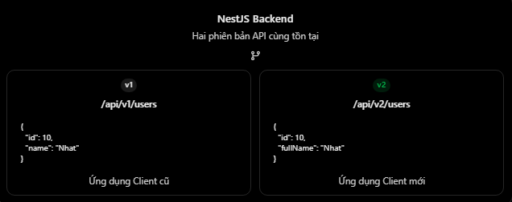

# REST API & HTTP: API Versioning

## Mục lục

- [API Versioning là gì?](#api-versioning-là-gì)
- [Vì sao cần API Versioning?](#vì-sao-cần-api-versioning)
- [Breaking và non-breaking changes](#breaking-và-non-breaking-changes)
- [API v1 và v2 có cần database riêng không?](#api-v1-và-v2-có-cần-database-riêng-không)
- [Các chiến lược API Versioning](#các-chiến-lược-api-versioning)
- [URI Versioning với NestJS](#uri-versioning-với-nestjs)
- [Header và Media Type Versioning với NestJS](#header-và-media-type-versioning-với-nestjs)
- [Backward compatibility và migration](#backward-compatibility-và-migration)
- [Deprecation và loại bỏ phiên bản cũ](#deprecation-và-loại-bỏ-phiên-bản-cũ)
- [Những lỗi thường gặp](#những-lỗi-thường-gặp)
- [Thực hành](#thực-hành)
- [Câu hỏi ôn tập](#câu-hỏi-ôn-tập)

## API Versioning là gì?

API Versioning là cách quản lý nhiều phiên bản của **API contract** để backend thay đổi API mà không làm hỏng ngay client dùng hợp đồng cũ.

```http
GET /api/v1/users/10
GET /api/v2/users/10
```

- `v1` là hợp đồng API cũ còn được hỗ trợ.
- `v2` là hợp đồng mới.
- Hai phiên bản có thể cùng tồn tại trong giai đoạn migration.

Versioning tập trung vào contract client quan sát được:

- Request path, query, headers và body.
- Response status, headers và body.
- Tên, kiểu và ý nghĩa fields.
- Error format và hành vi.
- Authentication/authorization requirements.

Version API không nhất thiết giống version ứng dụng mobile/web hoặc version package backend.

## Vì sao cần API Versioning?

Phiên bản v1:

```http
GET /api/v1/users/10
```

```json
{
  "id": 10,
  "name": "Nhat"
}
```

React Native đang dùng:

```tsx
<Text>{user.name}</Text>
```

Backend muốn thay `name` bằng cấu trúc mới:

```http
GET /api/v2/users/10
```

```json
{
  "id": "10",
  "fullName": "Minh Nhat",
  "profile": {
    "displayName": "Nhat"
  }
}
```

Nếu xóa `name` khỏi v1 ngay, client cũ có thể nhận `undefined`. Đây là **breaking change**.

API Versioning cho phép:

1. Giữ v1 hoạt động.
2. Phát hành v2.
3. Cập nhật tài liệu, SDK và client.
4. Theo dõi mức sử dụng v1.
5. Loại bỏ v1 theo kế hoạch đã thông báo.



Versioning không tự tạo backward compatibility; backend phải thực sự giữ hành vi đã cam kết của phiên bản cũ.

## Breaking và non-breaking changes

Không phải mọi thay đổi backend đều cần version mới.

| Thay đổi | Thường breaking? | Ghi chú |
| --- | --- | --- |
| Sửa bug nội bộ không đổi contract | Không | Trừ khi client phụ thuộc hành vi lỗi |
| Tối ưu query Prisma | Không | Output/semantics không đổi |
| Thêm endpoint mới | Không | Không ảnh hưởng endpoint cũ |
| Thêm optional request field | Thường không | Server vẫn nhận request cũ |
| Thêm response field | Thường không | Client deserialize nghiêm ngặt vẫn có thể lỗi |
| Xóa/đổi tên response field | Có | Client cũ có thể đang đọc field |
| Đổi `id` từ number sang string | Có | Kiểu dữ liệu thay đổi |
| Biến optional field thành required | Có | Request cũ bị từ chối |
| Đổi status code/error format | Có thể | Client có thể phân nhánh theo status |
| Thêm enum value | Có thể | Exhaustive switch ở client có thể lỗi |
| Đổi ý nghĩa field nhưng giữ tên | Có | Semantic breaking change |

“Thêm field luôn non-breaking” không tuyệt đối đúng. Client nên bỏ qua field lạ, nhưng generated client/schema validator có thể cấu hình strict.

Trước khi tạo v2, có thể cân nhắc:

- Thêm field mới nhưng giữ field cũ trong giai đoạn chuyển đổi.
- Chấp nhận cả request format cũ và mới tạm thời.
- Adapter/serializer theo từng contract.
- Endpoint/capability mới nếu chưa cần version toàn API.

## API v1 và v2 có cần database riêng không?

Không. v1 và v2 thường dùng chung domain/service/database nhưng có adapter khác nhau ở API boundary.

Domain model:

```ts
type User = {
  id: number;
  firstName: string;
  lastName: string;
};
```

Serializer v1:

```ts
function toUserV1(user: User) {
  return {
    id: user.id,
    name: user.firstName,
  };
}
```

Serializer v2:

```ts
function toUserV2(user: User) {
  return {
    id: String(user.id),
    fullName: user.firstName + " " + user.lastName,
  };
}
```

Tách contract khỏi database schema giúp:

- Không buộc v1/v2 có database riêng.
- Tránh trả nguyên Prisma model.
- Kiểm soát field theo version.
- Test contract độc lập.

Khi database schema cũng thay đổi, dùng **expand → migrate → contract**:

1. Thêm schema mới vẫn tương thích code cũ.
2. Deploy code đọc/ghi tương thích.
3. Migrate/backfill dữ liệu.
4. Chuyển client sang API mới.
5. Chỉ xóa schema cũ khi không còn consumer phụ thuộc.

## Các chiến lược API Versioning

| Phương pháp | Ví dụ | Ưu điểm | Đánh đổi |
| --- | --- | --- | --- |
| URI | `/api/v1/users` | Dễ thấy, dễ gọi/debug | Version là một phần URL |
| Custom header | `Api-Version: 1` | URL ổn định | Khó thử trực tiếp trên address bar |
| Media type | `Accept: application/json;v=1` | Gắn version với representation | Phức tạp hơn cho cache/docs |
| Query parameter | `/api/users?version=1` | Dễ thêm | Dễ lẫn với query nghiệp vụ |

Nên chọn một chiến lược chính và dùng nhất quán. URI Versioning phổ biến, dễ học và vận hành.

Version thường đại diện major contract như `v1`, `v2`. Không nhất thiết đưa semantic version đầy đủ như `/v1.4.7` vào URL; thay đổi tương thích tiếp tục nằm trong cùng major version.

Nếu response thay đổi theo header, cache/CDN cần phân biệt representation qua cache key và `Vary` phù hợp.

## URI Versioning với NestJS

### Cấu hình trong main.ts

```ts
import { VersioningType } from "@nestjs/common";

const app = await NestFactory.create(AppModule);

app.setGlobalPrefix("api");
app.enableVersioning({
  type: VersioningType.URI,
  defaultVersion: "1",
});

await app.listen(3000);
```

- `setGlobalPrefix("api")` thêm `/api`.
- `VersioningType.URI` tạo segment `/v{version}`.
- Version `"1"` trở thành `/api/v1/...`.
- `defaultVersion` cung cấp version mặc định theo cấu hình ứng dụng.

Hãy quyết định rõ request không chỉ định version được hỗ trợ, redirect hay trả lỗi; đừng để default che lỗi tích hợp ngoài ý muốn.

### Version cho từng handler

```ts
@Controller("users")
export class UsersController {
  @Get(":id")
  @Version("1")
  getUserV1(@Param("id") id: string) {
    return { id, name: "Nhat" };
  }

  @Get(":id")
  @Version("2")
  getUserV2(@Param("id") id: string) {
    return { id, fullName: "Minh Nhat" };
  }
}
```

```http
GET /api/v1/users/10
GET /api/v2/users/10
```

Có thể đặt version ở controller:

```ts
@Controller({
  path: "users",
  version: "2",
})
export class UsersV2Controller {}
```

Với codebase lớn, controller/DTO/serializer riêng theo major version thường dễ bảo trì hơn nhiều nhánh `if (version)` trong một handler.

## Header và Media Type Versioning với NestJS

### Header Versioning

```ts
app.enableVersioning({
  type: VersioningType.HEADER,
  header: "Api-Version",
});
```

```http
GET /api/users/10
Api-Version: 2
```

### Media Type Versioning

```ts
app.enableVersioning({
  type: VersioningType.MEDIA_TYPE,
  key: "v=",
});
```

```http
GET /api/users/10
Accept: application/json;v=2
```

Version resolver chỉ chọn handler; ứng dụng vẫn phải implement contract tương ứng.

Endpoint không cần version có thể dùng `VERSION_NEUTRAL`:

```ts
@Version(VERSION_NEUTRAL)
@Get("health")
health() {
  return { status: "ok" };
}
```

## Backward compatibility và migration

Chỉ đổi `/v1` thành `/v2` rồi xóa v1 không bảo vệ client cũ.

Kế hoạch migration nên:

1. Liệt kê breaking changes.
2. Công bố contract v2 và migration guide.
3. Deploy v2 song song với v1.
4. Thêm contract/integration tests cho cả hai.
5. Cập nhật SDK và client.
6. Theo dõi traffic, consumer và lỗi v1.
7. Nhắc consumer còn sử dụng.
8. Loại bỏ v1 sau thời hạn công bố.

Mobile app thường cần thời gian dài hơn vì người dùng không cập nhật đồng thời.

Tránh copy toàn bộ business logic cho mỗi version. Chia sẻ domain/service khi semantics giống nhau và chỉ tách:

- DTO request/response.
- Mapping/serializer.
- Validation khác version.
- Controller/route contract.
- Logic nghiệp vụ khi thật sự khác.

## Deprecation và loại bỏ phiên bản cũ

Deprecated nghĩa phiên bản vẫn hoạt động nhưng không dành cho tích hợp mới và sẽ bị loại bỏ theo kế hoạch.

Nên cung cấp:

- Ngày bắt đầu deprecated.
- Thời điểm dự kiến ngừng hỗ trợ.
- Migration guide và endpoint thay thế.
- Changelog/documentation.
- Thông báo qua kênh developer.
- Telemetry để biết consumer nào còn dùng.

Có thể dùng response headers và documentation để truyền tín hiệu deprecation/sunset theo chính sách hệ thống, nhưng không nên chỉ dựa vào header.

Ví dụ theo chuẩn HTTP hiện hành:

```http
Deprecation: @1793491200
Sunset: Thu, 31 Dec 2026 23:59:59 GMT
Link: </docs/migrations/v1-to-v2>; rel="deprecation"
```

- `Deprecation` dùng Structured Field Date, ký hiệu `@` theo sau Unix timestamp.
- `Sunset` cho biết thời điểm resource dự kiến ngừng phản hồi.
- Link relation `deprecation` trỏ đến tài liệu migration.
- Thời điểm `Sunset` không được sớm hơn thời điểm `Deprecation`.

Trước khi loại bỏ:

- Xác nhận traffic v1 đủ thấp/đã được phê duyệt.
- Có rollback và incident plan.
- Không âm thầm đổi contract v1 thành v2.
- Trả response rõ ràng theo chính sách.

## Những lỗi thường gặp

| Hiểu nhầm hoặc lỗi | Cách hiểu đúng |
| --- | --- |
| Mọi thay đổi đều cần v2 | Breaking contract change mới thường cần major version |
| Thêm response field chắc chắn an toàn | Strict client vẫn có thể lỗi |
| v1 và v2 phải dùng database riêng | Thường dùng chung domain/data với serializer khác |
| Có `/v2` là tự backward-compatible | Phải duy trì v1 thực sự |
| API version giống app version | Hai version độc lập |
| Dùng `VersioningType.URL` | NestJS dùng `VersioningType.URI` |
| Xóa v1 ngay khi có v2 | Cần migration/deprecation plan |
| Copy toàn bộ business logic mỗi version | Chia sẻ service/domain khi semantics giống |
| Đổi field nhưng giữ version cũ | Client v1 vẫn có thể bị phá |
| Không đo traffic version cũ | Không biết khi nào sunset an toàn |

## Thực hành

Chạy [ví dụ API Versioning](../Example/api-versioning-example.js). Ví dụ dùng Node.js có sẵn, cùng một domain model nhưng trả contract v1/v2 khác nhau; hỗ trợ URI versioning, header versioning và deprecation headers cho v1.

## Câu hỏi ôn tập

1. **API Versioning là gì?**
   Là quản lý nhiều API contracts để phát triển API mà không làm hỏng ngay client dùng phiên bản cũ.

2. **Khi nào nên tạo API version mới?**
   Khi cần breaking change mà không thể duy trì tương thích hợp lý trong version hiện tại.

3. **URI Versioning là gì?**
   Đưa major version vào URL, ví dụ `/api/v1/users` và `/api/v2/users`.

4. **API v1 và v2 có cần database riêng không?**
   Không. Chúng thường dùng chung domain/database và map sang response DTO khác nhau.

5. **Cấu hình URI Versioning trong NestJS thế nào?**
   Bật `VersioningType.URI` và dùng `@Version()` hoặc version ở controller.

6. **Vì sao không nên xóa v1 ngay khi phát hành v2?**
   Client cũ cần thời gian migration; đặc biệt mobile client không cập nhật đồng thời.

7. **Deprecation plan cần gì?**
   Timeline, migration guide, thông báo, telemetry, tiêu chí sunset và rollback plan.

## Tham khảo

- [RFC 9745: The Deprecation HTTP Response Header Field](https://www.rfc-editor.org/rfc/rfc9745.html)
- [RFC 8594: The Sunset HTTP Header Field](https://www.rfc-editor.org/rfc/rfc8594.html)
