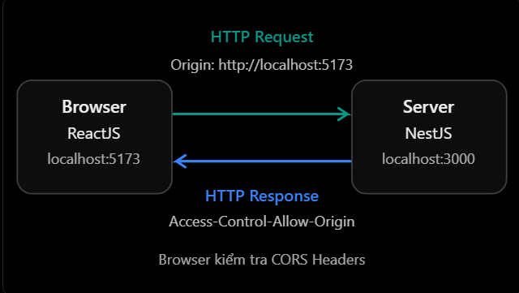
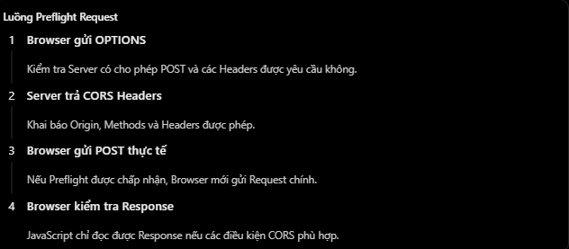

# REST API & HTTP Theory

## 13. CORS ở mức HTTP/API

### 1. CORS là gì?

**CORS (Cross-Origin Resource Sharing)** là cơ chế dựa trên HTTP header, cho phép server thông báo cho trình duyệt biết origin nào được phép đọc response trong ngữ cảnh cross-origin.

Hiểu đơn giản: CORS giúp trình duyệt quyết định JavaScript từ một website có được phép đọc dữ liệu từ API thuộc origin khác hay không.

Giả sử hệ thống full-stack gồm:

- Frontend React: `http://localhost:5173`
- Backend NestJS: `http://localhost:3000`

Frontend gửi request:

```ts
fetch("http://localhost:3000/api/users");
```

Hai địa chỉ khác port nên khác origin. Nếu backend không trả về CORS header phù hợp, trình duyệt sẽ không cho JavaScript đọc response.

> CORS chủ yếu là chính sách do **trình duyệt** thực thi. Nó không thay thế authentication, authorization, CSRF protection hay việc kiểm tra dữ liệu ở server.

### 2. Origin là gì?

Một origin được xác định bởi ba thành phần:

```text
Origin = Scheme + Host + Port
```

Ví dụ: `http://localhost:5173`

| Thành phần | Giá trị |
| --- | --- |
| Scheme (giao thức) | `http` |
| Host | `localhost` |
| Port | `5173` |

Hai URL cùng origin khi cả scheme, host và port đều giống nhau:

| URL so với `http://localhost:5173` | Cùng origin? | Lý do |
| --- | --- | --- |
| `http://localhost:5173/users` | Có | Chỉ khác path |
| `http://localhost:3000/users` | Không | Khác port |
| `https://localhost:5173/users` | Không | Khác scheme |
| `http://127.0.0.1:5173/users` | Không | Khác host |

Chỉ cần khác port đã là cross-origin, dù frontend và backend cùng chạy trên một máy.

### 3. CORS hoạt động như thế nào?



Trình duyệt có thể gửi:

```http
GET /api/users HTTP/1.1
Host: localhost:3000
Origin: http://localhost:5173
```

Nếu cho phép origin này, server trả về:

```http
HTTP/1.1 200 OK
Access-Control-Allow-Origin: http://localhost:5173
Vary: Origin
Content-Type: application/json

[{"id":1,"name":"Nhat"}]
```

Trình duyệt so sánh `Origin` của request với `Access-Control-Allow-Origin` trong response. Nếu hợp lệ, JavaScript được đọc response; nếu thiếu hoặc không khớp, trình duyệt chặn quyền truy cập response.

`Vary: Origin` báo cho cache rằng response có thể thay đổi theo request header `Origin`, tránh dùng nhầm response CORS đã cache cho origin khác.

### 4. Same-Origin Policy và CORS

| Same-Origin Policy (SOP) | CORS |
| --- | --- |
| Chính sách bảo mật mặc định của trình duyệt | Cơ chế nới lỏng SOP có kiểm soát |
| Hạn chế script đọc dữ liệu từ origin khác | Cho phép server khai báo origin được đọc response |
| Được trình duyệt thực thi | Hoạt động thông qua HTTP header |

SOP đặt ra giới hạn; CORS là cách server cho phép một số truy cập cross-origin phù hợp.

### 5. Simple request và preflight request

Không phải mọi cross-origin request đều cần preflight. Một **simple request** có thể được gửi thẳng nếu method, header và `Content-Type` thuộc nhóm an toàn do chuẩn CORS quy định.

Với request không thuộc nhóm simple, trình duyệt tự gửi **preflight request** bằng method `OPTIONS` để hỏi quyền trước. Ví dụ `POST` có `Authorization` và `Content-Type: application/json` thường kích hoạt preflight:

```ts
await fetch("http://localhost:3000/api/products", {
  method: "POST",
  headers: {
    Authorization: "Bearer <access_token>",
    "Content-Type": "application/json",
  },
  body: JSON.stringify({ name: "Laptop Dell", price: 20_000_000 }),
});
```



Trình duyệt hỏi server:

```http
OPTIONS /api/products HTTP/1.1
Origin: http://localhost:5173
Access-Control-Request-Method: POST
Access-Control-Request-Headers: authorization,content-type
```

Server có thể chấp thuận:

```http
HTTP/1.1 204 No Content
Access-Control-Allow-Origin: http://localhost:5173
Access-Control-Allow-Methods: GET, POST, PATCH, DELETE
Access-Control-Allow-Headers: Authorization, Content-Type
Access-Control-Max-Age: 600
Vary: Origin, Access-Control-Request-Method, Access-Control-Request-Headers
```

Nếu các điều kiện khớp, trình duyệt mới gửi request `POST` thật. `Access-Control-Max-Age` cho phép cache kết quả preflight trong một khoảng thời gian; trình duyệt có thể áp dụng giới hạn riêng.

### 6. Các CORS header quan trọng

| Header | Chiều | Mục đích |
| --- | --- | --- |
| `Origin` | Request | Origin khởi tạo request |
| `Access-Control-Request-Method` | Preflight request | Method dự kiến của request thật |
| `Access-Control-Request-Headers` | Preflight request | Các header dự kiến gửi trong request thật |
| `Access-Control-Allow-Origin` | Response | Origin được phép đọc response |
| `Access-Control-Allow-Methods` | Preflight response | Các method được cho phép |
| `Access-Control-Allow-Headers` | Preflight response | Các request header được cho phép |
| `Access-Control-Allow-Credentials` | Response | Cho phép chia sẻ response khi request có credentials |
| `Access-Control-Expose-Headers` | Response | Cho JavaScript đọc thêm response header |
| `Access-Control-Max-Age` | Preflight response | Thời gian cache kết quả preflight |

### 7. CORS và credentials

Credentials có thể là cookie, HTTP authentication hoặc chứng chỉ TLS phía client. Với `fetch`, gửi cookie cross-origin bằng:

```ts
fetch("http://localhost:3000/api/profile", {
  credentials: "include",
});
```

Server phải trả về:

```http
Access-Control-Allow-Origin: http://localhost:5173
Access-Control-Allow-Credentials: true
```

Khi dùng credentials, `Access-Control-Allow-Origin` không được là `*`; server phải trả về origin cụ thể đã được kiểm tra. Cookie cross-site còn phụ thuộc các thuộc tính như `SameSite` và `Secure`—bật CORS không tự làm cookie được gửi đi.

### 8. Cấu hình CORS trong NestJS

Trong `main.ts`:

```ts
const app = await NestFactory.create(AppModule);

app.enableCors({
  origin: ["http://localhost:5173"],
  methods: ["GET", "POST", "PUT", "PATCH", "DELETE"],
  allowedHeaders: ["Content-Type", "Authorization"],
  credentials: true,
  maxAge: 600,
});

await app.listen(3000);
```

- `origin`: danh sách frontend được phép.
- `methods`: các method được chấp nhận khi kiểm tra CORS.
- `allowedHeaders`: các request header được chấp nhận trong preflight.
- `credentials`: cho phép response của request có credentials được chia sẻ với frontend.
- `maxAge`: thời gian cache kết quả preflight.

Nếu không dùng cookie hoặc HTTP authentication cross-origin thì không cần bật `credentials`.

### 9. Cấu hình CORS trong ExpressJS

Với Express, có thể dùng middleware `cors`:

```ts
import cors from "cors";
import express from "express";

const app = express();

app.use(cors({ origin: "http://localhost:5173" }));
app.use(express.json());

app.get("/api/users", (_req, res) => {
  res.json([{ id: 1, name: "Nhat" }]);
});

app.listen(3000);
```

Middleware thiết lập các CORS response header cần thiết. CORS vẫn phải được cấu hình theo allowlist phù hợp với môi trường triển khai.

### 10. CORS có áp dụng cho React Native và Postman không?

CORS chủ yếu được thực thi bởi trình duyệt:

- React chạy trong Chrome: chịu chính sách CORS.
- React Native dùng native networking: thông thường không chịu browser CORS policy.
- Postman/cURL: không bị trình duyệt chặn theo CORS.
- Backend Node.js gọi API khác: không chịu browser CORS policy.

Vì vậy, API chạy thành công trong Postman nhưng frontend trên trình duyệt báo lỗi CORS là tình huống hoàn toàn có thể xảy ra. Gửi `Origin` bằng Postman/cURL chỉ giúp quan sát header; công cụ đó không thực thi chính sách như trình duyệt.

### 11. Lỗi thường gặp

1. **Xem CORS là authentication hoặc authorization.** CORS không thay thế JWT, guard, RBAC hay kiểm tra quyền tại server.
2. **Cho rằng server chắc chắn không nhận request khi thấy lỗi CORS.** Simple request có thể đã được xử lý nhưng response bị chặn; nếu preflight thất bại thì request thật thường chưa được gửi.
3. **Dùng `Access-Control-Allow-Origin: *` cùng credentials.** Trình duyệt không chấp nhận wildcard trong trường hợp này.
4. **Cho rằng mọi cross-origin request đều có `OPTIONS`.** Chỉ request cần preflight mới có bước này.
5. **Nhầm CORS với CSRF protection.** Server vẫn cần chống CSRF khi xác thực bằng cookie.
6. **Phản chiếu mọi giá trị `Origin` mà không kiểm tra.** Hành vi này tương đương cho phép mọi origin, đặc biệt nguy hiểm khi dùng credentials.
7. **Quên xử lý `OPTIONS` hoặc đặt authentication trước preflight.** Preflight nhận `401/403` khiến request thật không được gửi.
8. **Chỉ thêm CORS header vào response thành công.** Response lỗi cũng cần CORS header để frontend đọc được thông tin lỗi.

### 12. Thực hành

Chạy ví dụ Node.js không cần cài thư viện: [cors-example.js](../Example/cors-example.js).

Ví dụ minh họa allowlist origin, simple request, preflight thành công/thất bại và response lỗi vẫn có CORS header.

### 13. Câu hỏi ôn tập

1. Origin được cấu thành từ những thành phần nào?
2. CORS và Same-Origin Policy có quan hệ như thế nào?
3. Khi nào trình duyệt gửi preflight request và request đó dùng method gì?
4. Vì sao `Authorization` thường làm request cần preflight?
5. Vì sao không thể dùng `Access-Control-Allow-Origin: *` với credentials?
6. CORS có thay thế authentication, authorization hoặc CSRF protection không?
7. Vì sao API có thể chạy trong Postman nhưng lỗi trên trình duyệt?
8. `Vary: Origin` và `Access-Control-Max-Age` có vai trò gì?
