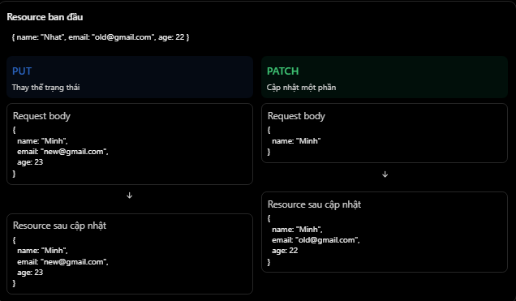

# REST API & HTTP: PUT và PATCH

## Mục lục

- [PUT là gì?](#put-là-gì)
- [PATCH là gì?](#patch-là-gì)
- [So sánh PUT và PATCH](#so-sánh-put-và-patch)
- [Tính idempotent](#tính-idempotent)
- [Định dạng PATCH](#định-dạng-patch)
- [Ví dụ với NestJS, Prisma và PostgreSQL](#ví-dụ-với-nestjs-prisma-và-postgresql)
- [Tránh ghi đè thay đổi đồng thời](#tránh-ghi-đè-thay-đổi-đồng-thời)
- [Những lỗi thường gặp](#những-lỗi-thường-gặp)
- [Thực hành](#thực-hành)
- [Câu hỏi ôn tập](#câu-hỏi-ôn-tập)

## PUT là gì?

Trong REST API, `PUT` thường được dùng khi client muốn **thay thế trạng thái** của resource tại URI đích.

Giả sử database đang có user:

```json
{
  "id": 10,
  "name": "Nhat",
  "email": "nhat@gmail.com",
  "age": 22
}
```

Client gửi đầy đủ các trường có thể chỉnh sửa:

```http
PUT /api/users/10
Content-Type: application/json

{
  "name": "Minh Nhat",
  "email": "minhnhat@gmail.com",
  "age": 23
}
```

Kết quả:

```json
{
  "id": 10,
  "name": "Minh Nhat",
  "email": "minhnhat@gmail.com",
  "age": 23
}
```

Client gửi representation thay thế cho trạng thái mà API cho phép chỉnh sửa. Các trường do server quản lý như `id`, `createdAt` hoặc `updatedAt` không nhất thiết xuất hiện trong request body.

Với `PUT`, trường bị thiếu được xử lý theo API contract. Server có thể từ chối request bằng `400 Bad Request`, hoặc áp dụng giá trị mặc định nếu contract quy định như vậy. Không nên mặc định rằng các trường thiếu sẽ được giữ nguyên như `PATCH`.

Theo HTTP semantics, `PUT` cũng có thể tạo resource nếu URI đích chưa tồn tại và server cho phép client xác định URI. Tuy nhiên, nhiều API thực tế chỉ dùng `PUT` để thay thế resource đã có và trả `404 Not Found` khi không tìm thấy. API phải mô tả rõ lựa chọn này.

## PATCH là gì?

`PATCH` dùng để áp dụng **một tập thay đổi** lên resource, thay vì gửi representation thay thế toàn bộ.

Giả sử user ban đầu:

```json
{
  "id": 10,
  "name": "Nhat",
  "email": "nhat@gmail.com",
  "age": 22
}
```

Client chỉ muốn đổi `name`:

```http
PATCH /api/users/10
Content-Type: application/merge-patch+json

{
  "name": "Minh Nhat"
}
```

Kết quả:

```json
{
  "id": 10,
  "name": "Minh Nhat",
  "email": "nhat@gmail.com",
  "age": 22
}
```

Chỉ `name` thay đổi; `email` và `age` được giữ nguyên theo quy tắc của patch này.

## So sánh PUT và PATCH



| Tiêu chí | `PUT` | `PATCH` |
| --- | --- | --- |
| Mục đích | Thay thế trạng thái resource | Áp dụng thay đổi một phần |
| Dữ liệu gửi | Thường gồm đầy đủ các trường client được phép thay thế | Chỉ mô tả thay đổi cần thực hiện |
| Trường không gửi | Xử lý theo contract; không mặc định được giữ nguyên | Thường được giữ nguyên, tùy định dạng patch |
| Idempotent | Có | Không được đảm bảo |
| Tình huống | Thay thế thông tin user | Chỉ sửa tên hoặc email |
| Content-Type thường gặp | `application/json` | `application/merge-patch+json` hoặc `application/json-patch+json` |

Khác biệt nằm ở **ngữ nghĩa API**, không chỉ ở số trường trong body. Một request có body nhỏ vẫn có thể là `PUT` nếu đó là representation đầy đủ của một resource vốn chỉ có một trường có thể chỉnh sửa.

## Tính idempotent

Idempotent nghĩa là gửi lặp lại **cùng một request** có hiệu ứng mong muốn lên trạng thái server giống như gửi một lần.

`PUT` là idempotent. Ví dụ:

```http
PUT /users/10
Content-Type: application/json

{
  "name": "Minh",
  "email": "minh@example.com",
  "age": 23
}
```

Gửi request này nhiều lần vẫn hướng user `10` đến cùng trạng thái.

`PATCH` không được HTTP đảm bảo là idempotent. Một patch gán giá trị thường có thể idempotent:

```json
{
  "name": "Minh"
}
```

Trong khi một patch theo contract riêng để tăng tồn kho không idempotent:

```http
PATCH /products/10/stock
Content-Type: application/json

{
  "incrementBy": 1
}
```

Mỗi lần gửi sẽ tiếp tục tăng tồn kho. Vì vậy, một PATCH cụ thể **có thể** idempotent, nhưng method `PATCH` không đảm bảo đặc tính đó.

> Idempotent nói về hiệu ứng mong muốn trên server, không yêu cầu mọi response giống nhau. Timestamp, status code hoặc response body vẫn có thể khác giữa các lần gọi.

## Định dạng PATCH

`PATCH` cần một định dạng tài liệu patch mà client và server cùng hiểu:

| Định dạng | Content-Type | Ví dụ ý nghĩa |
| --- | --- | --- |
| JSON Merge Patch | `application/merge-patch+json` | Object gần giống resource; trường xuất hiện sẽ được thay đổi |
| JSON Patch | `application/json-patch+json` | Danh sách operation như `add`, `remove`, `replace` |
| Định dạng riêng của API | Thường là `application/json` | API tự quy định ý nghĩa body |

Ví dụ JSON Patch:

```http
PATCH /api/users/10
Content-Type: application/json-patch+json

[
  { "op": "replace", "path": "/name", "value": "Minh Nhat" },
  { "op": "remove", "path": "/age" }
]
```

Không nên nhìn một object JSON rồi tự suy đoán cách xử lý `null`, trường thiếu hoặc operation. API contract và `Content-Type` phải xác định rõ các quy tắc này.

## Ví dụ với NestJS, Prisma và PostgreSQL

### PATCH

Controller:

```ts
@Controller("users")
export class UsersController {
  constructor(private readonly usersService: UsersService) {}

  @Patch(":id")
  update(@Param("id", ParseIntPipe) id: number, @Body() dto: UpdateUserDto) {
    return this.usersService.update(id, dto);
  }
}
```

Service:

```ts
async update(id: number, dto: UpdateUserDto) {
  return this.prisma.user.update({
    where: { id },
    data: dto,
  });
}
```

Ví dụ giả định `UpdateUserDto` chỉ cho phép các trường hợp lệ và request đã được validation. Prisma cập nhật các trường có trong `data`; các trường không được cung cấp sẽ không bị thay đổi.

### PUT

Controller:

```ts
@Put(":id")
replace(
  @Param("id", ParseIntPipe) id: number,
  @Body() dto: ReplaceUserDto,
) {
  return this.usersService.replace(id, dto);
}
```

Service:

```ts
async replace(id: number, dto: ReplaceUserDto) {
  return this.prisma.user.update({
    where: { id },
    data: {
      name: dto.name,
      email: dto.email,
      age: dto.age,
    },
  });
}
```

`ReplaceUserDto` nên yêu cầu đầy đủ các trường có thể thay thế, còn `UpdateUserDto` thường để các trường là optional. Prisma `update()` không tự quyết định đâu là `PUT` hay `PATCH`; HTTP method, DTO, validation và logic service mới xác định ngữ nghĩa.

Trong ứng dụng thực tế, cần chuyển lỗi “không tìm thấy record” của Prisma thành response phù hợp như `404 Not Found`.

## Tránh ghi đè thay đổi đồng thời

`PUT` và `PATCH` đều có thể gặp **lost update**:

1. Client A và B cùng đọc resource phiên bản 1.
2. Client A cập nhật thành phiên bản 2.
3. Client B gửi dữ liệu dựa trên phiên bản 1 và vô tình ghi đè thay đổi của A.

Một cách xử lý là optimistic concurrency control:

```http
GET /users/10

HTTP/1.1 200 OK
ETag: "user-10-v1"
```

Client gửi ETag cũ trong request cập nhật:

```http
PUT /users/10
If-Match: "user-10-v1"
```

Server chỉ cập nhật nếu phiên bản còn khớp; nếu không, có thể trả `412 Precondition Failed`. Với database, cũng có thể dùng cột `version` và cập nhật có điều kiện.

## Những lỗi thường gặp

| Hiểu nhầm hoặc lỗi | Cách hiểu đúng |
| --- | --- |
| `PUT` phải cập nhật mọi cột database | `PUT` thay thế trạng thái resource theo API contract, không phải toàn bộ cấu trúc lưu trữ |
| Trường thiếu trong `PUT` luôn được giữ nguyên | Cách xử lý do contract quy định; giữ nguyên mặc định dễ biến `PUT` thành `PATCH` |
| `PATCH` luôn idempotent | Một patch có thể idempotent, nhưng HTTP không đảm bảo |
| `PATCH` luôn là object JSON | Có nhiều định dạng patch; phải xem `Content-Type` và contract |
| Prisma `update()` luôn tương đương `PATCH` | Prisma là công cụ dữ liệu; tầng API quyết định semantics |
| Idempotent nghĩa là response luôn giống nhau | Idempotent nói về hiệu ứng lên trạng thái server |
| `PUT` luôn chỉ cập nhật resource có sẵn | HTTP cho phép tạo tại URI đích trong một số thiết kế, nhưng API có thể không hỗ trợ |
| Không cần validation vì chỉ cập nhật một phần | Mọi giá trị được cập nhật vẫn phải được validate và authorize |

## Thực hành

Chạy [ví dụ PUT và PATCH](../Example/put-patch-example.js). Ví dụ dùng Node.js có sẵn và dữ liệu trong bộ nhớ, minh họa `PUT` yêu cầu representation đầy đủ, `PATCH` chỉ đổi trường được gửi, cùng hai kiểu PATCH idempotent và không idempotent.

## Câu hỏi ôn tập

1. **PUT và PATCH khác nhau thế nào?**
   `PUT` thay thế trạng thái resource; `PATCH` áp dụng một tập thay đổi lên resource.

2. **Khi nào nên dùng PATCH thay vì PUT?**
   Khi client chỉ cần thay đổi một số trường và không muốn gửi representation thay thế đầy đủ.

3. **PUT có idempotent không?**
   Có. Gửi lặp lại cùng một request `PUT` phải hướng đến cùng hiệu ứng trạng thái như gửi một lần.

4. **PATCH có idempotent không?**
   Không được đảm bảo. Điều này phụ thuộc nội dung patch và logic server.

5. **PUT có luôn cập nhật mọi cột trong database không?**
   Không. `PUT` thay thế trạng thái resource theo API contract, không nhất thiết ánh xạ toàn bộ bảng.

6. **Vì sao cần quan tâm đến Content-Type của PATCH?**
   Vì nó cho biết định dạng và quy tắc áp dụng patch, chẳng hạn JSON Merge Patch hoặc JSON Patch.
