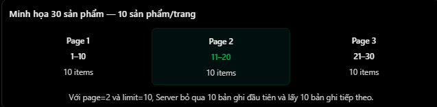
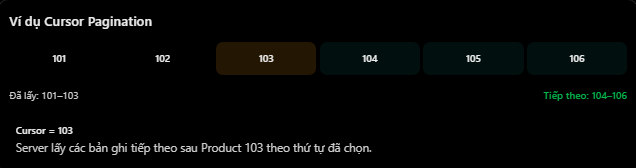

# REST API & HTTP: Pagination

## Mục lục

- [Pagination là gì?](#pagination-là-gì)
- [Offset pagination với page và limit](#offset-pagination-với-page-và-limit)
- [Tính offset](#tính-offset)
- [Offset pagination với NestJS và Prisma](#offset-pagination-với-nestjs-và-prisma)
- [Nhược điểm của offset pagination](#nhược-điểm-của-offset-pagination)
- [Cursor pagination là gì?](#cursor-pagination-là-gì)
- [Cursor pagination với Prisma](#cursor-pagination-với-prisma)
- [Thiết kế cursor ổn định](#thiết-kế-cursor-ổn-định)
- [So sánh offset và cursor](#so-sánh-offset-và-cursor)
- [Chọn cách phân trang](#chọn-cách-phân-trang)
- [Những lỗi thường gặp](#những-lỗi-thường-gặp)
- [Thực hành](#thực-hành)
- [Câu hỏi ôn tập](#câu-hỏi-ôn-tập)

## Pagination là gì?

Pagination (phân trang) chia một tập dữ liệu lớn thành các phần nhỏ để client không tải toàn bộ dữ liệu trong một request.

Giả sử bảng `products` có 100.000 bản ghi. Nếu gọi:

```http
GET /api/v1/products
```

và server trả toàn bộ dữ liệu, hệ thống có thể gặp:

- Truy vấn chậm và dùng nhiều memory.
- Response lớn, tốn băng thông.
- Serialize/parse JSON lâu.
- Frontend render nhiều phần tử.
- Dễ vượt timeout hoặc giới hạn hạ tầng.

Thay vào đó:

```http
GET /api/v1/products?page=1&limit=10
```

Server chỉ trả tối đa 10 products cùng metadata giúp client lấy phần tiếp theo.

Pagination không thay thế filtering/sorting. API cần áp dụng cùng filter và thứ tự ổn định cho mọi request trong chuỗi phân trang.

## Offset pagination với page và limit

Hai query parameters phổ biến:

| Tham số | Ý nghĩa | Ví dụ |
| --- | --- | --- |
| `page` | Trang cần lấy, thường bắt đầu từ 1 | `2` |
| `limit` | Số bản ghi tối đa mỗi trang | `10` |

```http
GET /products?page=2&limit=10
```

Request yêu cầu trang 2, mỗi trang tối đa 10 products.



API cũng có thể dùng cặp `offset`/`limit` trực tiếp:

```http
GET /products?offset=10&limit=10
```

Không nên trộn hai convention không rõ ràng trong cùng endpoint. Hãy mô tả trang bắt đầu từ 0 hay 1 trong API contract.

## Tính offset

Nếu `page` bắt đầu từ 1:

```text
skip = (page - 1) * limit
```

| Page | Limit | Skip |
| ---: | ---: | ---: |
| 1 | 10 | 0 |
| 2 | 10 | 10 |
| 3 | 10 | 20 |
| 4 | 20 | 60 |

Với:

```http
GET /products?page=3&limit=10
```

server bỏ qua 20 bản ghi đầu và lấy tối đa 10 bản ghi tiếp theo.

Phải validation:

- `page` là số nguyên và `page >= 1`.
- `limit` là số nguyên dương.
- `limit` không vượt giới hạn, ví dụ 100.
- Phép tính không vượt phạm vi số/database.

Trang vượt `totalPages` thường trả `200 OK` với `data: []` thay vì `404`, vì collection vẫn tồn tại.

## Offset pagination với NestJS và Prisma

Controller:

```ts
@Controller("products")
export class ProductsController {
  constructor(private readonly productsService: ProductsService) {}

  @Get()
  findAll(
    @Query("page", new DefaultValuePipe(1), ParseIntPipe)
    page: number,
    @Query("limit", new DefaultValuePipe(10), ParseIntPipe)
    limit: number,
  ) {
    return this.productsService.findAll(page, limit);
  }
}
```

Service:

```ts
async findAll(page: number, limit: number) {
  if (page < 1 || limit < 1 || limit > 100) {
    throw new BadRequestException("Invalid pagination");
  }

  const skip = (page - 1) * limit;

  const [products, total] = await Promise.all([
    this.prisma.product.findMany({
      skip,
      take: limit,
      orderBy: { id: "asc" },
    }),
    this.prisma.product.count(),
  ]);

  return {
    data: products,
    meta: {
      page,
      limit,
      total,
      totalPages: Math.ceil(total / limit),
      hasPreviousPage: page > 1,
      hasNextPage: page * limit < total,
    },
  };
}
```

Ví dụ response:

```json
{
  "data": [
    { "id": 11, "name": "Product 11" },
    { "id": 12, "name": "Product 12" }
  ],
  "meta": {
    "page": 2,
    "limit": 10,
    "total": 25,
    "totalPages": 3,
    "hasPreviousPage": true,
    "hasNextPage": true
  }
}
```

`count()` có thể tốn chi phí với dữ liệu/filter lớn. Nếu UI không thật sự cần tổng số trang, có thể lấy `limit + 1` để xác định `hasNextPage` mà không đếm toàn bộ.

Query lấy data và query `count` cũng có thể quan sát hai thời điểm khác nhau khi dữ liệu thay đổi. Nếu cần snapshot nhất quán tuyệt đối, phải cân nhắc transaction/isolation phù hợp với database và chi phí hệ thống.

## Nhược điểm của offset pagination

Trang sâu:

```http
GET /products?page=50000&limit=10
```

```text
skip = (50000 - 1) * 10 = 499990
```

Database có thể phải duyệt/bỏ qua nhiều bản ghi trước khi trả 10 bản ghi cần thiết. Hiệu suất thực tế phụ thuộc query plan, index, filter, sort và database.

Offset cũng có thể trùng hoặc bỏ sót khi dữ liệu thay đổi:

1. Client lấy trang 1 theo thứ tự mới nhất trước.
2. Có product mới được chèn vào đầu danh sách.
3. Các vị trí bị dịch.
4. Client lấy trang 2 và có thể thấy lại item từ trang 1.

Nếu một item bị xóa giữa hai request, client cũng có thể bỏ sót item do offset dịch ngược.

Offset vẫn hữu ích vì đơn giản, dễ hiển thị tổng trang và nhảy trực tiếp đến trang bất kỳ.

## Cursor pagination là gì?

Cursor pagination tiếp tục từ một vị trí trong tập dữ liệu đã sắp xếp, thay vì bỏ qua N bản ghi.



Request đầu:

```http
GET /products?limit=3
```

Server trả products `101`, `102`, `103` và một `nextCursor`.

Request tiếp:

```http
GET /products?limit=3&cursor=eyJpZCI6MTAzfQ
```

Cursor không phải số trang. Nó mã hóa vị trí tiếp tục theo thứ tự sort. Client nên xem cursor như chuỗi opaque: lưu và gửi lại, không tự sửa hoặc suy luận cấu trúc.

Response thường có:

```json
{
  "data": [
    { "id": 104, "name": "Product 104" },
    { "id": 105, "name": "Product 105" },
    { "id": 106, "name": "Product 106" }
  ],
  "pageInfo": {
    "hasNextPage": true,
    "nextCursor": "eyJpZCI6MTA2fQ"
  }
}
```

Cursor pagination thường phù hợp với feed/infinite scroll và dataset thay đổi thường xuyên.

## Cursor pagination với Prisma

Với `id` unique và sort tăng dần:

```ts
async findByCursor(limit: number, cursor?: number) {
  if (!Number.isInteger(limit) || limit < 1 || limit > 100) {
    throw new BadRequestException("Invalid limit");
  }

  const products = await this.prisma.product.findMany({
    take: limit + 1,
    skip: cursor === undefined ? 0 : 1,
    cursor: cursor === undefined ? undefined : { id: cursor },
    orderBy: { id: "asc" },
  });

  const hasNextPage = products.length > limit;
  const data = products.slice(0, limit);

  return {
    data,
    pageInfo: {
      hasNextPage,
      nextCursor:
        hasNextPage && data.length > 0
          ? data[data.length - 1].id
          : null,
    },
  };
}
```

- `cursor` xác định record tham chiếu.
- `skip: 1` bỏ chính record cursor.
- `take: limit + 1` kiểm tra còn record tiếp theo không.
- Chỉ trả `limit` records cho client.

Nếu cursor record có thể bị xóa, keyset query như `where: { id: { gt: cursorId } }` có thể phù hợp hơn, miễn sort/index nhất quán. Lựa chọn phụ thuộc database, ORM và semantics mong muốn.

Production nên encode/sign cursor hoặc validation chặt; không nối raw cursor của client vào SQL.

## Thiết kế cursor ổn định

Cursor phải tương ứng với thứ tự sort ổn định và có tính duy nhất.

Sort chỉ theo `createdAt` có thể không ổn định vì nhiều records có cùng timestamp:

```ts
orderBy: [
  { createdAt: "desc" },
  { id: "desc" },
]
```

Cursor nên chứa cả hai:

```json
{
  "createdAt": "2026-11-10T03:00:00.000Z",
  "id": 123
}
```

Các yêu cầu quan trọng:

- Thứ tự sort phải giống nhau giữa các request.
- Có unique tie-breaker, thường là `id`.
- Filter/sort không được âm thầm đổi giữa chuỗi request.
- Các cột filter/sort cần index phù hợp.
- Cursor sai, hết hạn hoặc không hợp lệ nên trả lỗi `400` rõ ràng.
- Nếu cursor chứa dữ liệu nội bộ/nhạy cảm, dùng opaque signed cursor.

Base64 chỉ là encoding, không phải encryption hoặc chữ ký. Client vẫn có thể decode/sửa nếu cursor không được ký.

## So sánh offset và cursor

| Tiêu chí | Offset (`page/limit`) | Cursor |
| --- | --- | --- |
| Cơ chế | Bỏ qua N records | Tiếp tục sau vị trí tham chiếu |
| Prisma | `skip`, `take` | `cursor`, `skip`, `take` hoặc keyset `where` |
| Nhảy đến trang bất kỳ | Dễ | Không thuận tiện |
| Tổng số trang | Dễ cung cấp qua `count` | Thường không cung cấp |
| Trang rất sâu | Có thể chậm | Thường tốt hơn với index phù hợp |
| Dữ liệu thay đổi | Dễ trùng/bỏ sót theo vị trí | Ổn định hơn theo sort key |
| UI phù hợp | Bảng admin | Feed, infinite scroll |
| URL chia sẻ “trang 20” | Dễ | Khó hơn |

Cursor không mặc định nhanh hơn trong mọi trường hợp. Query, index, độ chọn lọc, cursor design và database mới quyết định hiệu suất.

## Chọn cách phân trang

### Ưu tiên offset khi

- Admin dashboard có nút trang 1, 2, 3.
- Cần nhảy trực tiếp đến trang.
- Dataset vừa phải hoặc trang không quá sâu.
- Cần total/totalPages chính xác.

### Cân nhắc cursor khi

- Feed hoặc infinite scroll.
- Dataset lớn.
- Thường đọc các trang sâu theo tuần tự.
- Dữ liệu được thêm/xóa thường xuyên.
- Có sort key ổn định và index phù hợp.

Một API có thể hỗ trợ các chiến lược khác nhau ở endpoints khác nhau, nhưng không nên trộn `page` và `cursor` trong cùng request mà không quy định precedence rõ ràng.

## Những lỗi thường gặp

| Lỗi hoặc hiểu nhầm | Cách hiểu đúng |
| --- | --- |
| Tính `skip = page * limit` khi page bắt đầu từ 1 | Dùng `(page - 1) * limit` |
| Không giới hạn `limit` | Đặt default và maximum phù hợp |
| Không `orderBy` | Pagination cần thứ tự xác định |
| Sort không có tie-breaker unique | Thêm `id` hoặc khóa duy nhất |
| Cursor là số trang | Cursor là vị trí tiếp tục |
| Base64 cursor là bảo mật | Base64 chỉ encoding; cần ký nếu chống sửa |
| Luôn cần `count()` | Có thể dùng `limit + 1` nếu chỉ cần hasNext |
| Cursor luôn nhanh hơn offset | Phụ thuộc index và query plan |
| Trang vượt range phải trả `404` | Collection thường trả `200` với mảng rỗng |
| Cho phép đổi filter khi dùng cursor cũ | Cursor có thể không còn đúng với query mới |
| Tin cursor do client gửi | Decode, validation và xử lý lỗi an toàn |

## Thực hành

Chạy [ví dụ Pagination](../Example/pagination-example.js). Ví dụ dùng Node.js có sẵn và dữ liệu trong bộ nhớ, minh họa `page/limit`, metadata, cursor opaque, `limit + 1` và validation các query parameters.

## Câu hỏi ôn tập

1. **Pagination trong REST API là gì?**
   Là chia collection lớn thành các phần nhỏ để giảm chi phí truy vấn, truyền tải và xử lý.

2. **Offset pagination là gì?**
   Dùng vị trí bỏ qua và giới hạn; với page bắt đầu từ 1, `skip = (page - 1) * limit`.

3. **Áp dụng offset pagination trong Prisma thế nào?**
   Dùng `skip`, `take` và `orderBy` ổn định; có thể dùng `count()` để tạo metadata.

4. **Cursor pagination là gì?**
   Dùng một vị trí tham chiếu trong tập dữ liệu đã sắp xếp để lấy phần tiếp theo.

5. **Khi nào nên dùng cursor thay vì offset?**
   Với feed/infinite scroll, dataset lớn, trang sâu hoặc dữ liệu thay đổi thường xuyên.

6. **Vì sao cursor cần tie-breaker unique?**
   Để thứ tự không mơ hồ khi nhiều records có cùng giá trị sort chính.

7. **Vì sao lấy limit + 1?**
   Để biết có record tiếp theo và tính `hasNextPage` mà không cần đếm toàn bộ.
