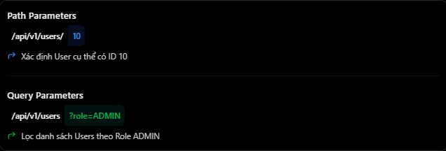

# REST API & HTTP: Path Params và Query Params

## Mục lục

- [Path parameters là gì?](#path-parameters-là-gì)
- [Query parameters là gì?](#query-parameters-là-gì)
- [So sánh path params và query params](#so-sánh-path-params-và-query-params)
- [Kết hợp path params và query params](#kết-hợp-path-params-và-query-params)
- [Chuyển kiểu và validation](#chuyển-kiểu-và-validation)
- [URL encoding và giá trị lặp](#url-encoding-và-giá-trị-lặp)
- [Ví dụ với Prisma và PostgreSQL](#ví-dụ-với-prisma-và-postgresql)
- [ExpressJS xử lý như thế nào?](#expressjs-xử-lý-như-thế-nào)
- [Lưu ý thiết kế và bảo mật](#lưu-ý-thiết-kế-và-bảo-mật)
- [Những lỗi thường gặp](#những-lỗi-thường-gặp)
- [Thực hành](#thực-hành)
- [Câu hỏi ôn tập](#câu-hỏi-ôn-tập)

## Path parameters là gì?

Path parameters (route parameters) là các giá trị động nằm trong URL path. Chúng thường dùng để nhận diện một resource cụ thể hoặc thể hiện quan hệ giữa các resource.

```http
GET /api/v1/users/10
```

Trong đó:

- `/api/v1/users` là đường dẫn đến users resource.
- `10` là path parameter nhận diện user cần lấy.

Khai báo route trong NestJS:

```ts
@Get(":id")
findOne(@Param("id") id: string) {
  return this.usersService.findOne(id);
}
```

Khi client gọi `GET /users/10`, NestJS nhận `id = "10"`. Path parameter lấy từ URL ban đầu là chuỗi, dù giá trị trông giống số. Nếu API dùng ID số:

```ts
@Get(":id")
findOne(@Param("id", ParseIntPipe) id: number) {
  return this.usersService.findOne(id);
}
```

Path parameter không chỉ là số. Nó có thể là UUID, username hoặc slug:

```http
GET /products/macbook-pro-m4
GET /users/550e8400-e29b-41d4-a716-446655440000
```

Một path parameter đã khai báo phải có để request khớp route tương ứng. `/users/:id` khớp `/users/10`, còn collection `/users` là route khác.

## Query parameters là gì?

Query parameters là các cặp key-value trong query string, bắt đầu sau dấu `?`. Chúng thường dùng để:

- Filtering.
- Searching.
- Sorting.
- Pagination.
- Chọn field hoặc tùy chọn representation.

```http
GET /api/v1/users?role=ADMIN
GET /api/v1/users?role=ADMIN&status=ACTIVE&page=2&limit=10
```

Trong NestJS:

```ts
@Get()
findAll(
  @Query("role") role?: string,
  @Query("status") status?: string,
) {
  return this.usersService.findAll(role, status);
}
```

Các giá trị đơn giản thường được nhận như chuỗi. Query parameters thường là tùy chọn, nhưng API vẫn có thể yêu cầu query cụ thể theo nghiệp vụ.

Query string không tham gia chọn route path. `GET /users?page=1` và `GET /users?page=2` đều khớp handler `GET /users`.

## So sánh path params và query params



| Tiêu chí | Path params | Query params |
| --- | --- | --- |
| Vị trí | Segment trong URL path | Sau dấu `?` |
| Mục đích phổ biến | Nhận diện resource hoặc quan hệ | Lọc, tìm kiếm, sắp xếp, phân trang |
| Ví dụ | `/users/10` | `/users?role=ADMIN` |
| NestJS | `@Param()` | `@Query()` |
| ExpressJS | `req.params` | `req.query` |
| Có bắt buộc không? | Cần để khớp route tương ứng | Tùy API, thường là tùy chọn |
| Ảnh hưởng route matching | Có | Không |

Quy tắc thực dụng:

- Giá trị **nhận diện resource**: thường dùng path parameter.
- Giá trị **điều chỉnh cách đọc resource/collection**: thường dùng query parameter.

`/users/10` rõ nghĩa hơn `/users?id=10` khi mục tiêu là user số `10`. Ngược lại, `/users?role=ADMIN` phù hợp hơn việc tạo route riêng chỉ để lọc.

## Kết hợp path params và query params

```http
GET /api/v1/families/42/members?status=ACTIVE&page=1&limit=10
```

| Thành phần | Loại | Ý nghĩa |
| --- | --- | --- |
| `42` | Path param | Family ID |
| `/members` | Resource con | Collection thành viên |
| `status=ACTIVE` | Query param | Điều kiện lọc |
| `page=1&limit=10` | Query params | Phân trang |

NestJS:

```ts
@Controller("families")
export class FamiliesController {
  @Get(":familyId/members")
  getMembers(
    @Param("familyId", ParseIntPipe) familyId: number,
    @Query("status") status?: string,
    @Query("page", new DefaultValuePipe(1), ParseIntPipe) page?: number,
  ) {
    return this.familyService.getMembers(familyId, { status, page });
  }
}
```

Path param xác định collection con; query params lọc và phân trang collection đó.

## Chuyển kiểu và validation

Mọi params đều do client kiểm soát nên phải được chuyển kiểu và validation trước khi dùng trong nghiệp vụ hoặc database.

```ts
@Get()
findAll(
  @Query("page", new DefaultValuePipe(1), ParseIntPipe) page: number,
  @Query("limit", new DefaultValuePipe(10), ParseIntPipe) limit: number,
) {
  if (page < 1 || limit < 1 || limit > 100) {
    throw new BadRequestException("Invalid pagination");
  }

  return this.usersService.findAll({ page, limit });
}
```

`GET /users/abc` khi ID phải là số thường trả `400 Bad Request`. Nếu ID hợp lệ nhưng resource không tồn tại, thường trả `404 Not Found`.

Không dùng `Boolean(value)` để parse chuỗi query:

```js
Boolean("false"); // true vì đây là chuỗi không rỗng
```

Hãy chỉ chấp nhận `true`/`false` rồi parse tường minh. Với enum như `role` hoặc `status`, giới hạn vào tập cho phép thay vì truyền chuỗi tùy ý xuống database.

## URL encoding và giá trị lặp

Ký tự đặc biệt trong URL phải được percent-encode. Ví dụ tìm `Minh Nhật`:

```text
/users?search=Minh%20Nh%E1%BA%ADt
```

Trong JavaScript, dùng `URL` và `URLSearchParams` thay vì tự nối chuỗi:

```js
const url = new URL("/users", "https://api.example.com");
url.searchParams.set("search", "Minh Nhật");
url.searchParams.set("page", "1");
```

Một query key có thể lặp:

```http
GET /products?tag=laptop&tag=sale
```

```js
const tags = url.searchParams.getAll("tag");
// ["laptop", "sale"]
```

Ý nghĩa của duplicate keys, `tag[]=a` hoặc nested query phụ thuộc API contract và parser. Hãy quy định format và validation rõ ràng.

## Ví dụ với Prisma và PostgreSQL

Controller:

```ts
@Get()
findAll(
  @Query("role") role?: UserRole,
  @Query("page", new DefaultValuePipe(1), ParseIntPipe) page?: number,
) {
  return this.usersService.findAll({ role, page });
}
```

Service:

```ts
async findAll(options: { role?: UserRole; page: number }) {
  const limit = 10;

  return this.prisma.user.findMany({
    where: options.role ? { role: options.role } : {},
    skip: (options.page - 1) * limit,
    take: limit,
    orderBy: { id: "asc" },
  });
}
```

```http
GET /users?role=ADMIN&page=2
```

Ví dụ giả định `role` đã được validation thành `UserRole` và `page >= 1`. Không truyền query chưa kiểm tra trực tiếp vào Prisma. Với dữ liệu lớn hoặc thường xuyên thay đổi, cursor pagination có thể phù hợp hơn offset pagination.

## ExpressJS xử lý như thế nào?

`req.params` chứa path parameters; `req.query` chứa query parameters:

```js
app.get("/users/:id", (req, res) => {
  return res.json({ id: req.params.id });
});

app.get("/users", (req, res) => {
  return res.json({ role: req.query.role });
});
```

Với `GET /users/10`, `req.params.id` thường là `"10"`. Với `GET /users?role=ADMIN`, `req.query.role` phụ thuộc parser/configuration.

Đừng giả định `req.query` luôn là string: query lặp hoặc parser mở rộng có thể tạo array/object. Cần kiểm tra kiểu trước khi dùng.

## Lưu ý thiết kế và bảo mật

- Không đặt access token, password hoặc secret trong query string; URL thường xuất hiện trong history, log và analytics.
- URL fragment sau `#` không được browser gửi trong HTTP request.
- Giữ tên query nhất quán và quy định default, giới hạn `limit`, field/chiều sort được phép.
- Không ghép `sort` hoặc filter tùy ý vào raw SQL; dùng allowlist và parameterized query/ORM.
- URL có giới hạn thực tế tùy client/server/proxy; dữ liệu lớn không phù hợp với query string.
- Thứ tự query parameters thường không đổi ý nghĩa, nhưng duplicate keys có thể có thứ tự theo contract.
- Collection không có kết quả thường trả `200 OK` với mảng rỗng.

## Những lỗi thường gặp

| Hiểu nhầm hoặc lỗi | Cách hiểu đúng |
| --- | --- |
| Dùng `@Query("id")` cho `/users/10` | `10` nằm trong path nên dùng `@Param("id")` |
| Giá trị nhìn như số sẽ tự thành number | Cần parse và validation |
| `Boolean("false")` trả `false` | Nó trả `true`; phải parse tường minh |
| Query string tạo route khác | Query không tham gia route path matching |
| Path param chỉ có thể là ID số | Có thể là UUID, slug hoặc username |
| Query parameters luôn optional | Tùy API contract |
| Collection rỗng phải trả `404` | Thường trả `200` cùng mảng rỗng |
| Token trong query an toàn như header | URL dễ bị ghi log/lưu history; ưu tiên `Authorization` |
| Backend đọc được fragment `#section` | Fragment không được gửi trong HTTP request |

## Thực hành

Chạy [ví dụ Path Params và Query Params](../Example/path-query-params-example.js). Ví dụ dùng Node.js có sẵn và dữ liệu trong bộ nhớ, minh họa resource theo `:id`, filtering, searching, sorting, pagination, query lặp và validation lỗi `400`.

## Câu hỏi ôn tập

1. **Path parameter trong REST API là gì?**
   Là giá trị động trong URL path, thường dùng để nhận diện resource hoặc quan hệ resource.

2. **Query parameter là gì?**
   Là key-value trong query string, thường dùng để lọc, tìm kiếm, sắp xếp hoặc phân trang.

3. **Path params và query params khác nhau thế nào?**
   Path params thường xác định resource và ảnh hưởng route matching; query params tinh chỉnh cách lấy dữ liệu và không đổi route path.

4. **Truy cập path/query params trong NestJS bằng gì?**
   Dùng `@Param()` cho path parameters và `@Query()` cho query parameters.

5. **Có thể dùng cả hai cùng nhau không?**
   Có, ví dụ `/users/10/orders?status=PAID` nhận diện orders của user `10` rồi lọc theo status.

6. **Vì sao phải validation params?**
   Vì chúng là input do client kiểm soát; kiểu, phạm vi và giá trị đều có thể không hợp lệ.
