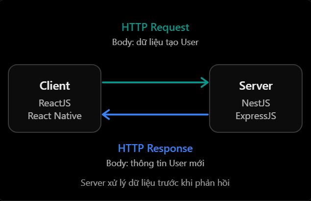

# REST API & HTTP: Request Body và Response Body

## Mục lục

- [Request body là gì?](#request-body-là-gì)
- [Response body là gì?](#response-body-là-gì)
- [Luồng xử lý](#luồng-xử-lý)
- [So sánh request body và response body](#so-sánh-request-body-và-response-body)
- [Content-Type và body](#content-type-và-body)
- [Ví dụ với NestJS và Prisma](#ví-dụ-với-nestjs-và-prisma)
- [Ví dụ với ExpressJS](#ví-dụ-với-expressjs)
- [GET có dùng request body không?](#get-có-dùng-request-body-không)
- [Khi nào response không có body?](#khi-nào-response-không-có-body)
- [Validation, giới hạn và bảo mật](#validation-giới-hạn-và-bảo-mật)
- [Những lỗi thường gặp](#những-lỗi-thường-gặp)
- [Thực hành](#thực-hành)
- [Câu hỏi ôn tập](#câu-hỏi-ôn-tập)

## Request body là gì?

Request body là phần nội dung mà client gửi đến server trong HTTP request. Nó thường được dùng để:

- Tạo resource mới.
- Thay thế hoặc cập nhật resource.
- Gửi dữ liệu để server xử lý, ví dụ đăng nhập.
- Upload file hoặc gửi dữ liệu nhị phân.

Ví dụ tạo user:

```http
POST /api/v1/users HTTP/1.1
Content-Type: application/json

{
  "name": "Nhat",
  "email": "nhat@gmail.com",
  "age": 22
}
```

| Thành phần | Giá trị | Ý nghĩa |
| --- | --- | --- |
| Method | `POST` | Ý định tạo/gửi dữ liệu |
| Request target | `/api/v1/users` | Endpoint nhận request |
| `Content-Type` | `application/json` | Media type của body |
| Request body | JSON sau dòng trống | Dữ liệu client gửi |

Request body chính là:

```json
{
  "name": "Nhat",
  "email": "nhat@gmail.com",
  "age": 22
}
```

Request body không bắt buộc là JSON:

| Media type | Nội dung thường dùng |
| --- | --- |
| `application/json` | JSON |
| `multipart/form-data` | File và form fields |
| `application/x-www-form-urlencoded` | Form key-value |
| `text/plain` | Văn bản thuần |
| `application/octet-stream` | Dữ liệu nhị phân |

Body chỉ là dữ liệu thô cho đến khi server chọn parser phù hợp theo `Content-Type`. Parse thành công cũng chưa có nghĩa dữ liệu hợp lệ về nghiệp vụ; server vẫn phải validation.

## Response body là gì?

Response body là nội dung server trả về cho client trong HTTP response:

```http
HTTP/1.1 201 Created
Location: /api/v1/users/15
Content-Type: application/json; charset=utf-8

{
  "id": 15,
  "name": "Nhat",
  "email": "nhat@gmail.com",
  "age": 22
}
```

- `201 Created` là status line.
- `Location` và `Content-Type` là response headers.
- JSON sau dòng trống là response body.

Client dùng response body để nhận representation, kết quả xử lý hoặc thông tin lỗi. Với Axios:

```ts
const response = await axios.post("/api/v1/users", {
  name: "Nhat",
  email: "nhat@gmail.com",
  age: 22,
});

console.log(response.status); // 201
console.log(response.data); // JSON đã được Axios parse
```

`response.data` không phải toàn bộ HTTP response; status và headers nằm ở các thuộc tính khác.

## Luồng xử lý



Luồng thường gặp:

1. Client serialize dữ liệu và gửi request body.
2. Server chọn body parser dựa trên `Content-Type`.
3. Backend parse, validate và kiểm tra quyền đối với dữ liệu.
4. Service xử lý nghiệp vụ, có thể gọi Prisma/PostgreSQL.
5. Backend tạo object kết quả.
6. Framework serialize kết quả thành response body.
7. Client đọc status/headers rồi parse body theo `Content-Type`.

Không phải request nào cũng có body và không phải response nào cũng được phép có body.

## So sánh request body và response body

| Tiêu chí | Request body | Response body |
| --- | --- | --- |
| Hướng dữ liệu | Client → Server | Server → Client |
| Mục đích | Cung cấp dữ liệu đầu vào | Trả representation/kết quả/lỗi |
| Bên thường tạo | Client | Server |
| Header mô tả media type | Request `Content-Type` | Response `Content-Type` |
| Ví dụ | Dữ liệu đăng ký user | User vừa được tạo |
| NestJS | `@Body()` | Giá trị controller trả về |
| ExpressJS | `req.body` sau parser | `res.json()`, `res.send()` |

Cách nhớ:

- Request body: client đang gửi nội dung gì?
- Response body: server đang trả nội dung gì?

## Content-Type và body

`Content-Type` phải mô tả đúng body hiện tại:

```http
POST /products
Content-Type: application/json

{
  "name": "Laptop",
  "price": 20000000
}
```

| Tình huống | Status thường dùng |
| --- | --- |
| Khai báo JSON nhưng JSON sai cú pháp | `400 Bad Request` |
| JSON đúng cú pháp nhưng field không hợp lệ | `400` hoặc `422` theo contract |
| Endpoint chỉ nhận JSON nhưng client gửi `text/plain` | `415 Unsupported Media Type` |
| Body vượt giới hạn server | `413 Content Too Large` |

`Accept` khác `Content-Type`: `Accept` mô tả response media type client chấp nhận, còn `Content-Type` mô tả body hiện tại.

Client nên đọc status và response `Content-Type` trước khi parse. Không phải mọi response thành công hoặc lỗi đều có JSON body.

Không nên chỉ dựa vào `Content-Length` để kết luận body tồn tại. Tùy phiên bản HTTP và cách truyền, độ dài có thể được xác định bằng cơ chế khác; hãy dùng API của framework/HTTP client để đọc body.

## Ví dụ với NestJS và Prisma

### DTO và validation đầu vào

```ts
export class CreateProductDto {
  @IsString()
  @IsNotEmpty()
  name: string;

  @IsNumber()
  @Min(0)
  price: number;
}
```

### Controller nhận request body

```ts
@Controller("products")
export class ProductsController {
  constructor(private readonly productsService: ProductsService) {}

  @Post()
  create(@Body() dto: CreateProductDto) {
    return this.productsService.create(dto);
  }
}
```

### Service xử lý dữ liệu

```ts
async create(dto: CreateProductDto) {
  return this.prisma.product.create({
    data: {
      name: dto.name,
      price: dto.price,
    },
    select: {
      id: true,
      name: true,
      price: true,
    },
  });
}
```

Client gửi:

```http
POST /products
Content-Type: application/json

{
  "name": "Laptop Dell",
  "price": 20000000
}
```

NestJS lấy body qua `@Body()`. Service tạo product và chỉ select field an toàn. Object controller trả về được serialize thành JSON; `@Post()` mặc định thường trả `201 Created`.

> DTO TypeScript không tự validation dữ liệu HTTP ở runtime. Cần cấu hình `ValidationPipe` cùng các quy tắc validation phù hợp.

Nên dùng response DTO, serializer hoặc `select` để kiểm soát output; không trả nguyên database model nếu có field nội bộ/nhạy cảm.

## Ví dụ với ExpressJS

```js
import express from "express";

const app = express();

app.use(express.json({ limit: "100kb" }));

app.post("/products", (req, res) => {
  const { name, price } = req.body;

  if (
    typeof name !== "string" ||
    typeof price !== "number" ||
    price < 0
  ) {
    return res.status(400).json({ message: "Invalid product data" });
  }

  const product = {
    id: 25,
    name: name.trim(),
    price,
  };

  return res
    .status(201)
    .location("/products/25")
    .json({ data: product });
});
```

- `express.json()` parse JSON request body.
- `limit` giới hạn kích thước body.
- `req.body` vẫn là input không đáng tin và phải validation.
- `res.json()` serialize object thành JSON response body.

## GET có dùng request body không?

Request `GET` không có ngữ nghĩa chung được định nghĩa cho nội dung body. Một số client, proxy hoặc framework có thể từ chối hoặc bỏ qua GET body. API thông thường không nên dựa vào nó.

```http
GET /users/10
GET /users?role=ADMIN&page=1
```

Nếu tiêu chí tìm kiếm quá phức tạp/lớn cho query string, API có thể thiết kế `POST /users/search` với contract rõ ràng.

## Khi nào response không có body?

Một số trường hợp:

- `204 No Content`.
- Response cho request `HEAD`.
- `304 Not Modified`.

```http
HTTP/1.1 204 No Content
```

Không gửi JSON kèm `204`. Nếu muốn trả message:

```http
HTTP/1.1 200 OK
Content-Type: application/json

{
  "message": "Product deleted successfully"
}
```

Client không nên luôn gọi `response.json()`:

```js
const response = await fetch("/products/25", { method: "DELETE" });

if (response.status !== 204) {
  const body = await response.json();
  console.log(body);
}
```

## Validation, giới hạn và bảo mật

### Request body

- Không tin shape, kiểu hoặc giá trị client gửi.
- Validate field bắt buộc, format, enum, range và quan hệ giữa các field.
- Giới hạn kích thước body và số lượng file.
- Chỉ chấp nhận `Content-Type` được hỗ trợ.
- Dùng allowlist/DTO; không truyền toàn bộ body vào database update.
- Authorization theo từng field/action để tránh mass assignment.
- Không log password, token, thông tin thẻ hoặc body nhạy cảm.

### Response body

- Chỉ trả field client cần.
- Không trả `passwordHash`, secret, token nội bộ hoặc stack trace.
- Dùng response DTO/serializer để ổn định API contract.
- Status code và body phải nhất quán.
- Dùng pagination cho collection lớn.
- Cân nhắc backward compatibility trước khi xóa/đổi kiểu field.

## Những lỗi thường gặp

| Hiểu nhầm hoặc lỗi | Cách hiểu đúng |
| --- | --- |
| Dùng query để gửi toàn bộ dữ liệu tạo user | Dữ liệu tạo/cập nhật thường nằm trong request body |
| Có `Content-Type: application/json` nghĩa body hợp lệ | Header chỉ mô tả định dạng; vẫn phải parse và validation |
| TypeScript type tự validation request | Type bị xóa khi runtime; cần validation thực tế |
| Quên `express.json()` vẫn có `req.body` JSON | Express cần parser phù hợp |
| Truyền nguyên `req.body` vào ORM update | Có rủi ro mass assignment; dùng allowlist/DTO |
| Trả nguyên database record | Có thể làm lộ field nội bộ/nhạy cảm |
| Luôn gọi `response.json()` | `204` và một số response khác không có body |
| Trả JSON với `204` | `204 No Content` không được có body |
| Dựa vào body của `GET` | GET body không có ngữ nghĩa chung và có thể không được hỗ trợ |
| Không giới hạn body | Body lớn có thể tiêu tốn bộ nhớ/tài nguyên |

## Thực hành

Chạy [ví dụ Request Body và Response Body](../Example/request-response-body-example.js). Ví dụ dùng Node.js có sẵn, minh họa parse/validation JSON, `400`, `413`, `415`, response an toàn bằng `201`, đọc bằng `200` và xóa bằng `204` không có body.

## Câu hỏi ôn tập

1. **Request body là gì?**
   Là nội dung client gửi trong HTTP request để tạo, cập nhật hoặc yêu cầu server xử lý dữ liệu.

2. **Response body là gì?**
   Là nội dung server trả trong HTTP response, ví dụ representation, kết quả hoặc chi tiết lỗi.

3. **Request body có bắt buộc là JSON không?**
   Không. Media type được mô tả bởi `Content-Type`, ví dụ JSON, form, text hoặc binary.

4. **Vì sao DTO TypeScript chưa đủ để validation?**
   Vì type không còn ở runtime; cần ValidationPipe/schema hoặc logic validation thực tế.

5. **Response 204 có body không?**
   Không. Client không nên cố parse JSON từ response `204`.

6. **Vì sao không nên trả nguyên database model?**
   Vì có thể làm lộ field nhạy cảm/nội bộ và khiến API contract phụ thuộc chặt vào schema lưu trữ.
